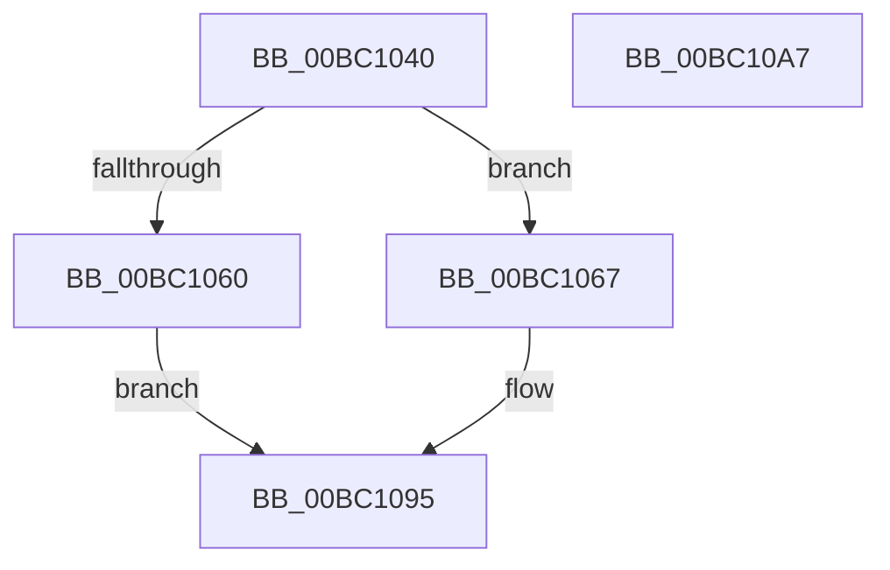

# BgpConsoleGetState

- RVA: `0x00BC1040`–`0x00BC10A8` (길이 `104` bytes)
- VA: `0x0000000140BC1040`
- 실행 섹션: `PAGEBGFX`
- PDB 이름 있음: `예`; PDB Function 태그: `아니요`
- unwind 정보 RVA: `0x0005CAAC`
- 디코드: `34`개 명령, `104/104` bytes 표시
- 미해석 바이트: `0` (있으면 어셈블리에 `.byte`로 보존)

> 이 문서는 커널 이미지의 기계어와 PDB 기호를 분석해 생성했습니다. 4번과 5번은 함수 원형과 자료형을 바이너리 사용 방식에서 추정한 C 해석이며 원본 소스 복구 결과는 아닙니다.

## 1. Dependencies

- 직접 호출 지점: **2**; 고유 호출 대상: **2**
- 직접 호출자로 확인된 함수: **0**
- RIP 상대 이미지 참조: **1**

### Outgoing calls
- `0x00BC104D` → [BgpFwAcquireLock](../../text/4B/BgpFwAcquireLock_function_004B3AA4.md) (function, `0x004B3AA4`)
- `0x00BC1095` → [BgpFwReleaseLock](../../text/4B/BgpFwReleaseLock_function_004B357C.md) (function, `0x004B357C`)

### Direct callers
- 이 함수 시작 RVA로 연결되는 직접 call은 확인되지 않았습니다. 간접 호출은 완전히 역산할 수 없습니다.

### Static image references
- `0x00BC1052` → RVA `0x00EEFEC8` (`.data`; read)

## 2. Other-region calls and transfers

- 다른 실행 섹션으로 향하는 call: **2**
  - `0x00BC104D` → [BgpFwAcquireLock](../../text/4B/BgpFwAcquireLock_function_004B3AA4.md) (`PAGEBGFX` → `.text`)
  - `0x00BC1095` → [BgpFwReleaseLock](../../text/4B/BgpFwReleaseLock_function_004B357C.md) (`PAGEBGFX` → `.text`)
- 별도 외부 분기/꼬리 이동을 확인하지 못했습니다.

## 3. Assembly (complete function range)

```asm
00BC1040  48 89 5C 24 08                  mov qword ptr [rsp + 8], rbx
00BC1045  57                              push rdi
00BC1046  48 83 EC 20                     sub rsp, 0x20
00BC104A  48 8B F9                        mov rdi, rcx
00BC104D  E8 52 2A 8F FF                  call 0x1404b3aa4
00BC1052  48 8B 15 6F EE 32 00            mov rdx, qword ptr [rip + 0x32ee6f]
00BC1059  33 DB                           xor ebx, ebx
00BC105B  48 85 D2                        test rdx, rdx
00BC105E  75 07                           jne 0x140bc1067
00BC1060  BB 01 00 00 C0                  mov ebx, 0xc0000001
00BC1065  EB 2E                           jmp 0x140bc1095
00BC1067  8B 42 14                        mov eax, dword ptr [rdx + 0x14]
00BC106A  89 07                           mov dword ptr [rdi], eax
00BC106C  8B 42 18                        mov eax, dword ptr [rdx + 0x18]
00BC106F  89 47 04                        mov dword ptr [rdi + 4], eax
00BC1072  8B 02                           mov eax, dword ptr [rdx]
00BC1074  89 47 08                        mov dword ptr [rdi + 8], eax
00BC1077  8B 4A 04                        mov ecx, dword ptr [rdx + 4]
00BC107A  89 4F 0C                        mov dword ptr [rdi + 0xc], ecx
00BC107D  8B 4A 30                        mov ecx, dword ptr [rdx + 0x30]
00BC1080  89 4F 10                        mov dword ptr [rdi + 0x10], ecx
00BC1083  8B 4A 34                        mov ecx, dword ptr [rdx + 0x34]
00BC1086  89 4F 14                        mov dword ptr [rdi + 0x14], ecx
00BC1089  8B 4A 3C                        mov ecx, dword ptr [rdx + 0x3c]
00BC108C  89 4F 18                        mov dword ptr [rdi + 0x18], ecx
00BC108F  8B 4A 40                        mov ecx, dword ptr [rdx + 0x40]
00BC1092  89 4F 1C                        mov dword ptr [rdi + 0x1c], ecx
00BC1095  E8 E2 24 8F FF                  call 0x1404b357c
00BC109A  8B C3                           mov eax, ebx
00BC109C  48 8B 5C 24 30                  mov rbx, qword ptr [rsp + 0x30]
00BC10A1  48 83 C4 20                     add rsp, 0x20
00BC10A5  5F                              pop rdi
00BC10A6  C3                              ret
00BC10A7  CC                              int3
```

## 4. C-style interpretation (structured pseudocode)

```c
__int64 __fastcall BgpConsoleGetState(__int64 a1)
{
    __int64 result;
    __int64 v_rbx;
    __int64 v_rsp;
    unsigned __int64 v_stack_p8;

    v_stack_p8 = v_rbx;
    v_rsp = (v_rsp) - (32);
    result = BgpFwAcquireLock(a1, a2, a3, a4);
    v_rbx = 0;
    if (*(unsigned __int64 *)(v_rip + 3337839) != 0) goto loc_00BC1067;
    goto loc_00BC1095;
loc_00BC1067:
    *(unsigned int *)(a1) = (unsigned int)((unsigned int)(*(unsigned int *)(*(unsigned __int64 *)(v_rip + 3337839) + 20)));
    *(unsigned int *)(a1 + 4) = (unsigned int)((unsigned int)(*(unsigned int *)(*(unsigned __int64 *)(v_rip + 3337839) + 24)));
    *(unsigned int *)(a1 + 8) = (unsigned int)((unsigned int)(*(unsigned int *)(*(unsigned __int64 *)(v_rip + 3337839))));
    *(unsigned int *)(a1 + 12) = (unsigned int)((unsigned int)(*(unsigned int *)(*(unsigned __int64 *)(v_rip + 3337839) + 4)));
    *(unsigned int *)(a1 + 16) = (unsigned int)((unsigned int)(*(unsigned int *)(*(unsigned __int64 *)(v_rip + 3337839) + 48)));
    *(unsigned int *)(a1 + 20) = (unsigned int)((unsigned int)(*(unsigned int *)(*(unsigned __int64 *)(v_rip + 3337839) + 52)));
    *(unsigned int *)(a1 + 24) = (unsigned int)((unsigned int)(*(unsigned int *)(*(unsigned __int64 *)(v_rip + 3337839) + 60)));
    *(unsigned int *)(a1 + 28) = (unsigned int)((unsigned int)(*(unsigned int *)(*(unsigned __int64 *)(v_rip + 3337839) + 64)));
loc_00BC1095:
    result = BgpFwReleaseLock((unsigned int)(*(unsigned int *)(*(unsigned __int64 *)(v_rip + 3337839) + 64)), *(unsigned __int64 *)(v_rip + 3337839), a3, a4);
    v_rsp = (v_rsp) + (32);
    return (unsigned int)((unsigned int)((unsigned int)(0xC0000001ULL)));
}
```

## 5. (Beta) C Style

```c
int64_t BgpConsoleGetState(void *Arg1)
{
    uint8_t *arg1 = (uint8_t *)Arg1;

    int64_t result;
    int64_t local_rbx;
    int64_t local_rsp;
    uint64_t v_stack_p8;

    v_stack_p8 = local_rbx;
    local_rsp = (local_rsp) - (32);
    result = BgpFwAcquireLock(Arg1, a2, a3, a4);
    local_rbx = 0;
    if (*(uint64_t *)(v_rip + 0x32EE6F) != 0) goto loc_00BC1067;
    goto loc_00BC1095;
loc_00BC1067:
    *(uint32_t *)(arg1) = (uint32_t)((uint32_t)(*(uint32_t *)(*(uint64_t *)(v_rip + 0x32EE6F) + 0x14)));
    *(uint32_t *)(arg1 + 0x4) = (uint32_t)((uint32_t)(*(uint32_t *)(*(uint64_t *)(v_rip + 0x32EE6F) + 0x18)));
    *(uint32_t *)(arg1 + 0x8) = (uint32_t)((uint32_t)(*(uint32_t *)(*(uint64_t *)(v_rip + 0x32EE6F))));
    *(uint32_t *)(arg1 + 0xC) = (uint32_t)((uint32_t)(*(uint32_t *)(*(uint64_t *)(v_rip + 0x32EE6F) + 0x4)));
    *(uint32_t *)(arg1 + 0x10) = (uint32_t)((uint32_t)(*(uint32_t *)(*(uint64_t *)(v_rip + 0x32EE6F) + 0x30)));
    *(uint32_t *)(arg1 + 0x14) = (uint32_t)((uint32_t)(*(uint32_t *)(*(uint64_t *)(v_rip + 0x32EE6F) + 0x34)));
    *(uint32_t *)(arg1 + 0x18) = (uint32_t)((uint32_t)(*(uint32_t *)(*(uint64_t *)(v_rip + 0x32EE6F) + 0x3C)));
    *(uint32_t *)(arg1 + 0x1C) = (uint32_t)((uint32_t)(*(uint32_t *)(*(uint64_t *)(v_rip + 0x32EE6F) + 0x40)));
loc_00BC1095:
    result = BgpFwReleaseLock((uint32_t)(*(uint32_t *)(*(uint64_t *)(v_rip + 0x32EE6F) + 0x40)), *(uint64_t *)(v_rip + 0x32EE6F), a3, a4);
    local_rsp = (local_rsp) + (32);
    return (uint32_t)((uint32_t)((uint32_t)(0xC0000001ULL)));
}
```

### 관측된 메모리 오프셋

구조체 형식이 확인되지 않은 접근은 인자 기준의 오프셋으로만 기록했습니다.

| 기준 인자 | 오프셋 표현 | 폭 (bit) | 접근 |
|---|---:|---:|---|
| `Arg1` | `+ 0x0` | `32` | `W` |
| `Arg1` | `+ 0x4` | `32` | `W` |
| `Arg1` | `+ 0x8` | `32` | `W` |
| `Arg1` | `+ 0xC` | `32` | `W` |
| `Arg1` | `+ 0x10` | `32` | `W` |
| `Arg1` | `+ 0x14` | `32` | `W` |
| `Arg1` | `+ 0x18` | `32` | `W` |
| `Arg1` | `+ 0x1C` | `32` | `W` |

## 6. Execution-region graph

[열기: 2D/3D 그래프와 함수 탐색 컨트롤 패널](../../../control-panel.html?section=pagebgfx&rva=0x00BC1040&view=graph)

- 2D 그래프는 위에서 아래로 흐르고, 3D 그래프는 빈 공간을 드래그해 회전합니다. Shift+드래그는 이동, 휠은 확대·축소, 함수 노드 선택은 대상 보고서 이동입니다.

### Static fallback


