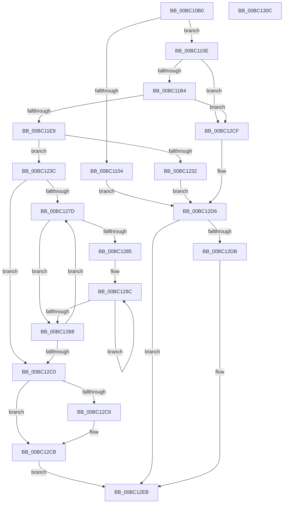

# BgpConsoleInitialize

- RVA: `0x00BC10B0`–`0x00BC130D` (길이 `605` bytes)
- VA: `0x0000000140BC10B0`
- 실행 섹션: `PAGEBGFX`
- PDB 이름 있음: `예`; PDB Function 태그: `아니요`
- unwind 정보 RVA: `0x000C9008`
- 디코드: `158`개 명령, `605/605` bytes 표시
- 미해석 바이트: `0` (있으면 어셈블리에 `.byte`로 보존)

> 이 문서는 커널 이미지의 기계어와 PDB 기호를 분석해 생성했습니다. 4번과 5번은 함수 원형과 자료형을 바이너리 사용 방식에서 추정한 C 해석이며 원본 소스 복구 결과는 아닙니다.

## 1. Dependencies

- 직접 호출 지점: **11**; 고유 호출 대상: **11**
- 직접 호출자로 확인된 함수: **0**
- RIP 상대 이미지 참조: **4**

### Outgoing calls
- `0x00BC10E6` → [BgpFwAcquireLock](../../text/4B/BgpFwAcquireLock_function_004B3AA4.md) (function, `0x004B3AA4`)
- `0x00BC10F0` → [BgpFwAllocateMemory](../../text/3E/BgpFwAllocateMemory_function_003E4374.md) (function, `0x003E4374`)
- `0x00BC112E` → [BgpGetResolution](../../text/4E/BgpGetResolution_function_004E3294.md) (function, `0x004E3294`)
- `0x00BC1172` → [memset](../../text/6C/memset_function_006C6C40.md) (function, `0x006C6C40`)
- `0x00BC1198` → [BgpConsoleGetFontName](../../init/C8/BgpConsoleGetFontName_function_00C80580.md) (function, `0x00C80580`)
- `0x00BC11A5` → [BgpFoGetFontHandle](BgpFoGetFontHandle_function_00BC52B0.md) (function, `0x00BC52B0`)
- `0x00BC11DA` → [BgpConsoleSetPointSize](../../text/69/BgpConsoleSetPointSize_function_0069ECB0.md) (function, `0x0069ECB0`)
- `0x00BC121D` → [BgpDisplayCharacterGetContext](BgpDisplayCharacterGetContext_function_00BC0860.md) (function, `0x00BC0860`)
- `0x00BC12C6` → [BgpConsoleClearScreenEx](BgpConsoleClearScreenEx_function_00BC0A28.md) (function, `0x00BC0A28`)
- `0x00BC12DE` → [BgpFwFreeMemory](../../text/3E/BgpFwFreeMemory_function_003E25E0.md) (function, `0x003E25E0`)
- `0x00BC12EB` → [BgpFwReleaseLock](../../text/4B/BgpFwReleaseLock_function_004B357C.md) (function, `0x004B357C`)

### Direct callers
- 이 함수 시작 RVA로 연결되는 직접 call은 확인되지 않았습니다. 간접 호출은 완전히 역산할 수 없습니다.

### Static image references
- `0x00BC10F5` → RVA `0x00EEFEC8` (`.data`; write)
- `0x00BC1192` → RVA `0x00EF05B8` (`.data`; read)
- `0x00BC11B4` → RVA `0x00EEFEC8` (`.data`; read)
- `0x00BC12E3` → RVA `0x00EEFEC8` (`.data`; read/write)

## 2. Other-region calls and transfers

- 다른 실행 섹션으로 향하는 call: **8**
  - `0x00BC10E6` → [BgpFwAcquireLock](../../text/4B/BgpFwAcquireLock_function_004B3AA4.md) (`PAGEBGFX` → `.text`)
  - `0x00BC10F0` → [BgpFwAllocateMemory](../../text/3E/BgpFwAllocateMemory_function_003E4374.md) (`PAGEBGFX` → `.text`)
  - `0x00BC112E` → [BgpGetResolution](../../text/4E/BgpGetResolution_function_004E3294.md) (`PAGEBGFX` → `.text`)
  - `0x00BC1172` → [memset](../../text/6C/memset_function_006C6C40.md) (`PAGEBGFX` → `.text`)
  - `0x00BC1198` → [BgpConsoleGetFontName](../../init/C8/BgpConsoleGetFontName_function_00C80580.md) (`PAGEBGFX` → `INIT`)
  - `0x00BC11DA` → [BgpConsoleSetPointSize](../../text/69/BgpConsoleSetPointSize_function_0069ECB0.md) (`PAGEBGFX` → `.text`)
  - `0x00BC12DE` → [BgpFwFreeMemory](../../text/3E/BgpFwFreeMemory_function_003E25E0.md) (`PAGEBGFX` → `.text`)
  - `0x00BC12EB` → [BgpFwReleaseLock](../../text/4B/BgpFwReleaseLock_function_004B357C.md) (`PAGEBGFX` → `.text`)
- 별도 외부 분기/꼬리 이동을 확인하지 못했습니다.

## 3. Assembly (complete function range)

```asm
00BC10B0  48 8B C4                        mov rax, rsp
00BC10B3  48 89 58 08                     mov qword ptr [rax + 8], rbx
00BC10B7  48 89 70 10                     mov qword ptr [rax + 0x10], rsi
00BC10BB  48 89 78 18                     mov qword ptr [rax + 0x18], rdi
00BC10BF  4C 89 70 20                     mov qword ptr [rax + 0x20], r14
00BC10C3  55                              push rbp
00BC10C4  48 8B EC                        mov rbp, rsp
00BC10C7  48 83 EC 70                     sub rsp, 0x70
00BC10CB  48 83 65 E8 00                  and qword ptr [rbp - 0x18], 0
00BC10D0  41 8B F0                        mov esi, r8d
00BC10D3  83 65 F0 00                     and dword ptr [rbp - 0x10], 0
00BC10D7  44 8B F2                        mov r14d, edx
00BC10DA  48 83 65 C0 00                  and qword ptr [rbp - 0x40], 0
00BC10DF  8B F9                           mov edi, ecx
00BC10E1  48 83 65 C8 00                  and qword ptr [rbp - 0x38], 0
00BC10E6  E8 B9 29 8F FF                  call 0x1404b3aa4
00BC10EB  B9 10 5E 00 00                  mov ecx, 0x5e10
00BC10F0  E8 7F 32 82 FF                  call 0x1403e4374
00BC10F5  48 89 05 CC ED 32 00            mov qword ptr [rip + 0x32edcc], rax
00BC10FC  4C 8B C8                        mov r9, rax
00BC10FF  48 85 C0                        test rax, rax
00BC1102  75 0A                           jne 0x140bc110e
00BC1104  BB 17 00 00 C0                  mov ebx, 0xc0000017
00BC1109  E9 C8 01 00 00                  jmp 0x140bc12d6
00BC110E  C7 00 50 00 00 00               mov dword ptr [rax], 0x50
00BC1114  48 8D 4D D0                     lea rcx, [rbp - 0x30]
00BC1118  C7 40 04 19 00 00 00            mov dword ptr [rax + 4], 0x19
00BC111F  0F B7 C7                        movzx eax, di
00BC1122  41 09 41 08                     or dword ptr [r9 + 8], eax
00BC1126  45 89 71 0C                     mov dword ptr [r9 + 0xc], r14d
00BC112A  41 89 71 10                     mov dword ptr [r9 + 0x10], esi
00BC112E  E8 61 21 92 FF                  call 0x1404e3294
00BC1133  49 8D 49 50                     lea rcx, [r9 + 0x50]
00BC1137  33 D2                           xor edx, edx
00BC1139  41 B8 C0 5D 00 00               mov r8d, 0x5dc0
00BC113F  F2 0F 10 00                     movsd xmm0, qword ptr [rax]
00BC1143  F2 41 0F 11 41 14               movsd qword ptr [r9 + 0x14], xmm0
00BC1149  8B 40 08                        mov eax, dword ptr [rax + 8]
00BC114C  49 83 61 28 00                  and qword ptr [r9 + 0x28], 0
00BC1151  41 83 61 38 00                  and dword ptr [r9 + 0x38], 0
00BC1156  41 89 41 1C                     mov dword ptr [r9 + 0x1c], eax
00BC115A  41 C7 41 20 0F 00 00 00         mov dword ptr [r9 + 0x20], 0xf
00BC1162  41 C7 41 30 0C 00 00 00         mov dword ptr [r9 + 0x30], 0xc
00BC116A  41 C7 41 34 16 00 00 00         mov dword ptr [r9 + 0x34], 0x16
00BC1172  E8 C9 5A B0 FF                  call 0x1406c6c40
00BC1177  40 8A C7                        mov al, dil
00BC117A  89 75 E0                        mov dword ptr [rbp - 0x20], esi
00BC117D  F6 D0                           not al
00BC117F  44 89 75 E4                     mov dword ptr [rbp - 0x1c], r14d
00BC1183  0F B6 C8                        movzx ecx, al
00BC1186  48 8D 55 C8                     lea rdx, [rbp - 0x38]
00BC118A  D1 E9                           shr ecx, 1
00BC118C  83 E1 01                        and ecx, 1
00BC118F  89 4D F4                        mov dword ptr [rbp - 0xc], ecx
00BC1192  8B 0D 20 F4 32 00               mov ecx, dword ptr [rip + 0x32f420]
00BC1198  E8 E3 F3 0B 00                  call 0x140c80580
00BC119D  48 8B 4D C8                     mov rcx, qword ptr [rbp - 0x38]
00BC11A1  48 8D 55 E8                     lea rdx, [rbp - 0x18]
00BC11A5  E8 06 41 00 00                  call 0x140bc52b0
00BC11AA  8B D8                           mov ebx, eax
00BC11AC  85 C0                           test eax, eax
00BC11AE  0F 88 1B 01 00 00               js 0x140bc12cf
00BC11B4  48 8B 0D 0D ED 32 00            mov rcx, qword ptr [rip + 0x32ed0d]
00BC11BB  48 8D 45 C0                     lea rax, [rbp - 0x40]
00BC11BF  48 89 44 24 28                  mov qword ptr [rsp + 0x28], rax
00BC11C4  48 8D 45 E0                     lea rax, [rbp - 0x20]
00BC11C8  48 89 44 24 20                  mov qword ptr [rsp + 0x20], rax
00BC11CD  44 8B 49 14                     mov r9d, dword ptr [rcx + 0x14]
00BC11D1  44 8B 41 18                     mov r8d, dword ptr [rcx + 0x18]
00BC11D5  8B 11                           mov edx, dword ptr [rcx]
00BC11D7  8B 49 04                        mov ecx, dword ptr [rcx + 4]
00BC11DA  E8 D1 DA AD FF                  call 0x14069ecb0
00BC11DF  8B D8                           mov ebx, eax
00BC11E1  85 C0                           test eax, eax
00BC11E3  0F 88 E6 00 00 00               js 0x140bc12cf
00BC11E9  48 8B 0D D8 EC 32 00            mov rcx, qword ptr [rip + 0x32ecd8]
00BC11F0  44 8B C7                        mov r8d, edi
00BC11F3  8B 45 F0                        mov eax, dword ptr [rbp - 0x10]
00BC11F6  41 D1 E8                        shr r8d, 1
00BC11F9  41 F7 D0                        not r8d
00BC11FC  89 41 20                        mov dword ptr [rcx + 0x20], eax
00BC11FF  48 8D 59 30                     lea rbx, [rcx + 0x30]
00BC1203  8B 45 C0                        mov eax, dword ptr [rbp - 0x40]
00BC1206  48 8D 4D E0                     lea rcx, [rbp - 0x20]
00BC120A  41 83 E0 02                     and r8d, 2
00BC120E  89 03                           mov dword ptr [rbx], eax
00BC1210  8B 45 C4                        mov eax, dword ptr [rbp - 0x3c]
00BC1213  41 83 C8 01                     or r8d, 1
00BC1217  48 8B D3                        mov rdx, rbx
00BC121A  89 43 04                        mov dword ptr [rbx + 4], eax
00BC121D  E8 3E F6 FF FF                  call 0x140bc0860
00BC1222  4C 8B 0D 9F EC 32 00            mov r9, qword ptr [rip + 0x32ec9f]
00BC1229  49 89 41 28                     mov qword ptr [r9 + 0x28], rax
00BC122D  48 85 C0                        test rax, rax
00BC1230  75 0A                           jne 0x140bc123c
00BC1232  BB 01 00 00 C0                  mov ebx, 0xc0000001
00BC1237  E9 9A 00 00 00                  jmp 0x140bc12d6
00BC123C  41 8B 11                        mov edx, dword ptr [r9]
00BC123F  45 33 D2                        xor r10d, r10d
00BC1242  41 8B 49 14                     mov ecx, dword ptr [r9 + 0x14]
00BC1246  8B C2                           mov eax, edx
00BC1248  0F AF 03                        imul eax, dword ptr [rbx]
00BC124B  45 8B 41 04                     mov r8d, dword ptr [r9 + 4]
00BC124F  2B C8                           sub ecx, eax
00BC1251  41 8B C0                        mov eax, r8d
00BC1254  D1 E9                           shr ecx, 1
00BC1256  41 89 49 3C                     mov dword ptr [r9 + 0x3c], ecx
00BC125A  0F AF 43 04                     imul eax, dword ptr [rbx + 4]
00BC125E  41 8B 49 18                     mov ecx, dword ptr [r9 + 0x18]
00BC1262  41 83 61 4C 00                  and dword ptr [r9 + 0x4c], 0
00BC1267  41 83 61 44 00                  and dword ptr [r9 + 0x44], 0
00BC126C  41 83 61 48 00                  and dword ptr [r9 + 0x48], 0
00BC1271  2B C8                           sub ecx, eax
00BC1273  D1 E9                           shr ecx, 1
00BC1275  41 89 49 40                     mov dword ptr [r9 + 0x40], ecx
00BC1279  85 D2                           test edx, edx
00BC127B  74 43                           je 0x140bc12c0
00BC127D  45 33 DB                        xor r11d, r11d
00BC1280  45 85 C0                        test r8d, r8d
00BC1283  74 33                           je 0x140bc12b8
00BC1285  41 8B C2                        mov eax, r10d
00BC1288  48 6B D8 19                     imul rbx, rax, 0x19
00BC128C  41 8B CB                        mov ecx, r11d
00BC128F  41 FF C3                        inc r11d
00BC1292  48 03 CB                        add rcx, rbx
00BC1295  48 8D 14 49                     lea rdx, [rcx + rcx*2]
00BC1299  48 8D 04 49                     lea rax, [rcx + rcx*2]
00BC129D  66 41 C7 44 91 58 20 00         mov word ptr [r9 + rdx*4 + 0x58], 0x20
00BC12A5  41 89 74 81 54                  mov dword ptr [r9 + rax*4 + 0x54], esi
00BC12AA  45 89 74 91 50                  mov dword ptr [r9 + rdx*4 + 0x50], r14d
00BC12AF  45 8B 41 04                     mov r8d, dword ptr [r9 + 4]
00BC12B3  45 3B D8                        cmp r11d, r8d
00BC12B6  72 D4                           jb 0x140bc128c
00BC12B8  41 FF C2                        inc r10d
00BC12BB  45 3B 11                        cmp r10d, dword ptr [r9]
00BC12BE  72 BD                           jb 0x140bc127d
00BC12C0  40 F6 C7 01                     test dil, 1
00BC12C4  74 05                           je 0x140bc12cb
00BC12C6  E8 5D F7 FF FF                  call 0x140bc0a28
00BC12CB  33 DB                           xor ebx, ebx
00BC12CD  EB 1C                           jmp 0x140bc12eb
00BC12CF  4C 8B 0D F2 EB 32 00            mov r9, qword ptr [rip + 0x32ebf2]
00BC12D6  4D 85 C9                        test r9, r9
00BC12D9  74 10                           je 0x140bc12eb
00BC12DB  49 8B C9                        mov rcx, r9
00BC12DE  E8 FD 12 82 FF                  call 0x1403e25e0
00BC12E3  48 83 25 DD EB 32 00 00         and qword ptr [rip + 0x32ebdd], 0
00BC12EB  E8 8C 22 8F FF                  call 0x1404b357c
00BC12F0  4C 8D 5C 24 70                  lea r11, [rsp + 0x70]
00BC12F5  8B C3                           mov eax, ebx
00BC12F7  49 8B 5B 10                     mov rbx, qword ptr [r11 + 0x10]
00BC12FB  49 8B 73 18                     mov rsi, qword ptr [r11 + 0x18]
00BC12FF  49 8B 7B 20                     mov rdi, qword ptr [r11 + 0x20]
00BC1303  4D 8B 73 28                     mov r14, qword ptr [r11 + 0x28]
00BC1307  49 8B E3                        mov rsp, r11
00BC130A  5D                              pop rbp
00BC130B  C3                              ret
00BC130C  CC                              int3
```

## 4. C-style interpretation (structured pseudocode)

```c
__int64 __fastcall BgpConsoleInitialize(int a1, int a2, int a3)
{
    __int64 result;
    __int64 v_r10;
    __int64 v_r11;
    __int64 v_rbx;
    __int64 v_rsp;
    unsigned int v_stack_m14;
    unsigned int v_stack_m18;
    unsigned __int64 v_stack_m20;
    unsigned int v_stack_m24;
    unsigned int v_stack_m28;
    unsigned __int64 v_stack_m38;
    unsigned __int64 v_stack_m40;
    unsigned int v_stack_m44;
    unsigned __int64 v_stack_m48;
    unsigned __int64 v_stack_m50;
    unsigned __int64 v_stack_m58;
    unsigned __int64 v_stack_m8;

    *(unsigned __int64 *)(v_rsp + 8) = v_rbx;
    *(unsigned __int64 *)(v_rsp + 16) = v_rsi;
    *(unsigned __int64 *)(v_rsp + 24) = v_rdi;
    *(unsigned __int64 *)(v_rsp + 32) = v_r14;
    v_rsp = (v_rsp) - (112);
    result = BgpFwAcquireLock(a1, a2, a3, a4);
    result = BgpFwAllocateMemory((unsigned int)(0x5E10ULL), a2, a3, a4);
    *(unsigned __int64 *)(v_rip + 3337676) = result;
    if (result != 0) goto loc_00BC110E;
    goto loc_00BC12D6;
loc_00BC110E:
    *(unsigned int *)(result) = 80;
    *(unsigned int *)(result + 4) = 25;
    *(unsigned int *)(result + 12) = (unsigned int)((unsigned int)(a2));
    *(unsigned int *)(result + 16) = (unsigned int)((unsigned int)(a3));
    result = BgpGetResolution(v_stack_m38, a2, a3, result);
    a2 = 0;
    *(unsigned __int64 *)(result + 20) = v_xmm0;
    *(unsigned int *)(result + 28) = (unsigned int)((unsigned int)(*(unsigned int *)(result + 8)));
    *(unsigned int *)(result + 32) = 15;
    *(unsigned int *)(result + 48) = 12;
    *(unsigned int *)(result + 52) = 22;
    result = memset(result + 80, a2, (unsigned int)(0x5DC0ULL), result);
    v_stack_m28 = (unsigned int)((unsigned int)(a3));
    result = (unsigned __int8)(~((unsigned __int8)((unsigned int)(a1))));
    v_stack_m24 = (unsigned int)((unsigned int)(a2));
    a1 = (unsigned int)(((unsigned __int8)(result)) >> (1));
    a1 = (unsigned int)((a1) & (1));
    v_stack_m14 = a1;
    result = BgpConsoleGetFontName((unsigned int)(*(unsigned int *)(v_rip + 3339296)), v_stack_m40, (unsigned int)(0x5DC0ULL), result);
    result = BgpFoGetFontHandle(v_stack_m40, v_stack_m20, (unsigned int)(0x5DC0ULL), result);
    if (sign_flag) goto loc_00BC12CF;
    v_stack_m50 = v_stack_m48;
    v_stack_m58 = v_stack_m28;
    result = BgpConsoleSetPointSize((unsigned int)(*(unsigned int *)(*(unsigned __int64 *)(v_rip + 3337485) + 4)), (unsigned int)(*(unsigned int *)(*(unsigned __int64 *)(v_rip + 3337485))), (unsigned int)(*(unsigned int *)(*(unsigned __int64 *)(v_rip + 3337485) + 24)), (unsigned int)(*(unsigned int *)(*(unsigned __int64 *)(v_rip + 3337485) + 20)));
    if (sign_flag) goto loc_00BC12CF;
    a3 = (unsigned int)(((unsigned int)((unsigned int)((unsigned int)(a1)))) >> (1));
    a3 = (unsigned int)(~(a3));
    *(unsigned int *)(*(unsigned __int64 *)(v_rip + 3337432) + 32) = (unsigned int)((unsigned int)(v_stack_m18));
    a3 = (unsigned int)((a3) & (2));
    *(unsigned int *)(*(unsigned __int64 *)(v_rip + 3337432) + 48) = (unsigned int)((unsigned int)(v_stack_m48));
    a3 = (unsigned int)((a3) | (1));
    *(unsigned int *)(*(unsigned __int64 *)(v_rip + 3337432) + 48 + 4) = (unsigned int)((unsigned int)(v_stack_m44));
    result = BgpDisplayCharacterGetContext(v_stack_m28, *(unsigned __int64 *)(v_rip + 3337432) + 48, a3, (unsigned int)(*(unsigned int *)(*(unsigned __int64 *)(v_rip + 3337485) + 20)));
    *(unsigned __int64 *)(*(unsigned __int64 *)(v_rip + 3337375) + 40) = result;
    if (result != 0) goto loc_00BC123C;
    goto loc_00BC12D6;
loc_00BC123C:
    v_r10 = 0;
    result = (unsigned int)(((unsigned int)((unsigned int)((unsigned int)(*(unsigned int *)(*(unsigned __int64 *)(v_rip + 3337375)))))) * (*(unsigned int *)((unsigned int)(0xC0000001ULL))));
    a1 = (unsigned int)(((unsigned int)(*(unsigned int *)(*(unsigned __int64 *)(v_rip + 3337375) + 20))) - ((unsigned int)(result)));
    a1 = (unsigned int)((a1) >> (1));
    *(unsigned int *)(*(unsigned __int64 *)(v_rip + 3337375) + 60) = a1;
    result = (unsigned int)(((unsigned int)((unsigned int)((unsigned int)(*(unsigned int *)(*(unsigned __int64 *)(v_rip + 3337375) + 4))))) * (*(unsigned int *)((unsigned int)(0xC0000001ULL) + 4)));
    a1 = (unsigned int)(((unsigned int)(*(unsigned int *)(*(unsigned __int64 *)(v_rip + 3337375) + 24))) - ((unsigned int)(result)));
    a1 = (unsigned int)((a1) >> (1));
    *(unsigned int *)(*(unsigned __int64 *)(v_rip + 3337375) + 64) = a1;
    if ((unsigned int)((unsigned int)(*(unsigned int *)(*(unsigned __int64 *)(v_rip + 3337375)))) == 0) goto loc_00BC12C0;
loc_00BC127D:
    v_r11 = 0;
    if ((unsigned int)((unsigned int)(*(unsigned int *)(*(unsigned __int64 *)(v_rip + 3337375) + 4))) == 0) goto loc_00BC12B8;
    v_rbx = ((unsigned int)(0xC0000001ULL)) * (0);
loc_00BC128C:
    v_r11 = (unsigned int)((v_r11) + 1);
    a1 = (0) + (v_rbx);
    *(unsigned __int16 *)(*(unsigned __int64 *)(v_rip + 3337375) + a1 + a1 * 2 * 4 + 88) = 32;
    *(unsigned int *)(*(unsigned __int64 *)(v_rip + 3337375) + a1 + a1 * 2 * 4 + 84) = (unsigned int)((unsigned int)(a3));
    *(unsigned int *)(*(unsigned __int64 *)(v_rip + 3337375) + a1 + a1 * 2 * 4 + 80) = (unsigned int)((unsigned int)(a2));
    if (((unsigned int)(v_r11)) < ((unsigned int)((unsigned int)(*(unsigned int *)(*(unsigned __int64 *)(v_rip + 3337375) + 4))))) goto loc_00BC128C;
loc_00BC12B8:
    v_r10 = (unsigned int)((v_r10) + 1);
    if (((unsigned int)(v_r10)) < (*(unsigned int *)(*(unsigned __int64 *)(v_rip + 3337375)))) goto loc_00BC127D;
loc_00BC12C0:
    result = a1 + a1 * 2;
    if ((((unsigned __int8)((unsigned int)(a1))) & (1)) != 0) {
        result = BgpConsoleClearScreenEx(a1, a1 + a1 * 2, (unsigned int)(*(unsigned int *)(*(unsigned __int64 *)(v_rip + 3337375) + 4)), *(unsigned __int64 *)(v_rip + 3337375));
    }
    v_rbx = 0;
    goto loc_00BC12EB;
loc_00BC12CF:
loc_00BC12D6:
    if (*(unsigned __int64 *)(v_rip + 3337202) != 0) {
        a1 = *(unsigned __int64 *)(v_rip + 3337202);
        result = BgpFwFreeMemory(a1, a1 + a1 * 2, (unsigned int)(*(unsigned int *)(*(unsigned __int64 *)(v_rip + 3337375) + 4)), *(unsigned __int64 *)(v_rip + 3337202));
    }
    result = BgpFwReleaseLock(a1, a1 + a1 * 2, (unsigned int)(*(unsigned int *)(*(unsigned __int64 *)(v_rip + 3337375) + 4)), *(unsigned __int64 *)(v_rip + 3337202));
    return 0;
}
```

## 5. (Beta) C Style

```c
int64_t BgpConsoleInitialize(int32_t Arg1, int32_t Arg2, int32_t Arg3)
{
    int64_t result;
    int64_t local_r10;
    int64_t local_r11;
    int64_t local_rbx;
    int64_t local_rsp;
    uint32_t v_stack_m14;
    uint32_t v_stack_m18;
    uint64_t v_stack_m20;
    uint32_t v_stack_m24;
    uint32_t v_stack_m28;
    uint64_t v_stack_m38;
    uint64_t v_stack_m40;
    uint32_t v_stack_m44;
    uint64_t v_stack_m48;
    uint64_t v_stack_m50;
    uint64_t v_stack_m58;
    uint64_t v_stack_m8;

    *(uint64_t *)(local_rsp + 0x8) = local_rbx;
    *(uint64_t *)(local_rsp + 0x10) = local_rsi;
    *(uint64_t *)(local_rsp + 0x18) = local_rdi;
    *(uint64_t *)(local_rsp + 0x20) = local_r14;
    local_rsp = (local_rsp) - (112);
    result = BgpFwAcquireLock(Arg1, Arg2, Arg3, a4);
    result = BgpFwAllocateMemory((uint32_t)(0x5E10ULL), Arg2, Arg3, a4);
    *(uint64_t *)(v_rip + 0x32EDCC) = result;
    if (result != 0) goto loc_00BC110E;
    goto loc_00BC12D6;
loc_00BC110E:
    *(uint32_t *)(result) = 80;
    *(uint32_t *)(result + 0x4) = 25;
    *(uint32_t *)(result + 0xC) = (uint32_t)((uint32_t)(Arg2));
    *(uint32_t *)(result + 0x10) = (uint32_t)((uint32_t)(Arg3));
    result = BgpGetResolution(v_stack_m38, Arg2, Arg3, result);
    Arg2 = 0;
    *(uint64_t *)(result + 0x14) = v_xmm0;
    *(uint32_t *)(result + 0x1C) = (uint32_t)((uint32_t)(*(uint32_t *)(result + 0x8)));
    *(uint32_t *)(result + 0x20) = 15;
    *(uint32_t *)(result + 0x30) = 12;
    *(uint32_t *)(result + 0x34) = 22;
    result = memset(result + 80, Arg2, (uint32_t)(0x5DC0ULL), result);
    v_stack_m28 = (uint32_t)((uint32_t)(Arg3));
    result = (uint8_t)(~((uint8_t)((uint32_t)(Arg1))));
    v_stack_m24 = (uint32_t)((uint32_t)(Arg2));
    Arg1 = (uint32_t)(((uint8_t)(result)) >> (1));
    Arg1 = (uint32_t)((Arg1) & (1));
    v_stack_m14 = Arg1;
    result = BgpConsoleGetFontName((uint32_t)(*(uint32_t *)(v_rip + 0x32F420)), v_stack_m40, (uint32_t)(0x5DC0ULL), result);
    result = BgpFoGetFontHandle(v_stack_m40, v_stack_m20, (uint32_t)(0x5DC0ULL), result);
    if (sign_flag) goto loc_00BC12CF;
    v_stack_m50 = v_stack_m48;
    v_stack_m58 = v_stack_m28;
    result = BgpConsoleSetPointSize((uint32_t)(*(uint32_t *)(*(uint64_t *)(v_rip + 0x32ED0D) + 0x4)), (uint32_t)(*(uint32_t *)(*(uint64_t *)(v_rip + 0x32ED0D))), (uint32_t)(*(uint32_t *)(*(uint64_t *)(v_rip + 0x32ED0D) + 0x18)), (uint32_t)(*(uint32_t *)(*(uint64_t *)(v_rip + 0x32ED0D) + 0x14)));
    if (sign_flag) goto loc_00BC12CF;
    Arg3 = (uint32_t)(((uint32_t)((uint32_t)((uint32_t)(Arg1)))) >> (1));
    Arg3 = (uint32_t)(~(Arg3));
    *(uint32_t *)(*(uint64_t *)(v_rip + 0x32ECD8) + 0x20) = (uint32_t)((uint32_t)(v_stack_m18));
    Arg3 = (uint32_t)((Arg3) & (2));
    *(uint32_t *)(*(uint64_t *)(v_rip + 0x32ECD8) + 0x30) = (uint32_t)((uint32_t)(v_stack_m48));
    Arg3 = (uint32_t)((Arg3) | (1));
    *(uint32_t *)(*(uint64_t *)(v_rip + 0x32ECD8) + 0x30 + 0x4) = (uint32_t)((uint32_t)(v_stack_m44));
    result = BgpDisplayCharacterGetContext(v_stack_m28, *(uint64_t *)(v_rip + 0x32ECD8) + 48, Arg3, (uint32_t)(*(uint32_t *)(*(uint64_t *)(v_rip + 0x32ED0D) + 0x14)));
    *(uint64_t *)(*(uint64_t *)(v_rip + 0x32EC9F) + 0x28) = result;
    if (result != 0) goto loc_00BC123C;
    goto loc_00BC12D6;
loc_00BC123C:
    local_r10 = 0;
    result = (uint32_t)(((uint32_t)((uint32_t)((uint32_t)(*(uint32_t *)(*(uint64_t *)(v_rip + 0x32EC9F)))))) * (*(uint32_t *)((uint32_t)(0xC0000001ULL))));
    Arg1 = (uint32_t)(((uint32_t)(*(uint32_t *)(*(uint64_t *)(v_rip + 0x32EC9F) + 0x14))) - ((uint32_t)(result)));
    Arg1 = (uint32_t)((Arg1) >> (1));
    *(uint32_t *)(*(uint64_t *)(v_rip + 0x32EC9F) + 0x3C) = Arg1;
    result = (uint32_t)(((uint32_t)((uint32_t)((uint32_t)(*(uint32_t *)(*(uint64_t *)(v_rip + 0x32EC9F) + 0x4))))) * (*(uint32_t *)((uint32_t)(0xC0000001ULL) + 0x4)));
    Arg1 = (uint32_t)(((uint32_t)(*(uint32_t *)(*(uint64_t *)(v_rip + 0x32EC9F) + 0x18))) - ((uint32_t)(result)));
    Arg1 = (uint32_t)((Arg1) >> (1));
    *(uint32_t *)(*(uint64_t *)(v_rip + 0x32EC9F) + 0x40) = Arg1;
    if ((uint32_t)((uint32_t)(*(uint32_t *)(*(uint64_t *)(v_rip + 0x32EC9F)))) == 0) goto loc_00BC12C0;
loc_00BC127D:
    local_r11 = 0;
    if ((uint32_t)((uint32_t)(*(uint32_t *)(*(uint64_t *)(v_rip + 0x32EC9F) + 0x4))) == 0) goto loc_00BC12B8;
    local_rbx = ((uint32_t)(0xC0000001ULL)) * (0);
loc_00BC128C:
    local_r11 = (uint32_t)((local_r11) + 1);
    Arg1 = (0) + (local_rbx);
    *(uint16_t *)(*(uint64_t *)(v_rip + 0x32EC9F) + Arg1 + Arg1 * 2 * 4 + 0x58) = 32;
    *(uint32_t *)(*(uint64_t *)(v_rip + 0x32EC9F) + Arg1 + Arg1 * 2 * 4 + 0x54) = (uint32_t)((uint32_t)(Arg3));
    *(uint32_t *)(*(uint64_t *)(v_rip + 0x32EC9F) + Arg1 + Arg1 * 2 * 4 + 0x50) = (uint32_t)((uint32_t)(Arg2));
    if (((uint32_t)(local_r11)) < ((uint32_t)((uint32_t)(*(uint32_t *)(*(uint64_t *)(v_rip + 0x32EC9F) + 0x4))))) goto loc_00BC128C;
loc_00BC12B8:
    local_r10 = (uint32_t)((local_r10) + 1);
    if (((uint32_t)(local_r10)) < (*(uint32_t *)(*(uint64_t *)(v_rip + 0x32EC9F)))) goto loc_00BC127D;
loc_00BC12C0:
    result = Arg1 + Arg1 * 2;
    if ((((uint8_t)((uint32_t)(Arg1))) & (1)) != 0) {
        result = BgpConsoleClearScreenEx(Arg1, Arg1 + Arg1 * 2, (uint32_t)(*(uint32_t *)(*(uint64_t *)(v_rip + 0x32EC9F) + 0x4)), *(uint64_t *)(v_rip + 0x32EC9F));
    }
    local_rbx = 0;
    goto loc_00BC12EB;
loc_00BC12CF:
loc_00BC12D6:
    if (*(uint64_t *)(v_rip + 0x32EBF2) != 0) {
        Arg1 = *(uint64_t *)(v_rip + 0x32EBF2);
        result = BgpFwFreeMemory(Arg1, Arg1 + Arg1 * 2, (uint32_t)(*(uint32_t *)(*(uint64_t *)(v_rip + 0x32EC9F) + 0x4)), *(uint64_t *)(v_rip + 0x32EBF2));
    }
    result = BgpFwReleaseLock(Arg1, Arg1 + Arg1 * 2, (uint32_t)(*(uint32_t *)(*(uint64_t *)(v_rip + 0x32EC9F) + 0x4)), *(uint64_t *)(v_rip + 0x32EBF2));
    return 0;
}
```

## 6. Execution-region graph

[열기: 2D/3D 그래프와 함수 탐색 컨트롤 패널](../../../control-panel.html?section=pagebgfx&rva=0x00BC10B0&view=graph)

- 2D 그래프는 위에서 아래로 흐르고, 3D 그래프는 빈 공간을 드래그해 회전합니다. Shift+드래그는 이동, 휠은 확대·축소, 함수 노드 선택은 대상 보고서 이동입니다.

### Static fallback


