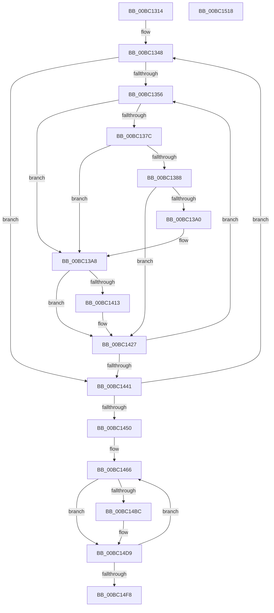

# BgpConsoleScrollScreen

- RVA: `0x00BC1314`–`0x00BC1519` (길이 `517` bytes)
- VA: `0x0000000140BC1314`
- 실행 섹션: `PAGEBGFX`
- PDB 이름 있음: `예`; PDB Function 태그: `아니요`
- unwind 정보 RVA: `0x000D04D0`
- 디코드: `128`개 명령, `517/517` bytes 표시
- 미해석 바이트: `0` (있으면 어셈블리에 `.byte`로 보존)

> 이 문서는 커널 이미지의 기계어와 PDB 기호를 분석해 생성했습니다. 4번과 5번은 함수 원형과 자료형을 바이너리 사용 방식에서 추정한 C 해석이며 원본 소스 복구 결과는 아닙니다.

## 1. Dependencies

- 직접 호출 지점: **2**; 고유 호출 대상: **1**
- 직접 호출자로 확인된 함수: **1**
- RIP 상대 이미지 참조: **1**

### Outgoing calls
- `0x00BC13FB` → [BgpDisplayCharacterEx](../../text/69/BgpDisplayCharacterEx_function_0069EBF4.md) (function, `0x0069EBF4`)
- `0x00BC14AC` → [BgpDisplayCharacterEx](../../text/69/BgpDisplayCharacterEx_function_0069EBF4.md) (function, `0x0069EBF4`)

### Direct callers
- [BgpConsoleDisplayCharacterEx](BgpConsoleDisplayCharacterEx_function_00BC0BC4.md) at `0x00BC0E21`

### Static image references
- `0x00BC1325` → RVA `0x00EEFEC8` (`.data`; read)

## 2. Other-region calls and transfers

- 다른 실행 섹션으로 향하는 call: **2**
  - `0x00BC13FB` → [BgpDisplayCharacterEx](../../text/69/BgpDisplayCharacterEx_function_0069EBF4.md) (`PAGEBGFX` → `.text`)
  - `0x00BC14AC` → [BgpDisplayCharacterEx](../../text/69/BgpDisplayCharacterEx_function_0069EBF4.md) (`PAGEBGFX` → `.text`)
- 별도 외부 분기/꼬리 이동을 확인하지 못했습니다.

## 3. Assembly (complete function range)

```asm
00BC1314  40 53                           push rbx
00BC1316  55                              push rbp
00BC1317  56                              push rsi
00BC1318  57                              push rdi
00BC1319  41 54                           push r12
00BC131B  41 55                           push r13
00BC131D  41 56                           push r14
00BC131F  41 57                           push r15
00BC1321  48 83 EC 58                     sub rsp, 0x58
00BC1325  4C 8B 15 9C EB 32 00            mov r10, qword ptr [rip + 0x32eb9c]
00BC132C  33 FF                           xor edi, edi
00BC132E  33 F6                           xor esi, esi
00BC1330  4D 8D 5A 3C                     lea r11, [r10 + 0x3c]
00BC1334  49 8D 4A 30                     lea rcx, [r10 + 0x30]
00BC1338  4C 89 9C 24 B8 00 00 00         mov qword ptr [rsp + 0xb8], r11
00BC1340  48 89 8C 24 B0 00 00 00         mov qword ptr [rsp + 0xb0], rcx
00BC1348  45 33 C9                        xor r9d, r9d
00BC134B  41 83 7A 04 01                  cmp dword ptr [r10 + 4], 1
00BC1350  0F 84 EB 00 00 00               je 0x140bc1441
00BC1356  45 8D 79 01                     lea r15d, [r9 + 1]
00BC135A  41 8B D9                        mov ebx, r9d
00BC135D  48 03 DE                        add rbx, rsi
00BC1360  41 8B D7                        mov edx, r15d
00BC1363  48 03 D6                        add rdx, rsi
00BC1366  48 8D 2C 5B                     lea rbp, [rbx + rbx*2]
00BC136A  4C 8D 04 52                     lea r8, [rdx + rdx*2]
00BC136E  47 0F B7 74 82 58               movzx r14d, word ptr [r10 + r8*4 + 0x58]
00BC1374  66 45 39 74 AA 58               cmp word ptr [r10 + rbp*4 + 0x58], r14w
00BC137A  75 2C                           jne 0x140bc13a8
00BC137C  43 8B 44 82 50                  mov eax, dword ptr [r10 + r8*4 + 0x50]
00BC1381  41 39 44 AA 50                  cmp dword ptr [r10 + rbp*4 + 0x50], eax
00BC1386  75 20                           jne 0x140bc13a8
00BC1388  48 8D 04 52                     lea rax, [rdx + rdx*2]
00BC138C  41 8B 44 82 54                  mov eax, dword ptr [r10 + rax*4 + 0x54]
00BC1391  48 8D 0C 5B                     lea rcx, [rbx + rbx*2]
00BC1395  41 39 44 8A 54                  cmp dword ptr [r10 + rcx*4 + 0x54], eax
00BC139A  0F 84 87 00 00 00               je 0x140bc1427
00BC13A0  48 8B 8C 24 B0 00 00 00         mov rcx, qword ptr [rsp + 0xb0]
00BC13A8  47 8B 64 82 50                  mov r12d, dword ptr [r10 + r8*4 + 0x50]
00BC13AD  48 8D 04 52                     lea rax, [rdx + rdx*2]
00BC13B1  45 8B 6C 82 54                  mov r13d, dword ptr [r10 + rax*4 + 0x54]
00BC13B6  44 8B C7                        mov r8d, edi
00BC13B9  48 83 64 24 48 00               and qword ptr [rsp + 0x48], 0
00BC13BF  48 8D 84 24 A0 00 00 00         lea rax, [rsp + 0xa0]
00BC13C7  44 0F AF 01                     imul r8d, dword ptr [rcx]
00BC13CB  44 0F AF 49 04                  imul r9d, dword ptr [rcx + 4]
00BC13D0  41 0F B7 CE                     movzx ecx, r14w
00BC13D4  49 8B 52 28                     mov rdx, qword ptr [r10 + 0x28]
00BC13D8  48 89 44 24 38                  mov qword ptr [rsp + 0x38], rax
00BC13DD  48 8D 84 24 A8 00 00 00         lea rax, [rsp + 0xa8]
00BC13E5  48 89 44 24 30                  mov qword ptr [rsp + 0x30], rax
00BC13EA  45 03 03                        add r8d, dword ptr [r11]
00BC13ED  45 03 4B 04                     add r9d, dword ptr [r11 + 4]
00BC13F1  44 89 64 24 28                  mov dword ptr [rsp + 0x28], r12d
00BC13F6  44 89 6C 24 20                  mov dword ptr [rsp + 0x20], r13d
00BC13FB  E8 F4 D7 AD FF                  call 0x14069ebf4
00BC1400  4C 8B 15 C1 EA 32 00            mov r10, qword ptr [rip + 0x32eac1]
00BC1407  4C 8B 9C 24 B8 00 00 00         mov r11, qword ptr [rsp + 0xb8]
00BC140F  85 C0                           test eax, eax
00BC1411  78 14                           js 0x140bc1427
00BC1413  48 8D 04 5B                     lea rax, [rbx + rbx*2]
00BC1417  66 45 89 74 AA 58               mov word ptr [r10 + rbp*4 + 0x58], r14w
00BC141D  45 89 6C 82 54                  mov dword ptr [r10 + rax*4 + 0x54], r13d
00BC1422  45 89 64 AA 50                  mov dword ptr [r10 + rbp*4 + 0x50], r12d
00BC1427  41 8B 42 04                     mov eax, dword ptr [r10 + 4]
00BC142B  45 8B CF                        mov r9d, r15d
00BC142E  48 8B 8C 24 B0 00 00 00         mov rcx, qword ptr [rsp + 0xb0]
00BC1436  FF C8                           dec eax
00BC1438  44 3B F8                        cmp r15d, eax
00BC143B  0F 82 15 FF FF FF               jb 0x140bc1356
00BC1441  FF C7                           inc edi
00BC1443  48 83 C6 19                     add rsi, 0x19
00BC1447  83 FF 50                        cmp edi, 0x50
00BC144A  0F 82 F8 FE FF FF               jb 0x140bc1348
00BC1450  41 8B 7A 04                     mov edi, dword ptr [r10 + 4]
00BC1454  33 DB                           xor ebx, ebx
00BC1456  41 8B 6A 10                     mov ebp, dword ptr [r10 + 0x10]
00BC145A  FF CF                           dec edi
00BC145C  45 8B 72 0C                     mov r14d, dword ptr [r10 + 0xc]
00BC1460  33 F6                           xor esi, esi
00BC1462  44 8D 7B 20                     lea r15d, [rbx + 0x20]
00BC1466  48 83 64 24 48 00               and qword ptr [rsp + 0x48], 0
00BC146C  48 8D 84 24 A0 00 00 00         lea rax, [rsp + 0xa0]
00BC1474  49 8B 52 28                     mov rdx, qword ptr [r10 + 0x28]
00BC1478  44 8B CF                        mov r9d, edi
00BC147B  44 0F AF 49 04                  imul r9d, dword ptr [rcx + 4]
00BC1480  44 8B C3                        mov r8d, ebx
00BC1483  44 0F AF 01                     imul r8d, dword ptr [rcx]
00BC1487  41 8B CF                        mov ecx, r15d
00BC148A  48 89 44 24 38                  mov qword ptr [rsp + 0x38], rax
00BC148F  48 8D 84 24 A8 00 00 00         lea rax, [rsp + 0xa8]
00BC1497  48 89 44 24 30                  mov qword ptr [rsp + 0x30], rax
00BC149C  44 89 74 24 28                  mov dword ptr [rsp + 0x28], r14d
00BC14A1  45 03 4B 04                     add r9d, dword ptr [r11 + 4]
00BC14A5  45 03 03                        add r8d, dword ptr [r11]
00BC14A8  89 6C 24 20                     mov dword ptr [rsp + 0x20], ebp
00BC14AC  E8 43 D7 AD FF                  call 0x14069ebf4
00BC14B1  4C 8B 15 10 EA 32 00            mov r10, qword ptr [rip + 0x32ea10]
00BC14B8  85 C0                           test eax, eax
00BC14BA  78 1D                           js 0x140bc14d9
00BC14BC  8B CF                           mov ecx, edi
00BC14BE  48 03 CE                        add rcx, rsi
00BC14C1  48 8D 14 49                     lea rdx, [rcx + rcx*2]
00BC14C5  48 8D 04 49                     lea rax, [rcx + rcx*2]
00BC14C9  66 45 89 7C 92 58               mov word ptr [r10 + rdx*4 + 0x58], r15w
00BC14CF  41 89 6C 82 54                  mov dword ptr [r10 + rax*4 + 0x54], ebp
00BC14D4  45 89 74 92 50                  mov dword ptr [r10 + rdx*4 + 0x50], r14d
00BC14D9  4C 8B 9C 24 B8 00 00 00         mov r11, qword ptr [rsp + 0xb8]
00BC14E1  FF C3                           inc ebx
00BC14E3  48 8B 8C 24 B0 00 00 00         mov rcx, qword ptr [rsp + 0xb0]
00BC14EB  48 83 C6 19                     add rsi, 0x19
00BC14EF  83 FB 50                        cmp ebx, 0x50
00BC14F2  0F 82 6E FF FF FF               jb 0x140bc1466
00BC14F8  41 83 62 44 00                  and dword ptr [r10 + 0x44], 0
00BC14FD  41 8B 42 04                     mov eax, dword ptr [r10 + 4]
00BC1501  FF C8                           dec eax
00BC1503  41 89 42 48                     mov dword ptr [r10 + 0x48], eax
00BC1507  48 83 C4 58                     add rsp, 0x58
00BC150B  41 5F                           pop r15
00BC150D  41 5E                           pop r14
00BC150F  41 5D                           pop r13
00BC1511  41 5C                           pop r12
00BC1513  5F                              pop rdi
00BC1514  5E                              pop rsi
00BC1515  5D                              pop rbp
00BC1516  5B                              pop rbx
00BC1517  C3                              ret
00BC1518  CC                              int3
```

## 4. C-style interpretation (structured pseudocode)

```c
__int64 __fastcall BgpConsoleScrollScreen(__int64 a1, __int64 a2, __int64 a3, int a4)
{
    __int64 result;
    __int64 v_rbx;
    __int64 v_rdi;
    __int64 v_rsi;
    __int64 v_rsp;
    unsigned __int64 v_stack_m50;
    unsigned __int64 v_stack_m60;
    unsigned __int64 v_stack_m68;
    unsigned int v_stack_m70;
    unsigned int v_stack_m78;
    unsigned __int64 v_stack_p10;
    unsigned __int64 v_stack_p18;
    unsigned __int64 v_stack_p20;
    unsigned __int64 v_stack_p8;

    v_rsp = (v_rsp) - (88);
    v_rdi = 0;
    v_rsi = 0;
    v_stack_p20 = *(unsigned __int64 *)(v_rip + 3337116) + 60;
    v_stack_p18 = *(unsigned __int64 *)(v_rip + 3337116) + 48;
loc_00BC1348:
    a4 = 0;
    if ((*(unsigned int *)(*(unsigned __int64 *)(v_rip + 3337116) + 4)) == 1) goto loc_00BC1441;
loc_00BC1356:
    v_rbx = (0) + (0);
    a2 = ((unsigned int)((unsigned int)(a4 + 1))) + (0);
    if ((*(unsigned __int16 *)(*(unsigned __int64 *)(v_rip + 3337116) + v_rbx + v_rbx * 2 * 4 + 88)) != ((unsigned __int16)(*(unsigned __int16 *)(*(unsigned __int64 *)(v_rip + 3337116) + a2 + a2 * 2 * 4 + 88)))) goto loc_00BC13A8;
    if ((*(unsigned int *)(*(unsigned __int64 *)(v_rip + 3337116) + v_rbx + v_rbx * 2 * 4 + 80)) != ((unsigned int)((unsigned int)(*(unsigned int *)(*(unsigned __int64 *)(v_rip + 3337116) + a2 + a2 * 2 * 4 + 80))))) goto loc_00BC13A8;
    if ((*(unsigned int *)(*(unsigned __int64 *)(v_rip + 3337116) + v_rbx + v_rbx * 2 * 4 + 84)) == ((unsigned int)((unsigned int)(*(unsigned int *)(*(unsigned __int64 *)(v_rip + 3337116) + a2 + a2 * 2 * 4 + 84))))) goto loc_00BC1427;
loc_00BC13A8:
    a3 = (unsigned int)((0) * (*(unsigned int *)(v_stack_p18)));
    a4 = (unsigned int)((a4) * (*(unsigned int *)(v_stack_p18 + 4)));
    v_stack_m60 = v_stack_p8;
    v_stack_m68 = v_stack_p10;
    a3 = (unsigned int)((a3) + (*(unsigned int *)(*(unsigned __int64 *)(v_rip + 3337116) + 60)));
    a4 = (unsigned int)((a4) + (*(unsigned int *)(*(unsigned __int64 *)(v_rip + 3337116) + 60 + 4)));
    v_stack_m70 = (unsigned int)((unsigned int)(*(unsigned int *)(*(unsigned __int64 *)(v_rip + 3337116) + a2 + a2 * 2 * 4 + 80)));
    v_stack_m78 = (unsigned int)((unsigned int)(*(unsigned int *)(*(unsigned __int64 *)(v_rip + 3337116) + a2 + a2 * 2 * 4 + 84)));
    result = BgpDisplayCharacterEx((unsigned __int16)(*(unsigned __int16 *)(*(unsigned __int64 *)(v_rip + 3337116) + a2 + a2 * 2 * 4 + 88)), *(unsigned __int64 *)(*(unsigned __int64 *)(v_rip + 3337116) + 40), a3, a4);
    if (!(sign_flag)) {
        result = v_rbx + v_rbx * 2;
        *(unsigned __int16 *)(*(unsigned __int64 *)(v_rip + 3336897) + v_rbx + v_rbx * 2 * 4 + 88) = (unsigned __int16)(*(unsigned __int16 *)(*(unsigned __int64 *)(v_rip + 3337116) + a2 + a2 * 2 * 4 + 88));
        *(unsigned int *)(*(unsigned __int64 *)(v_rip + 3336897) + result * 4 + 84) = (unsigned int)((unsigned int)(*(unsigned int *)(*(unsigned __int64 *)(v_rip + 3337116) + a2 + a2 * 2 * 4 + 84)));
        *(unsigned int *)(*(unsigned __int64 *)(v_rip + 3336897) + v_rbx + v_rbx * 2 * 4 + 80) = (unsigned int)((unsigned int)(*(unsigned int *)(*(unsigned __int64 *)(v_rip + 3337116) + a2 + a2 * 2 * 4 + 80)));
    }
    result = (unsigned int)(((unsigned int)(*(unsigned int *)(*(unsigned __int64 *)(v_rip + 3336897) + 4))) - 1);
    if (((unsigned int)(a4 + 1)) < ((unsigned int)(result))) goto loc_00BC1356;
loc_00BC1441:
    v_rdi = (unsigned int)((v_rdi) + 1);
    v_rsi = (v_rsi) + (25);
    if (((unsigned int)(v_rdi)) < 80) goto loc_00BC1348;
    v_rbx = 0;
    v_rdi = (unsigned int)(((unsigned int)(*(unsigned int *)(*(unsigned __int64 *)(v_rip + 3336897) + 4))) - 1);
    v_rsi = 0;
loc_00BC1466:
    a4 = (unsigned int)(((unsigned int)((unsigned int)(v_rdi))) * (*(unsigned int *)(v_stack_p18 + 4)));
    a3 = (unsigned int)((0) * (*(unsigned int *)(v_stack_p18)));
    v_stack_m60 = v_stack_p8;
    v_stack_m68 = v_stack_p10;
    v_stack_m70 = (unsigned int)((unsigned int)(*(unsigned int *)(*(unsigned __int64 *)(v_rip + 3336897) + 12)));
    a4 = (unsigned int)((a4) + (*(unsigned int *)(v_stack_p20 + 4)));
    a3 = (unsigned int)((a3) + (*(unsigned int *)(v_stack_p20)));
    v_stack_m78 = (unsigned int)((unsigned int)(*(unsigned int *)(*(unsigned __int64 *)(v_rip + 3336897) + 16)));
    result = BgpDisplayCharacterEx((unsigned int)((unsigned int)(v_rbx + 32)), *(unsigned __int64 *)(*(unsigned __int64 *)(v_rip + 3336897) + 40), a3, a4);
    if (!(sign_flag)) {
        a1 = (unsigned int)(v_rdi);
        a1 = (a1) + (0);
        a2 = a1 + a1 * 2;
        result = a1 + a1 * 2;
        *(unsigned __int16 *)(*(unsigned __int64 *)(v_rip + 3336720) + a2 * 4 + 88) = (unsigned __int16)(v_rbx + 32);
        *(unsigned int *)(*(unsigned __int64 *)(v_rip + 3336720) + result * 4 + 84) = (unsigned int)((unsigned int)(*(unsigned int *)(*(unsigned __int64 *)(v_rip + 3336897) + 16)));
        *(unsigned int *)(*(unsigned __int64 *)(v_rip + 3336720) + a2 * 4 + 80) = (unsigned int)((unsigned int)(*(unsigned int *)(*(unsigned __int64 *)(v_rip + 3336897) + 12)));
    }
    v_rbx = (unsigned int)((v_rbx) + 1);
    v_rsi = (v_rsi) + (25);
    if (((unsigned int)(v_rbx)) < 80) goto loc_00BC1466;
    result = (unsigned int)(((unsigned int)(*(unsigned int *)(*(unsigned __int64 *)(v_rip + 3336720) + 4))) - 1);
    *(unsigned int *)(*(unsigned __int64 *)(v_rip + 3336720) + 72) = (unsigned int)(result);
    v_rsp = (v_rsp) + (88);
    return result;
}
```

## 5. (Beta) C Style

```c
int64_t BgpConsoleScrollScreen(int64_t Arg1, int64_t Arg2, int64_t Arg3, int32_t Arg4)
{
    int64_t result;
    int64_t local_rbx;
    int64_t local_rdi;
    int64_t local_rsi;
    int64_t local_rsp;
    uint64_t v_stack_m50;
    uint64_t v_stack_m60;
    uint64_t v_stack_m68;
    uint32_t v_stack_m70;
    uint32_t v_stack_m78;
    uint64_t v_stack_p10;
    uint64_t v_stack_p18;
    uint64_t v_stack_p20;
    uint64_t v_stack_p8;

    local_rsp = (local_rsp) - (88);
    local_rdi = 0;
    local_rsi = 0;
    v_stack_p20 = *(uint64_t *)(v_rip + 0x32EB9C) + 60;
    v_stack_p18 = *(uint64_t *)(v_rip + 0x32EB9C) + 48;
loc_00BC1348:
    Arg4 = 0;
    if ((*(uint32_t *)(*(uint64_t *)(v_rip + 0x32EB9C) + 0x4)) == 1) goto loc_00BC1441;
loc_00BC1356:
    local_rbx = (0) + (0);
    Arg2 = ((uint32_t)((uint32_t)(Arg4 + 1))) + (0);
    if ((*(uint16_t *)(*(uint64_t *)(v_rip + 0x32EB9C) + local_rbx + local_rbx * 2 * 4 + 0x58)) != ((uint16_t)(*(uint16_t *)(*(uint64_t *)(v_rip + 0x32EB9C) + Arg2 + Arg2 * 2 * 4 + 0x58)))) goto loc_00BC13A8;
    if ((*(uint32_t *)(*(uint64_t *)(v_rip + 0x32EB9C) + local_rbx + local_rbx * 2 * 4 + 0x50)) != ((uint32_t)((uint32_t)(*(uint32_t *)(*(uint64_t *)(v_rip + 0x32EB9C) + Arg2 + Arg2 * 2 * 4 + 0x50))))) goto loc_00BC13A8;
    if ((*(uint32_t *)(*(uint64_t *)(v_rip + 0x32EB9C) + local_rbx + local_rbx * 2 * 4 + 0x54)) == ((uint32_t)((uint32_t)(*(uint32_t *)(*(uint64_t *)(v_rip + 0x32EB9C) + Arg2 + Arg2 * 2 * 4 + 0x54))))) goto loc_00BC1427;
loc_00BC13A8:
    Arg3 = (uint32_t)((0) * (*(uint32_t *)(v_stack_p18)));
    Arg4 = (uint32_t)((Arg4) * (*(uint32_t *)(v_stack_p18 + 0x4)));
    v_stack_m60 = v_stack_p8;
    v_stack_m68 = v_stack_p10;
    Arg3 = (uint32_t)((Arg3) + (*(uint32_t *)(*(uint64_t *)(v_rip + 0x32EB9C) + 0x3C)));
    Arg4 = (uint32_t)((Arg4) + (*(uint32_t *)(*(uint64_t *)(v_rip + 0x32EB9C) + 0x3C + 0x4)));
    v_stack_m70 = (uint32_t)((uint32_t)(*(uint32_t *)(*(uint64_t *)(v_rip + 0x32EB9C) + Arg2 + Arg2 * 2 * 4 + 0x50)));
    v_stack_m78 = (uint32_t)((uint32_t)(*(uint32_t *)(*(uint64_t *)(v_rip + 0x32EB9C) + Arg2 + Arg2 * 2 * 4 + 0x54)));
    result = BgpDisplayCharacterEx((uint16_t)(*(uint16_t *)(*(uint64_t *)(v_rip + 0x32EB9C) + Arg2 + Arg2 * 2 * 4 + 0x58)), *(uint64_t *)(*(uint64_t *)(v_rip + 0x32EB9C) + 0x28), Arg3, Arg4);
    if (!(sign_flag)) {
        result = local_rbx + local_rbx * 2;
        *(uint16_t *)(*(uint64_t *)(v_rip + 0x32EAC1) + local_rbx + local_rbx * 2 * 4 + 0x58) = (uint16_t)(*(uint16_t *)(*(uint64_t *)(v_rip + 0x32EB9C) + Arg2 + Arg2 * 2 * 4 + 0x58));
        *(uint32_t *)(*(uint64_t *)(v_rip + 0x32EAC1) + result * 4 + 0x54) = (uint32_t)((uint32_t)(*(uint32_t *)(*(uint64_t *)(v_rip + 0x32EB9C) + Arg2 + Arg2 * 2 * 4 + 0x54)));
        *(uint32_t *)(*(uint64_t *)(v_rip + 0x32EAC1) + local_rbx + local_rbx * 2 * 4 + 0x50) = (uint32_t)((uint32_t)(*(uint32_t *)(*(uint64_t *)(v_rip + 0x32EB9C) + Arg2 + Arg2 * 2 * 4 + 0x50)));
    }
    result = (uint32_t)(((uint32_t)(*(uint32_t *)(*(uint64_t *)(v_rip + 0x32EAC1) + 0x4))) - 1);
    if (((uint32_t)(Arg4 + 1)) < ((uint32_t)(result))) goto loc_00BC1356;
loc_00BC1441:
    local_rdi = (uint32_t)((local_rdi) + 1);
    local_rsi = (local_rsi) + (25);
    if (((uint32_t)(local_rdi)) < 80) goto loc_00BC1348;
    local_rbx = 0;
    local_rdi = (uint32_t)(((uint32_t)(*(uint32_t *)(*(uint64_t *)(v_rip + 0x32EAC1) + 0x4))) - 1);
    local_rsi = 0;
loc_00BC1466:
    Arg4 = (uint32_t)(((uint32_t)((uint32_t)(local_rdi))) * (*(uint32_t *)(v_stack_p18 + 0x4)));
    Arg3 = (uint32_t)((0) * (*(uint32_t *)(v_stack_p18)));
    v_stack_m60 = v_stack_p8;
    v_stack_m68 = v_stack_p10;
    v_stack_m70 = (uint32_t)((uint32_t)(*(uint32_t *)(*(uint64_t *)(v_rip + 0x32EAC1) + 0xC)));
    Arg4 = (uint32_t)((Arg4) + (*(uint32_t *)(v_stack_p20 + 0x4)));
    Arg3 = (uint32_t)((Arg3) + (*(uint32_t *)(v_stack_p20)));
    v_stack_m78 = (uint32_t)((uint32_t)(*(uint32_t *)(*(uint64_t *)(v_rip + 0x32EAC1) + 0x10)));
    result = BgpDisplayCharacterEx((uint32_t)((uint32_t)(local_rbx + 32)), *(uint64_t *)(*(uint64_t *)(v_rip + 0x32EAC1) + 0x28), Arg3, Arg4);
    if (!(sign_flag)) {
        Arg1 = (uint32_t)(local_rdi);
        Arg1 = (Arg1) + (0);
        Arg2 = Arg1 + Arg1 * 2;
        result = Arg1 + Arg1 * 2;
        *(uint16_t *)(*(uint64_t *)(v_rip + 0x32EA10) + Arg2 * 4 + 0x58) = (uint16_t)(local_rbx + 32);
        *(uint32_t *)(*(uint64_t *)(v_rip + 0x32EA10) + result * 4 + 0x54) = (uint32_t)((uint32_t)(*(uint32_t *)(*(uint64_t *)(v_rip + 0x32EAC1) + 0x10)));
        *(uint32_t *)(*(uint64_t *)(v_rip + 0x32EA10) + Arg2 * 4 + 0x50) = (uint32_t)((uint32_t)(*(uint32_t *)(*(uint64_t *)(v_rip + 0x32EAC1) + 0xC)));
    }
    local_rbx = (uint32_t)((local_rbx) + 1);
    local_rsi = (local_rsi) + (25);
    if (((uint32_t)(local_rbx)) < 80) goto loc_00BC1466;
    result = (uint32_t)(((uint32_t)(*(uint32_t *)(*(uint64_t *)(v_rip + 0x32EA10) + 0x4))) - 1);
    *(uint32_t *)(*(uint64_t *)(v_rip + 0x32EA10) + 0x48) = (uint32_t)(result);
    local_rsp = (local_rsp) + (88);
    return result;
}
```

## 6. Execution-region graph

[열기: 2D/3D 그래프와 함수 탐색 컨트롤 패널](../../../control-panel.html?section=pagebgfx&rva=0x00BC1314&view=graph)

- 2D 그래프는 위에서 아래로 흐르고, 3D 그래프는 빈 공간을 드래그해 회전합니다. Shift+드래그는 이동, 휠은 확대·축소, 함수 노드 선택은 대상 보고서 이동입니다.

### Static fallback


