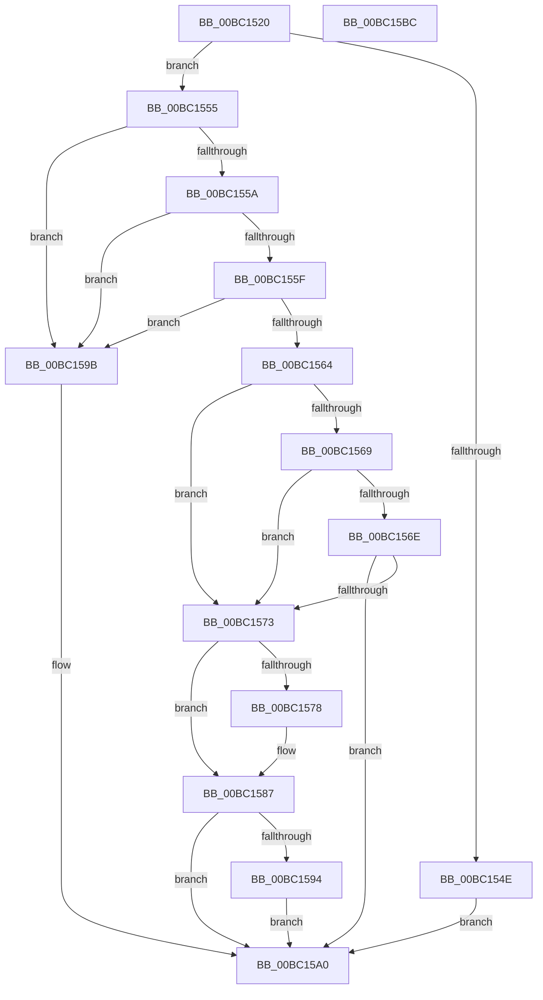

# BgpConsoleSetCursor

- RVA: `0x00BC1520`–`0x00BC15BD` (길이 `157` bytes)
- VA: `0x0000000140BC1520`
- 실행 섹션: `PAGEBGFX`
- PDB 이름 있음: `예`; PDB Function 태그: `아니요`
- unwind 정보 RVA: `0x0005C954`
- 디코드: `49`개 명령, `157/157` bytes 표시
- 미해석 바이트: `0` (있으면 어셈블리에 `.byte`로 보존)

> 이 문서는 커널 이미지의 기계어와 PDB 기호를 분석해 생성했습니다. 4번과 5번은 함수 원형과 자료형을 바이너리 사용 방식에서 추정한 C 해석이며 원본 소스 복구 결과는 아닙니다.

## 1. Dependencies

- 직접 호출 지점: **4**; 고유 호출 대상: **3**
- 직접 호출자로 확인된 함수: **0**
- RIP 상대 이미지 참조: **1**

### Outgoing calls
- `0x00BC153B` → [BgpFwAcquireLock](../../text/4B/BgpFwAcquireLock_function_004B3AA4.md) (function, `0x004B3AA4`)
- `0x00BC157B` → [BgpConsoleDrawCursor](BgpConsoleDrawCursor_function_00BC0F18.md) (function, `0x00BC0F18`)
- `0x00BC1594` → [BgpConsoleDrawCursor](BgpConsoleDrawCursor_function_00BC0F18.md) (function, `0x00BC0F18`)
- `0x00BC15A0` → [BgpFwReleaseLock](../../text/4B/BgpFwReleaseLock_function_004B357C.md) (function, `0x004B357C`)

### Direct callers
- 이 함수 시작 RVA로 연결되는 직접 call은 확인되지 않았습니다. 간접 호출은 완전히 역산할 수 없습니다.

### Static image references
- `0x00BC1540` → RVA `0x00EEFEC8` (`.data`; read)

## 2. Other-region calls and transfers

- 다른 실행 섹션으로 향하는 call: **2**
  - `0x00BC153B` → [BgpFwAcquireLock](../../text/4B/BgpFwAcquireLock_function_004B3AA4.md) (`PAGEBGFX` → `.text`)
  - `0x00BC15A0` → [BgpFwReleaseLock](../../text/4B/BgpFwReleaseLock_function_004B357C.md) (`PAGEBGFX` → `.text`)
- 별도 외부 분기/꼬리 이동을 확인하지 못했습니다.

## 3. Assembly (complete function range)

```asm
00BC1520  48 89 5C 24 08                  mov qword ptr [rsp + 8], rbx
00BC1525  48 89 6C 24 10                  mov qword ptr [rsp + 0x10], rbp
00BC152A  48 89 74 24 18                  mov qword ptr [rsp + 0x18], rsi
00BC152F  57                              push rdi
00BC1530  48 83 EC 20                     sub rsp, 0x20
00BC1534  41 8B F8                        mov edi, r8d
00BC1537  8B F2                           mov esi, edx
00BC1539  8B E9                           mov ebp, ecx
00BC153B  E8 64 25 8F FF                  call 0x1404b3aa4
00BC1540  48 8B 05 81 E9 32 00            mov rax, qword ptr [rip + 0x32e981]
00BC1547  33 DB                           xor ebx, ebx
00BC1549  48 85 C0                        test rax, rax
00BC154C  75 07                           jne 0x140bc1555
00BC154E  BB 01 00 00 C0                  mov ebx, 0xc0000001
00BC1553  EB 4B                           jmp 0x140bc15a0
00BC1555  83 FD 50                        cmp ebp, 0x50
00BC1558  73 41                           jae 0x140bc159b
00BC155A  3B 70 04                        cmp esi, dword ptr [rax + 4]
00BC155D  73 3C                           jae 0x140bc159b
00BC155F  83 FF 64                        cmp edi, 0x64
00BC1562  77 37                           ja 0x140bc159b
00BC1564  39 68 44                        cmp dword ptr [rax + 0x44], ebp
00BC1567  75 0A                           jne 0x140bc1573
00BC1569  39 70 48                        cmp dword ptr [rax + 0x48], esi
00BC156C  75 05                           jne 0x140bc1573
00BC156E  39 78 4C                        cmp dword ptr [rax + 0x4c], edi
00BC1571  74 2D                           je 0x140bc15a0
00BC1573  39 58 4C                        cmp dword ptr [rax + 0x4c], ebx
00BC1576  74 0F                           je 0x140bc1587
00BC1578  89 58 4C                        mov dword ptr [rax + 0x4c], ebx
00BC157B  E8 98 F9 FF FF                  call 0x140bc0f18
00BC1580  48 8B 05 41 E9 32 00            mov rax, qword ptr [rip + 0x32e941]
00BC1587  89 68 44                        mov dword ptr [rax + 0x44], ebp
00BC158A  89 70 48                        mov dword ptr [rax + 0x48], esi
00BC158D  89 78 4C                        mov dword ptr [rax + 0x4c], edi
00BC1590  85 FF                           test edi, edi
00BC1592  74 0C                           je 0x140bc15a0
00BC1594  E8 7F F9 FF FF                  call 0x140bc0f18
00BC1599  EB 05                           jmp 0x140bc15a0
00BC159B  BB 0D 00 00 C0                  mov ebx, 0xc000000d
00BC15A0  E8 D7 1F 8F FF                  call 0x1404b357c
00BC15A5  48 8B 6C 24 38                  mov rbp, qword ptr [rsp + 0x38]
00BC15AA  8B C3                           mov eax, ebx
00BC15AC  48 8B 5C 24 30                  mov rbx, qword ptr [rsp + 0x30]
00BC15B1  48 8B 74 24 40                  mov rsi, qword ptr [rsp + 0x40]
00BC15B6  48 83 C4 20                     add rsp, 0x20
00BC15BA  5F                              pop rdi
00BC15BB  C3                              ret
00BC15BC  CC                              int3
```

## 4. C-style interpretation (structured pseudocode)

```c
__int64 __fastcall BgpConsoleSetCursor(int a1, int a2, int a3)
{
    __int64 result;
    __int64 v_rbx;
    __int64 v_rsp;
    unsigned __int64 v_stack_p10;
    unsigned __int64 v_stack_p18;
    unsigned __int64 v_stack_p8;

    v_stack_p8 = v_rbx;
    v_stack_p10 = v_rbp;
    v_stack_p18 = v_rsi;
    v_rsp = (v_rsp) - (32);
    result = BgpFwAcquireLock(a1, a2, a3, a4);
    v_rbx = 0;
    if (*(unsigned __int64 *)(v_rip + 3336577) != 0) goto loc_00BC1555;
    goto loc_00BC15A0;
loc_00BC1555:
    if (((unsigned int)((unsigned int)(a1))) >= 80) goto loc_00BC159B;
    if (((unsigned int)((unsigned int)(a2))) >= (*(unsigned int *)(*(unsigned __int64 *)(v_rip + 3336577) + 4))) goto loc_00BC159B;
    if (((unsigned int)((unsigned int)(a3))) > 100) goto loc_00BC159B;
    if ((*(unsigned int *)(*(unsigned __int64 *)(v_rip + 3336577) + 68)) != ((unsigned int)((unsigned int)(a1)))) goto loc_00BC1573;
    if ((*(unsigned int *)(*(unsigned __int64 *)(v_rip + 3336577) + 72)) != ((unsigned int)((unsigned int)(a2)))) goto loc_00BC1573;
    if ((*(unsigned int *)(*(unsigned __int64 *)(v_rip + 3336577) + 76)) == ((unsigned int)((unsigned int)(a3)))) goto loc_00BC15A0;
loc_00BC1573:
    result = *(unsigned __int64 *)(v_rip + 3336577);
    if ((*(unsigned int *)(*(unsigned __int64 *)(v_rip + 3336577) + 76)) != ((unsigned int)((unsigned int)(0xC0000001ULL)))) {
        *(unsigned int *)(*(unsigned __int64 *)(v_rip + 3336577) + 76) = (unsigned int)((unsigned int)(0xC0000001ULL));
        result = BgpConsoleDrawCursor(a1, a2, a3, a4);
        result = *(unsigned __int64 *)(v_rip + 3336513);
    }
    *(unsigned int *)(result + 68) = (unsigned int)((unsigned int)(a1));
    *(unsigned int *)(result + 72) = (unsigned int)((unsigned int)(a2));
    *(unsigned int *)(result + 76) = (unsigned int)((unsigned int)(a3));
    if ((unsigned int)((unsigned int)(a3)) == 0) goto loc_00BC15A0;
    result = BgpConsoleDrawCursor(a1, a2, a3, a4);
    goto loc_00BC15A0;
loc_00BC159B:
loc_00BC15A0:
    result = BgpFwReleaseLock(a1, a2, a3, a4);
    v_rsp = (v_rsp) + (32);
    return (unsigned int)((unsigned int)((unsigned int)(0xC000000DULL)));
}
```

## 5. (Beta) C Style

```c
int64_t BgpConsoleSetCursor(int32_t Arg1, int32_t Arg2, int32_t Arg3)
{
    int64_t result;
    int64_t local_rbx;
    int64_t local_rsp;
    uint64_t v_stack_p10;
    uint64_t v_stack_p18;
    uint64_t v_stack_p8;

    v_stack_p8 = local_rbx;
    v_stack_p10 = local_rbp;
    v_stack_p18 = local_rsi;
    local_rsp = (local_rsp) - (32);
    result = BgpFwAcquireLock(Arg1, Arg2, Arg3, a4);
    local_rbx = 0;
    if (*(uint64_t *)(v_rip + 0x32E981) != 0) goto loc_00BC1555;
    goto loc_00BC15A0;
loc_00BC1555:
    if (((uint32_t)((uint32_t)(Arg1))) >= 80) goto loc_00BC159B;
    if (((uint32_t)((uint32_t)(Arg2))) >= (*(uint32_t *)(*(uint64_t *)(v_rip + 0x32E981) + 0x4))) goto loc_00BC159B;
    if (((uint32_t)((uint32_t)(Arg3))) > 100) goto loc_00BC159B;
    if ((*(uint32_t *)(*(uint64_t *)(v_rip + 0x32E981) + 0x44)) != ((uint32_t)((uint32_t)(Arg1)))) goto loc_00BC1573;
    if ((*(uint32_t *)(*(uint64_t *)(v_rip + 0x32E981) + 0x48)) != ((uint32_t)((uint32_t)(Arg2)))) goto loc_00BC1573;
    if ((*(uint32_t *)(*(uint64_t *)(v_rip + 0x32E981) + 0x4C)) == ((uint32_t)((uint32_t)(Arg3)))) goto loc_00BC15A0;
loc_00BC1573:
    result = *(uint64_t *)(v_rip + 0x32E981);
    if ((*(uint32_t *)(*(uint64_t *)(v_rip + 0x32E981) + 0x4C)) != ((uint32_t)((uint32_t)(0xC0000001ULL)))) {
        *(uint32_t *)(*(uint64_t *)(v_rip + 0x32E981) + 0x4C) = (uint32_t)((uint32_t)(0xC0000001ULL));
        result = BgpConsoleDrawCursor(Arg1, Arg2, Arg3, a4);
        result = *(uint64_t *)(v_rip + 0x32E941);
    }
    *(uint32_t *)(result + 0x44) = (uint32_t)((uint32_t)(Arg1));
    *(uint32_t *)(result + 0x48) = (uint32_t)((uint32_t)(Arg2));
    *(uint32_t *)(result + 0x4C) = (uint32_t)((uint32_t)(Arg3));
    if ((uint32_t)((uint32_t)(Arg3)) == 0) goto loc_00BC15A0;
    result = BgpConsoleDrawCursor(Arg1, Arg2, Arg3, a4);
    goto loc_00BC15A0;
loc_00BC159B:
loc_00BC15A0:
    result = BgpFwReleaseLock(Arg1, Arg2, Arg3, a4);
    local_rsp = (local_rsp) + (32);
    return (uint32_t)((uint32_t)((uint32_t)(0xC000000DULL)));
}
```

## 6. Execution-region graph

[열기: 2D/3D 그래프와 함수 탐색 컨트롤 패널](../../../control-panel.html?section=pagebgfx&rva=0x00BC1520&view=graph)

- 2D 그래프는 위에서 아래로 흐르고, 3D 그래프는 빈 공간을 드래그해 회전합니다. Shift+드래그는 이동, 휠은 확대·축소, 함수 노드 선택은 대상 보고서 이동입니다.

### Static fallback


