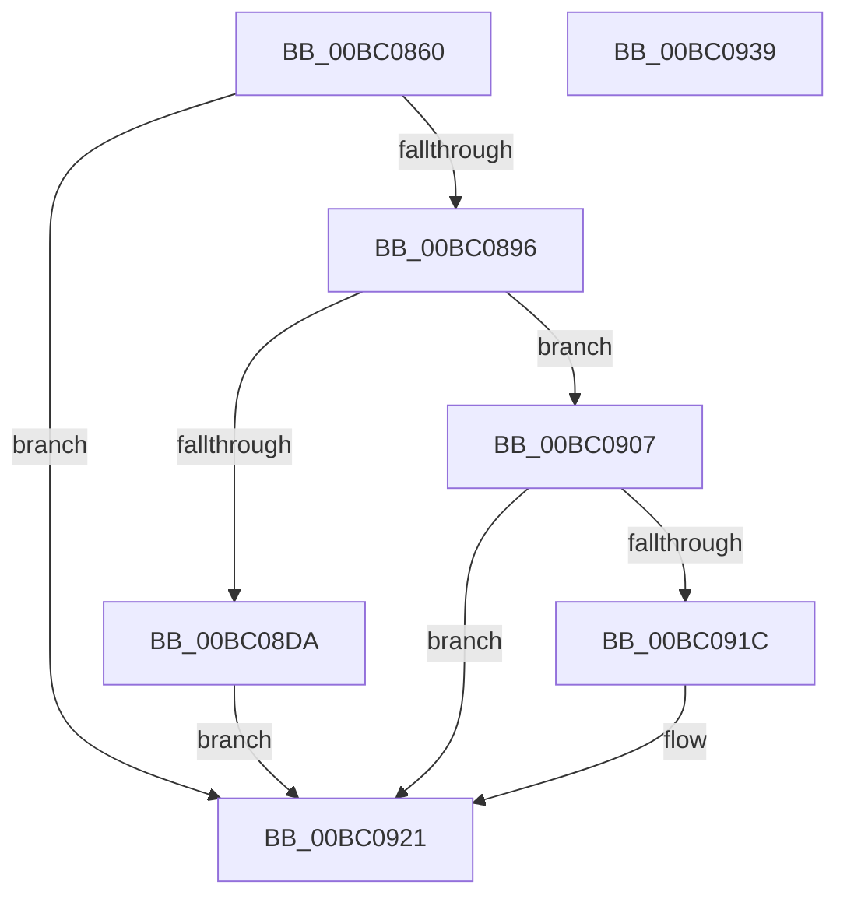

# BgpDisplayCharacterGetContext

- RVA: `0x00BC0860`–`0x00BC093A` (길이 `218` bytes)
- VA: `0x0000000140BC0860`
- 실행 섹션: `PAGEBGFX`
- PDB 이름 있음: `예`; PDB Function 태그: `아니요`
- unwind 정보 RVA: `0x000D0810`
- 디코드: `61`개 명령, `218/218` bytes 표시
- 미해석 바이트: `0` (있으면 어셈블리에 `.byte`로 보존)

> 이 문서는 커널 이미지의 기계어와 PDB 기호를 분석해 생성했습니다. 4번과 5번은 함수 원형과 자료형을 바이너리 사용 방식에서 추정한 C 해석이며 원본 소스 복구 결과는 아닙니다.

## 1. Dependencies

- 직접 호출 지점: **4**; 고유 호출 대상: **4**
- 직접 호출자로 확인된 함수: **2**
- RIP 상대 이미지 참조: **0**

### Outgoing calls
- `0x00BC0885` → [BgpFwAllocateMemory](../../text/3E/BgpFwAllocateMemory_function_003E4374.md) (function, `0x003E4374`)
- `0x00BC08D1` → [BgpTxtCreateRegion](BgpTxtCreateRegion_function_00BC2908.md) (function, `0x00BC2908`)
- `0x00BC090A` → [BgpFwFreeMemory](../../text/3E/BgpFwFreeMemory_function_003E25E0.md) (function, `0x003E25E0`)
- `0x00BC091C` → [BgpTxtDestroyRegion](BgpTxtDestroyRegion_function_00BC2B5C.md) (function, `0x00BC2B5C`)

### Direct callers
- [BgpConsoleInitialize](BgpConsoleInitialize_function_00BC10B0.md) at `0x00BC121D`
- [BgpBcInitializeCriticalMode](../../init/C8/BgpBcInitializeCriticalMode_function_00C81454.md) at `0x00C81980`

### Static image references
- 디코드된 RIP-relative 메모리 참조가 없습니다.

## 2. Other-region calls and transfers

- 다른 실행 섹션으로 향하는 call: **2**
  - `0x00BC0885` → [BgpFwAllocateMemory](../../text/3E/BgpFwAllocateMemory_function_003E4374.md) (`PAGEBGFX` → `.text`)
  - `0x00BC090A` → [BgpFwFreeMemory](../../text/3E/BgpFwFreeMemory_function_003E25E0.md) (`PAGEBGFX` → `.text`)
- 별도 외부 분기/꼬리 이동을 확인하지 못했습니다.

## 3. Assembly (complete function range)

```asm
00BC0860  48 8B C4                        mov rax, rsp
00BC0863  48 89 58 08                     mov qword ptr [rax + 8], rbx
00BC0867  48 89 68 10                     mov qword ptr [rax + 0x10], rbp
00BC086B  56                              push rsi
00BC086C  57                              push rdi
00BC086D  41 56                           push r14
00BC086F  48 83 EC 60                     sub rsp, 0x60
00BC0873  33 FF                           xor edi, edi
00BC0875  48 8B E9                        mov rbp, rcx
00BC0878  45 8B F0                        mov r14d, r8d
00BC087B  48 89 78 20                     mov qword ptr [rax + 0x20], rdi
00BC087F  48 8B F2                        mov rsi, rdx
00BC0882  8D 4F 20                        lea ecx, [rdi + 0x20]
00BC0885  E8 EA 3A 82 FF                  call 0x1403e4374
00BC088A  48 8B D8                        mov rbx, rax
00BC088D  48 85 C0                        test rax, rax
00BC0890  0F 84 8B 00 00 00               je 0x140bc0921
00BC0896  44 8B 06                        mov r8d, dword ptr [rsi]
00BC0899  48 8D 54 24 48                  lea rdx, [rsp + 0x48]
00BC089E  8B 46 04                        mov eax, dword ptr [rsi + 4]
00BC08A1  48 8D 4C 24 40                  lea rcx, [rsp + 0x40]
00BC08A6  89 44 24 4C                     mov dword ptr [rsp + 0x4c], eax
00BC08AA  45 33 C9                        xor r9d, r9d
00BC08AD  48 8D 84 24 98 00 00 00         lea rax, [rsp + 0x98]
00BC08B5  44 89 44 24 48                  mov dword ptr [rsp + 0x48], r8d
00BC08BA  44 89 44 24 50                  mov dword ptr [rsp + 0x50], r8d
00BC08BF  4C 8B C5                        mov r8, rbp
00BC08C2  44 89 74 24 28                  mov dword ptr [rsp + 0x28], r14d
00BC08C7  48 89 44 24 20                  mov qword ptr [rsp + 0x20], rax
00BC08CC  48 89 7C 24 40                  mov qword ptr [rsp + 0x40], rdi
00BC08D1  E8 32 20 00 00                  call 0x140bc2908
00BC08D6  85 C0                           test eax, eax
00BC08D8  78 2D                           js 0x140bc0907
00BC08DA  F2 0F 10 06                     movsd xmm0, qword ptr [rsi]
00BC08DE  48 8B FB                        mov rdi, rbx
00BC08E1  F2 0F 11 43 0C                  movsd qword ptr [rbx + 0xc], xmm0
00BC08E6  8B 46 08                        mov eax, dword ptr [rsi + 8]
00BC08E9  89 43 14                        mov dword ptr [rbx + 0x14], eax
00BC08EC  48 8B 45 08                     mov rax, qword ptr [rbp + 8]
00BC08F0  48 89 03                        mov qword ptr [rbx], rax
00BC08F3  8B 45 10                        mov eax, dword ptr [rbp + 0x10]
00BC08F6  89 43 08                        mov dword ptr [rbx + 8], eax
00BC08F9  48 8B 84 24 98 00 00 00         mov rax, qword ptr [rsp + 0x98]
00BC0901  48 89 43 18                     mov qword ptr [rbx + 0x18], rax
00BC0905  EB 1A                           jmp 0x140bc0921
00BC0907  48 8B CB                        mov rcx, rbx
00BC090A  E8 D1 1C 82 FF                  call 0x1403e25e0
00BC090F  48 8B 8C 24 98 00 00 00         mov rcx, qword ptr [rsp + 0x98]
00BC0917  48 85 C9                        test rcx, rcx
00BC091A  74 05                           je 0x140bc0921
00BC091C  E8 3B 22 00 00                  call 0x140bc2b5c
00BC0921  4C 8D 5C 24 60                  lea r11, [rsp + 0x60]
00BC0926  48 8B C7                        mov rax, rdi
00BC0929  49 8B 5B 20                     mov rbx, qword ptr [r11 + 0x20]
00BC092D  49 8B 6B 28                     mov rbp, qword ptr [r11 + 0x28]
00BC0931  49 8B E3                        mov rsp, r11
00BC0934  41 5E                           pop r14
00BC0936  5F                              pop rdi
00BC0937  5E                              pop rsi
00BC0938  C3                              ret
00BC0939  CC                              int3
```

## 4. C-style interpretation (structured pseudocode)

```c
__int64 __fastcall BgpDisplayCharacterGetContext(__int64 a1, __int64 a2, int a3, int a4)
{
    __int64 result;
    __int64 v_rdi;
    __int64 v_rsp;
    unsigned __int64 v_stack_m18;
    unsigned int v_stack_m28;
    unsigned int v_stack_m2C;
    unsigned __int64 v_stack_m30;
    unsigned __int64 v_stack_m38;
    unsigned int v_stack_m50;
    unsigned __int64 v_stack_m58;
    unsigned __int64 v_stack_p20;

    *(unsigned __int64 *)(v_rsp + 8) = v_rbx;
    *(unsigned __int64 *)(v_rsp + 16) = v_rbp;
    v_rsp = (v_rsp) - (96);
    v_rdi = 0;
    *(unsigned __int64 *)(v_rsp + 32) = 0;
    result = BgpFwAllocateMemory(v_rdi + 32, a2, a3, a4);
    if (result == 0) goto loc_00BC0921;
    v_stack_m2C = (unsigned int)((unsigned int)(*(unsigned int *)(a2 + 4)));
    a4 = 0;
    v_stack_m30 = (unsigned int)((unsigned int)(*(unsigned int *)(a2)));
    v_stack_m28 = (unsigned int)((unsigned int)(*(unsigned int *)(a2)));
    v_stack_m50 = (unsigned int)((unsigned int)(a3));
    v_stack_m58 = v_stack_p20;
    v_stack_m38 = 0;
    result = BgpTxtCreateRegion(v_stack_m38, v_stack_m30, a1, a4);
    if (sign_flag) goto loc_00BC0907;
    *(unsigned __int64 *)(result + 12) = v_xmm0;
    *(unsigned int *)(result + 20) = (unsigned int)((unsigned int)(*(unsigned int *)(a2 + 8)));
    *(unsigned __int64 *)(result) = *(unsigned __int64 *)(a1 + 8);
    *(unsigned int *)(result + 8) = (unsigned int)((unsigned int)(*(unsigned int *)(a1 + 16)));
    *(unsigned __int64 *)(result + 24) = v_stack_p20;
    goto loc_00BC0921;
loc_00BC0907:
    result = BgpFwFreeMemory(result, v_stack_m30, a1, a4);
    if (v_stack_p20 != 0) {
        result = BgpTxtDestroyRegion(v_stack_p20, v_stack_m30, a1, a4);
    }
    return result;
}
```

## 5. (Beta) C Style

```c
int64_t BgpDisplayCharacterGetContext(void *Arg1, void *Arg2, int32_t Arg3, int32_t Arg4)
{
    uint8_t *arg1 = (uint8_t *)Arg1;
    uint8_t *arg2 = (uint8_t *)Arg2;

    int64_t result;
    int64_t local_rdi;
    int64_t local_rsp;
    uint64_t v_stack_m18;
    uint32_t v_stack_m28;
    uint32_t v_stack_m2C;
    uint64_t v_stack_m30;
    uint64_t v_stack_m38;
    uint32_t v_stack_m50;
    uint64_t v_stack_m58;
    uint64_t v_stack_p20;

    *(uint64_t *)(local_rsp + 0x8) = local_rbx;
    *(uint64_t *)(local_rsp + 0x10) = local_rbp;
    local_rsp = (local_rsp) - (96);
    local_rdi = 0;
    *(uint64_t *)(local_rsp + 0x20) = 0;
    result = BgpFwAllocateMemory(local_rdi + 32, Arg2, Arg3, Arg4);
    if (result == 0) goto loc_00BC0921;
    v_stack_m2C = (uint32_t)((uint32_t)(*(uint32_t *)(arg2 + 0x4)));
    Arg4 = 0;
    v_stack_m30 = (uint32_t)((uint32_t)(*(uint32_t *)(arg2)));
    v_stack_m28 = (uint32_t)((uint32_t)(*(uint32_t *)(arg2)));
    v_stack_m50 = (uint32_t)((uint32_t)(Arg3));
    v_stack_m58 = v_stack_p20;
    v_stack_m38 = 0;
    result = BgpTxtCreateRegion(v_stack_m38, v_stack_m30, Arg1, Arg4);
    if (sign_flag) goto loc_00BC0907;
    *(uint64_t *)(result + 0xC) = v_xmm0;
    *(uint32_t *)(result + 0x14) = (uint32_t)((uint32_t)(*(uint32_t *)(arg2 + 0x8)));
    *(uint64_t *)(result) = *(uint64_t *)(arg1 + 0x8);
    *(uint32_t *)(result + 0x8) = (uint32_t)((uint32_t)(*(uint32_t *)(arg1 + 0x10)));
    *(uint64_t *)(result + 0x18) = v_stack_p20;
    goto loc_00BC0921;
loc_00BC0907:
    result = BgpFwFreeMemory(result, v_stack_m30, Arg1, Arg4);
    if (v_stack_p20 != 0) {
        result = BgpTxtDestroyRegion(v_stack_p20, v_stack_m30, Arg1, Arg4);
    }
    return result;
}
```

### 관측된 메모리 오프셋

구조체 형식이 확인되지 않은 접근은 인자 기준의 오프셋으로만 기록했습니다.

| 기준 인자 | 오프셋 표현 | 폭 (bit) | 접근 |
|---|---:|---:|---|
| `Arg1` | `+ 0x8` | `64` | `R` |
| `Arg1` | `+ 0x10` | `32` | `R` |
| `Arg2` | `+ 0x0` | `32` | `R` |
| `Arg2` | `+ 0x0` | `64` | `R` |
| `Arg2` | `+ 0x4` | `32` | `R` |
| `Arg2` | `+ 0x8` | `32` | `R` |

## 6. Execution-region graph

[열기: 2D/3D 그래프와 함수 탐색 컨트롤 패널](../../../control-panel.html?section=pagebgfx&rva=0x00BC0860&view=graph)

- 2D 그래프는 위에서 아래로 흐르고, 3D 그래프는 빈 공간을 드래그해 회전합니다. Shift+드래그는 이동, 휠은 확대·축소, 함수 노드 선택은 대상 보고서 이동입니다.

### Static fallback


