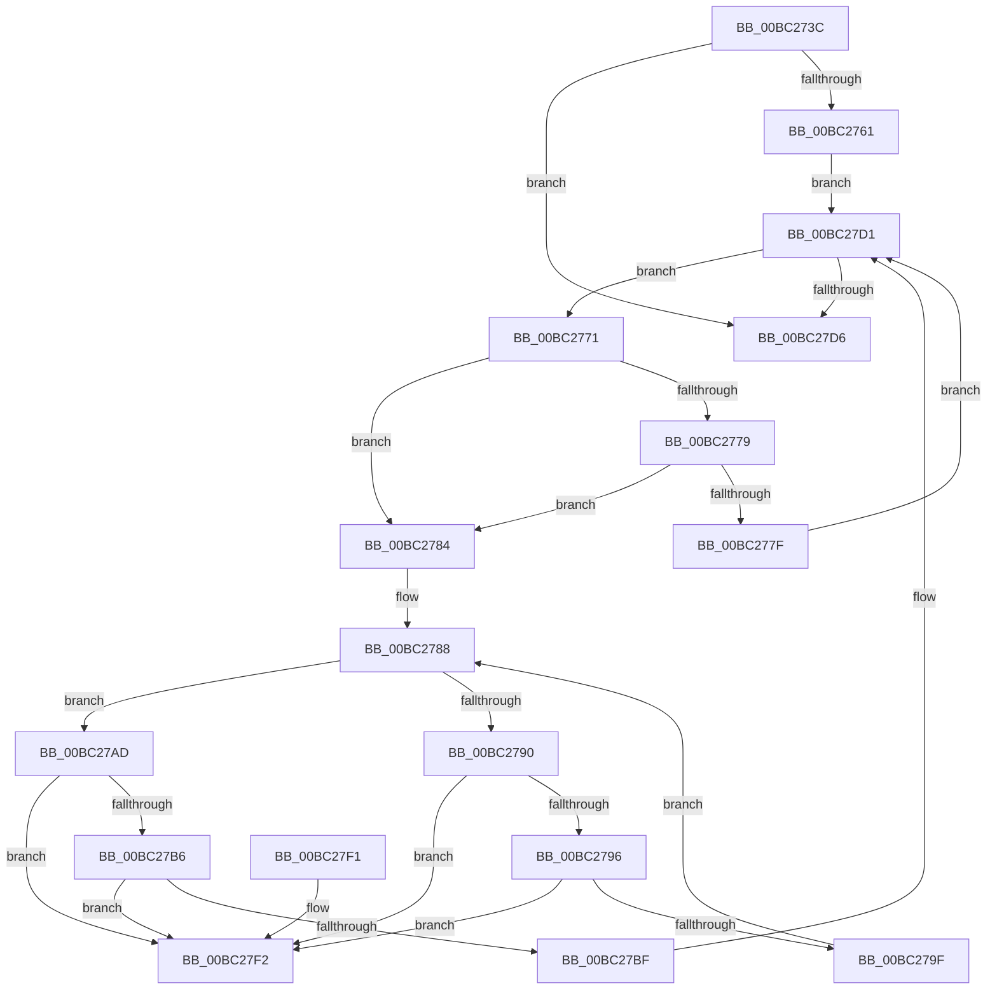

# BgpFoDestroy

- RVA: `0x00BC273C`–`0x00BC27F9` (길이 `189` bytes)
- VA: `0x0000000140BC273C`
- 실행 섹션: `PAGEBGFX`
- PDB 이름 있음: `예`; PDB Function 태그: `아니요`
- unwind 정보 RVA: `0x0006B020`
- 디코드: `56`개 명령, `189/189` bytes 표시
- 미해석 바이트: `0` (있으면 어셈블리에 `.byte`로 보존)

> 이 문서는 커널 이미지의 기계어와 PDB 기호를 분석해 생성했습니다. 4번과 5번은 함수 원형과 자료형을 바이너리 사용 방식에서 추정한 C 해석이며 원본 소스 복구 결과는 아닙니다.

## 1. Dependencies

- 직접 호출 지점: **2**; 고유 호출 대상: **2**
- 직접 호출자로 확인된 함수: **2**
- RIP 상대 이미지 참조: **2**

### Outgoing calls
- `0x00BC27A6` → [FopFreeFontData](FopFreeFontData_function_00BC2800.md) (function, `0x00BC2800`)
- `0x00BC27CC` → [BgpFwFreeMemory](../../text/3E/BgpFwFreeMemory_function_003E25E0.md) (function, `0x003E25E0`)

### Direct callers
- [BgpFwLibraryDestroy](BgpFwLibraryDestroy_function_00BC1678.md) at `0x00BC167E`
- [BgpFwLibraryDestroy](BgpFwLibraryDestroy_function_00BC1678.md) at `0x00BC168F`
- [BgpFwLibraryDisable](BgpFwLibraryDisable_function_00BC1724.md) at `0x00BC17B7`

### Static image references
- `0x00BC2755` → RVA `0x00EF03B4` (`.data`; read)
- `0x00BC2761` → RVA `0x00EF03C0` (`.data`; read)

## 2. Other-region calls and transfers

- 다른 실행 섹션으로 향하는 call: **1**
  - `0x00BC27CC` → [BgpFwFreeMemory](../../text/3E/BgpFwFreeMemory_function_003E25E0.md) (`PAGEBGFX` → `.text`)
- 별도 외부 분기/꼬리 이동을 확인하지 못했습니다.

## 3. Assembly (complete function range)

```asm
00BC273C  48 8B C4                        mov rax, rsp
00BC273F  48 89 58 08                     mov qword ptr [rax + 8], rbx
00BC2743  48 89 68 10                     mov qword ptr [rax + 0x10], rbp
00BC2747  48 89 70 18                     mov qword ptr [rax + 0x18], rsi
00BC274B  48 89 78 20                     mov qword ptr [rax + 0x20], rdi
00BC274F  41 56                           push r14
00BC2751  48 83 EC 20                     sub rsp, 0x20
00BC2755  80 3D 58 DC 32 00 00            cmp byte ptr [rip + 0x32dc58], 0
00BC275C  48 8B F1                        mov rsi, rcx
00BC275F  74 75                           je 0x140bc27d6
00BC2761  48 8B 1D 58 DC 32 00            mov rbx, qword ptr [rip + 0x32dc58]
00BC2768  4C 8D 35 51 DC 32 00            lea r14, [rip + 0x32dc51]
00BC276F  EB 60                           jmp 0x140bc27d1
00BC2771  48 8B EB                        mov rbp, rbx
00BC2774  48 85 F6                        test rsi, rsi
00BC2777  74 0B                           je 0x140bc2784
00BC2779  48 39 73 10                     cmp qword ptr [rbx + 0x10], rsi
00BC277D  74 05                           je 0x140bc2784
00BC277F  48 8B 1B                        mov rbx, qword ptr [rbx]
00BC2782  EB 4D                           jmp 0x140bc27d1
00BC2784  48 8D 7B 28                     lea rdi, [rbx + 0x28]
00BC2788  48 8B 0F                        mov rcx, qword ptr [rdi]
00BC278B  48 3B CF                        cmp rcx, rdi
00BC278E  74 1D                           je 0x140bc27ad
00BC2790  48 39 79 08                     cmp qword ptr [rcx + 8], rdi
00BC2794  75 5C                           jne 0x140bc27f2
00BC2796  48 8B 01                        mov rax, qword ptr [rcx]
00BC2799  48 39 48 08                     cmp qword ptr [rax + 8], rcx
00BC279D  75 53                           jne 0x140bc27f2
00BC279F  48 89 07                        mov qword ptr [rdi], rax
00BC27A2  48 89 78 08                     mov qword ptr [rax + 8], rdi
00BC27A6  E8 55 00 00 00                  call 0x140bc2800
00BC27AB  EB DB                           jmp 0x140bc2788
00BC27AD  48 8B 13                        mov rdx, qword ptr [rbx]
00BC27B0  48 39 5A 08                     cmp qword ptr [rdx + 8], rbx
00BC27B4  75 3C                           jne 0x140bc27f2
00BC27B6  48 8B 43 08                     mov rax, qword ptr [rbx + 8]
00BC27BA  48 39 18                        cmp qword ptr [rax], rbx
00BC27BD  75 33                           jne 0x140bc27f2
00BC27BF  48 89 10                        mov qword ptr [rax], rdx
00BC27C2  48 8B CD                        mov rcx, rbp
00BC27C5  48 89 42 08                     mov qword ptr [rdx + 8], rax
00BC27C9  48 8B 1B                        mov rbx, qword ptr [rbx]
00BC27CC  E8 0F FE 81 FF                  call 0x1403e25e0
00BC27D1  49 3B DE                        cmp rbx, r14
00BC27D4  75 9B                           jne 0x140bc2771
00BC27D6  48 8B 5C 24 30                  mov rbx, qword ptr [rsp + 0x30]
00BC27DB  48 8B 6C 24 38                  mov rbp, qword ptr [rsp + 0x38]
00BC27E0  48 8B 74 24 40                  mov rsi, qword ptr [rsp + 0x40]
00BC27E5  48 8B 7C 24 48                  mov rdi, qword ptr [rsp + 0x48]
00BC27EA  48 83 C4 20                     add rsp, 0x20
00BC27EE  41 5E                           pop r14
00BC27F0  C3                              ret
00BC27F1  CC                              int3
00BC27F2  B9 03 00 00 00                  mov ecx, 3
00BC27F7  CD 29                           int 0x29
```

## 4. C-style interpretation (structured pseudocode)

```c
__int64 __fastcall BgpFoDestroy(__int64 a1)
{
    __int64 result;
    __int64 v_rsp;
    unsigned __int64 v_stack_p10;
    unsigned __int64 v_stack_p18;
    unsigned __int64 v_stack_p20;
    unsigned __int64 v_stack_p8;

    *(unsigned __int64 *)(v_rsp + 8) = v_rbx;
    *(unsigned __int64 *)(v_rsp + 16) = v_rbp;
    *(unsigned __int64 *)(v_rsp + 24) = v_rsi;
    *(unsigned __int64 *)(v_rsp + 32) = v_rdi;
    v_rsp = (v_rsp) - (32);
    if ((*(unsigned __int8 *)(v_rip + 3333208)) == 0) goto loc_00BC27D6;
    goto loc_00BC27D1;
loc_00BC2771:
    if (a1 == 0) goto loc_00BC2784;
    if ((*(unsigned __int64 *)(*(unsigned __int64 *)(v_rip + 3333208) + 16)) == a1) goto loc_00BC2784;
    goto loc_00BC27D1;
loc_00BC2784:
loc_00BC2788:
    if ((*(unsigned __int64 *)(*(unsigned __int64 *)(*(unsigned __int64 *)(v_rip + 3333208)) + 40)) == (*(unsigned __int64 *)(*(unsigned __int64 *)(v_rip + 3333208)) + 40)) goto loc_00BC27AD;
    if ((*(unsigned __int64 *)(*(unsigned __int64 *)(*(unsigned __int64 *)(*(unsigned __int64 *)(v_rip + 3333208)) + 40) + 8)) != (*(unsigned __int64 *)(*(unsigned __int64 *)(v_rip + 3333208)) + 40)) goto loc_00BC27F2;
    if ((*(unsigned __int64 *)(*(unsigned __int64 *)(*(unsigned __int64 *)(*(unsigned __int64 *)(*(unsigned __int64 *)(v_rip + 3333208)) + 40)) + 8)) != (*(unsigned __int64 *)(*(unsigned __int64 *)(*(unsigned __int64 *)(v_rip + 3333208)) + 40))) goto loc_00BC27F2;
    *(unsigned __int64 *)(*(unsigned __int64 *)(*(unsigned __int64 *)(v_rip + 3333208)) + 40) = *(unsigned __int64 *)(*(unsigned __int64 *)(*(unsigned __int64 *)(*(unsigned __int64 *)(v_rip + 3333208)) + 40));
    *(unsigned __int64 *)(*(unsigned __int64 *)(*(unsigned __int64 *)(*(unsigned __int64 *)(*(unsigned __int64 *)(v_rip + 3333208)) + 40)) + 8) = *(unsigned __int64 *)(*(unsigned __int64 *)(v_rip + 3333208)) + 40;
    result = FopFreeFontData(*(unsigned __int64 *)(*(unsigned __int64 *)(*(unsigned __int64 *)(v_rip + 3333208)) + 40), a2, a3, a4);
    goto loc_00BC2788;
loc_00BC27AD:
    if ((*(unsigned __int64 *)(*(unsigned __int64 *)(*(unsigned __int64 *)(*(unsigned __int64 *)(v_rip + 3333208))) + 8)) != (*(unsigned __int64 *)(*(unsigned __int64 *)(v_rip + 3333208)))) goto loc_00BC27F2;
    if ((*(unsigned __int64 *)(*(unsigned __int64 *)(*(unsigned __int64 *)(*(unsigned __int64 *)(v_rip + 3333208)) + 8))) != (*(unsigned __int64 *)(*(unsigned __int64 *)(v_rip + 3333208)))) goto loc_00BC27F2;
    *(unsigned __int64 *)(*(unsigned __int64 *)(*(unsigned __int64 *)(*(unsigned __int64 *)(v_rip + 3333208)) + 8)) = *(unsigned __int64 *)(*(unsigned __int64 *)(*(unsigned __int64 *)(v_rip + 3333208)));
    *(unsigned __int64 *)(*(unsigned __int64 *)(*(unsigned __int64 *)(*(unsigned __int64 *)(v_rip + 3333208))) + 8) = *(unsigned __int64 *)(*(unsigned __int64 *)(*(unsigned __int64 *)(v_rip + 3333208)) + 8);
    result = BgpFwFreeMemory(*(unsigned __int64 *)(v_rip + 3333208), *(unsigned __int64 *)(*(unsigned __int64 *)(*(unsigned __int64 *)(v_rip + 3333208))), a3, a4);
loc_00BC27D1:
    if ((*(unsigned __int64 *)(*(unsigned __int64 *)(*(unsigned __int64 *)(v_rip + 3333208)))) != (v_rip + 3333201)) goto loc_00BC2771;
loc_00BC27D6:
    v_rsp = (v_rsp) + (32);
    return result;
loc_00BC27F2:
    return result;
}
```

## 5. (Beta) C Style

```c
int64_t BgpFoDestroy(int64_t Arg1)
{
    int64_t result;
    int64_t local_rsp;
    uint64_t v_stack_p10;
    uint64_t v_stack_p18;
    uint64_t v_stack_p20;
    uint64_t v_stack_p8;

    *(uint64_t *)(local_rsp + 0x8) = local_rbx;
    *(uint64_t *)(local_rsp + 0x10) = local_rbp;
    *(uint64_t *)(local_rsp + 0x18) = local_rsi;
    *(uint64_t *)(local_rsp + 0x20) = local_rdi;
    local_rsp = (local_rsp) - (32);
    if ((*(uint8_t *)(v_rip + 0x32DC58)) == 0) goto loc_00BC27D6;
    goto loc_00BC27D1;
loc_00BC2771:
    if (Arg1 == 0) goto loc_00BC2784;
    if ((*(uint64_t *)(*(uint64_t *)(v_rip + 0x32DC58) + 0x10)) == Arg1) goto loc_00BC2784;
    goto loc_00BC27D1;
loc_00BC2784:
loc_00BC2788:
    if ((*(uint64_t *)(*(uint64_t *)(*(uint64_t *)(v_rip + 0x32DC58)) + 0x28)) == (*(uint64_t *)(*(uint64_t *)(v_rip + 0x32DC58)) + 40)) goto loc_00BC27AD;
    if ((*(uint64_t *)(*(uint64_t *)(*(uint64_t *)(*(uint64_t *)(v_rip + 0x32DC58)) + 0x28) + 0x8)) != (*(uint64_t *)(*(uint64_t *)(v_rip + 0x32DC58)) + 40)) goto loc_00BC27F2;
    if ((*(uint64_t *)(*(uint64_t *)(*(uint64_t *)(*(uint64_t *)(*(uint64_t *)(v_rip + 0x32DC58)) + 0x28)) + 0x8)) != (*(uint64_t *)(*(uint64_t *)(*(uint64_t *)(v_rip + 0x32DC58)) + 0x28))) goto loc_00BC27F2;
    *(uint64_t *)(*(uint64_t *)(*(uint64_t *)(v_rip + 0x32DC58)) + 0x28) = *(uint64_t *)(*(uint64_t *)(*(uint64_t *)(*(uint64_t *)(v_rip + 0x32DC58)) + 0x28));
    *(uint64_t *)(*(uint64_t *)(*(uint64_t *)(*(uint64_t *)(*(uint64_t *)(v_rip + 0x32DC58)) + 0x28)) + 0x8) = *(uint64_t *)(*(uint64_t *)(v_rip + 0x32DC58)) + 40;
    result = FopFreeFontData(*(uint64_t *)(*(uint64_t *)(*(uint64_t *)(v_rip + 0x32DC58)) + 0x28), a2, a3, a4);
    goto loc_00BC2788;
loc_00BC27AD:
    if ((*(uint64_t *)(*(uint64_t *)(*(uint64_t *)(*(uint64_t *)(v_rip + 0x32DC58))) + 0x8)) != (*(uint64_t *)(*(uint64_t *)(v_rip + 0x32DC58)))) goto loc_00BC27F2;
    if ((*(uint64_t *)(*(uint64_t *)(*(uint64_t *)(*(uint64_t *)(v_rip + 0x32DC58)) + 0x8))) != (*(uint64_t *)(*(uint64_t *)(v_rip + 0x32DC58)))) goto loc_00BC27F2;
    *(uint64_t *)(*(uint64_t *)(*(uint64_t *)(*(uint64_t *)(v_rip + 0x32DC58)) + 0x8)) = *(uint64_t *)(*(uint64_t *)(*(uint64_t *)(v_rip + 0x32DC58)));
    *(uint64_t *)(*(uint64_t *)(*(uint64_t *)(*(uint64_t *)(v_rip + 0x32DC58))) + 0x8) = *(uint64_t *)(*(uint64_t *)(*(uint64_t *)(v_rip + 0x32DC58)) + 0x8);
    result = BgpFwFreeMemory(*(uint64_t *)(v_rip + 0x32DC58), *(uint64_t *)(*(uint64_t *)(*(uint64_t *)(v_rip + 0x32DC58))), a3, a4);
loc_00BC27D1:
    if ((*(uint64_t *)(*(uint64_t *)(*(uint64_t *)(v_rip + 0x32DC58)))) != (v_rip + 3333201)) goto loc_00BC2771;
loc_00BC27D6:
    local_rsp = (local_rsp) + (32);
    return result;
loc_00BC27F2:
    return result;
}
```

## 6. Execution-region graph

[열기: 2D/3D 그래프와 함수 탐색 컨트롤 패널](../../../control-panel.html?section=pagebgfx&rva=0x00BC273C&view=graph)

- 2D 그래프는 위에서 아래로 흐르고, 3D 그래프는 빈 공간을 드래그해 회전합니다. Shift+드래그는 이동, 휠은 확대·축소, 함수 노드 선택은 대상 보고서 이동입니다.

### Static fallback


