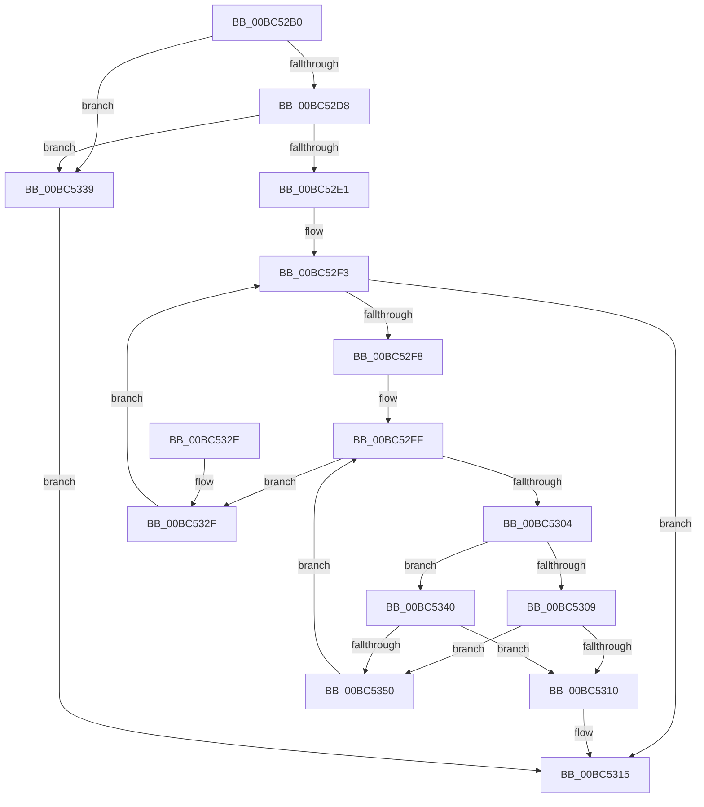

# BgpFoGetFontHandle

- RVA: `0x00BC52B0`–`0x00BC5355` (길이 `165` bytes)
- VA: `0x0000000140BC52B0`
- 실행 섹션: `PAGEBGFX`
- PDB 이름 있음: `예`; PDB Function 태그: `아니요`
- unwind 정보 RVA: `0x000BB038`
- 디코드: `51`개 명령, `165/165` bytes 표시
- 미해석 바이트: `0` (있으면 어셈블리에 `.byte`로 보존)

> 이 문서는 커널 이미지의 기계어와 PDB 기호를 분석해 생성했습니다. 4번과 5번은 함수 원형과 자료형을 바이너리 사용 방식에서 추정한 C 해석이며 원본 소스 복구 결과는 아닙니다.

## 1. Dependencies

- 직접 호출 지점: **1**; 고유 호출 대상: **1**
- 직접 호출자로 확인된 함수: **5**
- RIP 상대 이미지 참조: **2**

### Outgoing calls
- `0x00BC5347` → [wcsicmp](../../text/50/wcsicmp_function_00500080.md) (function, `0x00500080`)

### Direct callers
- [BgpConsoleInitialize](BgpConsoleInitialize_function_00BC10B0.md) at `0x00BC11A5`
- [ResFwConfigureDisplayStringResources](ResFwConfigureDisplayStringResources_function_00BC18C4.md) at `0x00BC18F4`
- [AnFwConfigureProgressResources](AnFwConfigureProgressResources_function_00BC1CFC.md) at `0x00BC1D79`
- [BgpTxtCreateRegion](BgpTxtCreateRegion_function_00BC2908.md) at `0x00BC29E2`
- [BgpFoDetermineFontInformation](../../init/C8/BgpFoDetermineFontInformation_function_00C805DC.md) at `0x00C80612`

### Static image references
- `0x00BC52D8` → RVA `0x00EF03B4` (`.data`; read)
- `0x00BC52E5` → RVA `0x00EF03C0` (`.data`; read)

## 2. Other-region calls and transfers

- 다른 실행 섹션으로 향하는 call: **1**
  - `0x00BC5347` → [wcsicmp](../../text/50/wcsicmp_function_00500080.md) (`PAGEBGFX` → `.text`)
- 별도 외부 분기/꼬리 이동을 확인하지 못했습니다.

## 3. Assembly (complete function range)

```asm
00BC52B0  48 89 5C 24 08                  mov qword ptr [rsp + 8], rbx
00BC52B5  48 89 6C 24 10                  mov qword ptr [rsp + 0x10], rbp
00BC52BA  48 89 74 24 18                  mov qword ptr [rsp + 0x18], rsi
00BC52BF  57                              push rdi
00BC52C0  41 54                           push r12
00BC52C2  41 56                           push r14
00BC52C4  48 83 EC 20                     sub rsp, 0x20
00BC52C8  48 8B F2                        mov rsi, rdx
00BC52CB  48 8B E9                        mov rbp, rcx
00BC52CE  B8 25 02 00 C0                  mov eax, 0xc0000225
00BC52D3  48 85 D2                        test rdx, rdx
00BC52D6  74 61                           je 0x140bc5339
00BC52D8  80 3D D5 B0 32 00 00            cmp byte ptr [rip + 0x32b0d5], 0
00BC52DF  74 58                           je 0x140bc5339
00BC52E1  48 83 22 00                     and qword ptr [rdx], 0
00BC52E5  4C 8D 25 D4 B0 32 00            lea r12, [rip + 0x32b0d4]
00BC52EC  48 8B 3D CD B0 32 00            mov rdi, qword ptr [rip + 0x32b0cd]
00BC52F3  49 3B FC                        cmp rdi, r12
00BC52F6  74 1D                           je 0x140bc5315
00BC52F8  4C 8D 77 28                     lea r14, [rdi + 0x28]
00BC52FC  49 8B 1E                        mov rbx, qword ptr [r14]
00BC52FF  49 3B DE                        cmp rbx, r14
00BC5302  74 2B                           je 0x140bc532f
00BC5304  48 85 ED                        test rbp, rbp
00BC5307  75 37                           jne 0x140bc5340
00BC5309  8B 47 1C                        mov eax, dword ptr [rdi + 0x1c]
00BC530C  A8 01                           test al, 1
00BC530E  74 40                           je 0x140bc5350
00BC5310  48 89 1E                        mov qword ptr [rsi], rbx
00BC5313  33 C0                           xor eax, eax
00BC5315  48 8B 5C 24 40                  mov rbx, qword ptr [rsp + 0x40]
00BC531A  48 8B 6C 24 48                  mov rbp, qword ptr [rsp + 0x48]
00BC531F  48 8B 74 24 50                  mov rsi, qword ptr [rsp + 0x50]
00BC5324  48 83 C4 20                     add rsp, 0x20
00BC5328  41 5E                           pop r14
00BC532A  41 5C                           pop r12
00BC532C  5F                              pop rdi
00BC532D  C3                              ret
00BC532E  CC                              int3
00BC532F  48 8B 3F                        mov rdi, qword ptr [rdi]
00BC5332  B8 25 02 00 C0                  mov eax, 0xc0000225
00BC5337  EB BA                           jmp 0x140bc52f3
00BC5339  B8 0D 00 00 C0                  mov eax, 0xc000000d
00BC533E  EB D5                           jmp 0x140bc5315
00BC5340  48 8B 4B 20                     mov rcx, qword ptr [rbx + 0x20]
00BC5344  48 8B D5                        mov rdx, rbp
00BC5347  E8 34 AD 93 FF                  call 0x140500080
00BC534C  85 C0                           test eax, eax
00BC534E  74 C0                           je 0x140bc5310
00BC5350  48 8B 1B                        mov rbx, qword ptr [rbx]
00BC5353  EB AA                           jmp 0x140bc52ff
```

## 4. C-style interpretation (structured pseudocode)

```c
__int64 __fastcall BgpFoGetFontHandle(__int64 a1, __int64 a2)
{
    __int64 result;
    __int64 v_rsp;
    unsigned __int64 v_stack_p10;
    unsigned __int64 v_stack_p18;
    unsigned __int64 v_stack_p8;

    v_stack_p8 = v_rbx;
    v_stack_p10 = v_rbp;
    v_stack_p18 = v_rsi;
    v_rsp = (v_rsp) - (32);
    if (a2 == 0) goto loc_00BC5339;
    if ((*(unsigned __int8 *)(v_rip + 3322069)) == 0) goto loc_00BC5339;
loc_00BC52F3:
    if ((*(unsigned __int64 *)(v_rip + 3322061)) == (v_rip + 3322068)) goto loc_00BC5315;
loc_00BC52FF:
    if ((*(unsigned __int64 *)(*(unsigned __int64 *)(v_rip + 3322061) + 40)) == (*(unsigned __int64 *)(v_rip + 3322061) + 40)) goto loc_00BC532F;
    if (a1 != 0) goto loc_00BC5340;
    if ((((unsigned __int8)((unsigned int)(*(unsigned int *)(*(unsigned __int64 *)(v_rip + 3322061) + 28)))) & (1)) == 0) goto loc_00BC5350;
loc_00BC5310:
    *(unsigned __int64 *)(a2) = *(unsigned __int64 *)(*(unsigned __int64 *)(v_rip + 3322061) + 40);
    result = 0;
loc_00BC5315:
    v_rsp = (v_rsp) + (32);
    return result;
loc_00BC532F:
    goto loc_00BC52F3;
loc_00BC5339:
    goto loc_00BC5315;
loc_00BC5340:
    result = wcsicmp(*(unsigned __int64 *)(v_stack_p8 + 32), v_stack_p10, a3, a4);
    if ((unsigned int)(result) == 0) goto loc_00BC5310;
loc_00BC5350:
    goto loc_00BC52FF;
}
```

## 5. (Beta) C Style

```c
int64_t BgpFoGetFontHandle(int64_t Arg1, void *Arg2)
{
    uint8_t *arg2 = (uint8_t *)Arg2;

    int64_t result;
    int64_t local_rsp;
    uint64_t v_stack_p10;
    uint64_t v_stack_p18;
    uint64_t v_stack_p8;

    v_stack_p8 = local_rbx;
    v_stack_p10 = local_rbp;
    v_stack_p18 = local_rsi;
    local_rsp = (local_rsp) - (32);
    if (Arg2 == NULL) goto loc_00BC5339;
    if ((*(uint8_t *)(v_rip + 0x32B0D5)) == 0) goto loc_00BC5339;
loc_00BC52F3:
    if ((*(uint64_t *)(v_rip + 0x32B0CD)) == (v_rip + 3322068)) goto loc_00BC5315;
loc_00BC52FF:
    if ((*(uint64_t *)(*(uint64_t *)(v_rip + 0x32B0CD) + 0x28)) == (*(uint64_t *)(v_rip + 0x32B0CD) + 40)) goto loc_00BC532F;
    if (Arg1 != 0) goto loc_00BC5340;
    if ((((uint8_t)((uint32_t)(*(uint32_t *)(*(uint64_t *)(v_rip + 0x32B0CD) + 0x1C)))) & (1)) == 0) goto loc_00BC5350;
loc_00BC5310:
    *(uint64_t *)(arg2) = *(uint64_t *)(*(uint64_t *)(v_rip + 0x32B0CD) + 0x28);
    result = 0;
loc_00BC5315:
    local_rsp = (local_rsp) + (32);
    return result;
loc_00BC532F:
    goto loc_00BC52F3;
loc_00BC5339:
    goto loc_00BC5315;
loc_00BC5340:
    result = wcsicmp(*(uint64_t *)(v_stack_p8 + 0x20), v_stack_p10, a3, a4);
    if ((uint32_t)(result) == 0) goto loc_00BC5310;
loc_00BC5350:
    goto loc_00BC52FF;
}
```

### 관측된 메모리 오프셋

구조체 형식이 확인되지 않은 접근은 인자 기준의 오프셋으로만 기록했습니다.

| 기준 인자 | 오프셋 표현 | 폭 (bit) | 접근 |
|---|---:|---:|---|
| `Arg2` | `+ 0x0` | `64` | `W` |

## 6. Execution-region graph

[열기: 2D/3D 그래프와 함수 탐색 컨트롤 패널](../../../control-panel.html?section=pagebgfx&rva=0x00BC52B0&view=graph)

- 2D 그래프는 위에서 아래로 흐르고, 3D 그래프는 빈 공간을 드래그해 회전합니다. Shift+드래그는 이동, 휠은 확대·축소, 함수 노드 선택은 대상 보고서 이동입니다.

### Static fallback


