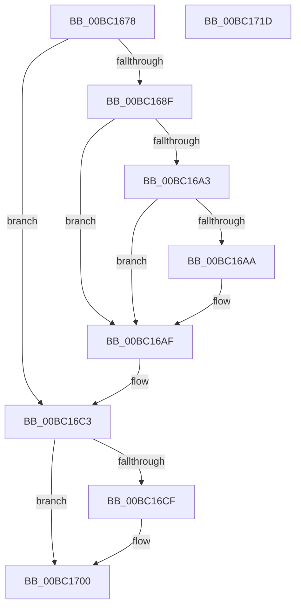

# BgpFwLibraryDestroy

- RVA: `0x00BC1678`–`0x00BC171E` (길이 `166` bytes)
- VA: `0x0000000140BC1678`
- 실행 섹션: `PAGEBGFX`
- PDB 이름 있음: `예`; PDB Function 태그: `아니요`
- unwind 정보 RVA: `0x0005C788`
- 디코드: `38`개 명령, `166/166` bytes 표시
- 미해석 바이트: `0` (있으면 어셈블리에 `.byte`로 보존)

> 이 문서는 커널 이미지의 기계어와 PDB 기호를 분석해 생성했습니다. 4번과 5번은 함수 원형과 자료형을 바이너리 사용 방식에서 추정한 C 해석이며 원본 소스 복구 결과는 아닙니다.

## 1. Dependencies

- 직접 호출 지점: **8**; 고유 호출 대상: **5**
- 직접 호출자로 확인된 함수: **2**
- RIP 상대 이미지 참조: **8**

### Outgoing calls
- `0x00BC167E` → [BgpFoDestroy](BgpFoDestroy_function_00BC273C.md) (function, `0x00BC273C`)
- `0x00BC168F` → [BgpFoDestroy](BgpFoDestroy_function_00BC273C.md) (function, `0x00BC273C`)
- `0x00BC16AA` → [BgpFwFreeMemory](../../text/3E/BgpFwFreeMemory_function_003E25E0.md) (function, `0x003E25E0`)
- `0x00BC16B6` → [BgpFwFreeMemory](../../text/3E/BgpFwFreeMemory_function_003E25E0.md) (function, `0x003E25E0`)
- `0x00BC16CF` → [BgpFwFreeMemory](../../text/3E/BgpFwFreeMemory_function_003E25E0.md) (function, `0x003E25E0`)
- `0x00BC16E3` → [BgpFwInitializeReservePool](BgpFwInitializeReservePool_function_00BC1634.md) (function, `0x00BC1634`)
- `0x00BC1700` → [BgpFwLibraryDisable](BgpFwLibraryDisable_function_00BC1724.md) (function, `0x00BC1724`)
- `0x00BC170A` → [ResFwBackgroundTransition](ResFwBackgroundTransition_function_00BC5D28.md) (function, `0x00BC5D28`)

### Direct callers
- [BgkDestroy](BgkDestroy_function_00BC0170.md) at `0x00BC020C`
- [BgpFwLibraryInitialize](BgpFwLibraryInitialize_function_00BC5400.md) at `0x00BC5816`

### Static image references
- `0x00BC1683` → RVA `0x00EF04F8` (`.data`; read)
- `0x00BC16BB` → RVA `0x00EF04F8` (`.data`; read/write)
- `0x00BC16C3` → RVA `0x00EF0480` (`.data`; read)
- `0x00BC16D4` → RVA `0x00EF0480` (`.data`; read/write)
- `0x00BC16E8` → RVA `0x00EF0500` (`.data`; read/write)
- `0x00BC16F0` → RVA `0x00EF0518` (`.data`; read/write)
- `0x00BC16F8` → RVA `0x00EF0510` (`.data`; read/write)
- `0x00BC170F` → RVA `0x00EF0450` (`.data`; read/write)

## 2. Other-region calls and transfers

- 다른 실행 섹션으로 향하는 call: **3**
  - `0x00BC16AA` → [BgpFwFreeMemory](../../text/3E/BgpFwFreeMemory_function_003E25E0.md) (`PAGEBGFX` → `.text`)
  - `0x00BC16B6` → [BgpFwFreeMemory](../../text/3E/BgpFwFreeMemory_function_003E25E0.md) (`PAGEBGFX` → `.text`)
  - `0x00BC16CF` → [BgpFwFreeMemory](../../text/3E/BgpFwFreeMemory_function_003E25E0.md) (`PAGEBGFX` → `.text`)
- 별도 외부 분기/꼬리 이동을 확인하지 못했습니다.

## 3. Assembly (complete function range)

```asm
00BC1678  48 83 EC 28                     sub rsp, 0x28
00BC167C  33 C9                           xor ecx, ecx
00BC167E  E8 B9 10 00 00                  call 0x140bc273c
00BC1683  48 8B 0D 6E EE 32 00            mov rcx, qword ptr [rip + 0x32ee6e]
00BC168A  48 85 C9                        test rcx, rcx
00BC168D  74 34                           je 0x140bc16c3
00BC168F  E8 A8 10 00 00                  call 0x140bc273c
00BC1694  48 8B 05 5D EE 32 00            mov rax, qword ptr [rip + 0x32ee5d]
00BC169B  48 8B 08                        mov rcx, qword ptr [rax]
00BC169E  48 85 C9                        test rcx, rcx
00BC16A1  74 0C                           je 0x140bc16af
00BC16A3  8B 40 0C                        mov eax, dword ptr [rax + 0xc]
00BC16A6  A8 01                           test al, 1
00BC16A8  75 05                           jne 0x140bc16af
00BC16AA  E8 31 0F 82 FF                  call 0x1403e25e0
00BC16AF  48 8B 0D 42 EE 32 00            mov rcx, qword ptr [rip + 0x32ee42]
00BC16B6  E8 25 0F 82 FF                  call 0x1403e25e0
00BC16BB  48 83 25 35 EE 32 00 00         and qword ptr [rip + 0x32ee35], 0
00BC16C3  48 8B 0D B6 ED 32 00            mov rcx, qword ptr [rip + 0x32edb6]
00BC16CA  48 85 C9                        test rcx, rcx
00BC16CD  74 31                           je 0x140bc1700
00BC16CF  E8 0C 0F 82 FF                  call 0x1403e25e0
00BC16D4  48 83 25 A4 ED 32 00 00         and qword ptr [rip + 0x32eda4], 0
00BC16DC  45 33 C0                        xor r8d, r8d
00BC16DF  33 D2                           xor edx, edx
00BC16E1  33 C9                           xor ecx, ecx
00BC16E3  E8 4C FF FF FF                  call 0x140bc1634
00BC16E8  48 83 25 10 EE 32 00 00         and qword ptr [rip + 0x32ee10], 0
00BC16F0  48 83 25 20 EE 32 00 00         and qword ptr [rip + 0x32ee20], 0
00BC16F8  48 83 25 10 EE 32 00 00         and qword ptr [rip + 0x32ee10], 0
00BC1700  E8 1F 00 00 00                  call 0x140bc1724
00BC1705  B9 02 00 00 00                  mov ecx, 2
00BC170A  E8 19 46 00 00                  call 0x140bc5d28
00BC170F  83 25 3A ED 32 00 00            and dword ptr [rip + 0x32ed3a], 0
00BC1716  33 C0                           xor eax, eax
00BC1718  48 83 C4 28                     add rsp, 0x28
00BC171C  C3                              ret
00BC171D  CC                              int3
```

## 4. C-style interpretation (structured pseudocode)

```c
__int64 __fastcall BgpFwLibraryDestroy(int a1, int a2, int a3)
{
    __int64 result;
    __int64 v_rsp;

    v_rsp = (v_rsp) - (40);
    a1 = 0;
    result = BgpFoDestroy(a1, a2, a3, a4);
    if (*(unsigned __int64 *)(v_rip + 3337838) == 0) goto loc_00BC16C3;
    result = BgpFoDestroy(*(unsigned __int64 *)(v_rip + 3337838), a2, a3, a4);
    if (*(unsigned __int64 *)(*(unsigned __int64 *)(v_rip + 3337821)) == 0) goto loc_00BC16AF;
    result = (unsigned int)(*(unsigned int *)(*(unsigned __int64 *)(v_rip + 3337821) + 12));
    if ((((unsigned __int8)((unsigned int)(*(unsigned int *)(*(unsigned __int64 *)(v_rip + 3337821) + 12)))) & (1)) == 0) {
        result = BgpFwFreeMemory(*(unsigned __int64 *)(*(unsigned __int64 *)(v_rip + 3337821)), a2, a3, a4);
    }
    result = BgpFwFreeMemory(*(unsigned __int64 *)(v_rip + 3337794), a2, a3, a4);
loc_00BC16C3:
    if (*(unsigned __int64 *)(v_rip + 3337654) != 0) {
        result = BgpFwFreeMemory(*(unsigned __int64 *)(v_rip + 3337654), a2, a3, a4);
        a3 = 0;
        a2 = 0;
        a1 = 0;
        result = BgpFwInitializeReservePool(a1, a2, a3, a4);
    }
    result = BgpFwLibraryDisable(a1, a2, a3, a4);
    result = ResFwBackgroundTransition(2, a2, a3, a4);
    result = 0;
    v_rsp = (v_rsp) + (40);
    return result;
}
```

## 5. (Beta) C Style

```c
int64_t BgpFwLibraryDestroy(int32_t Arg1, int32_t Arg2, int32_t Arg3)
{
    int64_t result;
    int64_t local_rsp;

    local_rsp = (local_rsp) - (40);
    Arg1 = 0;
    result = BgpFoDestroy(Arg1, Arg2, Arg3, a4);
    if (*(uint64_t *)(v_rip + 0x32EE6E) == 0) goto loc_00BC16C3;
    result = BgpFoDestroy(*(uint64_t *)(v_rip + 0x32EE6E), Arg2, Arg3, a4);
    if (*(uint64_t *)(*(uint64_t *)(v_rip + 0x32EE5D)) == 0) goto loc_00BC16AF;
    result = (uint32_t)(*(uint32_t *)(*(uint64_t *)(v_rip + 0x32EE5D) + 0xC));
    if ((((uint8_t)((uint32_t)(*(uint32_t *)(*(uint64_t *)(v_rip + 0x32EE5D) + 0xC)))) & (1)) == 0) {
        result = BgpFwFreeMemory(*(uint64_t *)(*(uint64_t *)(v_rip + 0x32EE5D)), Arg2, Arg3, a4);
    }
    result = BgpFwFreeMemory(*(uint64_t *)(v_rip + 0x32EE42), Arg2, Arg3, a4);
loc_00BC16C3:
    if (*(uint64_t *)(v_rip + 0x32EDB6) != 0) {
        result = BgpFwFreeMemory(*(uint64_t *)(v_rip + 0x32EDB6), Arg2, Arg3, a4);
        Arg3 = 0;
        Arg2 = 0;
        Arg1 = 0;
        result = BgpFwInitializeReservePool(Arg1, Arg2, Arg3, a4);
    }
    result = BgpFwLibraryDisable(Arg1, Arg2, Arg3, a4);
    result = ResFwBackgroundTransition(2, Arg2, Arg3, a4);
    result = 0;
    local_rsp = (local_rsp) + (40);
    return result;
}
```

## 6. Execution-region graph

[열기: 2D/3D 그래프와 함수 탐색 컨트롤 패널](../../../control-panel.html?section=pagebgfx&rva=0x00BC1678&view=graph)

- 2D 그래프는 위에서 아래로 흐르고, 3D 그래프는 빈 공간을 드래그해 회전합니다. Shift+드래그는 이동, 휠은 확대·축소, 함수 노드 선택은 대상 보고서 이동입니다.

### Static fallback


