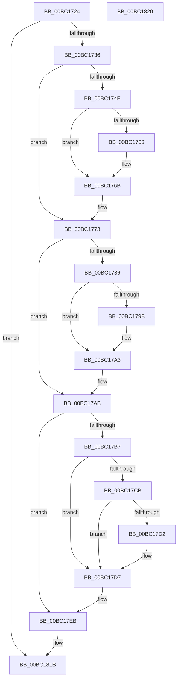

# BgpFwLibraryDisable

- RVA: `0x00BC1724`–`0x00BC1821` (길이 `253` bytes)
- VA: `0x0000000140BC1724`
- 실행 섹션: `PAGEBGFX`
- PDB 이름 있음: `예`; PDB Function 태그: `아니요`
- unwind 정보 RVA: `0x0005C788`
- 디코드: `54`개 명령, `253/253` bytes 표시
- 미해석 바이트: `0` (있으면 어셈블리에 `.byte`로 보존)

> 이 문서는 커널 이미지의 기계어와 PDB 기호를 분석해 생성했습니다. 4번과 5번은 함수 원형과 자료형을 바이너리 사용 방식에서 추정한 C 해석이며 원본 소스 복구 결과는 아닙니다.

## 1. Dependencies

- 직접 호출 지점: **10**; 고유 호출 대상: **8**
- 직접 호출자로 확인된 함수: **2**
- RIP 상대 이미지 참조: **15**

### Outgoing calls
- `0x00BC1738` → [AnFwDisplayBackgroundUpdate](AnFwDisplayBackgroundUpdate_function_00BC1E44.md) (function, `0x00BC1E44`)
- `0x00BC173D` → [AnFwFadeCompletion](AnFwFadeCompletion_function_00BC358C.md) (function, `0x00BC358C`)
- `0x00BC174E` → [BgpTxtDestroyRegion](BgpTxtDestroyRegion_function_00BC2B5C.md) (function, `0x00BC2B5C`)
- `0x00BC1775` → [AnFwDisplayProgressIndicator](AnFwDisplayProgressIndicator_function_00BC1FD0.md) (function, `0x00BC1FD0`)
- `0x00BC1786` → [BgpTxtDestroyRegion](BgpTxtDestroyRegion_function_00BC2B5C.md) (function, `0x00BC2B5C`)
- `0x00BC17B7` → [BgpFoDestroy](BgpFoDestroy_function_00BC273C.md) (function, `0x00BC273C`)
- `0x00BC17D2` → [BgpFwFreeMemory](../../text/3E/BgpFwFreeMemory_function_003E25E0.md) (function, `0x003E25E0`)
- `0x00BC17DE` → [BgpFwFreeMemory](../../text/3E/BgpFwFreeMemory_function_003E25E0.md) (function, `0x003E25E0`)
- `0x00BC17EB` → [LogFwReport](LogFwReport_function_00BC43FC.md) (function, `0x00BC43FC`)
- `0x00BC17F5` → [ResFwBackgroundTransition](ResFwBackgroundTransition_function_00BC5D28.md) (function, `0x00BC5D28`)

### Direct callers
- [BgLibraryDisable](BgLibraryDisable_function_00BC0724.md) at `0x00BC0746`
- [BgpFwLibraryDestroy](BgpFwLibraryDestroy_function_00BC1678.md) at `0x00BC1700`

### Static image references
- `0x00BC1728` → RVA `0x00EF0450` (`.data`; read)
- `0x00BC1742` → RVA `0x00EF0518` (`.data`; read)
- `0x00BC175A` → RVA `0x00EEFED0` (`.data`; read)
- `0x00BC1763` → RVA `0x00EEFED0` (`.data`; read/write)
- `0x00BC176B` → RVA `0x00EF0518` (`.data`; read/write)
- `0x00BC177A` → RVA `0x00EF0510` (`.data`; read)
- `0x00BC1792` → RVA `0x00EEFED8` (`.data`; read)
- `0x00BC179B` → RVA `0x00EEFED8` (`.data`; read/write)
- `0x00BC17A3` → RVA `0x00EF0510` (`.data`; read/write)
- `0x00BC17AB` → RVA `0x00EF04F8` (`.data`; read)
- `0x00BC17E3` → RVA `0x00EF04F8` (`.data`; read/write)
- `0x00BC17FF` → RVA `0x00EF0450` (`.data`; read/write)
- `0x00BC1806` → RVA `0x00EF03E0` (`.data`; read)
- `0x00BC180D` → RVA `0x00EF0400` (`.data`; write)
- `0x00BC1814` → RVA `0x00EF03F0` (`.data`; read)

## 2. Other-region calls and transfers

- 다른 실행 섹션으로 향하는 call: **2**
  - `0x00BC17D2` → [BgpFwFreeMemory](../../text/3E/BgpFwFreeMemory_function_003E25E0.md) (`PAGEBGFX` → `.text`)
  - `0x00BC17DE` → [BgpFwFreeMemory](../../text/3E/BgpFwFreeMemory_function_003E25E0.md) (`PAGEBGFX` → `.text`)
- 별도 외부 분기/꼬리 이동을 확인하지 못했습니다.

## 3. Assembly (complete function range)

```asm
00BC1724  48 83 EC 28                     sub rsp, 0x28
00BC1728  8B 05 22 ED 32 00               mov eax, dword ptr [rip + 0x32ed22]
00BC172E  A8 02                           test al, 2
00BC1730  0F 84 E5 00 00 00               je 0x140bc181b
00BC1736  33 C9                           xor ecx, ecx
00BC1738  E8 07 07 00 00                  call 0x140bc1e44
00BC173D  E8 4A 1E 00 00                  call 0x140bc358c
00BC1742  48 8B 0D CF ED 32 00            mov rcx, qword ptr [rip + 0x32edcf]
00BC1749  48 85 C9                        test rcx, rcx
00BC174C  74 25                           je 0x140bc1773
00BC174E  E8 09 14 00 00                  call 0x140bc2b5c
00BC1753  48 8B 05 BE ED 32 00            mov rax, qword ptr [rip + 0x32edbe]
00BC175A  48 39 05 6F E7 32 00            cmp qword ptr [rip + 0x32e76f], rax
00BC1761  75 08                           jne 0x140bc176b
00BC1763  48 83 25 65 E7 32 00 00         and qword ptr [rip + 0x32e765], 0
00BC176B  48 83 25 A5 ED 32 00 00         and qword ptr [rip + 0x32eda5], 0
00BC1773  33 C9                           xor ecx, ecx
00BC1775  E8 56 08 00 00                  call 0x140bc1fd0
00BC177A  48 8B 0D 8F ED 32 00            mov rcx, qword ptr [rip + 0x32ed8f]
00BC1781  48 85 C9                        test rcx, rcx
00BC1784  74 25                           je 0x140bc17ab
00BC1786  E8 D1 13 00 00                  call 0x140bc2b5c
00BC178B  48 8B 05 7E ED 32 00            mov rax, qword ptr [rip + 0x32ed7e]
00BC1792  48 39 05 3F E7 32 00            cmp qword ptr [rip + 0x32e73f], rax
00BC1799  75 08                           jne 0x140bc17a3
00BC179B  48 83 25 35 E7 32 00 00         and qword ptr [rip + 0x32e735], 0
00BC17A3  48 83 25 65 ED 32 00 00         and qword ptr [rip + 0x32ed65], 0
00BC17AB  48 8B 0D 46 ED 32 00            mov rcx, qword ptr [rip + 0x32ed46]
00BC17B2  48 85 C9                        test rcx, rcx
00BC17B5  74 34                           je 0x140bc17eb
00BC17B7  E8 80 0F 00 00                  call 0x140bc273c
00BC17BC  48 8B 05 35 ED 32 00            mov rax, qword ptr [rip + 0x32ed35]
00BC17C3  48 8B 08                        mov rcx, qword ptr [rax]
00BC17C6  48 85 C9                        test rcx, rcx
00BC17C9  74 0C                           je 0x140bc17d7
00BC17CB  8B 40 0C                        mov eax, dword ptr [rax + 0xc]
00BC17CE  A8 01                           test al, 1
00BC17D0  75 05                           jne 0x140bc17d7
00BC17D2  E8 09 0E 82 FF                  call 0x1403e25e0
00BC17D7  48 8B 0D 1A ED 32 00            mov rcx, qword ptr [rip + 0x32ed1a]
00BC17DE  E8 FD 0D 82 FF                  call 0x1403e25e0
00BC17E3  48 83 25 0D ED 32 00 00         and qword ptr [rip + 0x32ed0d], 0
00BC17EB  E8 0C 2C 00 00                  call 0x140bc43fc
00BC17F0  B9 01 00 00 00                  mov ecx, 1
00BC17F5  E8 2E 45 00 00                  call 0x140bc5d28
00BC17FA  0F 57 C0                        xorps xmm0, xmm0
00BC17FD  33 C0                           xor eax, eax
00BC17FF  83 25 4A EC 32 00 FD            and dword ptr [rip + 0x32ec4a], 0xfffffffd
00BC1806  0F 11 05 D3 EB 32 00            movups xmmword ptr [rip + 0x32ebd3], xmm0
00BC180D  48 89 05 EC EB 32 00            mov qword ptr [rip + 0x32ebec], rax
00BC1814  0F 11 05 D5 EB 32 00            movups xmmword ptr [rip + 0x32ebd5], xmm0
00BC181B  48 83 C4 28                     add rsp, 0x28
00BC181F  C3                              ret
00BC1820  CC                              int3
```

## 4. C-style interpretation (structured pseudocode)

```c
__int64 __fastcall BgpFwLibraryDisable(int a1)
{
    __int64 result;
    __int64 v_rsp;

    v_rsp = (v_rsp) - (40);
    if ((((unsigned __int8)((unsigned int)(*(unsigned int *)(v_rip + 3337506)))) & (2)) == 0) goto loc_00BC181B;
    a1 = 0;
    result = AnFwDisplayBackgroundUpdate(a1, a2, a3, a4);
    result = AnFwFadeCompletion(a1, a2, a3, a4);
    if (*(unsigned __int64 *)(v_rip + 3337679) == 0) goto loc_00BC1773;
    result = BgpTxtDestroyRegion(*(unsigned __int64 *)(v_rip + 3337679), a2, a3, a4);
    if ((*(unsigned __int64 *)(v_rip + 3336047)) == (*(unsigned __int64 *)(v_rip + 3337662))) {
    }
loc_00BC1773:
    a1 = 0;
    result = AnFwDisplayProgressIndicator(a1, a2, a3, a4);
    if (*(unsigned __int64 *)(v_rip + 3337615) == 0) goto loc_00BC17AB;
    result = BgpTxtDestroyRegion(*(unsigned __int64 *)(v_rip + 3337615), a2, a3, a4);
    if ((*(unsigned __int64 *)(v_rip + 3335999)) == (*(unsigned __int64 *)(v_rip + 3337598))) {
    }
loc_00BC17AB:
    if (*(unsigned __int64 *)(v_rip + 3337542) == 0) goto loc_00BC17EB;
    result = BgpFoDestroy(*(unsigned __int64 *)(v_rip + 3337542), a2, a3, a4);
    if (*(unsigned __int64 *)(*(unsigned __int64 *)(v_rip + 3337525)) == 0) goto loc_00BC17D7;
    result = (unsigned int)(*(unsigned int *)(*(unsigned __int64 *)(v_rip + 3337525) + 12));
    if ((((unsigned __int8)((unsigned int)(*(unsigned int *)(*(unsigned __int64 *)(v_rip + 3337525) + 12)))) & (1)) == 0) {
        result = BgpFwFreeMemory(*(unsigned __int64 *)(*(unsigned __int64 *)(v_rip + 3337525)), a2, a3, a4);
    }
    result = BgpFwFreeMemory(*(unsigned __int64 *)(v_rip + 3337498), a2, a3, a4);
loc_00BC17EB:
    result = LogFwReport(*(unsigned __int64 *)(v_rip + 3337498), a2, a3, a4);
    result = ResFwBackgroundTransition(1, a2, a3, a4);
    result = 0;
    *(unsigned __int64 *)(v_rip + 3337171) = v_xmm0;
    *(unsigned __int64 *)(v_rip + 3337196) = 0;
    *(unsigned __int64 *)(v_rip + 3337173) = v_xmm0;
loc_00BC181B:
    v_rsp = (v_rsp) + (40);
    return result;
}
```

## 5. (Beta) C Style

```c
int64_t BgpFwLibraryDisable(int32_t Arg1)
{
    int64_t result;
    int64_t local_rsp;

    local_rsp = (local_rsp) - (40);
    if ((((uint8_t)((uint32_t)(*(uint32_t *)(v_rip + 0x32ED22)))) & (2)) == 0) goto loc_00BC181B;
    Arg1 = 0;
    result = AnFwDisplayBackgroundUpdate(Arg1, a2, a3, a4);
    result = AnFwFadeCompletion(Arg1, a2, a3, a4);
    if (*(uint64_t *)(v_rip + 0x32EDCF) == 0) goto loc_00BC1773;
    result = BgpTxtDestroyRegion(*(uint64_t *)(v_rip + 0x32EDCF), a2, a3, a4);
    if ((*(uint64_t *)(v_rip + 0x32E76F)) == (*(uint64_t *)(v_rip + 0x32EDBE))) {
    }
loc_00BC1773:
    Arg1 = 0;
    result = AnFwDisplayProgressIndicator(Arg1, a2, a3, a4);
    if (*(uint64_t *)(v_rip + 0x32ED8F) == 0) goto loc_00BC17AB;
    result = BgpTxtDestroyRegion(*(uint64_t *)(v_rip + 0x32ED8F), a2, a3, a4);
    if ((*(uint64_t *)(v_rip + 0x32E73F)) == (*(uint64_t *)(v_rip + 0x32ED7E))) {
    }
loc_00BC17AB:
    if (*(uint64_t *)(v_rip + 0x32ED46) == 0) goto loc_00BC17EB;
    result = BgpFoDestroy(*(uint64_t *)(v_rip + 0x32ED46), a2, a3, a4);
    if (*(uint64_t *)(*(uint64_t *)(v_rip + 0x32ED35)) == 0) goto loc_00BC17D7;
    result = (uint32_t)(*(uint32_t *)(*(uint64_t *)(v_rip + 0x32ED35) + 0xC));
    if ((((uint8_t)((uint32_t)(*(uint32_t *)(*(uint64_t *)(v_rip + 0x32ED35) + 0xC)))) & (1)) == 0) {
        result = BgpFwFreeMemory(*(uint64_t *)(*(uint64_t *)(v_rip + 0x32ED35)), a2, a3, a4);
    }
    result = BgpFwFreeMemory(*(uint64_t *)(v_rip + 0x32ED1A), a2, a3, a4);
loc_00BC17EB:
    result = LogFwReport(*(uint64_t *)(v_rip + 0x32ED1A), a2, a3, a4);
    result = ResFwBackgroundTransition(1, a2, a3, a4);
    result = 0;
    *(uint64_t *)(v_rip + 0x32EBD3) = v_xmm0;
    *(uint64_t *)(v_rip + 0x32EBEC) = 0;
    *(uint64_t *)(v_rip + 0x32EBD5) = v_xmm0;
loc_00BC181B:
    local_rsp = (local_rsp) + (40);
    return result;
}
```

## 6. Execution-region graph

[열기: 2D/3D 그래프와 함수 탐색 컨트롤 패널](../../../control-panel.html?section=pagebgfx&rva=0x00BC1724&view=graph)

- 2D 그래프는 위에서 아래로 흐르고, 3D 그래프는 빈 공간을 드래그해 회전합니다. Shift+드래그는 이동, 휠은 확대·축소, 함수 노드 선택은 대상 보고서 이동입니다.

### Static fallback


