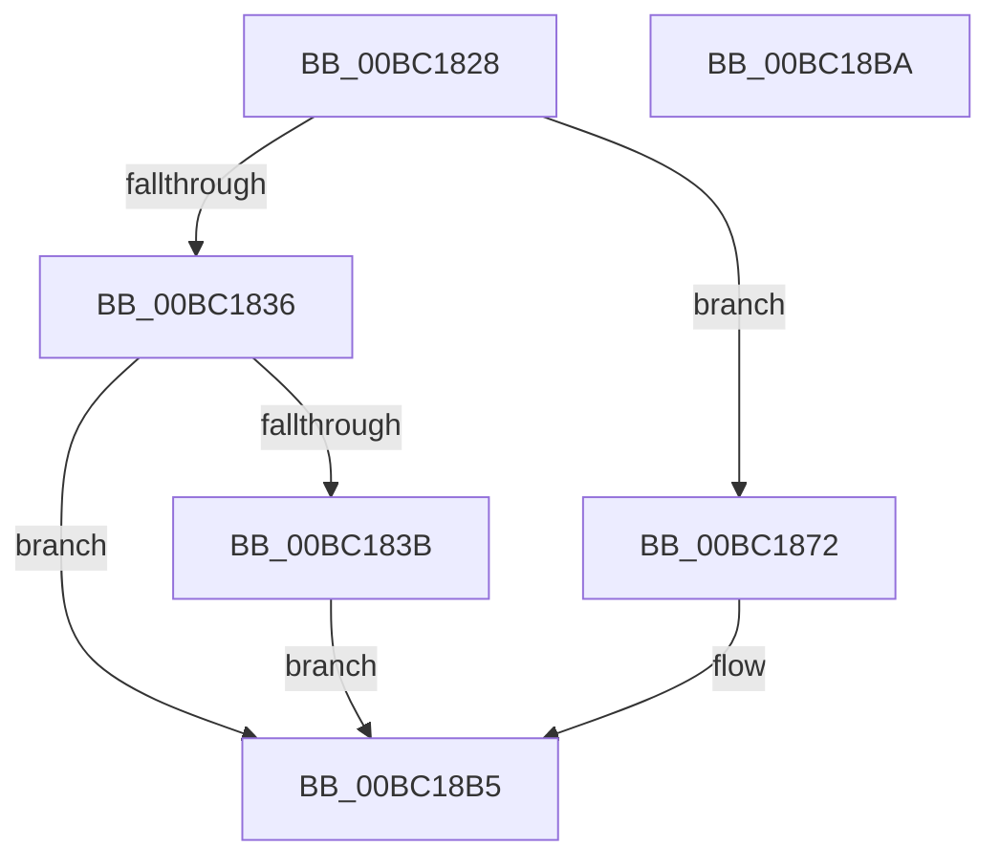

# BgpFwReservePoolSwap

- RVA: `0x00BC1828`–`0x00BC18BB` (길이 `147` bytes)
- VA: `0x0000000140BC1828`
- 실행 섹션: `PAGEBGFX`
- PDB 이름 있음: `예`; PDB Function 태그: `아니요`
- unwind 정보 RVA: `0x0005C788`
- 디코드: `31`개 명령, `147/147` bytes 표시
- 미해석 바이트: `0` (있으면 어셈블리에 `.byte`로 보존)

> 이 문서는 커널 이미지의 기계어와 PDB 기호를 분석해 생성했습니다. 4번과 5번은 함수 원형과 자료형을 바이너리 사용 방식에서 추정한 C 해석이며 원본 소스 복구 결과는 아닙니다.

## 1. Dependencies

- 직접 호출 지점: **1**; 고유 호출 대상: **1**
- 직접 호출자로 확인된 함수: **2**
- RIP 상대 이미지 참조: **16**

### Outgoing calls
- `0x00BC18B0` → [BgpFwInitializeReservePool](BgpFwInitializeReservePool_function_00BC1634.md) (function, `0x00BC1634`)

### Direct callers
- [ResFwFreeContext](ResFwFreeContext_function_00BC34C4.md) at `0x00BC3521`
- [BgpFwLibraryInitialize](BgpFwLibraryInitialize_function_00BC5400.md) at `0x00BC54E0`

### Static image references
- `0x00BC183B` → RVA `0x00E64F50` (`.data`; read)
- `0x00BC1842` → RVA `0x00E64F70` (`.data`; read)
- `0x00BC1849` → RVA `0x00E62388` (`.data`; write)
- `0x00BC1850` → RVA `0x00E3EE30` (`.data`; read)
- `0x00BC1856` → RVA `0x00E3EE38` (`.data`; write)
- `0x00BC185C` → RVA `0x00E3EE2C` (`.data`; read)
- `0x00BC1862` → RVA `0x00E3EE34` (`.data`; write)
- `0x00BC1868` → RVA `0x00E64F58` (`.data`; write)
- `0x00BC1872` → RVA `0x00E3EE34` (`.data`; read)
- `0x00BC187B` → RVA `0x00E64F58` (`.data`; read)
- `0x00BC1882` → RVA `0x00E3EE2C` (`.data`; write)
- `0x00BC188B` → RVA `0x00E62388` (`.data`; read)
- `0x00BC1895` → RVA `0x00E64F50` (`.data`; write)
- `0x00BC189C` → RVA `0x00E3EE38` (`.data`; read)
- `0x00BC18A2` → RVA `0x00E3EE30` (`.data`; write)
- `0x00BC18A8` → RVA `0x00E64F70` (`.data`; write)

## 2. Other-region calls and transfers

- 다른 실행 섹션으로 향하는 call: **0**
- 별도 외부 분기/꼬리 이동을 확인하지 못했습니다.

## 3. Assembly (complete function range)

```asm
00BC1828  48 83 EC 28                     sub rsp, 0x28
00BC182C  45 8B D0                        mov r10d, r8d
00BC182F  4C 8B DA                        mov r11, rdx
00BC1832  85 C9                           test ecx, ecx
00BC1834  74 3C                           je 0x140bc1872
00BC1836  83 F9 01                        cmp ecx, 1
00BC1839  75 7A                           jne 0x140bc18b5
00BC183B  48 8B 05 0E 37 2A 00            mov rax, qword ptr [rip + 0x2a370e]
00BC1842  0F 10 05 27 37 2A 00            movups xmm0, xmmword ptr [rip + 0x2a3727]
00BC1849  48 89 05 38 0B 2A 00            mov qword ptr [rip + 0x2a0b38], rax
00BC1850  8B 05 DA D5 27 00               mov eax, dword ptr [rip + 0x27d5da]
00BC1856  89 05 DC D5 27 00               mov dword ptr [rip + 0x27d5dc], eax
00BC185C  8B 05 CA D5 27 00               mov eax, dword ptr [rip + 0x27d5ca]
00BC1862  89 05 CC D5 27 00               mov dword ptr [rip + 0x27d5cc], eax
00BC1868  F3 0F 7F 05 E8 36 2A 00         movdqu xmmword ptr [rip + 0x2a36e8], xmm0
00BC1870  EB 43                           jmp 0x140bc18b5
00BC1872  8B 05 BC D5 27 00               mov eax, dword ptr [rip + 0x27d5bc]
00BC1878  4D 8B C1                        mov r8, r9
00BC187B  0F 10 05 D6 36 2A 00            movups xmm0, xmmword ptr [rip + 0x2a36d6]
00BC1882  89 05 A4 D5 27 00               mov dword ptr [rip + 0x27d5a4], eax
00BC1888  41 8B D2                        mov edx, r10d
00BC188B  48 8B 05 F6 0A 2A 00            mov rax, qword ptr [rip + 0x2a0af6]
00BC1892  49 8B CB                        mov rcx, r11
00BC1895  48 89 05 B4 36 2A 00            mov qword ptr [rip + 0x2a36b4], rax
00BC189C  8B 05 96 D5 27 00               mov eax, dword ptr [rip + 0x27d596]
00BC18A2  89 05 88 D5 27 00               mov dword ptr [rip + 0x27d588], eax
00BC18A8  F3 0F 7F 05 C0 36 2A 00         movdqu xmmword ptr [rip + 0x2a36c0], xmm0
00BC18B0  E8 7F FD FF FF                  call 0x140bc1634
00BC18B5  48 83 C4 28                     add rsp, 0x28
00BC18B9  C3                              ret
00BC18BA  CC                              int3
```

## 4. C-style interpretation (structured pseudocode)

```c
__int64 __fastcall BgpFwReservePoolSwap(int a1, __int64 a2, int a3, __int64 a4)
{
    __int64 result;
    __int64 v_rsp;

    v_rsp = (v_rsp) - (40);
    if (a1 == 0) goto loc_00BC1872;
    if (a1 != 1) goto loc_00BC18B5;
    *(unsigned __int64 *)(v_rip + 2755384) = *(unsigned __int64 *)(v_rip + 2766606);
    *(unsigned int *)(v_rip + 2610652) = (unsigned int)((unsigned int)(*(unsigned int *)(v_rip + 2610650)));
    *(unsigned int *)(v_rip + 2610636) = (unsigned int)((unsigned int)(*(unsigned int *)(v_rip + 2610634)));
    *(unsigned __int64 *)(v_rip + 2766568) = v_xmm0;
    goto loc_00BC18B5;
loc_00BC1872:
    *(unsigned int *)(v_rip + 2610596) = (unsigned int)((unsigned int)(*(unsigned int *)(v_rip + 2610620)));
    *(unsigned __int64 *)(v_rip + 2766516) = *(unsigned __int64 *)(v_rip + 2755318);
    *(unsigned int *)(v_rip + 2610568) = (unsigned int)((unsigned int)(*(unsigned int *)(v_rip + 2610582)));
    *(unsigned __int64 *)(v_rip + 2766528) = v_xmm0;
    result = BgpFwInitializeReservePool(a2, (unsigned int)((unsigned int)((unsigned int)(a3))), a4, a4);
loc_00BC18B5:
    v_rsp = (v_rsp) + (40);
    return result;
}
```

## 5. (Beta) C Style

```c
int64_t BgpFwReservePoolSwap(int32_t Arg1, int64_t Arg2, int32_t Arg3, int64_t Arg4)
{
    int64_t result;
    int64_t local_rsp;

    local_rsp = (local_rsp) - (40);
    if (Arg1 == 0) goto loc_00BC1872;
    if (Arg1 != 1) goto loc_00BC18B5;
    *(uint64_t *)(v_rip + 0x2A0B38) = *(uint64_t *)(v_rip + 0x2A370E);
    *(uint32_t *)(v_rip + 0x27D5DC) = (uint32_t)((uint32_t)(*(uint32_t *)(v_rip + 0x27D5DA)));
    *(uint32_t *)(v_rip + 0x27D5CC) = (uint32_t)((uint32_t)(*(uint32_t *)(v_rip + 0x27D5CA)));
    *(uint64_t *)(v_rip + 0x2A36E8) = v_xmm0;
    goto loc_00BC18B5;
loc_00BC1872:
    *(uint32_t *)(v_rip + 0x27D5A4) = (uint32_t)((uint32_t)(*(uint32_t *)(v_rip + 0x27D5BC)));
    *(uint64_t *)(v_rip + 0x2A36B4) = *(uint64_t *)(v_rip + 0x2A0AF6);
    *(uint32_t *)(v_rip + 0x27D588) = (uint32_t)((uint32_t)(*(uint32_t *)(v_rip + 0x27D596)));
    *(uint64_t *)(v_rip + 0x2A36C0) = v_xmm0;
    result = BgpFwInitializeReservePool(Arg2, (uint32_t)((uint32_t)((uint32_t)(Arg3))), Arg4, Arg4);
loc_00BC18B5:
    local_rsp = (local_rsp) + (40);
    return result;
}
```

## 6. Execution-region graph

[열기: 2D/3D 그래프와 함수 탐색 컨트롤 패널](../../../control-panel.html?section=pagebgfx&rva=0x00BC1828&view=graph)

- 2D 그래프는 위에서 아래로 흐르고, 3D 그래프는 빈 공간을 드래그해 회전합니다. Shift+드래그는 이동, 휠은 확대·축소, 함수 노드 선택은 대상 보고서 이동입니다.

### Static fallback


