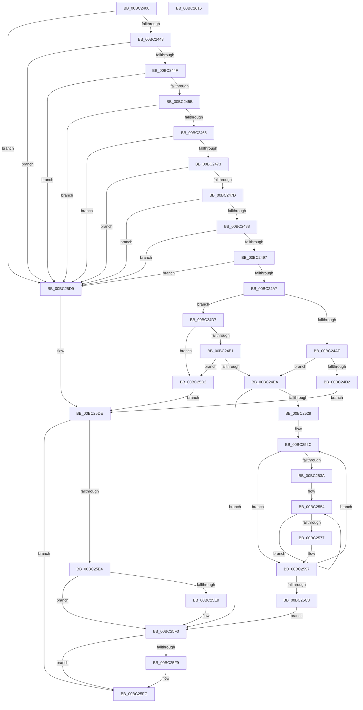

# BgpGxBlendRectangle

- RVA: `0x00BC2400`–`0x00BC2617` (길이 `535` bytes)
- VA: `0x0000000140BC2400`
- 실행 섹션: `PAGEBGFX`
- PDB 이름 있음: `예`; PDB Function 태그: `아니요`
- unwind 정보 RVA: `0x000DA454`
- 디코드: `151`개 명령, `535/535` bytes 표시
- 미해석 바이트: `0` (있으면 어셈블리에 `.byte`로 보존)

> 이 문서는 커널 이미지의 기계어와 PDB 기호를 분석해 생성했습니다. 4번과 5번은 함수 원형과 자료형을 바이너리 사용 방식에서 추정한 C 해석이며 원본 소스 복구 결과는 아닙니다.

## 1. Dependencies

- 직접 호출 지점: **3**; 고유 호출 대상: **3**
- 직접 호출자로 확인된 함수: **2**
- RIP 상대 이미지 참조: **0**

### Outgoing calls
- `0x00BC24C2` → [BgpGxRectangleCreate](BgpGxRectangleCreate_function_00BC3E78.md) (function, `0x00BC3E78`)
- `0x00BC2560` → [BgpGxBlendColor](../../text/47/BgpGxBlendColor_function_0047F034.md) (function, `0x0047F034`)
- `0x00BC25EC` → [BgpGxRectangleDestroy](BgpGxRectangleDestroy_function_00BC3F04.md) (function, `0x00BC3F04`)

### Direct callers
- [BgpTxtDisplayCharacter](../../text/47/BgpTxtDisplayCharacter_function_0047F120.md) at `0x0047F294`
- [BgpTxtDisplayString](BgpTxtDisplayString_function_00BC2BB0.md) at `0x00BC2D59`

### Static image references
- 디코드된 RIP-relative 메모리 참조가 없습니다.

## 2. Other-region calls and transfers

- 다른 실행 섹션으로 향하는 call: **1**
  - `0x00BC2560` → [BgpGxBlendColor](../../text/47/BgpGxBlendColor_function_0047F034.md) (`PAGEBGFX` → `.text`)
- 별도 외부 분기/꼬리 이동을 확인하지 못했습니다.

## 3. Assembly (complete function range)

```asm
00BC2400  48 8B C4                        mov rax, rsp
00BC2403  48 89 58 18                     mov qword ptr [rax + 0x18], rbx
00BC2407  4C 89 48 20                     mov qword ptr [rax + 0x20], r9
00BC240B  48 89 50 10                     mov qword ptr [rax + 0x10], rdx
00BC240F  48 89 48 08                     mov qword ptr [rax + 8], rcx
00BC2413  55                              push rbp
00BC2414  56                              push rsi
00BC2415  57                              push rdi
00BC2416  41 54                           push r12
00BC2418  41 55                           push r13
00BC241A  41 56                           push r14
00BC241C  41 57                           push r15
00BC241E  48 83 EC 60                     sub rsp, 0x60
00BC2422  83 60 A8 00                     and dword ptr [rax - 0x58], 0
00BC2426  33 DB                           xor ebx, ebx
00BC2428  33 FF                           xor edi, edi
00BC242A  48 89 58 90                     mov qword ptr [rax - 0x70], rbx
00BC242E  49 8B F1                        mov rsi, r9
00BC2431  4D 8B E8                        mov r13, r8
00BC2434  4C 8B FA                        mov r15, rdx
00BC2437  4C 8B F1                        mov r14, rcx
00BC243A  4D 85 C9                        test r9, r9
00BC243D  0F 84 96 01 00 00               je 0x140bc25d9
00BC2443  44 8B 11                        mov r10d, dword ptr [rcx]
00BC2446  45 85 D2                        test r10d, r10d
00BC2449  0F 84 8A 01 00 00               je 0x140bc25d9
00BC244F  44 8B 02                        mov r8d, dword ptr [rdx]
00BC2452  45 85 C0                        test r8d, r8d
00BC2455  0F 84 7E 01 00 00               je 0x140bc25d9
00BC245B  8B 51 04                        mov edx, dword ptr [rcx + 4]
00BC245E  85 D2                           test edx, edx
00BC2460  0F 84 73 01 00 00               je 0x140bc25d9
00BC2466  45 8B 4F 04                     mov r9d, dword ptr [r15 + 4]
00BC246A  45 85 C9                        test r9d, r9d
00BC246D  0F 84 66 01 00 00               je 0x140bc25d9
00BC2473  83 79 08 20                     cmp dword ptr [rcx + 8], 0x20
00BC2477  0F 85 5C 01 00 00               jne 0x140bc25d9
00BC247D  41 83 7F 08 20                  cmp dword ptr [r15 + 8], 0x20
00BC2482  0F 85 51 01 00 00               jne 0x140bc25d9
00BC2488  41 8B 4D 00                     mov ecx, dword ptr [r13]
00BC248C  41 03 C9                        add ecx, r9d
00BC248F  3B D1                           cmp edx, ecx
00BC2491  0F 82 42 01 00 00               jb 0x140bc25d9
00BC2497  41 8B 4D 04                     mov ecx, dword ptr [r13 + 4]
00BC249B  41 03 C8                        add ecx, r8d
00BC249E  44 3B D1                        cmp r10d, ecx
00BC24A1  0F 82 32 01 00 00               jb 0x140bc25d9
00BC24A7  48 8B 1E                        mov rbx, qword ptr [rsi]
00BC24AA  48 85 DB                        test rbx, rbx
00BC24AD  75 28                           jne 0x140bc24d7
00BC24AF  44 89 40 A4                     mov dword ptr [rax - 0x5c], r8d
00BC24B3  8D 57 20                        lea edx, [rdi + 0x20]
00BC24B6  4C 8D 40 90                     lea r8, [rax - 0x70]
00BC24BA  44 89 48 A0                     mov dword ptr [rax - 0x60], r9d
00BC24BE  48 8D 48 A0                     lea rcx, [rax - 0x60]
00BC24C2  E8 B1 19 00 00                  call 0x140bc3e78
00BC24C7  48 8B 5C 24 28                  mov rbx, qword ptr [rsp + 0x28]
00BC24CC  8B F8                           mov edi, eax
00BC24CE  85 C0                           test eax, eax
00BC24D0  79 18                           jns 0x140bc24ea
00BC24D2  E9 07 01 00 00                  jmp 0x140bc25de
00BC24D7  44 39 4B 04                     cmp dword ptr [rbx + 4], r9d
00BC24DB  0F 85 F1 00 00 00               jne 0x140bc25d2
00BC24E1  44 39 03                        cmp dword ptr [rbx], r8d
00BC24E4  0F 85 E8 00 00 00               jne 0x140bc25d2
00BC24EA  45 8B 45 04                     mov r8d, dword ptr [r13 + 4]
00BC24EE  45 0F AF 46 04                  imul r8d, dword ptr [r14 + 4]
00BC24F3  8B 03                           mov eax, dword ptr [rbx]
00BC24F5  8B 6B 08                        mov ebp, dword ptr [rbx + 8]
00BC24F8  4C 8B 4B 18                     mov r9, qword ptr [rbx + 0x18]
00BC24FC  4D 8B 67 18                     mov r12, qword ptr [r15 + 0x18]
00BC2500  45 03 45 00                     add r8d, dword ptr [r13]
00BC2504  C1 ED 03                        shr ebp, 3
00BC2507  44 0F AF C5                     imul r8d, ebp
00BC250B  4C 89 4C 24 50                  mov qword ptr [rsp + 0x50], r9
00BC2510  89 6C 24 28                     mov dword ptr [rsp + 0x28], ebp
00BC2514  89 44 24 20                     mov dword ptr [rsp + 0x20], eax
00BC2518  4D 03 46 18                     add r8, qword ptr [r14 + 0x18]
00BC251C  4C 89 44 24 48                  mov qword ptr [rsp + 0x48], r8
00BC2521  85 C0                           test eax, eax
00BC2523  0F 84 CA 00 00 00               je 0x140bc25f3
00BC2529  8B 4B 04                        mov ecx, dword ptr [rbx + 4]
00BC252C  83 64 24 30 00                  and dword ptr [rsp + 0x30], 0
00BC2531  4D 8B EC                        mov r13, r12
00BC2534  8B D1                           mov edx, ecx
00BC2536  85 C9                           test ecx, ecx
00BC2538  74 5D                           je 0x140bc2597
00BC253A  44 8B 74 24 30                  mov r14d, dword ptr [rsp + 0x30]
00BC253F  49 8B F1                        mov rsi, r9
00BC2542  8B C5                           mov eax, ebp
00BC2544  49 2B F4                        sub rsi, r12
00BC2547  4D 8B F8                        mov r15, r8
00BC254A  48 89 44 24 38                  mov qword ptr [rsp + 0x38], rax
00BC254F  4D 2B FC                        sub r15, r12
00BC2552  8B E8                           mov ebp, eax
00BC2554  45 8A 45 03                     mov r8b, byte ptr [r13 + 3]
00BC2558  41 8B 55 00                     mov edx, dword ptr [r13]
00BC255C  43 8B 0C 2F                     mov ecx, dword ptr [r15 + r13]
00BC2560  E8 CF CA 8B FF                  call 0x14047f034
00BC2565  42 89 04 2E                     mov dword ptr [rsi + r13], eax
00BC2569  41 FF C6                        inc r14d
00BC256C  8B 4B 04                        mov ecx, dword ptr [rbx + 4]
00BC256F  4C 03 ED                        add r13, rbp
00BC2572  44 3B F1                        cmp r14d, ecx
00BC2575  72 DD                           jb 0x140bc2554
00BC2577  4C 8B B4 24 A0 00 00 00         mov r14, qword ptr [rsp + 0xa0]
00BC257F  8B D1                           mov edx, ecx
00BC2581  4C 8B BC 24 A8 00 00 00         mov r15, qword ptr [rsp + 0xa8]
00BC2589  8B 6C 24 28                     mov ebp, dword ptr [rsp + 0x28]
00BC258D  4C 8B 44 24 48                  mov r8, qword ptr [rsp + 0x48]
00BC2592  4C 8B 4C 24 50                  mov r9, qword ptr [rsp + 0x50]
00BC2597  8B C5                           mov eax, ebp
00BC2599  0F AF D5                        imul edx, ebp
00BC259C  41 0F AF 47 04                  imul eax, dword ptr [r15 + 4]
00BC25A1  4C 03 E0                        add r12, rax
00BC25A4  8B C5                           mov eax, ebp
00BC25A6  41 0F AF 46 04                  imul eax, dword ptr [r14 + 4]
00BC25AB  4C 03 C0                        add r8, rax
00BC25AE  8B C2                           mov eax, edx
00BC25B0  4C 03 C8                        add r9, rax
00BC25B3  4C 89 44 24 48                  mov qword ptr [rsp + 0x48], r8
00BC25B8  83 44 24 20 FF                  add dword ptr [rsp + 0x20], -1
00BC25BD  4C 89 4C 24 50                  mov qword ptr [rsp + 0x50], r9
00BC25C2  0F 85 64 FF FF FF               jne 0x140bc252c
00BC25C8  48 8B B4 24 B8 00 00 00         mov rsi, qword ptr [rsp + 0xb8]
00BC25D0  EB 21                           jmp 0x140bc25f3
00BC25D2  BF 9A 00 00 C0                  mov edi, 0xc000009a
00BC25D7  EB 05                           jmp 0x140bc25de
00BC25D9  BF 0D 00 00 C0                  mov edi, 0xc000000d
00BC25DE  48 83 3E 00                     cmp qword ptr [rsi], 0
00BC25E2  75 18                           jne 0x140bc25fc
00BC25E4  48 85 DB                        test rbx, rbx
00BC25E7  74 0A                           je 0x140bc25f3
00BC25E9  48 8B CB                        mov rcx, rbx
00BC25EC  E8 13 19 00 00                  call 0x140bc3f04
00BC25F1  33 DB                           xor ebx, ebx
00BC25F3  48 83 3E 00                     cmp qword ptr [rsi], 0
00BC25F7  75 03                           jne 0x140bc25fc
00BC25F9  48 89 1E                        mov qword ptr [rsi], rbx
00BC25FC  48 8B 9C 24 B0 00 00 00         mov rbx, qword ptr [rsp + 0xb0]
00BC2604  8B C7                           mov eax, edi
00BC2606  48 83 C4 60                     add rsp, 0x60
00BC260A  41 5F                           pop r15
00BC260C  41 5E                           pop r14
00BC260E  41 5D                           pop r13
00BC2610  41 5C                           pop r12
00BC2612  5F                              pop rdi
00BC2613  5E                              pop rsi
00BC2614  5D                              pop rbp
00BC2615  C3                              ret
00BC2616  CC                              int3
```

## 4. C-style interpretation (structured pseudocode)

```c
__int64 __fastcall BgpGxBlendRectangle(__int64 a1, __int64 a2, __int64 a3, __int64 a4)
{
    __int64 result;
    __int64 v_r12;
    __int64 v_r13;
    __int64 v_r14;
    __int64 v_r15;
    __int64 v_rbp;
    __int64 v_rbx;
    __int64 v_rdi;
    __int64 v_rsi;
    __int64 v_rsp;
    unsigned __int64 v_stack_m48;
    unsigned __int64 v_stack_m50;
    unsigned __int64 v_stack_m60;
    unsigned int v_stack_m68;
    unsigned __int64 v_stack_m70;
    unsigned int v_stack_m78;
    unsigned __int64 v_stack_p10;
    unsigned __int64 v_stack_p18;
    unsigned __int64 v_stack_p20;
    unsigned __int64 v_stack_p8;

    *(unsigned __int64 *)(v_rsp + 24) = v_rbx;
    *(unsigned __int64 *)(v_rsp + 32) = a4;
    *(unsigned __int64 *)(v_rsp + 16) = a2;
    *(unsigned __int64 *)(v_rsp + 8) = a1;
    v_rsp = (v_rsp) - (96);
    v_rbx = 0;
    v_rdi = 0;
    *(unsigned __int64 *)(v_rsp - 112) = 0;
    if (a4 == 0) goto loc_00BC25D9;
    if ((unsigned int)((unsigned int)(*(unsigned int *)(a1))) == 0) goto loc_00BC25D9;
    if ((unsigned int)((unsigned int)(*(unsigned int *)(a2))) == 0) goto loc_00BC25D9;
    if ((unsigned int)((unsigned int)(*(unsigned int *)(a1 + 4))) == 0) goto loc_00BC25D9;
    if ((unsigned int)((unsigned int)(*(unsigned int *)(a2 + 4))) == 0) goto loc_00BC25D9;
    if ((*(unsigned int *)(a1 + 8)) != 32) goto loc_00BC25D9;
    if ((*(unsigned int *)(a2 + 8)) != 32) goto loc_00BC25D9;
    a1 = (unsigned int)(((unsigned int)(*(unsigned int *)(a3))) + ((unsigned int)((unsigned int)(*(unsigned int *)(a2 + 4)))));
    if (((unsigned int)((unsigned int)(*(unsigned int *)(a1 + 4)))) < ((unsigned int)(a1))) goto loc_00BC25D9;
    a1 = (unsigned int)(((unsigned int)(*(unsigned int *)(a3 + 4))) + ((unsigned int)((unsigned int)(*(unsigned int *)(a2)))));
    if (((unsigned int)((unsigned int)(*(unsigned int *)(a1)))) < ((unsigned int)(a1))) goto loc_00BC25D9;
    if (*(unsigned __int64 *)(a4) != 0) goto loc_00BC24D7;
    *(unsigned int *)(v_rsp - 92) = (unsigned int)((unsigned int)(*(unsigned int *)(a2)));
    *(unsigned int *)(v_rsp - 96) = (unsigned int)((unsigned int)(*(unsigned int *)(a2 + 4)));
    result = BgpGxRectangleCreate(v_rsp - 96, v_rdi + 32, v_rsp - 112, (unsigned int)(*(unsigned int *)(a2 + 4)));
    if (!sign_flag) goto loc_00BC24EA;
    goto loc_00BC25DE;
loc_00BC24D7:
    if ((*(unsigned int *)(v_stack_m70 + 4)) != ((unsigned int)((unsigned int)(*(unsigned int *)(a2 + 4))))) goto loc_00BC25D2;
    if ((*(unsigned int *)(v_stack_m70)) != ((unsigned int)(v_rsp - 112))) goto loc_00BC25D2;
loc_00BC24EA:
    a3 = (unsigned int)(((unsigned int)(*(unsigned int *)(a3 + 4))) * (*(unsigned int *)(a1 + 4)));
    a3 = (unsigned int)((a3) + (*(unsigned int *)(a3)));
    v_rbp = (unsigned int)(((unsigned int)(*(unsigned int *)(v_stack_m70 + 8))) >> (3));
    a3 = (unsigned int)((a3) * ((unsigned int)(v_rbp)));
    v_stack_m48 = *(unsigned __int64 *)(v_stack_m70 + 24);
    v_stack_m70 = (unsigned int)(v_rbp);
    v_stack_m78 = (unsigned int)((unsigned int)(*(unsigned int *)(v_stack_m70)));
    a3 = (a3) + (*(unsigned __int64 *)(a1 + 24));
    v_stack_m50 = a3;
    if ((unsigned int)((unsigned int)(*(unsigned int *)(v_stack_m70))) == 0) goto loc_00BC25F3;
loc_00BC252C:
    if ((unsigned int)((unsigned int)(*(unsigned int *)(v_stack_m70 + 4))) == 0) goto loc_00BC2597;
    v_rsi = (*(unsigned __int64 *)(v_stack_m70 + 24)) - (*(unsigned __int64 *)(a2 + 24));
    v_stack_m60 = (unsigned int)((unsigned int)(v_rbp));
    v_r15 = (a3) - (*(unsigned __int64 *)(a2 + 24));
loc_00BC2554:
    result = BgpGxBlendColor((unsigned int)(*(unsigned int *)(v_r15 + *(unsigned __int64 *)(a2 + 24) * 1)), (unsigned int)(*(unsigned int *)(*(unsigned __int64 *)(a2 + 24))), *(unsigned __int8 *)(*(unsigned __int64 *)(a2 + 24) + 3), *(unsigned __int64 *)(v_stack_m70 + 24));
    *(unsigned int *)(v_rsi + *(unsigned __int64 *)(a2 + 24) * 1) = (unsigned int)(result);
    v_r14 = (unsigned int)(((unsigned int)(v_stack_m68)) + 1);
    v_r13 = (*(unsigned __int64 *)(a2 + 24)) + ((unsigned int)((unsigned int)((unsigned int)((unsigned int)(v_rbp)))));
    if (((unsigned int)(v_r14)) < ((unsigned int)((unsigned int)(*(unsigned int *)(v_stack_m70 + 4))))) goto loc_00BC2554;
loc_00BC2597:
    a2 = (unsigned int)(((unsigned int)((unsigned int)((unsigned int)(*(unsigned int *)(v_stack_m70 + 4))))) * ((unsigned int)((unsigned int)(v_stack_m70))));
    result = (unsigned int)(((unsigned int)((unsigned int)((unsigned int)(v_stack_m70)))) * (*(unsigned int *)(v_stack_p10 + 4)));
    v_r12 = (*(unsigned __int64 *)(a2 + 24)) + (result);
    result = (unsigned int)(((unsigned int)((unsigned int)((unsigned int)(v_stack_m70)))) * (*(unsigned int *)(v_stack_p8 + 4)));
    a3 = (v_stack_m50) + (result);
    a4 = (v_stack_m48) + ((unsigned int)((unsigned int)(a2)));
    v_stack_m50 = a3;
    v_stack_m48 = a4;
    if (condition_is_not_equal) goto loc_00BC252C;
    goto loc_00BC25F3;
loc_00BC25D2:
    goto loc_00BC25DE;
loc_00BC25D9:
loc_00BC25DE:
    if ((*(unsigned __int64 *)(v_stack_p20)) != 0) goto loc_00BC25FC;
    result = (unsigned int)((unsigned int)(a2));
    v_rbx = v_stack_m70;
    if (v_stack_m70 != 0) {
        a1 = v_stack_m70;
        result = BgpGxRectangleDestroy(a1, a2, a3, a4);
        v_rbx = 0;
    }
    if ((*(unsigned __int64 *)(v_stack_p20)) == 0) {
        *(unsigned __int64 *)(v_stack_p20) = 0;
    }
    v_rsp = (v_rsp) + (96);
    return (unsigned int)((unsigned int)((unsigned int)(0xC000000DULL)));
}
```

## 5. (Beta) C Style

```c
int64_t BgpGxBlendRectangle(void *Arg1, void *Arg2, void *Arg3, void *Arg4)
{
    uint8_t *arg1 = (uint8_t *)Arg1;
    uint8_t *arg2 = (uint8_t *)Arg2;
    uint8_t *arg3 = (uint8_t *)Arg3;
    uint8_t *arg4 = (uint8_t *)Arg4;

    int64_t result;
    int64_t local_r12;
    int64_t local_r13;
    int64_t local_r14;
    int64_t local_r15;
    int64_t local_rbp;
    int64_t local_rbx;
    int64_t local_rdi;
    int64_t local_rsi;
    int64_t local_rsp;
    uint64_t v_stack_m48;
    uint64_t v_stack_m50;
    uint64_t v_stack_m60;
    uint32_t v_stack_m68;
    uint64_t v_stack_m70;
    uint32_t v_stack_m78;
    uint64_t v_stack_p10;
    uint64_t v_stack_p18;
    uint64_t v_stack_p20;
    uint64_t v_stack_p8;

    *(uint64_t *)(local_rsp + 0x18) = local_rbx;
    *(void **)(local_rsp + 0x20) = Arg4;
    *(void **)(local_rsp + 0x10) = Arg2;
    *(void **)(local_rsp + 0x8) = Arg1;
    local_rsp = (local_rsp) - (96);
    local_rbx = 0;
    local_rdi = 0;
    *(uint64_t *)(local_rsp - 0x70) = 0;
    if (Arg4 == NULL) goto loc_00BC25D9;
    if ((uint32_t)((uint32_t)(*(uint32_t *)(arg1))) == 0) goto loc_00BC25D9;
    if ((uint32_t)((uint32_t)(*(uint32_t *)(arg2))) == 0) goto loc_00BC25D9;
    if ((uint32_t)((uint32_t)(*(uint32_t *)(arg1 + 0x4))) == 0) goto loc_00BC25D9;
    if ((uint32_t)((uint32_t)(*(uint32_t *)(arg2 + 0x4))) == 0) goto loc_00BC25D9;
    if ((*(uint32_t *)(arg1 + 0x8)) != 32) goto loc_00BC25D9;
    if ((*(uint32_t *)(arg2 + 0x8)) != 32) goto loc_00BC25D9;
    Arg1 = (uint32_t)(((uint32_t)(*(uint32_t *)(arg3))) + ((uint32_t)((uint32_t)(*(uint32_t *)(arg2 + 0x4)))));
    if (((uint32_t)((uint32_t)(*(uint32_t *)(arg1 + 0x4)))) < ((uint32_t)(Arg1))) goto loc_00BC25D9;
    Arg1 = (uint32_t)(((uint32_t)(*(uint32_t *)(arg3 + 0x4))) + ((uint32_t)((uint32_t)(*(uint32_t *)(arg2)))));
    if (((uint32_t)((uint32_t)(*(uint32_t *)(arg1)))) < ((uint32_t)(Arg1))) goto loc_00BC25D9;
    if (*(uint64_t *)(arg4) != 0) goto loc_00BC24D7;
    *(uint32_t *)(local_rsp - 0x5C) = (uint32_t)((uint32_t)(*(uint32_t *)(arg2)));
    *(uint32_t *)(local_rsp - 0x60) = (uint32_t)((uint32_t)(*(uint32_t *)(arg2 + 0x4)));
    result = BgpGxRectangleCreate(local_rsp - 96, local_rdi + 32, local_rsp - 112, (uint32_t)(*(uint32_t *)(arg2 + 0x4)));
    if (!sign_flag) goto loc_00BC24EA;
    goto loc_00BC25DE;
loc_00BC24D7:
    if ((*(uint32_t *)(v_stack_m70 + 0x4)) != ((uint32_t)((uint32_t)(*(uint32_t *)(arg2 + 0x4))))) goto loc_00BC25D2;
    if ((*(uint32_t *)(v_stack_m70)) != ((uint32_t)(local_rsp - 112))) goto loc_00BC25D2;
loc_00BC24EA:
    Arg3 = (uint32_t)(((uint32_t)(*(uint32_t *)(arg3 + 0x4))) * (*(uint32_t *)(arg1 + 0x4)));
    Arg3 = (uint32_t)((Arg3) + (*(uint32_t *)(arg3)));
    local_rbp = (uint32_t)(((uint32_t)(*(uint32_t *)(v_stack_m70 + 0x8))) >> (3));
    Arg3 = (uint32_t)((Arg3) * ((uint32_t)(local_rbp)));
    v_stack_m48 = *(uint64_t *)(v_stack_m70 + 0x18);
    v_stack_m70 = (uint32_t)(local_rbp);
    v_stack_m78 = (uint32_t)((uint32_t)(*(uint32_t *)(v_stack_m70)));
    Arg3 = (Arg3) + (*(uint64_t *)(arg1 + 0x18));
    v_stack_m50 = Arg3;
    if ((uint32_t)((uint32_t)(*(uint32_t *)(v_stack_m70))) == 0) goto loc_00BC25F3;
loc_00BC252C:
    if ((uint32_t)((uint32_t)(*(uint32_t *)(v_stack_m70 + 0x4))) == 0) goto loc_00BC2597;
    local_rsi = (*(uint64_t *)(v_stack_m70 + 0x18)) - (*(uint64_t *)(arg2 + 0x18));
    v_stack_m60 = (uint32_t)((uint32_t)(local_rbp));
    local_r15 = (Arg3) - (*(uint64_t *)(arg2 + 0x18));
loc_00BC2554:
    result = BgpGxBlendColor((uint32_t)(*(uint32_t *)(local_r15 + *(uint64_t *)(arg2 + 0x18) * 1)), (uint32_t)(*(uint32_t *)(*(uint64_t *)(arg2 + 0x18))), *(uint8_t *)(*(uint64_t *)(arg2 + 0x18) + 0x3), *(uint64_t *)(v_stack_m70 + 0x18));
    *(uint32_t *)(local_rsi + *(uint64_t *)(arg2 + 0x18) * 1) = (uint32_t)(result);
    local_r14 = (uint32_t)(((uint32_t)(v_stack_m68)) + 1);
    local_r13 = (*(uint64_t *)(arg2 + 0x18)) + ((uint32_t)((uint32_t)((uint32_t)((uint32_t)(local_rbp)))));
    if (((uint32_t)(local_r14)) < ((uint32_t)((uint32_t)(*(uint32_t *)(v_stack_m70 + 0x4))))) goto loc_00BC2554;
loc_00BC2597:
    Arg2 = (uint32_t)(((uint32_t)((uint32_t)((uint32_t)(*(uint32_t *)(v_stack_m70 + 0x4))))) * ((uint32_t)((uint32_t)(v_stack_m70))));
    result = (uint32_t)(((uint32_t)((uint32_t)((uint32_t)(v_stack_m70)))) * (*(uint32_t *)(v_stack_p10 + 0x4)));
    local_r12 = (*(uint64_t *)(arg2 + 0x18)) + (result);
    result = (uint32_t)(((uint32_t)((uint32_t)((uint32_t)(v_stack_m70)))) * (*(uint32_t *)(v_stack_p8 + 0x4)));
    Arg3 = (v_stack_m50) + (result);
    Arg4 = (v_stack_m48) + ((uint32_t)((uint32_t)(Arg2)));
    v_stack_m50 = Arg3;
    v_stack_m48 = Arg4;
    if (condition_is_not_equal) goto loc_00BC252C;
    goto loc_00BC25F3;
loc_00BC25D2:
    goto loc_00BC25DE;
loc_00BC25D9:
loc_00BC25DE:
    if ((*(uint64_t *)(v_stack_p20)) != 0) goto loc_00BC25FC;
    result = (uint32_t)((uint32_t)(Arg2));
    local_rbx = v_stack_m70;
    if (v_stack_m70 != 0) {
        Arg1 = v_stack_m70;
        result = BgpGxRectangleDestroy(Arg1, Arg2, Arg3, Arg4);
        local_rbx = 0;
    }
    if ((*(uint64_t *)(v_stack_p20)) == 0) {
        *(uint64_t *)(v_stack_p20) = 0;
    }
    local_rsp = (local_rsp) + (96);
    return (uint32_t)((uint32_t)((uint32_t)(0xC000000DULL)));
}
```

### 관측된 메모리 오프셋

구조체 형식이 확인되지 않은 접근은 인자 기준의 오프셋으로만 기록했습니다.

| 기준 인자 | 오프셋 표현 | 폭 (bit) | 접근 |
|---|---:|---:|---|
| `Arg1` | `+ 0x0` | `32` | `R` |
| `Arg1` | `+ 0x4` | `32` | `R` |
| `Arg1` | `+ 0x8` | `32` | `R` |
| `Arg1` | `+ 0x18` | `64` | `R` |
| `Arg2` | `+ 0x0` | `32` | `R` |
| `Arg2` | `+ 0x4` | `32` | `R` |
| `Arg2` | `+ 0x8` | `32` | `R` |
| `Arg2` | `+ 0x18` | `64` | `R` |
| `Arg3` | `+ 0x0` | `32` | `R` |
| `Arg3` | `+ 0x4` | `32` | `R` |
| `Arg4` | `+ 0x0` | `64` | `R` |

## 6. Execution-region graph

[열기: 2D/3D 그래프와 함수 탐색 컨트롤 패널](../../../control-panel.html?section=pagebgfx&rva=0x00BC2400&view=graph)

- 2D 그래프는 위에서 아래로 흐르고, 3D 그래프는 빈 공간을 드래그해 회전합니다. Shift+드래그는 이동, 휠은 확대·축소, 함수 노드 선택은 대상 보고서 이동입니다.

### Static fallback


