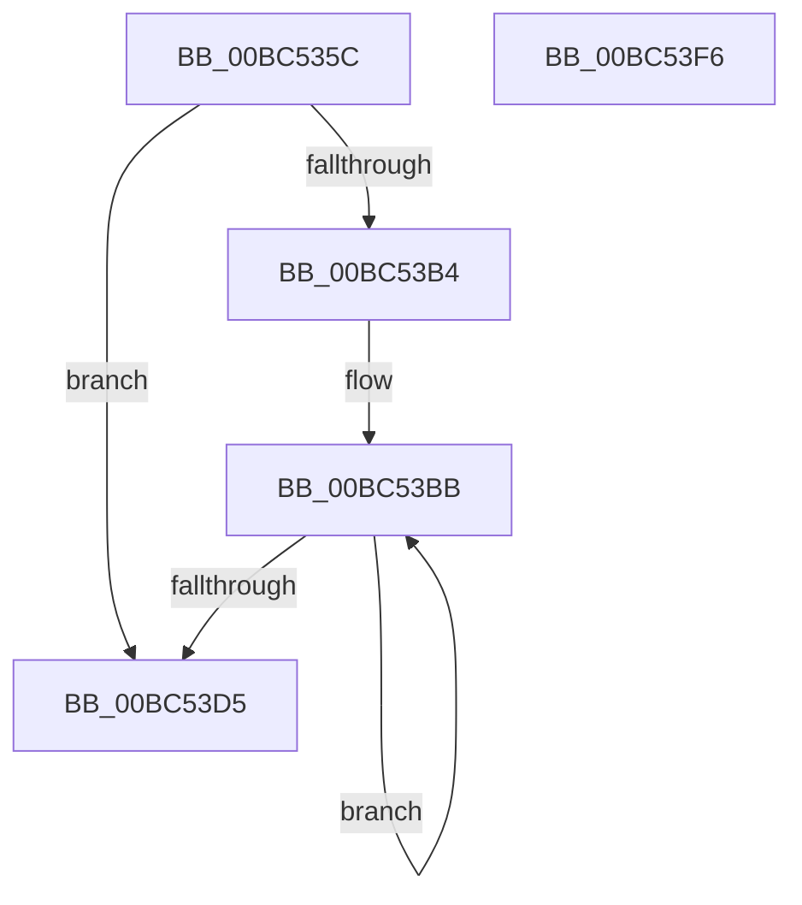

# BgpGxCopyBitmapToRectangle

- RVA: `0x00BC535C`–`0x00BC53F7` (길이 `155` bytes)
- VA: `0x0000000140BC535C`
- 실행 섹션: `PAGEBGFX`
- PDB 이름 있음: `예`; PDB Function 태그: `아니요`
- unwind 정보 RVA: `0x00060300`
- 디코드: `48`개 명령, `155/155` bytes 표시
- 미해석 바이트: `0` (있으면 어셈블리에 `.byte`로 보존)

> 이 문서는 커널 이미지의 기계어와 PDB 기호를 분석해 생성했습니다. 4번과 5번은 함수 원형과 자료형을 바이너리 사용 방식에서 추정한 C 해석이며 원본 소스 복구 결과는 아닙니다.

## 1. Dependencies

- 직접 호출 지점: **2**; 고유 호출 대상: **2**
- 직접 호출자로 확인된 함수: **1**
- RIP 상대 이미지 참조: **0**

### Outgoing calls
- `0x00BC53C4` → [memcpy](../../text/6C/memcpy_function_006C6840.md) (function, `0x006C6840`)
- `0x00BC53D8` → [BgpGxMarkClean](../../text/4F/BgpGxMarkClean_function_004FC740.md) (function, `0x004FC740`)

### Direct callers
- [BgpGxParseBitmap](BgpGxParseBitmap_function_00BC00B8.md) at `0x00BC012E`

### Static image references
- 디코드된 RIP-relative 메모리 참조가 없습니다.

## 2. Other-region calls and transfers

- 다른 실행 섹션으로 향하는 call: **2**
  - `0x00BC53C4` → [memcpy](../../text/6C/memcpy_function_006C6840.md) (`PAGEBGFX` → `.text`)
  - `0x00BC53D8` → [BgpGxMarkClean](../../text/4F/BgpGxMarkClean_function_004FC740.md) (`PAGEBGFX` → `.text`)
- 별도 외부 분기/꼬리 이동을 확인하지 못했습니다.

## 3. Assembly (complete function range)

```asm
00BC535C  48 89 5C 24 08                  mov qword ptr [rsp + 8], rbx
00BC5361  48 89 6C 24 10                  mov qword ptr [rsp + 0x10], rbp
00BC5366  48 89 74 24 18                  mov qword ptr [rsp + 0x18], rsi
00BC536B  57                              push rdi
00BC536C  41 56                           push r14
00BC536E  41 57                           push r15
00BC5370  48 83 EC 20                     sub rsp, 0x20
00BC5374  44 8B 09                        mov r9d, dword ptr [rcx]
00BC5377  48 8D 6A 28                     lea rbp, [rdx + 0x28]
00BC537B  44 8B 51 08                     mov r10d, dword ptr [rcx + 8]
00BC537F  48 8B F9                        mov rdi, rcx
00BC5382  41 C1 EA 03                     shr r10d, 3
00BC5386  B8 04 00 00 00                  mov eax, 4
00BC538B  44 0F AF 51 04                  imul r10d, dword ptr [rcx + 4]
00BC5390  41 8D 59 FF                     lea ebx, [r9 - 1]
00BC5394  41 0F AF DA                     imul ebx, r10d
00BC5398  45 8B C2                        mov r8d, r10d
00BC539B  41 83 E0 03                     and r8d, 3
00BC539F  41 2B C0                        sub eax, r8d
00BC53A2  48 03 59 18                     add rbx, qword ptr [rcx + 0x18]
00BC53A6  41 F7 D8                        neg r8d
00BC53A9  1B C9                           sbb ecx, ecx
00BC53AB  33 F6                           xor esi, esi
00BC53AD  23 C8                           and ecx, eax
00BC53AF  45 85 C9                        test r9d, r9d
00BC53B2  74 21                           je 0x140bc53d5
00BC53B4  45 8B F2                        mov r14d, r10d
00BC53B7  46 8D 3C 11                     lea r15d, [rcx + r10]
00BC53BB  4D 8B C6                        mov r8, r14
00BC53BE  48 8B D5                        mov rdx, rbp
00BC53C1  48 8B CB                        mov rcx, rbx
00BC53C4  E8 77 14 B0 FF                  call 0x1406c6840
00BC53C9  49 2B DE                        sub rbx, r14
00BC53CC  49 03 EF                        add rbp, r15
00BC53CF  FF C6                           inc esi
00BC53D1  3B 37                           cmp esi, dword ptr [rdi]
00BC53D3  72 E6                           jb 0x140bc53bb
00BC53D5  48 8B CF                        mov rcx, rdi
00BC53D8  E8 63 73 93 FF                  call 0x1404fc740
00BC53DD  48 8B 5C 24 40                  mov rbx, qword ptr [rsp + 0x40]
00BC53E2  48 8B 6C 24 48                  mov rbp, qword ptr [rsp + 0x48]
00BC53E7  48 8B 74 24 50                  mov rsi, qword ptr [rsp + 0x50]
00BC53EC  48 83 C4 20                     add rsp, 0x20
00BC53F0  41 5F                           pop r15
00BC53F2  41 5E                           pop r14
00BC53F4  5F                              pop rdi
00BC53F5  C3                              ret
00BC53F6  CC                              int3
```

## 4. C-style interpretation (structured pseudocode)

```c
__int64 __fastcall BgpGxCopyBitmapToRectangle(__int64 a1, __int64 a2)
{
    __int64 result;
    __int64 v_r10;
    __int64 v_rbp;
    __int64 v_rbx;
    __int64 v_rsi;
    __int64 v_rsp;
    unsigned __int64 v_stack_p10;
    unsigned __int64 v_stack_p18;
    unsigned __int64 v_stack_p8;

    v_stack_p8 = v_rbx;
    v_stack_p10 = v_rbp;
    v_stack_p18 = v_rsi;
    v_rsp = (v_rsp) - (32);
    v_r10 = (unsigned int)(((unsigned int)(*(unsigned int *)(a1 + 8))) >> (3));
    v_r10 = (unsigned int)((v_r10) * (*(unsigned int *)(a1 + 4)));
    v_rbx = (unsigned int)(((unsigned int)(*(unsigned int *)(a1)) - 1) * ((unsigned int)(v_r10)));
    a3 = (unsigned int)(((unsigned int)((unsigned int)(v_r10))) & (3));
    result = (unsigned int)((4) - ((unsigned int)(a3)));
    v_rbx = (v_rbx) + (*(unsigned __int64 *)(a1 + 24));
    a3 = (unsigned int)(-(a3));
    v_rsi = 0;
    a1 = (unsigned int)((a1) & ((unsigned int)(result)));
    if ((unsigned int)((unsigned int)(*(unsigned int *)(a1))) == 0) goto loc_00BC53D5;
loc_00BC53BB:
    result = memcpy(v_rbx, a2 + 40, (unsigned int)((unsigned int)(v_r10)), (unsigned int)(*(unsigned int *)(a1)));
    v_rbx = (v_rbx) - ((unsigned int)((unsigned int)(v_r10)));
    v_rbp = (a2 + 40) + (a1 + v_r10 * 1);
    v_rsi = (unsigned int)((v_rsi) + 1);
    if (((unsigned int)(v_rsi)) < (*(unsigned int *)(a1))) goto loc_00BC53BB;
loc_00BC53D5:
    result = BgpGxMarkClean(a1, a2 + 40, (unsigned int)((unsigned int)(v_r10)), (unsigned int)(*(unsigned int *)(a1)));
    v_rsp = (v_rsp) + (32);
    return result;
}
```

## 5. (Beta) C Style

```c
int64_t BgpGxCopyBitmapToRectangle(void *Arg1, void *Arg2)
{
    uint8_t *arg1 = (uint8_t *)Arg1;
    uint8_t *arg2 = (uint8_t *)Arg2;

    int64_t result;
    int64_t local_r10;
    int64_t local_rbp;
    int64_t local_rbx;
    int64_t local_rsi;
    int64_t local_rsp;
    uint64_t v_stack_p10;
    uint64_t v_stack_p18;
    uint64_t v_stack_p8;

    v_stack_p8 = local_rbx;
    v_stack_p10 = local_rbp;
    v_stack_p18 = local_rsi;
    local_rsp = (local_rsp) - (32);
    local_r10 = (uint32_t)(((uint32_t)(*(uint32_t *)(arg1 + 0x8))) >> (3));
    local_r10 = (uint32_t)((local_r10) * (*(uint32_t *)(arg1 + 0x4)));
    local_rbx = (uint32_t)(((uint32_t)(*(uint32_t *)(arg1)) - 1) * ((uint32_t)(local_r10)));
    a3 = (uint32_t)(((uint32_t)((uint32_t)(local_r10))) & (3));
    result = (uint32_t)((4) - ((uint32_t)(a3)));
    local_rbx = (local_rbx) + (*(uint64_t *)(arg1 + 0x18));
    a3 = (uint32_t)(-(a3));
    local_rsi = 0;
    Arg1 = (uint32_t)((Arg1) & ((uint32_t)(result)));
    if ((uint32_t)((uint32_t)(*(uint32_t *)(arg1))) == 0) goto loc_00BC53D5;
loc_00BC53BB:
    result = memcpy(local_rbx, Arg2 + 40, (uint32_t)((uint32_t)(local_r10)), (uint32_t)(*(uint32_t *)(arg1)));
    local_rbx = (local_rbx) - ((uint32_t)((uint32_t)(local_r10)));
    local_rbp = (Arg2 + 40) + (Arg1 + local_r10 * 1);
    local_rsi = (uint32_t)((local_rsi) + 1);
    if (((uint32_t)(local_rsi)) < (*(uint32_t *)(arg1))) goto loc_00BC53BB;
loc_00BC53D5:
    result = BgpGxMarkClean(Arg1, Arg2 + 40, (uint32_t)((uint32_t)(local_r10)), (uint32_t)(*(uint32_t *)(arg1)));
    local_rsp = (local_rsp) + (32);
    return result;
}
```

### 관측된 메모리 오프셋

구조체 형식이 확인되지 않은 접근은 인자 기준의 오프셋으로만 기록했습니다.

| 기준 인자 | 오프셋 표현 | 폭 (bit) | 접근 |
|---|---:|---:|---|
| `Arg1` | `+ 0x0` | `32` | `R` |
| `Arg1` | `+ 0x4` | `32` | `R` |
| `Arg1` | `+ 0x8` | `32` | `R` |
| `Arg1` | `+ 0x18` | `64` | `R` |
| `Arg2` | `+ 0x28` | `64` | `R` |

## 6. Execution-region graph

[열기: 2D/3D 그래프와 함수 탐색 컨트롤 패널](../../../control-panel.html?section=pagebgfx&rva=0x00BC535C&view=graph)

- 2D 그래프는 위에서 아래로 흐르고, 3D 그래프는 빈 공간을 드래그해 회전합니다. Shift+드래그는 이동, 휠은 확대·축소, 함수 노드 선택은 대상 보고서 이동입니다.

### Static fallback


