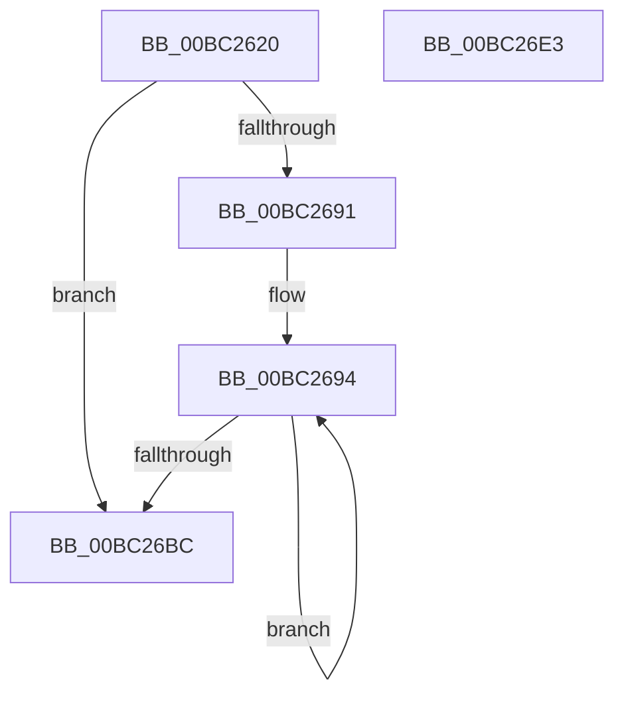

# BgpGxCopyRectangle

- RVA: `0x00BC2620`–`0x00BC26E4` (길이 `196` bytes)
- VA: `0x0000000140BC2620`
- 실행 섹션: `PAGEBGFX`
- PDB 이름 있음: `예`; PDB Function 태그: `아니요`
- unwind 정보 RVA: `0x0005FEF8`
- 디코드: `60`개 명령, `196/196` bytes 표시
- 미해석 바이트: `0` (있으면 어셈블리에 `.byte`로 보존)

> 이 문서는 커널 이미지의 기계어와 PDB 기호를 분석해 생성했습니다. 4번과 5번은 함수 원형과 자료형을 바이너리 사용 방식에서 추정한 C 해석이며 원본 소스 복구 결과는 아닙니다.

## 1. Dependencies

- 직접 호출 지점: **2**; 고유 호출 대상: **2**
- 직접 호출자로 확인된 함수: **1**
- RIP 상대 이미지 참조: **0**

### Outgoing calls
- `0x00BC269D` → [memcpy](../../text/6C/memcpy_function_006C6840.md) (function, `0x006C6840`)
- `0x00BC26BF` → [BgpGxMarkClean](../../text/4F/BgpGxMarkClean_function_004FC740.md) (function, `0x004FC740`)

### Direct callers
- [BgpRasPrintGlyph](../../text/47/BgpRasPrintGlyph_function_0047F3B4.md) at `0x0047F759`

### Static image references
- 디코드된 RIP-relative 메모리 참조가 없습니다.

## 2. Other-region calls and transfers

- 다른 실행 섹션으로 향하는 call: **2**
  - `0x00BC269D` → [memcpy](../../text/6C/memcpy_function_006C6840.md) (`PAGEBGFX` → `.text`)
  - `0x00BC26BF` → [BgpGxMarkClean](../../text/4F/BgpGxMarkClean_function_004FC740.md) (`PAGEBGFX` → `.text`)
- 별도 외부 분기/꼬리 이동을 확인하지 못했습니다.

## 3. Assembly (complete function range)

```asm
00BC2620  48 8B C4                        mov rax, rsp
00BC2623  48 89 58 08                     mov qword ptr [rax + 8], rbx
00BC2627  48 89 68 10                     mov qword ptr [rax + 0x10], rbp
00BC262B  48 89 70 18                     mov qword ptr [rax + 0x18], rsi
00BC262F  48 89 78 20                     mov qword ptr [rax + 0x20], rdi
00BC2633  41 54                           push r12
00BC2635  41 56                           push r14
00BC2637  41 57                           push r15
00BC2639  48 83 EC 20                     sub rsp, 0x20
00BC263D  8B 01                           mov eax, dword ptr [rcx]
00BC263F  4C 8B E2                        mov r12, rdx
00BC2642  44 8B 52 04                     mov r10d, dword ptr [rdx + 4]
00BC2646  4C 8B F1                        mov r14, rcx
00BC2649  44 8B 59 04                     mov r11d, dword ptr [rcx + 4]
00BC264D  8B 1A                           mov ebx, dword ptr [rdx]
00BC264F  8B 69 08                        mov ebp, dword ptr [rcx + 8]
00BC2652  C1 ED 03                        shr ebp, 3
00BC2655  3B D8                           cmp ebx, eax
00BC2657  0F 43 D8                        cmovae ebx, eax
00BC265A  45 3B D3                        cmp r10d, r11d
00BC265D  41 8B C2                        mov eax, r10d
00BC2660  41 0F 43 C3                     cmovae eax, r11d
00BC2664  45 0F AF 51 04                  imul r10d, dword ptr [r9 + 4]
00BC2669  45 0F AF 58 04                  imul r11d, dword ptr [r8 + 4]
00BC266E  0F AF C5                        imul eax, ebp
00BC2671  45 03 11                        add r10d, dword ptr [r9]
00BC2674  45 03 18                        add r11d, dword ptr [r8]
00BC2677  44 0F AF D5                     imul r10d, ebp
00BC267B  44 0F AF DD                     imul r11d, ebp
00BC267F  41 8B FA                        mov edi, r10d
00BC2682  48 03 7A 18                     add rdi, qword ptr [rdx + 0x18]
00BC2686  41 8B F3                        mov esi, r11d
00BC2689  48 03 71 18                     add rsi, qword ptr [rcx + 0x18]
00BC268D  85 DB                           test ebx, ebx
00BC268F  74 2B                           je 0x140bc26bc
00BC2691  44 8B F8                        mov r15d, eax
00BC2694  4D 8B C7                        mov r8, r15
00BC2697  48 8B D7                        mov rdx, rdi
00BC269A  48 8B CE                        mov rcx, rsi
00BC269D  E8 9E 41 B0 FF                  call 0x1406c6840
00BC26A2  8B C5                           mov eax, ebp
00BC26A4  41 0F AF 44 24 04               imul eax, dword ptr [r12 + 4]
00BC26AA  48 03 F8                        add rdi, rax
00BC26AD  8B C5                           mov eax, ebp
00BC26AF  41 0F AF 46 04                  imul eax, dword ptr [r14 + 4]
00BC26B4  48 03 F0                        add rsi, rax
00BC26B7  83 C3 FF                        add ebx, -1
00BC26BA  75 D8                           jne 0x140bc2694
00BC26BC  49 8B CE                        mov rcx, r14
00BC26BF  E8 7C A0 93 FF                  call 0x1404fc740
00BC26C4  48 8B 5C 24 40                  mov rbx, qword ptr [rsp + 0x40]
00BC26C9  48 8B 6C 24 48                  mov rbp, qword ptr [rsp + 0x48]
00BC26CE  48 8B 74 24 50                  mov rsi, qword ptr [rsp + 0x50]
00BC26D3  48 8B 7C 24 58                  mov rdi, qword ptr [rsp + 0x58]
00BC26D8  48 83 C4 20                     add rsp, 0x20
00BC26DC  41 5F                           pop r15
00BC26DE  41 5E                           pop r14
00BC26E0  41 5C                           pop r12
00BC26E2  C3                              ret
00BC26E3  CC                              int3
```

## 4. C-style interpretation (structured pseudocode)

```c
__int64 __fastcall BgpGxCopyRectangle(__int64 a1, __int64 a2, __int64 a3, __int64 a4)
{
    __int64 result;
    __int64 v_r10;
    __int64 v_r11;
    __int64 v_rbp;
    __int64 v_rbx;
    __int64 v_rdi;
    __int64 v_rsi;
    __int64 v_rsp;
    unsigned __int64 v_stack_p10;
    unsigned __int64 v_stack_p18;
    unsigned __int64 v_stack_p20;
    unsigned __int64 v_stack_p8;

    *(unsigned __int64 *)(v_rsp + 8) = v_rbx;
    *(unsigned __int64 *)(v_rsp + 16) = v_rbp;
    *(unsigned __int64 *)(v_rsp + 24) = v_rsi;
    *(unsigned __int64 *)(v_rsp + 32) = v_rdi;
    v_rsp = (v_rsp) - (32);
    v_rbp = (unsigned int)(((unsigned int)(*(unsigned int *)(a1 + 8))) >> (3));
    v_rbx = (unsigned int)(*(unsigned int *)(a2));
    if (((unsigned int)((unsigned int)(*(unsigned int *)(a2)))) >= ((unsigned int)((unsigned int)(*(unsigned int *)(a1))))) { v_rbx = (unsigned int)((unsigned int)(*(unsigned int *)(a1))); }
    result = (unsigned int)((unsigned int)((unsigned int)(*(unsigned int *)(a2 + 4))));
    if (((unsigned int)((unsigned int)(*(unsigned int *)(a2 + 4)))) >= ((unsigned int)((unsigned int)(*(unsigned int *)(a1 + 4))))) { result = (unsigned int)((unsigned int)(*(unsigned int *)(a1 + 4))); }
    v_r10 = (unsigned int)(((unsigned int)(*(unsigned int *)(a2 + 4))) * (*(unsigned int *)(a4 + 4)));
    v_r11 = (unsigned int)(((unsigned int)(*(unsigned int *)(a1 + 4))) * (*(unsigned int *)(a3 + 4)));
    result = (unsigned int)((result) * ((unsigned int)(v_rbp)));
    v_r10 = (unsigned int)((v_r10) + (*(unsigned int *)(a4)));
    v_r11 = (unsigned int)((v_r11) + (*(unsigned int *)(a3)));
    v_r10 = (unsigned int)((v_r10) * ((unsigned int)(v_rbp)));
    v_r11 = (unsigned int)((v_r11) * ((unsigned int)(v_rbp)));
    v_rdi = ((unsigned int)((unsigned int)(v_r10))) + (*(unsigned __int64 *)(a2 + 24));
    v_rsi = ((unsigned int)((unsigned int)(v_r11))) + (*(unsigned __int64 *)(a1 + 24));
    if ((unsigned int)(v_rbx) == 0) goto loc_00BC26BC;
loc_00BC2694:
    result = memcpy(v_rsi, v_rdi, (unsigned int)((unsigned int)(result)), a4);
    result = (unsigned int)(((unsigned int)((unsigned int)(v_rbp))) * (*(unsigned int *)(a2 + 4)));
    v_rdi = (v_rdi) + (result);
    result = (unsigned int)(((unsigned int)((unsigned int)(v_rbp))) * (*(unsigned int *)(a1 + 4)));
    v_rsi = (v_rsi) + (result);
    v_rbx = (unsigned int)((v_rbx) + (-1));
    if (condition_is_not_equal) goto loc_00BC2694;
loc_00BC26BC:
    result = BgpGxMarkClean(a1, v_rdi, (unsigned int)((unsigned int)(result)), a4);
    v_rsp = (v_rsp) + (32);
    return result;
}
```

## 5. (Beta) C Style

```c
int64_t BgpGxCopyRectangle(void *Arg1, void *Arg2, void *Arg3, void *Arg4)
{
    uint8_t *arg1 = (uint8_t *)Arg1;
    uint8_t *arg2 = (uint8_t *)Arg2;
    uint8_t *arg3 = (uint8_t *)Arg3;
    uint8_t *arg4 = (uint8_t *)Arg4;

    int64_t result;
    int64_t local_r10;
    int64_t local_r11;
    int64_t local_rbp;
    int64_t local_rbx;
    int64_t local_rdi;
    int64_t local_rsi;
    int64_t local_rsp;
    uint64_t v_stack_p10;
    uint64_t v_stack_p18;
    uint64_t v_stack_p20;
    uint64_t v_stack_p8;

    *(uint64_t *)(local_rsp + 0x8) = local_rbx;
    *(uint64_t *)(local_rsp + 0x10) = local_rbp;
    *(uint64_t *)(local_rsp + 0x18) = local_rsi;
    *(uint64_t *)(local_rsp + 0x20) = local_rdi;
    local_rsp = (local_rsp) - (32);
    local_rbp = (uint32_t)(((uint32_t)(*(uint32_t *)(arg1 + 0x8))) >> (3));
    local_rbx = (uint32_t)(*(uint32_t *)(arg2));
    if (((uint32_t)((uint32_t)(*(uint32_t *)(arg2)))) >= ((uint32_t)((uint32_t)(*(uint32_t *)(arg1))))) { local_rbx = (uint32_t)((uint32_t)(*(uint32_t *)(arg1))); }
    result = (uint32_t)((uint32_t)((uint32_t)(*(uint32_t *)(arg2 + 0x4))));
    if (((uint32_t)((uint32_t)(*(uint32_t *)(arg2 + 0x4)))) >= ((uint32_t)((uint32_t)(*(uint32_t *)(arg1 + 0x4))))) { result = (uint32_t)((uint32_t)(*(uint32_t *)(arg1 + 0x4))); }
    local_r10 = (uint32_t)(((uint32_t)(*(uint32_t *)(arg2 + 0x4))) * (*(uint32_t *)(arg4 + 0x4)));
    local_r11 = (uint32_t)(((uint32_t)(*(uint32_t *)(arg1 + 0x4))) * (*(uint32_t *)(arg3 + 0x4)));
    result = (uint32_t)((result) * ((uint32_t)(local_rbp)));
    local_r10 = (uint32_t)((local_r10) + (*(uint32_t *)(arg4)));
    local_r11 = (uint32_t)((local_r11) + (*(uint32_t *)(arg3)));
    local_r10 = (uint32_t)((local_r10) * ((uint32_t)(local_rbp)));
    local_r11 = (uint32_t)((local_r11) * ((uint32_t)(local_rbp)));
    local_rdi = ((uint32_t)((uint32_t)(local_r10))) + (*(uint64_t *)(arg2 + 0x18));
    local_rsi = ((uint32_t)((uint32_t)(local_r11))) + (*(uint64_t *)(arg1 + 0x18));
    if ((uint32_t)(local_rbx) == 0) goto loc_00BC26BC;
loc_00BC2694:
    result = memcpy(local_rsi, local_rdi, (uint32_t)((uint32_t)(result)), Arg4);
    result = (uint32_t)(((uint32_t)((uint32_t)(local_rbp))) * (*(uint32_t *)(arg2 + 0x4)));
    local_rdi = (local_rdi) + (result);
    result = (uint32_t)(((uint32_t)((uint32_t)(local_rbp))) * (*(uint32_t *)(arg1 + 0x4)));
    local_rsi = (local_rsi) + (result);
    local_rbx = (uint32_t)((local_rbx) + (-1));
    if (condition_is_not_equal) goto loc_00BC2694;
loc_00BC26BC:
    result = BgpGxMarkClean(Arg1, local_rdi, (uint32_t)((uint32_t)(result)), Arg4);
    local_rsp = (local_rsp) + (32);
    return result;
}
```

### 관측된 메모리 오프셋

구조체 형식이 확인되지 않은 접근은 인자 기준의 오프셋으로만 기록했습니다.

| 기준 인자 | 오프셋 표현 | 폭 (bit) | 접근 |
|---|---:|---:|---|
| `Arg1` | `+ 0x0` | `32` | `R` |
| `Arg1` | `+ 0x4` | `32` | `R` |
| `Arg1` | `+ 0x8` | `32` | `R` |
| `Arg1` | `+ 0x18` | `64` | `R` |
| `Arg2` | `+ 0x0` | `32` | `R` |
| `Arg2` | `+ 0x4` | `32` | `R` |
| `Arg2` | `+ 0x18` | `64` | `R` |
| `Arg3` | `+ 0x0` | `32` | `R` |
| `Arg3` | `+ 0x4` | `32` | `R` |
| `Arg4` | `+ 0x0` | `32` | `R` |
| `Arg4` | `+ 0x4` | `32` | `R` |

## 6. Execution-region graph

[열기: 2D/3D 그래프와 함수 탐색 컨트롤 패널](../../../control-panel.html?section=pagebgfx&rva=0x00BC2620&view=graph)

- 2D 그래프는 위에서 아래로 흐르고, 3D 그래프는 빈 공간을 드래그해 회전합니다. Shift+드래그는 이동, 휠은 확대·축소, 함수 노드 선택은 대상 보고서 이동입니다.

### Static fallback


