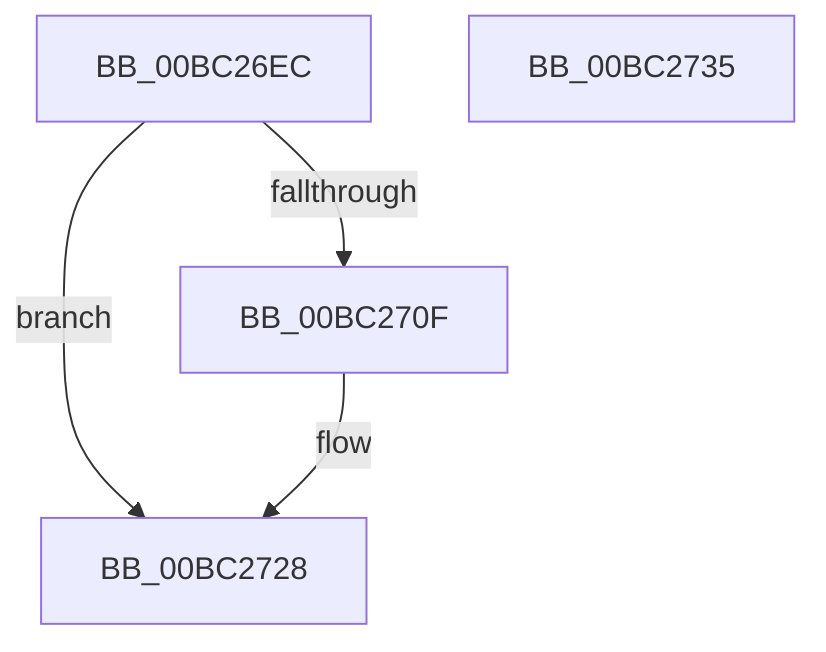

# BgpGxDrawBitmapImage

- RVA: `0x00BC26EC`–`0x00BC2736` (길이 `74` bytes)
- VA: `0x0000000140BC26EC`
- 실행 섹션: `PAGEBGFX`
- PDB 이름 있음: `예`; PDB Function 태그: `아니요`
- unwind 정보 RVA: `0x0005CAAC`
- 디코드: `22`개 명령, `74/74` bytes 표시
- 미해석 바이트: `0` (있으면 어셈블리에 `.byte`로 보존)

> 이 문서는 커널 이미지의 기계어와 PDB 기호를 분석해 생성했습니다. 4번과 5번은 함수 원형과 자료형을 바이너리 사용 방식에서 추정한 C 해석이며 원본 소스 복구 결과는 아닙니다.

## 1. Dependencies

- 직접 호출 지점: **3**; 고유 호출 대상: **3**
- 직접 호출자로 확인된 함수: **2**
- RIP 상대 이미지 참조: **0**

### Outgoing calls
- `0x00BC2704` → [BgpGxParseBitmap](BgpGxParseBitmap_function_00BC00B8.md) (function, `0x00BC00B8`)
- `0x00BC2717` → [BgpGxDrawRectangle](../../text/48/BgpGxDrawRectangle_function_0048C91C.md) (function, `0x0048C91C`)
- `0x00BC2723` → [BgpGxRectangleDestroy](BgpGxRectangleDestroy_function_00BC3F04.md) (function, `0x00BC3F04`)

### Direct callers
- [AnFwDisplayBackgroundUpdate](AnFwDisplayBackgroundUpdate_function_00BC1E44.md) at `0x00BC1F35`
- [AnFwpBackgroundUpdateTimer](AnFwpBackgroundUpdateTimer_function_00BC21B0.md) at `0x00BC224F`

### Static image references
- 디코드된 RIP-relative 메모리 참조가 없습니다.

## 2. Other-region calls and transfers

- 다른 실행 섹션으로 향하는 call: **1**
  - `0x00BC2717` → [BgpGxDrawRectangle](../../text/48/BgpGxDrawRectangle_function_0048C91C.md) (`PAGEBGFX` → `.text`)
- 별도 외부 분기/꼬리 이동을 확인하지 못했습니다.

## 3. Assembly (complete function range)

```asm
00BC26EC  48 89 5C 24 08                  mov qword ptr [rsp + 8], rbx
00BC26F1  57                              push rdi
00BC26F2  48 83 EC 20                     sub rsp, 0x20
00BC26F6  48 83 64 24 48 00               and qword ptr [rsp + 0x48], 0
00BC26FC  48 8B FA                        mov rdi, rdx
00BC26FF  48 8D 54 24 48                  lea rdx, [rsp + 0x48]
00BC2704  E8 AF D9 FF FF                  call 0x140bc00b8
00BC2709  8B D8                           mov ebx, eax
00BC270B  85 C0                           test eax, eax
00BC270D  78 19                           js 0x140bc2728
00BC270F  48 8B 4C 24 48                  mov rcx, qword ptr [rsp + 0x48]
00BC2714  48 8B D7                        mov rdx, rdi
00BC2717  E8 00 A2 8C FF                  call 0x14048c91c
00BC271C  48 8B 4C 24 48                  mov rcx, qword ptr [rsp + 0x48]
00BC2721  8B D8                           mov ebx, eax
00BC2723  E8 DC 17 00 00                  call 0x140bc3f04
00BC2728  8B C3                           mov eax, ebx
00BC272A  48 8B 5C 24 30                  mov rbx, qword ptr [rsp + 0x30]
00BC272F  48 83 C4 20                     add rsp, 0x20
00BC2733  5F                              pop rdi
00BC2734  C3                              ret
00BC2735  CC                              int3
```

## 4. C-style interpretation (structured pseudocode)

```c
__int64 __fastcall BgpGxDrawBitmapImage(__int64 a1, __int64 a2)
{
    __int64 result;
    __int64 v_rbx;
    __int64 v_rsp;
    unsigned __int64 v_stack_p20;
    unsigned __int64 v_stack_p8;

    v_stack_p8 = v_rbx;
    v_rsp = (v_rsp) - (32);
    result = BgpGxParseBitmap(a1, v_stack_p20, a3, a4);
    v_rbx = (unsigned int)((unsigned int)(result));
    if (!(sign_flag)) {
        a1 = v_stack_p20;
        a2 = a2;
        result = BgpGxDrawRectangle(a1, a2, a3, a4);
        a1 = v_stack_p20;
        v_rbx = (unsigned int)(result);
        result = BgpGxRectangleDestroy(a1, a2, a3, a4);
    }
    v_rsp = (v_rsp) + (32);
    return (unsigned int)((unsigned int)(v_rbx));
}
```

## 5. (Beta) C Style

```c
int64_t BgpGxDrawBitmapImage(int64_t Arg1, int64_t Arg2)
{
    int64_t result;
    int64_t local_rbx;
    int64_t local_rsp;
    uint64_t v_stack_p20;
    uint64_t v_stack_p8;

    v_stack_p8 = local_rbx;
    local_rsp = (local_rsp) - (32);
    result = BgpGxParseBitmap(Arg1, v_stack_p20, a3, a4);
    local_rbx = (uint32_t)((uint32_t)(result));
    if (!(sign_flag)) {
        Arg1 = v_stack_p20;
        Arg2 = Arg2;
        result = BgpGxDrawRectangle(Arg1, Arg2, a3, a4);
        Arg1 = v_stack_p20;
        local_rbx = (uint32_t)(result);
        result = BgpGxRectangleDestroy(Arg1, Arg2, a3, a4);
    }
    local_rsp = (local_rsp) + (32);
    return (uint32_t)((uint32_t)(local_rbx));
}
```

## 6. Execution-region graph

[열기: 2D/3D 그래프와 함수 탐색 컨트롤 패널](../../../control-panel.html?section=pagebgfx&rva=0x00BC26EC&view=graph)

- 2D 그래프는 위에서 아래로 흐르고, 3D 그래프는 빈 공간을 드래그해 회전합니다. Shift+드래그는 이동, 휠은 확대·축소, 함수 노드 선택은 대상 보고서 이동입니다.

### Static fallback


