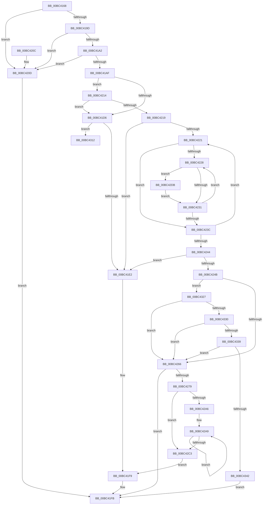

# BgpGxFindSubRectangle

- RVA: `0x00BC4168`–`0x00BC434C` (길이 `484` bytes)
- VA: `0x0000000140BC4168`
- 실행 섹션: `PAGEBGFX`
- PDB 이름 있음: `예`; PDB Function 태그: `예`
- unwind 정보 RVA: `0x000AA5F0`
- 디코드: `148`개 명령, `484/484` bytes 표시
- 미해석 바이트: `0` (있으면 어셈블리에 `.byte`로 보존)

> 이 문서는 커널 이미지의 기계어와 PDB 기호를 분석해 생성했습니다. 4번과 5번은 함수 원형과 자료형을 바이너리 사용 방식에서 추정한 C 해석이며 원본 소스 복구 결과는 아닙니다.

## 1. Dependencies

- 직접 호출 지점: **2**; 고유 호출 대상: **2**
- 직접 호출자로 확인된 함수: **1**
- RIP 상대 이미지 참조: **0**

### Outgoing calls
- `0x00BC4270` → [BgpGxRectangleCreate](BgpGxRectangleCreate_function_00BC3E78.md) (function, `0x00BC3E78`)
- `0x00BC42B2` → [memcpy](../../text/6C/memcpy_function_006C6840.md) (function, `0x006C6840`)

### Direct callers
- [AnFwDisplayFade](AnFwDisplayFade_function_00BC36EC.md) at `0x00BC39DA`
- [AnFwDisplayFade](AnFwDisplayFade_function_00BC36EC.md) at `0x00BC3BE8`
- [AnFwDisplayFade](AnFwDisplayFade_function_00BC36EC.md) at `0x00BC3C37`

### Static image references
- 디코드된 RIP-relative 메모리 참조가 없습니다.

## 2. Other-region calls and transfers

- 다른 실행 섹션으로 향하는 call: **1**
  - `0x00BC42B2` → [memcpy](../../text/6C/memcpy_function_006C6840.md) (`PAGEBGFX` → `.text`)
- call이 아닌 외부 분기/꼬리 이동: **1**
  - `0x00BC4322` → [sub_00BC68C6](Unknown_function_00BC68C6.md) (`tail-transfer`)

## 3. Assembly (complete function range)

```asm
00BC4168  48 8B C4                        mov rax, rsp
00BC416B  4C 89 48 20                     mov qword ptr [rax + 0x20], r9
00BC416F  4C 89 40 18                     mov qword ptr [rax + 0x18], r8
00BC4173  89 50 10                        mov dword ptr [rax + 0x10], edx
00BC4176  48 89 48 08                     mov qword ptr [rax + 8], rcx
00BC417A  53                              push rbx
00BC417B  55                              push rbp
00BC417C  56                              push rsi
00BC417D  57                              push rdi
00BC417E  41 54                           push r12
00BC4180  41 55                           push r13
00BC4182  41 56                           push r14
00BC4184  41 57                           push r15
00BC4186  48 83 EC 48                     sub rsp, 0x48
00BC418A  48 83 60 A4 00                  and qword ptr [rax - 0x5c], 0
00BC418F  4D 8B E9                        mov r13, r9
00BC4192  4D 8B D8                        mov r11, r8
00BC4195  4C 8B F1                        mov r14, rcx
00BC4198  4D 85 C9                        test r9, r9
00BC419B  74 70                           je 0x140bc420d
00BC419D  48 85 C9                        test rcx, rcx
00BC41A0  74 6B                           je 0x140bc420d
00BC41A2  8B 69 08                        mov ebp, dword ptr [rcx + 8]
00BC41A5  8D 45 E8                        lea eax, [rbp - 0x18]
00BC41A8  A9 F7 FF FF FF                  test eax, 0xfffffff7
00BC41AD  75 5E                           jne 0x140bc420d
00BC41AF  44 8B 09                        mov r9d, dword ptr [rcx]
00BC41B2  8B DD                           mov ebx, ebp
00BC41B4  44 8B 51 04                     mov r10d, dword ptr [rcx + 4]
00BC41B8  33 F6                           xor esi, esi
00BC41BA  48 8B 49 18                     mov rcx, qword ptr [rcx + 0x18]
00BC41BE  33 FF                           xor edi, edi
00BC41C0  C1 EB 03                        shr ebx, 3
00BC41C3  45 8B E1                        mov r12d, r9d
00BC41C6  C6 44 24 20 00                  mov byte ptr [rsp + 0x20], 0
00BC41CB  45 8B FA                        mov r15d, r10d
00BC41CE  81 FA 00 00 00 FF               cmp edx, 0xff000000
00BC41D4  74 3E                           je 0x140bc4214
00BC41D6  45 33 DB                        xor r11d, r11d
00BC41D9  45 85 C9                        test r9d, r9d
00BC41DC  0F 85 30 01 00 00               jne 0x140bc4312
00BC41E2  48 8B 84 24 B0 00 00 00         mov rax, qword ptr [rsp + 0xb0]
00BC41EA  C6 00 01                        mov byte ptr [rax], 1
00BC41ED  48 8B 84 24 A0 00 00 00         mov rax, qword ptr [rsp + 0xa0]
00BC41F5  48 83 20 00                     and qword ptr [rax], 0
00BC41F9  33 C0                           xor eax, eax
00BC41FB  48 83 C4 48                     add rsp, 0x48
00BC41FF  41 5F                           pop r15
00BC4201  41 5E                           pop r14
00BC4203  41 5D                           pop r13
00BC4205  41 5C                           pop r12
00BC4207  5F                              pop rdi
00BC4208  5E                              pop rsi
00BC4209  5D                              pop rbp
00BC420A  5B                              pop rbx
00BC420B  C3                              ret
00BC420C  CC                              int3
00BC420D  B8 0D 00 00 C0                  mov eax, 0xc000000d
00BC4212  EB E7                           jmp 0x140bc41fb
00BC4214  83 FB 04                        cmp ebx, 4
00BC4217  75 BD                           jne 0x140bc41d6
00BC4219  45 33 C0                        xor r8d, r8d
00BC421C  45 85 C9                        test r9d, r9d
00BC421F  74 C1                           je 0x140bc41e2
00BC4221  33 D2                           xor edx, edx
00BC4223  45 85 D2                        test r10d, r10d
00BC4226  74 14                           je 0x140bc423c
00BC4228  83 39 00                        cmp dword ptr [rcx], 0
00BC422B  0F 85 AA 00 00 00               jne 0x140bc42db
00BC4231  48 83 C1 04                     add rcx, 4
00BC4235  FF C2                           inc edx
00BC4237  41 3B D2                        cmp edx, r10d
00BC423A  72 EC                           jb 0x140bc4228
00BC423C  41 FF C0                        inc r8d
00BC423F  45 3B C1                        cmp r8d, r9d
00BC4242  72 DD                           jb 0x140bc4221
00BC4244  80 7C 24 20 00                  cmp byte ptr [rsp + 0x20], 0
00BC4249  74 97                           je 0x140bc41e2
00BC424B  41 2B FF                        sub edi, r15d
00BC424E  41 2B F4                        sub esi, r12d
00BC4251  FF C7                           inc edi
00BC4253  FF C6                           inc esi
00BC4255  89 7C 24 28                     mov dword ptr [rsp + 0x28], edi
00BC4259  89 74 24 2C                     mov dword ptr [rsp + 0x2c], esi
00BC425D  45 85 E4                        test r12d, r12d
00BC4260  0F 84 C1 00 00 00               je 0x140bc4327
00BC4266  4D 8B C3                        mov r8, r11
00BC4269  48 8D 4C 24 28                  lea rcx, [rsp + 0x28]
00BC426E  8B D5                           mov edx, ebp
00BC4270  E8 03 FC FF FF                  call 0x140bc3e78
00BC4275  85 C0                           test eax, eax
00BC4277  78 82                           js 0x140bc41fb
00BC4279  48 8B 84 24 A0 00 00 00         mov rax, qword ptr [rsp + 0xa0]
00BC4281  8B D3                           mov edx, ebx
00BC4283  41 0F AF 56 04                  imul edx, dword ptr [r14 + 4]
00BC4288  41 8B CC                        mov ecx, r12d
00BC428B  0F AF FB                        imul edi, ebx
00BC428E  41 0F AF DF                     imul ebx, r15d
00BC4292  48 8B 00                        mov rax, qword ptr [rax]
00BC4295  0F AF CA                        imul ecx, edx
00BC4298  48 8B 68 18                     mov rbp, qword ptr [rax + 0x18]
00BC429C  03 D9                           add ebx, ecx
00BC429E  49 03 5E 18                     add rbx, qword ptr [r14 + 0x18]
00BC42A2  85 F6                           test esi, esi
00BC42A4  74 1D                           je 0x140bc42c3
00BC42A6  44 8B F2                        mov r14d, edx
00BC42A9  4C 8B C7                        mov r8, rdi
00BC42AC  48 8B D3                        mov rdx, rbx
00BC42AF  48 8B CD                        mov rcx, rbp
00BC42B2  E8 89 25 B0 FF                  call 0x1406c6840
00BC42B7  48 03 EF                        add rbp, rdi
00BC42BA  49 03 DE                        add rbx, r14
00BC42BD  48 83 EE 01                     sub rsi, 1
00BC42C1  75 E6                           jne 0x140bc42a9
00BC42C3  48 8B 84 24 B0 00 00 00         mov rax, qword ptr [rsp + 0xb0]
00BC42CB  45 89 7D 00                     mov dword ptr [r13], r15d
00BC42CF  45 89 65 04                     mov dword ptr [r13 + 4], r12d
00BC42D3  C6 00 00                        mov byte ptr [rax], 0
00BC42D6  E9 1E FF FF FF                  jmp 0x140bc41f9
00BC42DB  41 3B D7                        cmp edx, r15d
00BC42DE  C6 44 24 20 01                  mov byte ptr [rsp + 0x20], 1
00BC42E3  8B C2                           mov eax, edx
00BC42E5  41 0F 43 C7                     cmovae eax, r15d
00BC42E9  3B D7                           cmp edx, edi
00BC42EB  44 8B F8                        mov r15d, eax
00BC42EE  8B C2                           mov eax, edx
00BC42F0  0F 46 C7                        cmovbe eax, edi
00BC42F3  45 3B C4                        cmp r8d, r12d
00BC42F6  8B F8                           mov edi, eax
00BC42F8  41 8B C0                        mov eax, r8d
00BC42FB  41 0F 43 C4                     cmovae eax, r12d
00BC42FF  44 3B C6                        cmp r8d, esi
00BC4302  44 8B E0                        mov r12d, eax
00BC4305  41 8B C0                        mov eax, r8d
00BC4308  0F 46 C6                        cmovbe eax, esi
00BC430B  8B F0                           mov esi, eax
00BC430D  E9 1F FF FF FF                  jmp 0x140bc4231
00BC4312  44 8A AC 24 9A 00 00 00         mov r13b, byte ptr [rsp + 0x9a]
00BC431A  44 8A B4 24 99 00 00 00         mov r14b, byte ptr [rsp + 0x99]
00BC4322  E9 9F 25 00 00                  jmp 0x140bc68c6
00BC4327  45 85 FF                        test r15d, r15d
00BC432A  0F 85 36 FF FF FF               jne 0x140bc4266
00BC4330  41 3B FA                        cmp edi, r10d
00BC4333  0F 85 2D FF FF FF               jne 0x140bc4266
00BC4339  41 3B F1                        cmp esi, r9d
00BC433C  0F 85 24 FF FF FF               jne 0x140bc4266
00BC4342  B8 25 02 00 C0                  mov eax, 0xc0000225
00BC4347  E9 AF FE FF FF                  jmp 0x140bc41fb
```

## 4. C-style interpretation (structured pseudocode)

```c
__int64 __fastcall BgpGxFindSubRectangle(__int64 a1, int a2, __int64 a3, __int64 a4, __int64 a5)
{
    __int64 result;
    __int64 v_r11;
    __int64 v_rbp;
    __int64 v_rbx;
    __int64 v_rdi;
    __int64 v_rsi;
    __int64 v_rsp;
    unsigned __int8 v_stack_m68;
    unsigned __int64 v_stack_p18;
    unsigned __int8 v_stack_p20;
    unsigned int v_stack_p28;
    unsigned int v_stack_p2C;
    unsigned __int8 v_stack_p99;
    unsigned __int8 v_stack_p9A;
    unsigned __int64 v_stack_pA0;

    *(unsigned __int64 *)(v_rsp + 32) = a4;
    *(unsigned __int64 *)(v_rsp + 24) = a3;
    *(unsigned int *)(v_rsp + 16) = a2;
    *(unsigned __int64 *)(v_rsp + 8) = a1;
    v_rsp = (v_rsp) - (72);
    if (a4 == 0) goto loc_00BC420D;
    if (a1 == 0) goto loc_00BC420D;
    if ((((unsigned int)((unsigned int)(*(unsigned int *)(a1 + 8)) - 24)) & (0xFFFFFFF7ULL)) != 0) goto loc_00BC420D;
    v_rsi = 0;
    v_rdi = 0;
    v_rbx = (unsigned int)(((unsigned int)((unsigned int)((unsigned int)(*(unsigned int *)(a1 + 8))))) >> (3));
    v_stack_m68 = 0;
    if (a2 == 0xFF000000ULL) goto loc_00BC4214;
loc_00BC41D6:
    v_r11 = 0;
    if ((unsigned int)((unsigned int)(*(unsigned int *)(a1))) != 0) goto loc_00BC4312;
loc_00BC41E2:
    *(unsigned __int8 *)(a5) = 1;
loc_00BC41F9:
    result = 0;
loc_00BC41FB:
    v_rsp = (v_rsp) + (72);
    return result;
loc_00BC420D:
    goto loc_00BC41FB;
loc_00BC4214:
    if (((unsigned int)(v_rbx)) != 4) goto loc_00BC41D6;
    a3 = 0;
    if ((unsigned int)((unsigned int)(*(unsigned int *)(a1))) == 0) goto loc_00BC41E2;
loc_00BC4221:
    a2 = 0;
    if ((unsigned int)((unsigned int)(*(unsigned int *)(a1 + 4))) == 0) goto loc_00BC423C;
loc_00BC4228:
    if ((*(unsigned int *)(*(unsigned __int64 *)(a1 + 24))) != 0) goto loc_00BC42DB;
loc_00BC4231:
    a1 = (*(unsigned __int64 *)(a1 + 24)) + (4);
    a2 = (unsigned int)((a2) + 1);
    if (a2 < ((unsigned int)((unsigned int)(*(unsigned int *)(a1 + 4))))) goto loc_00BC4228;
loc_00BC423C:
    a3 = (unsigned int)((a3) + 1);
    if (((unsigned int)(a3)) < ((unsigned int)((unsigned int)(*(unsigned int *)(a1))))) goto loc_00BC4221;
    if (v_stack_p20 == 0) goto loc_00BC41E2;
    v_rdi = (unsigned int)((v_rdi) - ((unsigned int)((unsigned int)((unsigned int)((unsigned int)(*(unsigned int *)(a1 + 4)))))));
    v_rsi = (unsigned int)((v_rsi) - ((unsigned int)((unsigned int)((unsigned int)((unsigned int)(*(unsigned int *)(a1)))))));
    v_rdi = (unsigned int)((v_rdi) + 1);
    v_rsi = (unsigned int)((v_rsi) + 1);
    v_stack_p28 = (unsigned int)(v_rdi);
    v_stack_p2C = (unsigned int)(v_rsi);
    if ((unsigned int)((unsigned int)((unsigned int)((unsigned int)(*(unsigned int *)(a1))))) == 0) goto loc_00BC4327;
loc_00BC4266:
    result = BgpGxRectangleCreate(v_stack_p28, (unsigned int)((unsigned int)((unsigned int)(*(unsigned int *)(a1 + 8)))), 0, (unsigned int)(*(unsigned int *)(a1)));
    if (sign_flag) goto loc_00BC41FB;
    a2 = (unsigned int)(((unsigned int)((unsigned int)(v_rbx))) * (*(unsigned int *)(a1 + 4)));
    v_rdi = (unsigned int)((v_rdi) * ((unsigned int)(v_rbx)));
    v_rbx = (unsigned int)((v_rbx) * ((unsigned int)((unsigned int)((unsigned int)((unsigned int)(*(unsigned int *)(a1 + 4)))))));
    a1 = (unsigned int)(((unsigned int)((unsigned int)((unsigned int)((unsigned int)((unsigned int)(*(unsigned int *)(a1))))))) * (a2));
    v_rbx = (unsigned int)((v_rbx) + ((unsigned int)(a1)));
    v_rbx = (v_rbx) + (*(unsigned __int64 *)(a1 + 24));
    if ((unsigned int)(v_rsi) == 0) goto loc_00BC42C3;
loc_00BC42A9:
    result = memcpy(*(unsigned __int64 *)(*(unsigned __int64 *)(v_stack_pA0) + 24), v_rbx, v_rdi, (unsigned int)(*(unsigned int *)(a1)));
    v_rbp = (*(unsigned __int64 *)(*(unsigned __int64 *)(v_stack_pA0) + 24)) + (v_rdi);
    v_rbx = (v_rbx) + ((unsigned int)(a2));
    v_rsi = (v_rsi) - (1);
    if (condition_is_not_equal) goto loc_00BC42A9;
loc_00BC42C3:
    *(unsigned int *)(a4) = (unsigned int)((unsigned int)((unsigned int)((unsigned int)(*(unsigned int *)(a1 + 4)))));
    *(unsigned int *)(a4 + 4) = (unsigned int)((unsigned int)((unsigned int)((unsigned int)(*(unsigned int *)(a1)))));
    *(unsigned __int8 *)(a5) = 0;
    goto loc_00BC41F9;
loc_00BC42DB:
    v_stack_p20 = 1;
    result = (unsigned int)((unsigned int)(v_rbx));
    if (((unsigned int)(v_rbx)) >= ((unsigned int)((unsigned int)((unsigned int)((unsigned int)(*(unsigned int *)(a1 + 4))))))) { result = (unsigned int)((unsigned int)((unsigned int)((unsigned int)(*(unsigned int *)(a1 + 4))))); }
    result = (unsigned int)((unsigned int)(v_rbx));
    if (((unsigned int)(v_rbx)) <= ((unsigned int)(v_rdi))) { result = (unsigned int)(v_rdi); }
    result = (unsigned int)((unsigned int)(v_rdi));
    if (((unsigned int)(v_rdi)) >= ((unsigned int)((unsigned int)((unsigned int)((unsigned int)(*(unsigned int *)(a1))))))) { result = (unsigned int)((unsigned int)((unsigned int)((unsigned int)(*(unsigned int *)(a1))))); }
    result = (unsigned int)((unsigned int)(v_rdi));
    if (((unsigned int)(v_rdi)) <= ((unsigned int)(v_rsi))) { result = (unsigned int)(v_rsi); }
    goto loc_00BC4231;
loc_00BC4312:
loc_00BC4327:
    if ((unsigned int)((unsigned int)((unsigned int)(result))) != 0) goto loc_00BC4266;
    if (((unsigned int)((unsigned int)((unsigned int)(result)))) != ((unsigned int)((unsigned int)(*(unsigned int *)(a1 + 4))))) goto loc_00BC4266;
    if (((unsigned int)((unsigned int)((unsigned int)(result)))) != ((unsigned int)((unsigned int)(*(unsigned int *)(a1))))) goto loc_00BC4266;
    goto loc_00BC41FB;
}
```

## 5. (Beta) C Style

```c
int64_t BgpGxFindSubRectangle(void *Arg1, int32_t Arg2, int64_t Arg3, void *Arg4, void *Arg5)
{
    uint8_t *arg1 = (uint8_t *)Arg1;
    uint8_t *arg4 = (uint8_t *)Arg4;
    uint8_t *arg5 = (uint8_t *)Arg5;

    int64_t result;
    int64_t local_r11;
    int64_t local_rbp;
    int64_t local_rbx;
    int64_t local_rdi;
    int64_t local_rsi;
    int64_t local_rsp;
    uint8_t v_stack_m68;
    uint64_t v_stack_p18;
    uint8_t v_stack_p20;
    uint32_t v_stack_p28;
    uint32_t v_stack_p2C;
    uint8_t v_stack_p99;
    uint8_t v_stack_p9A;
    uint64_t v_stack_pA0;

    *(void **)(local_rsp + 0x20) = Arg4;
    *(uint64_t *)(local_rsp + 0x18) = Arg3;
    *(uint32_t *)(local_rsp + 0x10) = Arg2;
    *(void **)(local_rsp + 0x8) = Arg1;
    local_rsp = (local_rsp) - (72);
    if (Arg4 == NULL) goto loc_00BC420D;
    if (Arg1 == NULL) goto loc_00BC420D;
    if ((((uint32_t)((uint32_t)(*(uint32_t *)(arg1 + 0x8)) - 24)) & (0xFFFFFFF7ULL)) != 0) goto loc_00BC420D;
    local_rsi = 0;
    local_rdi = 0;
    local_rbx = (uint32_t)(((uint32_t)((uint32_t)((uint32_t)(*(uint32_t *)(arg1 + 0x8))))) >> (3));
    v_stack_m68 = 0;
    if (Arg2 == 0xFF000000ULL) goto loc_00BC4214;
loc_00BC41D6:
    local_r11 = 0;
    if ((uint32_t)((uint32_t)(*(uint32_t *)(arg1))) != 0) goto loc_00BC4312;
loc_00BC41E2:
    *(uint8_t *)(arg5) = 1;
loc_00BC41F9:
    result = 0;
loc_00BC41FB:
    local_rsp = (local_rsp) + (72);
    return result;
loc_00BC420D:
    goto loc_00BC41FB;
loc_00BC4214:
    if (((uint32_t)(local_rbx)) != 4) goto loc_00BC41D6;
    Arg3 = 0;
    if ((uint32_t)((uint32_t)(*(uint32_t *)(arg1))) == 0) goto loc_00BC41E2;
loc_00BC4221:
    Arg2 = 0;
    if ((uint32_t)((uint32_t)(*(uint32_t *)(arg1 + 0x4))) == 0) goto loc_00BC423C;
loc_00BC4228:
    if ((*(uint32_t *)(*(uint64_t *)(arg1 + 0x18))) != 0) goto loc_00BC42DB;
loc_00BC4231:
    Arg1 = (*(uint64_t *)(arg1 + 0x18)) + (4);
    Arg2 = (uint32_t)((Arg2) + 1);
    if (Arg2 < ((uint32_t)((uint32_t)(*(uint32_t *)(arg1 + 0x4))))) goto loc_00BC4228;
loc_00BC423C:
    Arg3 = (uint32_t)((Arg3) + 1);
    if (((uint32_t)(Arg3)) < ((uint32_t)((uint32_t)(*(uint32_t *)(arg1))))) goto loc_00BC4221;
    if (v_stack_p20 == 0) goto loc_00BC41E2;
    local_rdi = (uint32_t)((local_rdi) - ((uint32_t)((uint32_t)((uint32_t)((uint32_t)(*(uint32_t *)(arg1 + 0x4)))))));
    local_rsi = (uint32_t)((local_rsi) - ((uint32_t)((uint32_t)((uint32_t)((uint32_t)(*(uint32_t *)(arg1)))))));
    local_rdi = (uint32_t)((local_rdi) + 1);
    local_rsi = (uint32_t)((local_rsi) + 1);
    v_stack_p28 = (uint32_t)(local_rdi);
    v_stack_p2C = (uint32_t)(local_rsi);
    if ((uint32_t)((uint32_t)((uint32_t)((uint32_t)(*(uint32_t *)(arg1))))) == 0) goto loc_00BC4327;
loc_00BC4266:
    result = BgpGxRectangleCreate(v_stack_p28, (uint32_t)((uint32_t)((uint32_t)(*(uint32_t *)(arg1 + 0x8)))), 0, (uint32_t)(*(uint32_t *)(arg1)));
    if (sign_flag) goto loc_00BC41FB;
    Arg2 = (uint32_t)(((uint32_t)((uint32_t)(local_rbx))) * (*(uint32_t *)(arg1 + 0x4)));
    local_rdi = (uint32_t)((local_rdi) * ((uint32_t)(local_rbx)));
    local_rbx = (uint32_t)((local_rbx) * ((uint32_t)((uint32_t)((uint32_t)((uint32_t)(*(uint32_t *)(arg1 + 0x4)))))));
    Arg1 = (uint32_t)(((uint32_t)((uint32_t)((uint32_t)((uint32_t)((uint32_t)(*(uint32_t *)(arg1))))))) * (Arg2));
    local_rbx = (uint32_t)((local_rbx) + ((uint32_t)(Arg1)));
    local_rbx = (local_rbx) + (*(uint64_t *)(arg1 + 0x18));
    if ((uint32_t)(local_rsi) == 0) goto loc_00BC42C3;
loc_00BC42A9:
    result = memcpy(*(uint64_t *)(*(uint64_t *)(v_stack_pA0) + 0x18), local_rbx, local_rdi, (uint32_t)(*(uint32_t *)(arg1)));
    local_rbp = (*(uint64_t *)(*(uint64_t *)(v_stack_pA0) + 0x18)) + (local_rdi);
    local_rbx = (local_rbx) + ((uint32_t)(Arg2));
    local_rsi = (local_rsi) - (1);
    if (condition_is_not_equal) goto loc_00BC42A9;
loc_00BC42C3:
    *(uint32_t *)(arg4) = (uint32_t)((uint32_t)((uint32_t)((uint32_t)(*(uint32_t *)(arg1 + 0x4)))));
    *(uint32_t *)(arg4 + 0x4) = (uint32_t)((uint32_t)((uint32_t)((uint32_t)(*(uint32_t *)(arg1)))));
    *(uint8_t *)(arg5) = 0;
    goto loc_00BC41F9;
loc_00BC42DB:
    v_stack_p20 = 1;
    result = (uint32_t)((uint32_t)(local_rbx));
    if (((uint32_t)(local_rbx)) >= ((uint32_t)((uint32_t)((uint32_t)((uint32_t)(*(uint32_t *)(arg1 + 0x4))))))) { result = (uint32_t)((uint32_t)((uint32_t)((uint32_t)(*(uint32_t *)(arg1 + 0x4))))); }
    result = (uint32_t)((uint32_t)(local_rbx));
    if (((uint32_t)(local_rbx)) <= ((uint32_t)(local_rdi))) { result = (uint32_t)(local_rdi); }
    result = (uint32_t)((uint32_t)(local_rdi));
    if (((uint32_t)(local_rdi)) >= ((uint32_t)((uint32_t)((uint32_t)((uint32_t)(*(uint32_t *)(arg1))))))) { result = (uint32_t)((uint32_t)((uint32_t)((uint32_t)(*(uint32_t *)(arg1))))); }
    result = (uint32_t)((uint32_t)(local_rdi));
    if (((uint32_t)(local_rdi)) <= ((uint32_t)(local_rsi))) { result = (uint32_t)(local_rsi); }
    goto loc_00BC4231;
loc_00BC4312:
loc_00BC4327:
    if ((uint32_t)((uint32_t)((uint32_t)(result))) != 0) goto loc_00BC4266;
    if (((uint32_t)((uint32_t)((uint32_t)(result)))) != ((uint32_t)((uint32_t)(*(uint32_t *)(arg1 + 0x4))))) goto loc_00BC4266;
    if (((uint32_t)((uint32_t)((uint32_t)(result)))) != ((uint32_t)((uint32_t)(*(uint32_t *)(arg1))))) goto loc_00BC4266;
    goto loc_00BC41FB;
}
```

### 관측된 메모리 오프셋

구조체 형식이 확인되지 않은 접근은 인자 기준의 오프셋으로만 기록했습니다.

| 기준 인자 | 오프셋 표현 | 폭 (bit) | 접근 |
|---|---:|---:|---|
| `Arg1` | `+ 0x4` | `32` | `R` |
| `Arg1` | `+ 0x18` | `64` | `R` |
| `Arg4` | `+ 0x0` | `32` | `W` |
| `Arg4` | `+ 0x4` | `32` | `W` |
| `Arg5` | `+ 0x0` | `8` | `W` |

## 6. Execution-region graph

[열기: 2D/3D 그래프와 함수 탐색 컨트롤 패널](../../../control-panel.html?section=pagebgfx&rva=0x00BC4168&view=graph)

- 2D 그래프는 위에서 아래로 흐르고, 3D 그래프는 빈 공간을 드래그해 회전합니다. Shift+드래그는 이동, 휠은 확대·축소, 함수 노드 선택은 대상 보고서 이동입니다.

### Static fallback


