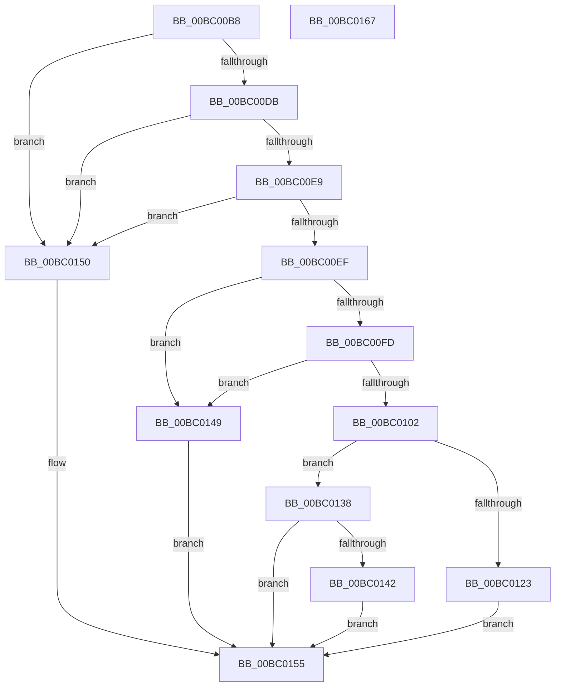

# BgpGxParseBitmap

- RVA: `0x00BC00B8`–`0x00BC0168` (길이 `176` bytes)
- VA: `0x0000000140BC00B8`
- 실행 섹션: `PAGEBGFX`
- PDB 이름 있음: `예`; PDB Function 태그: `아니요`
- unwind 정보 RVA: `0x000733E4`
- 디코드: `53`개 명령, `176/176` bytes 표시
- 미해석 바이트: `0` (있으면 어셈블리에 `.byte`로 보존)

> 이 문서는 커널 이미지의 기계어와 PDB 기호를 분석해 생성했습니다. 4번과 5번은 함수 원형과 자료형을 바이너리 사용 방식에서 추정한 C 해석이며 원본 소스 복구 결과는 아닙니다.

## 1. Dependencies

- 직접 호출 지점: **3**; 고유 호출 대상: **3**
- 직접 호출자로 확인된 함수: **3**
- RIP 상대 이미지 참조: **0**

### Outgoing calls
- `0x00BC0118` → [BgpGxRectangleCreate](BgpGxRectangleCreate_function_00BC3E78.md) (function, `0x00BC3E78`)
- `0x00BC012E` → [BgpGxCopyBitmapToRectangle](BgpGxCopyBitmapToRectangle_function_00BC535C.md) (function, `0x00BC535C`)
- `0x00BC0142` → [BgpGxRectangleDestroy](BgpGxRectangleDestroy_function_00BC3F04.md) (function, `0x00BC3F04`)

### Direct callers
- [BgpGxProcessQrCodeBitmap](../../text/69/BgpGxProcessQrCodeBitmap_function_0069F244.md) at `0x0069F268`
- [BgpGxDrawBitmapImage](BgpGxDrawBitmapImage_function_00BC26EC.md) at `0x00BC2704`
- [AnFwDisplayFade](AnFwDisplayFade_function_00BC36EC.md) at `0x00BC384E`

### Static image references
- 디코드된 RIP-relative 메모리 참조가 없습니다.

## 2. Other-region calls and transfers

- 다른 실행 섹션으로 향하는 call: **0**
- 별도 외부 분기/꼬리 이동을 확인하지 못했습니다.

## 3. Assembly (complete function range)

```asm
00BC00B8  4C 8B DC                        mov r11, rsp
00BC00BB  49 89 5B 08                     mov qword ptr [r11 + 8], rbx
00BC00BF  49 89 73 10                     mov qword ptr [r11 + 0x10], rsi
00BC00C3  57                              push rdi
00BC00C4  48 83 EC 30                     sub rsp, 0x30
00BC00C8  83 64 24 28 00                  and dword ptr [rsp + 0x28], 0
00BC00CD  48 8B F2                        mov rsi, rdx
00BC00D0  49 83 63 20 00                  and qword ptr [r11 + 0x20], 0
00BC00D5  83 79 02 30                     cmp dword ptr [rcx + 2], 0x30
00BC00D9  72 75                           jb 0x140bc0150
00BC00DB  B8 42 4D 00 00                  mov eax, 0x4d42
00BC00E0  48 8D 59 0E                     lea rbx, [rcx + 0xe]
00BC00E4  66 39 01                        cmp word ptr [rcx], ax
00BC00E7  75 67                           jne 0x140bc0150
00BC00E9  83 7B 10 00                     cmp dword ptr [rbx + 0x10], 0
00BC00ED  75 61                           jne 0x140bc0150
00BC00EF  0F B7 53 0E                     movzx edx, word ptr [rbx + 0xe]
00BC00F3  8D 42 E8                        lea eax, [rdx - 0x18]
00BC00F6  A9 F7 FF FF FF                  test eax, 0xfffffff7
00BC00FB  75 4C                           jne 0x140bc0149
00BC00FD  83 3B 28                        cmp dword ptr [rbx], 0x28
00BC0100  75 47                           jne 0x140bc0149
00BC0102  8B 43 04                        mov eax, dword ptr [rbx + 4]
00BC0105  4D 8D 43 20                     lea r8, [r11 + 0x20]
00BC0109  89 44 24 20                     mov dword ptr [rsp + 0x20], eax
00BC010D  49 8D 4B E8                     lea rcx, [r11 - 0x18]
00BC0111  8B 43 08                        mov eax, dword ptr [rbx + 8]
00BC0114  89 44 24 24                     mov dword ptr [rsp + 0x24], eax
00BC0118  E8 5B 3D 00 00                  call 0x140bc3e78
00BC011D  8B F8                           mov edi, eax
00BC011F  85 C0                           test eax, eax
00BC0121  78 15                           js 0x140bc0138
00BC0123  48 8B D3                        mov rdx, rbx
00BC0126  48 8B 5C 24 58                  mov rbx, qword ptr [rsp + 0x58]
00BC012B  48 8B CB                        mov rcx, rbx
00BC012E  E8 29 52 00 00                  call 0x140bc535c
00BC0133  48 89 1E                        mov qword ptr [rsi], rbx
00BC0136  EB 1D                           jmp 0x140bc0155
00BC0138  48 8B 4C 24 58                  mov rcx, qword ptr [rsp + 0x58]
00BC013D  48 85 C9                        test rcx, rcx
00BC0140  74 13                           je 0x140bc0155
00BC0142  E8 BD 3D 00 00                  call 0x140bc3f04
00BC0147  EB 0C                           jmp 0x140bc0155
00BC0149  BF BB 00 00 C0                  mov edi, 0xc00000bb
00BC014E  EB 05                           jmp 0x140bc0155
00BC0150  BF 0D 00 00 C0                  mov edi, 0xc000000d
00BC0155  48 8B 5C 24 40                  mov rbx, qword ptr [rsp + 0x40]
00BC015A  8B C7                           mov eax, edi
00BC015C  48 8B 74 24 48                  mov rsi, qword ptr [rsp + 0x48]
00BC0161  48 83 C4 30                     add rsp, 0x30
00BC0165  5F                              pop rdi
00BC0166  C3                              ret
00BC0167  CC                              int3
```

## 4. C-style interpretation (structured pseudocode)

```c
__int64 __fastcall BgpGxParseBitmap(__int64 a1, __int64 a2)
{
    __int64 result;
    __int64 v_rsp;
    unsigned int v_stack_m10;
    unsigned int v_stack_m14;
    unsigned int v_stack_m18;
    unsigned __int64 v_stack_p10;
    unsigned __int64 v_stack_p20;
    unsigned __int64 v_stack_p8;

    *(unsigned __int64 *)(v_rsp + 8) = v_rbx;
    *(unsigned __int64 *)(v_rsp + 16) = v_rsi;
    v_rsp = (v_rsp) - (48);
    if ((*(unsigned int *)(a1 + 2)) < 48) goto loc_00BC0150;
    if ((*(unsigned __int16 *)(a1)) != ((unsigned __int16)((unsigned int)(0x4D42ULL)))) goto loc_00BC0150;
    if ((*(unsigned int *)(a1 + 14 + 16)) != 0) goto loc_00BC0150;
    if ((((unsigned int)(*(unsigned __int16 *)(a1 + 14 + 14) - 24)) & (0xFFFFFFF7ULL)) != 0) goto loc_00BC0149;
    if ((*(unsigned int *)(a1 + 14)) != 40) goto loc_00BC0149;
    v_stack_m18 = (unsigned int)((unsigned int)(*(unsigned int *)(a1 + 14 + 4)));
    v_stack_m14 = (unsigned int)((unsigned int)(*(unsigned int *)(a1 + 14 + 8)));
    result = BgpGxRectangleCreate(v_rsp - 24, *(unsigned __int16 *)(a1 + 14 + 14), v_rsp + 32, a4);
    if (sign_flag) goto loc_00BC0138;
    result = BgpGxCopyBitmapToRectangle(v_stack_p20, a1 + 14, v_rsp + 32, a4);
    *(unsigned __int64 *)(a2) = v_stack_p20;
    goto loc_00BC0155;
loc_00BC0138:
    if (v_stack_p20 == 0) goto loc_00BC0155;
    result = BgpGxRectangleDestroy(v_stack_p20, a1 + 14, v_rsp + 32, a4);
    goto loc_00BC0155;
loc_00BC0149:
    goto loc_00BC0155;
loc_00BC0150:
loc_00BC0155:
    v_rsp = (v_rsp) + (48);
    return (unsigned int)((unsigned int)((unsigned int)(0xC000000DULL)));
}
```

## 5. (Beta) C Style

```c
int64_t BgpGxParseBitmap(void *Arg1, void *Arg2)
{
    uint8_t *arg1 = (uint8_t *)Arg1;
    uint8_t *arg2 = (uint8_t *)Arg2;

    int64_t result;
    int64_t local_rsp;
    uint32_t v_stack_m10;
    uint32_t v_stack_m14;
    uint32_t v_stack_m18;
    uint64_t v_stack_p10;
    uint64_t v_stack_p20;
    uint64_t v_stack_p8;

    *(uint64_t *)(local_rsp + 0x8) = local_rbx;
    *(uint64_t *)(local_rsp + 0x10) = local_rsi;
    local_rsp = (local_rsp) - (48);
    if ((*(uint32_t *)(arg1 + 0x2)) < 48) goto loc_00BC0150;
    if ((*(uint16_t *)(arg1)) != ((uint16_t)((uint32_t)(0x4D42ULL)))) goto loc_00BC0150;
    if ((*(uint32_t *)(arg1 + 0xE + 0x10)) != 0) goto loc_00BC0150;
    if ((((uint32_t)(*(uint16_t *)(arg1 + 0xE + 0xE) - 24)) & (0xFFFFFFF7ULL)) != 0) goto loc_00BC0149;
    if ((*(uint32_t *)(arg1 + 0xE)) != 40) goto loc_00BC0149;
    v_stack_m18 = (uint32_t)((uint32_t)(*(uint32_t *)(arg1 + 0xE + 0x4)));
    v_stack_m14 = (uint32_t)((uint32_t)(*(uint32_t *)(arg1 + 0xE + 0x8)));
    result = BgpGxRectangleCreate(local_rsp - 24, *(uint16_t *)(arg1 + 0xE + 0xE), local_rsp + 32, a4);
    if (sign_flag) goto loc_00BC0138;
    result = BgpGxCopyBitmapToRectangle(v_stack_p20, Arg1 + 14, local_rsp + 32, a4);
    *(uint64_t *)(arg2) = v_stack_p20;
    goto loc_00BC0155;
loc_00BC0138:
    if (v_stack_p20 == 0) goto loc_00BC0155;
    result = BgpGxRectangleDestroy(v_stack_p20, Arg1 + 14, local_rsp + 32, a4);
    goto loc_00BC0155;
loc_00BC0149:
    goto loc_00BC0155;
loc_00BC0150:
loc_00BC0155:
    local_rsp = (local_rsp) + (48);
    return (uint32_t)((uint32_t)((uint32_t)(0xC000000DULL)));
}
```

### 관측된 메모리 오프셋

구조체 형식이 확인되지 않은 접근은 인자 기준의 오프셋으로만 기록했습니다.

| 기준 인자 | 오프셋 표현 | 폭 (bit) | 접근 |
|---|---:|---:|---|
| `Arg1` | `+ 0x0` | `16` | `R` |
| `Arg1` | `+ 0x0` | `32` | `R` |
| `Arg1` | `+ 0x2` | `32` | `R` |
| `Arg1` | `+ 0x4` | `32` | `R` |
| `Arg1` | `+ 0x8` | `32` | `R` |
| `Arg1` | `+ 0xE` | `16` | `R` |
| `Arg1` | `+ 0xE` | `64` | `R` |
| `Arg1` | `+ 0x10` | `32` | `R` |
| `Arg2` | `+ 0x0` | `64` | `W` |

## 6. Execution-region graph

[열기: 2D/3D 그래프와 함수 탐색 컨트롤 패널](../../../control-panel.html?section=pagebgfx&rva=0x00BC00B8&view=graph)

- 2D 그래프는 위에서 아래로 흐르고, 3D 그래프는 빈 공간을 드래그해 회전합니다. Shift+드래그는 이동, 휠은 확대·축소, 함수 노드 선택은 대상 보고서 이동입니다.

### Static fallback


