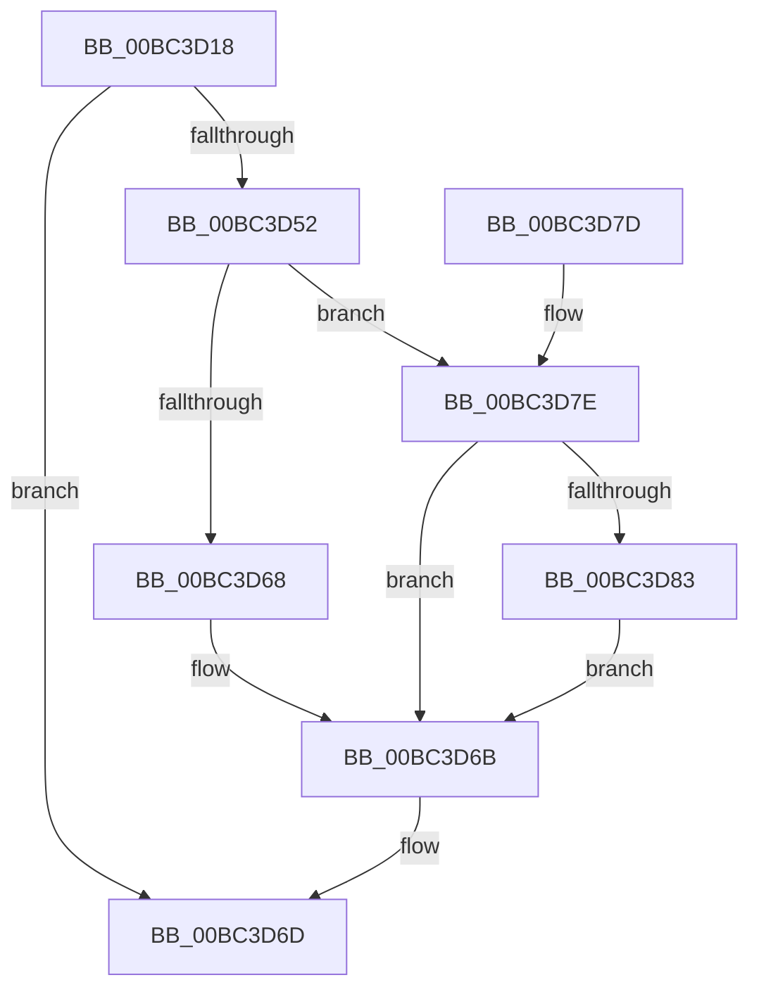

# BgpGxReadRectangle

- RVA: `0x00BC3D18`–`0x00BC3D8D` (길이 `117` bytes)
- VA: `0x0000000140BC3D18`
- 실행 섹션: `PAGEBGFX`
- PDB 이름 있음: `예`; PDB Function 태그: `아니요`
- unwind 정보 RVA: `0x000AA5A0`
- 디코드: `36`개 명령, `117/117` bytes 표시
- 미해석 바이트: `0` (있으면 어셈블리에 `.byte`로 보존)

> 이 문서는 커널 이미지의 기계어와 PDB 기호를 분석해 생성했습니다. 4번과 5번은 함수 원형과 자료형을 바이너리 사용 방식에서 추정한 C 해석이며 원본 소스 복구 결과는 아닙니다.

## 1. Dependencies

- 직접 호출 지점: **4**; 고유 호출 대상: **4**
- 직접 호출자로 확인된 함수: **2**
- RIP 상대 이미지 참조: **0**

### Outgoing calls
- `0x00BC3D3A` → [BgpGetBitsPerPixel](../../text/48/BgpGetBitsPerPixel_function_0048CDA0.md) (function, `0x0048CDA0`)
- `0x00BC3D49` → [BgpGxRectangleCreate](BgpGxRectangleCreate_function_00BC3E78.md) (function, `0x00BC3E78`)
- `0x00BC3D5D` → [GxpReadFrameBufferPixels](GxpReadFrameBufferPixels_function_00BC3F2C.md) (function, `0x00BC3F2C`)
- `0x00BC3D86` → [BgpGxRectangleDestroy](BgpGxRectangleDestroy_function_00BC3F04.md) (function, `0x00BC3F04`)

### Direct callers
- [AnFwDisplayFade](AnFwDisplayFade_function_00BC36EC.md) at `0x00BC3973`
- [sub_00BC65EE](Unknown_function_00BC65EE.md) at `0x00BC660F`

### Static image references
- 디코드된 RIP-relative 메모리 참조가 없습니다.

## 2. Other-region calls and transfers

- 다른 실행 섹션으로 향하는 call: **1**
  - `0x00BC3D3A` → [BgpGetBitsPerPixel](../../text/48/BgpGetBitsPerPixel_function_0048CDA0.md) (`PAGEBGFX` → `.text`)
- 별도 외부 분기/꼬리 이동을 확인하지 못했습니다.

## 3. Assembly (complete function range)

```asm
00BC3D18  48 89 5C 24 10                  mov qword ptr [rsp + 0x10], rbx
00BC3D1D  48 89 74 24 18                  mov qword ptr [rsp + 0x18], rsi
00BC3D22  57                              push rdi
00BC3D23  48 83 EC 20                     sub rsp, 0x20
00BC3D27  48 83 21 00                     and qword ptr [rcx], 0
00BC3D2B  4D 8B C8                        mov r9, r8
00BC3D2E  48 83 64 24 30 00               and qword ptr [rsp + 0x30], 0
00BC3D34  48 8B DA                        mov rbx, rdx
00BC3D37  48 8B F1                        mov rsi, rcx
00BC3D3A  E8 61 90 8C FF                  call 0x14048cda0
00BC3D3F  8B D0                           mov edx, eax
00BC3D41  4C 8D 44 24 30                  lea r8, [rsp + 0x30]
00BC3D46  49 8B C9                        mov rcx, r9
00BC3D49  E8 2A 01 00 00                  call 0x140bc3e78
00BC3D4E  85 C0                           test eax, eax
00BC3D50  78 1B                           js 0x140bc3d6d
00BC3D52  48 8B D3                        mov rdx, rbx
00BC3D55  48 8B 5C 24 30                  mov rbx, qword ptr [rsp + 0x30]
00BC3D5A  48 8B CB                        mov rcx, rbx
00BC3D5D  E8 CA 01 00 00                  call 0x140bc3f2c
00BC3D62  8B F8                           mov edi, eax
00BC3D64  85 C0                           test eax, eax
00BC3D66  78 16                           js 0x140bc3d7e
00BC3D68  48 89 1E                        mov qword ptr [rsi], rbx
00BC3D6B  8B C7                           mov eax, edi
00BC3D6D  48 8B 5C 24 38                  mov rbx, qword ptr [rsp + 0x38]
00BC3D72  48 8B 74 24 40                  mov rsi, qword ptr [rsp + 0x40]
00BC3D77  48 83 C4 20                     add rsp, 0x20
00BC3D7B  5F                              pop rdi
00BC3D7C  C3                              ret
00BC3D7D  CC                              int3
00BC3D7E  48 85 DB                        test rbx, rbx
00BC3D81  74 E8                           je 0x140bc3d6b
00BC3D83  48 8B CB                        mov rcx, rbx
00BC3D86  E8 79 01 00 00                  call 0x140bc3f04
00BC3D8B  EB DE                           jmp 0x140bc3d6b
```

## 4. C-style interpretation (structured pseudocode)

```c
__int64 __fastcall BgpGxReadRectangle(__int64 a1, __int64 a2, __int64 a3)
{
    __int64 result;
    __int64 v_rsp;
    unsigned __int64 v_stack_p10;
    unsigned __int64 v_stack_p18;
    unsigned __int64 v_stack_p8;

    v_stack_p10 = v_rbx;
    v_stack_p18 = v_rsi;
    v_rsp = (v_rsp) - (32);
    result = BgpGetBitsPerPixel(a1, a2, a3, a3);
    result = BgpGxRectangleCreate(a3, (unsigned int)((unsigned int)(result)), v_stack_p8, a3);
    if (sign_flag) goto loc_00BC3D6D;
    result = GxpReadFrameBufferPixels(v_stack_p8, a2, v_stack_p8, a3);
    if (sign_flag) goto loc_00BC3D7E;
    *(unsigned __int64 *)(a1) = v_stack_p8;
loc_00BC3D6B:
loc_00BC3D6D:
    v_rsp = (v_rsp) + (32);
    return (unsigned int)((unsigned int)((unsigned int)((unsigned int)(result))));
loc_00BC3D7E:
    if (v_stack_p10 == 0) goto loc_00BC3D6B;
    result = BgpGxRectangleDestroy(v_stack_p10, a2, v_stack_p8, a3);
    goto loc_00BC3D6B;
}
```

## 5. (Beta) C Style

```c
int64_t BgpGxReadRectangle(void *Arg1, int64_t Arg2, int64_t Arg3)
{
    uint8_t *arg1 = (uint8_t *)Arg1;

    int64_t result;
    int64_t local_rsp;
    uint64_t v_stack_p10;
    uint64_t v_stack_p18;
    uint64_t v_stack_p8;

    v_stack_p10 = local_rbx;
    v_stack_p18 = local_rsi;
    local_rsp = (local_rsp) - (32);
    result = BgpGetBitsPerPixel(Arg1, Arg2, Arg3, Arg3);
    result = BgpGxRectangleCreate(Arg3, (uint32_t)((uint32_t)(result)), v_stack_p8, Arg3);
    if (sign_flag) goto loc_00BC3D6D;
    result = GxpReadFrameBufferPixels(v_stack_p8, Arg2, v_stack_p8, Arg3);
    if (sign_flag) goto loc_00BC3D7E;
    *(uint64_t *)(arg1) = v_stack_p8;
loc_00BC3D6B:
loc_00BC3D6D:
    local_rsp = (local_rsp) + (32);
    return (uint32_t)((uint32_t)((uint32_t)((uint32_t)(result))));
loc_00BC3D7E:
    if (v_stack_p10 == 0) goto loc_00BC3D6B;
    result = BgpGxRectangleDestroy(v_stack_p10, Arg2, v_stack_p8, Arg3);
    goto loc_00BC3D6B;
}
```

### 관측된 메모리 오프셋

구조체 형식이 확인되지 않은 접근은 인자 기준의 오프셋으로만 기록했습니다.

| 기준 인자 | 오프셋 표현 | 폭 (bit) | 접근 |
|---|---:|---:|---|
| `Arg1` | `+ 0x0` | `64` | `R/W` |
| `Arg1` | `+ 0x0` | `64` | `W` |

## 6. Execution-region graph

[열기: 2D/3D 그래프와 함수 탐색 컨트롤 패널](../../../control-panel.html?section=pagebgfx&rva=0x00BC3D18&view=graph)

- 2D 그래프는 위에서 아래로 흐르고, 3D 그래프는 빈 공간을 드래그해 회전합니다. Shift+드래그는 이동, 휠은 확대·축소, 함수 노드 선택은 대상 보고서 이동입니다.

### Static fallback


