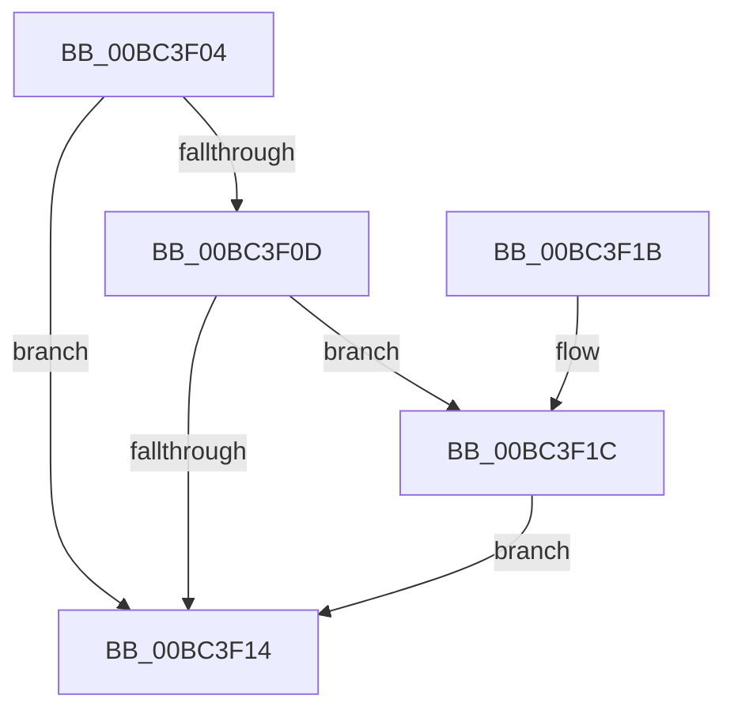

# BgpGxRectangleDestroy

- RVA: `0x00BC3F04`–`0x00BC3F23` (길이 `31` bytes)
- VA: `0x0000000140BC3F04`
- 실행 섹션: `PAGEBGFX`
- PDB 이름 있음: `예`; PDB Function 태그: `아니요`
- unwind 정보 RVA: `0x0005CEE8`
- 디코드: `12`개 명령, `31/31` bytes 표시
- 미해석 바이트: `0` (있으면 어셈블리에 `.byte`로 보존)

> 이 문서는 커널 이미지의 기계어와 PDB 기호를 분석해 생성했습니다. 4번과 5번은 함수 원형과 자료형을 바이너리 사용 방식에서 추정한 C 해석이며 원본 소스 복구 결과는 아닙니다.

## 1. Dependencies

- 직접 호출 지점: **1**; 고유 호출 대상: **1**
- 직접 호출자로 확인된 함수: **16**
- RIP 상대 이미지 참조: **0**

### Outgoing calls
- `0x00BC3F1C` → [BgpFwFreeMemory](../../text/3E/BgpFwFreeMemory_function_003E25E0.md) (function, `0x003E25E0`)

### Direct callers
- [BgpTxtDisplayCharacter](../../text/47/BgpTxtDisplayCharacter_function_0047F120.md) at `0x0047F2E7`
- [BgpTxtDisplayCharacter](../../text/47/BgpTxtDisplayCharacter_function_0047F120.md) at `0x0047F380`
- [BgpGxDrawRectangle](../../text/48/BgpGxDrawRectangle_function_0048C91C.md) at `0x0048C9C2`
- [BgpGxConvertRectangle](../../text/69/BgpGxConvertRectangle_function_0069F190.md) at `0x0069F1C2`
- [BgpGxProcessQrCodeBitmap](../../text/69/BgpGxProcessQrCodeBitmap_function_0069F244.md) at `0x0069F2AD`
- [sub_006F6564](../../text/6F/Unknown_function_006F6564.md) at `0x006F65EB`
- [BgpGxParseBitmap](BgpGxParseBitmap_function_00BC00B8.md) at `0x00BC0142`
- [BgpGxBlendRectangle](BgpGxBlendRectangle_function_00BC2400.md) at `0x00BC25EC`
- [BgpGxDrawBitmapImage](BgpGxDrawBitmapImage_function_00BC26EC.md) at `0x00BC2723`
- [BgpTxtCreateRegion](BgpTxtCreateRegion_function_00BC2908.md) at `0x00BC2B10`
- [BgpTxtCreateRegion](BgpTxtCreateRegion_function_00BC2908.md) at `0x00BC2B1D`
- [BgpTxtDestroyRegion](BgpTxtDestroyRegion_function_00BC2B5C.md) at `0x00BC2B79`
- [BgpTxtDestroyRegion](BgpTxtDestroyRegion_function_00BC2B5C.md) at `0x00BC2B87`
- [BgpTxtDisplayString](BgpTxtDisplayString_function_00BC2BB0.md) at `0x00BC2D97`
- [BgpTxtDisplayString](BgpTxtDisplayString_function_00BC2BB0.md) at `0x00BC2DA4`
- [AnFwFadeCompletion](AnFwFadeCompletion_function_00BC358C.md) at `0x00BC3641`
- [AnFwFadeCompletion](AnFwFadeCompletion_function_00BC358C.md) at `0x00BC3650`
- [AnFwFadeCompletion](AnFwFadeCompletion_function_00BC358C.md) at `0x00BC365F`
- [AnFwFadeCompletion](AnFwFadeCompletion_function_00BC358C.md) at `0x00BC366E`
- [AnFwFadeCompletion](AnFwFadeCompletion_function_00BC358C.md) at `0x00BC367D`
- [AnFwFadeCompletion](AnFwFadeCompletion_function_00BC358C.md) at `0x00BC368C`
- [AnFwDisplayFade](AnFwDisplayFade_function_00BC36EC.md) at `0x00BC3AC5`
- [AnFwDisplayFade](AnFwDisplayFade_function_00BC36EC.md) at `0x00BC3CA0`
- [BgpGxReadRectangle](BgpGxReadRectangle_function_00BC3D18.md) at `0x00BC3D86`
- [TxtpDestroyCacheEntry](TxtpDestroyCacheEntry_function_00BC43D4.md) at `0x00BC43E1`
- [sub_00BC65EE](Unknown_function_00BC65EE.md) at `0x00BC67DC`
- [sub_00BC65EE](Unknown_function_00BC65EE.md) at `0x00BC67E9`
- [sub_00BC65EE](Unknown_function_00BC65EE.md) at `0x00BC67FA`
- [sub_00BC65EE](Unknown_function_00BC65EE.md) at `0x00BC6807`
- [sub_00BC65EE](Unknown_function_00BC65EE.md) at `0x00BC6818`

### Static image references
- 디코드된 RIP-relative 메모리 참조가 없습니다.

## 2. Other-region calls and transfers

- 다른 실행 섹션으로 향하는 call: **1**
  - `0x00BC3F1C` → [BgpFwFreeMemory](../../text/3E/BgpFwFreeMemory_function_003E25E0.md) (`PAGEBGFX` → `.text`)
- 별도 외부 분기/꼬리 이동을 확인하지 못했습니다.

## 3. Assembly (complete function range)

```asm
00BC3F04  48 83 EC 28                     sub rsp, 0x28
00BC3F08  48 85 C9                        test rcx, rcx
00BC3F0B  74 07                           je 0x140bc3f14
00BC3F0D  8B 41 10                        mov eax, dword ptr [rcx + 0x10]
00BC3F10  A8 01                           test al, 1
00BC3F12  74 08                           je 0x140bc3f1c
00BC3F14  33 C0                           xor eax, eax
00BC3F16  48 83 C4 28                     add rsp, 0x28
00BC3F1A  C3                              ret
00BC3F1B  CC                              int3
00BC3F1C  E8 BF E6 81 FF                  call 0x1403e25e0
00BC3F21  EB F1                           jmp 0x140bc3f14
```

## 4. C-style interpretation (structured pseudocode)

```c
__int64 __fastcall BgpGxRectangleDestroy(__int64 a1)
{
    __int64 result;
    __int64 v_rsp;

    v_rsp = (v_rsp) - (40);
    if (a1 == 0) goto loc_00BC3F14;
    if ((((unsigned __int8)((unsigned int)(*(unsigned int *)(a1 + 16)))) & (1)) == 0) goto loc_00BC3F1C;
loc_00BC3F14:
    result = 0;
    v_rsp = (v_rsp) + (40);
    return result;
loc_00BC3F1C:
    result = BgpFwFreeMemory(a1, a2, a3, a4);
    goto loc_00BC3F14;
}
```

## 5. (Beta) C Style

```c
int64_t BgpGxRectangleDestroy(int64_t Arg1)
{
    int64_t result;
    int64_t local_rsp;

    local_rsp = (local_rsp) - (40);
    if (Arg1 == 0) goto loc_00BC3F14;
    if ((((uint8_t)((uint32_t)(*(uint32_t *)(Arg1 + 0x10)))) & (1)) == 0) goto loc_00BC3F1C;
loc_00BC3F14:
    result = 0;
    local_rsp = (local_rsp) + (40);
    return result;
loc_00BC3F1C:
    result = BgpFwFreeMemory(Arg1, a2, a3, a4);
    goto loc_00BC3F14;
}
```

## 6. Execution-region graph

[열기: 2D/3D 그래프와 함수 탐색 컨트롤 패널](../../../control-panel.html?section=pagebgfx&rva=0x00BC3F04&view=graph)

- 2D 그래프는 위에서 아래로 흐르고, 3D 그래프는 빈 공간을 드래그해 회전합니다. Shift+드래그는 이동, 휠은 확대·축소, 함수 노드 선택은 대상 보고서 이동입니다.

### Static fallback


