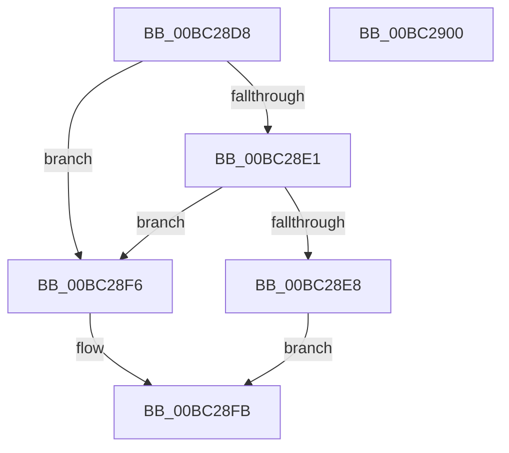

# BgpTxtClearRegion

- RVA: `0x00BC28D8`–`0x00BC2901` (길이 `41` bytes)
- VA: `0x0000000140BC28D8`
- 실행 섹션: `PAGEBGFX`
- PDB 이름 있음: `예`; PDB Function 태그: `아니요`
- unwind 정보 RVA: `0x0005C788`
- 디코드: `14`개 명령, `41/41` bytes 표시
- 미해석 바이트: `0` (있으면 어셈블리에 `.byte`로 보존)

> 이 문서는 커널 이미지의 기계어와 PDB 기호를 분석해 생성했습니다. 4번과 5번은 함수 원형과 자료형을 바이너리 사용 방식에서 추정한 C 해석이며 원본 소스 복구 결과는 아닙니다.

## 1. Dependencies

- 직접 호출 지점: **1**; 고유 호출 대상: **1**
- 직접 호출자로 확인된 함수: **1**
- RIP 상대 이미지 참조: **0**

### Outgoing calls
- `0x00BC28EF` → [BgpGxDrawRectangle](../../text/48/BgpGxDrawRectangle_function_0048C91C.md) (function, `0x0048C91C`)

### Direct callers
- [BgpTxtDisplayString](BgpTxtDisplayString_function_00BC2BB0.md) at `0x00BC2C0D`
- [BgpTxtDisplayString](BgpTxtDisplayString_function_00BC2BB0.md) at `0x00BC2D6B`

### Static image references
- 디코드된 RIP-relative 메모리 참조가 없습니다.

## 2. Other-region calls and transfers

- 다른 실행 섹션으로 향하는 call: **1**
  - `0x00BC28EF` → [BgpGxDrawRectangle](../../text/48/BgpGxDrawRectangle_function_0048C91C.md) (`PAGEBGFX` → `.text`)
- 별도 외부 분기/꼬리 이동을 확인하지 못했습니다.

## 3. Assembly (complete function range)

```asm
00BC28D8  48 83 EC 28                     sub rsp, 0x28
00BC28DC  48 85 C9                        test rcx, rcx
00BC28DF  74 15                           je 0x140bc28f6
00BC28E1  8B 41 48                        mov eax, dword ptr [rcx + 0x48]
00BC28E4  A8 01                           test al, 1
00BC28E6  74 0E                           je 0x140bc28f6
00BC28E8  48 8B D1                        mov rdx, rcx
00BC28EB  48 8B 49 18                     mov rcx, qword ptr [rcx + 0x18]
00BC28EF  E8 28 A0 8C FF                  call 0x14048c91c
00BC28F4  EB 05                           jmp 0x140bc28fb
00BC28F6  B8 0D 00 00 C0                  mov eax, 0xc000000d
00BC28FB  48 83 C4 28                     add rsp, 0x28
00BC28FF  C3                              ret
00BC2900  CC                              int3
```

## 4. C-style interpretation (structured pseudocode)

```c
__int64 __fastcall BgpTxtClearRegion(__int64 a1)
{
    __int64 result;
    __int64 v_rsp;

    v_rsp = (v_rsp) - (40);
    if (a1 == 0) goto loc_00BC28F6;
    if ((((unsigned __int8)((unsigned int)(*(unsigned int *)(a1 + 72)))) & (1)) == 0) goto loc_00BC28F6;
    result = BgpGxDrawRectangle(*(unsigned __int64 *)(a1 + 24), a1, a3, a4);
    goto loc_00BC28FB;
loc_00BC28F6:
loc_00BC28FB:
    v_rsp = (v_rsp) + (40);
    return (unsigned int)(0xC000000DULL);
}
```

## 5. (Beta) C Style

```c
int64_t BgpTxtClearRegion(int64_t Arg1)
{
    int64_t result;
    int64_t local_rsp;

    local_rsp = (local_rsp) - (40);
    if (Arg1 == 0) goto loc_00BC28F6;
    if ((((uint8_t)((uint32_t)(*(uint32_t *)(Arg1 + 0x48)))) & (1)) == 0) goto loc_00BC28F6;
    result = BgpGxDrawRectangle(*(uint64_t *)(Arg1 + 0x18), Arg1, a3, a4);
    goto loc_00BC28FB;
loc_00BC28F6:
loc_00BC28FB:
    local_rsp = (local_rsp) + (40);
    return (uint32_t)(0xC000000DULL);
}
```

## 6. Execution-region graph

[열기: 2D/3D 그래프와 함수 탐색 컨트롤 패널](../../../control-panel.html?section=pagebgfx&rva=0x00BC28D8&view=graph)

- 2D 그래프는 위에서 아래로 흐르고, 3D 그래프는 빈 공간을 드래그해 회전합니다. Shift+드래그는 이동, 휠은 확대·축소, 함수 노드 선택은 대상 보고서 이동입니다.

### Static fallback


