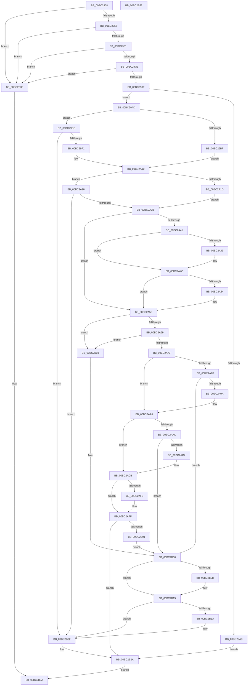

# BgpTxtCreateRegion

- RVA: `0x00BC2908`–`0x00BC2B53` (길이 `587` bytes)
- VA: `0x0000000140BC2908`
- 실행 섹션: `PAGEBGFX`
- PDB 이름 있음: `예`; PDB Function 태그: `아니요`
- unwind 정보 RVA: `0x000DA538`
- 디코드: `169`개 명령, `587/587` bytes 표시
- 미해석 바이트: `0` (있으면 어셈블리에 `.byte`로 보존)

> 이 문서는 커널 이미지의 기계어와 PDB 기호를 분석해 생성했습니다. 4번과 5번은 함수 원형과 자료형을 바이너리 사용 방식에서 추정한 C 해석이며 원본 소스 복구 결과는 아닙니다.

## 1. Dependencies

- 직접 호출 지점: **11**; 고유 호출 대상: **9**
- 직접 호출자로 확인된 함수: **3**
- RIP 상대 이미지 참조: **0**

### Outgoing calls
- `0x00BC2965` → [BgpGetResolution](../../text/4E/BgpGetResolution_function_004E3294.md) (function, `0x004E3294`)
- `0x00BC2996` → [BgpFwAllocateMemory](../../text/3E/BgpFwAllocateMemory_function_003E4374.md) (function, `0x003E4374`)
- `0x00BC29B5` → [memset](../../text/6C/memset_function_006C6C40.md) (function, `0x006C6C40`)
- `0x00BC29E2` → [BgpFoGetFontHandle](BgpFoGetFontHandle_function_00BC52B0.md) (function, `0x00BC52B0`)
- `0x00BC2A2C` → [BgpFoGetTextMetrics](../../text/4E/BgpFoGetTextMetrics_function_004E3FC4.md) (function, `0x004E3FC4`)
- `0x00BC2A8B` → [BgpGxRectangleCreate](BgpGxRectangleCreate_function_00BC3E78.md) (function, `0x00BC3E78`)
- `0x00BC2AA1` → [BgpGxFillRectangle](../../text/47/BgpGxFillRectangle_function_0047F808.md) (function, `0x0047F808`)
- `0x00BC2AB8` → [BgpGxRectangleCreate](BgpGxRectangleCreate_function_00BC3E78.md) (function, `0x00BC3E78`)
- `0x00BC2B10` → [BgpGxRectangleDestroy](BgpGxRectangleDestroy_function_00BC3F04.md) (function, `0x00BC3F04`)
- `0x00BC2B1D` → [BgpGxRectangleDestroy](BgpGxRectangleDestroy_function_00BC3F04.md) (function, `0x00BC3F04`)
- `0x00BC2B25` → [BgpFwFreeMemory](../../text/3E/BgpFwFreeMemory_function_003E25E0.md) (function, `0x003E25E0`)

### Direct callers
- [BgpDisplayCharacterGetContext](BgpDisplayCharacterGetContext_function_00BC0860.md) at `0x00BC08D1`
- [ResFwConfigureDisplayStringResources](ResFwConfigureDisplayStringResources_function_00BC18C4.md) at `0x00BC1949`
- [AnFwConfigureProgressResources](AnFwConfigureProgressResources_function_00BC1CFC.md) at `0x00BC1DCB`

### Static image references
- 디코드된 RIP-relative 메모리 참조가 없습니다.

## 2. Other-region calls and transfers

- 다른 실행 섹션으로 향하는 call: **6**
  - `0x00BC2965` → [BgpGetResolution](../../text/4E/BgpGetResolution_function_004E3294.md) (`PAGEBGFX` → `.text`)
  - `0x00BC2996` → [BgpFwAllocateMemory](../../text/3E/BgpFwAllocateMemory_function_003E4374.md) (`PAGEBGFX` → `.text`)
  - `0x00BC29B5` → [memset](../../text/6C/memset_function_006C6C40.md) (`PAGEBGFX` → `.text`)
  - `0x00BC2A2C` → [BgpFoGetTextMetrics](../../text/4E/BgpFoGetTextMetrics_function_004E3FC4.md) (`PAGEBGFX` → `.text`)
  - `0x00BC2AA1` → [BgpGxFillRectangle](../../text/47/BgpGxFillRectangle_function_0047F808.md) (`PAGEBGFX` → `.text`)
  - `0x00BC2B25` → [BgpFwFreeMemory](../../text/3E/BgpFwFreeMemory_function_003E25E0.md) (`PAGEBGFX` → `.text`)
- 별도 외부 분기/꼬리 이동을 확인하지 못했습니다.

## 3. Assembly (complete function range)

```asm
00BC2908  48 89 5C 24 10                  mov qword ptr [rsp + 0x10], rbx
00BC290D  4C 89 4C 24 20                  mov qword ptr [rsp + 0x20], r9
00BC2912  48 89 4C 24 08                  mov qword ptr [rsp + 8], rcx
00BC2917  55                              push rbp
00BC2918  56                              push rsi
00BC2919  57                              push rdi
00BC291A  41 54                           push r12
00BC291C  41 55                           push r13
00BC291E  41 56                           push r14
00BC2920  41 57                           push r15
00BC2922  48 8B EC                        mov rbp, rsp
00BC2925  48 83 EC 60                     sub rsp, 0x60
00BC2929  48 8B 45 60                     mov rax, qword ptr [rbp + 0x60]
00BC292D  45 33 FF                        xor r15d, r15d
00BC2930  48 83 65 D0 00                  and qword ptr [rbp - 0x30], 0
00BC2935  45 33 F6                        xor r14d, r14d
00BC2938  33 FF                           xor edi, edi
00BC293A  4C 89 7D C0                     mov qword ptr [rbp - 0x40], r15
00BC293E  48 8B F2                        mov rsi, rdx
00BC2941  4C 89 75 C8                     mov qword ptr [rbp - 0x38], r14
00BC2945  48 83 20 00                     and qword ptr [rax], 0
00BC2949  4D 8B E8                        mov r13, r8
00BC294C  48 8B D1                        mov rdx, rcx
00BC294F  48 85 C9                        test rcx, rcx
00BC2952  0F 84 DD 01 00 00               je 0x140bc2b35
00BC2958  48 85 F6                        test rsi, rsi
00BC295B  0F 84 D4 01 00 00               je 0x140bc2b35
00BC2961  48 8D 4D E8                     lea rcx, [rbp - 0x18]
00BC2965  E8 2A 09 92 FF                  call 0x1404e3294
00BC296A  F2 0F 10 00                     movsd xmm0, qword ptr [rax]
00BC296E  F2 0F 11 45 D8                  movsd qword ptr [rbp - 0x28], xmm0
00BC2973  8B 45 D8                        mov eax, dword ptr [rbp - 0x28]
00BC2976  39 02                           cmp dword ptr [rdx], eax
00BC2978  0F 87 B7 01 00 00               ja 0x140bc2b35
00BC297E  48 8B 45 D8                     mov rax, qword ptr [rbp - 0x28]
00BC2982  48 C1 E8 20                     shr rax, 0x20
00BC2986  39 42 04                        cmp dword ptr [rdx + 4], eax
00BC2989  0F 87 A6 01 00 00               ja 0x140bc2b35
00BC298F  45 8D 67 50                     lea r12d, [r15 + 0x50]
00BC2993  41 8B CC                        mov ecx, r12d
00BC2996  E8 D9 19 82 FF                  call 0x1403e4374
00BC299B  48 8B D8                        mov rbx, rax
00BC299E  48 85 C0                        test rax, rax
00BC29A1  75 0A                           jne 0x140bc29ad
00BC29A3  BF 17 00 00 C0                  mov edi, 0xc0000017
00BC29A8  E9 7D 01 00 00                  jmp 0x140bc2b2a
00BC29AD  4D 8B C4                        mov r8, r12
00BC29B0  33 D2                           xor edx, edx
00BC29B2  48 8B CB                        mov rcx, rbx
00BC29B5  E8 86 42 B0 FF                  call 0x1406c6c40
00BC29BA  4D 85 ED                        test r13, r13
00BC29BD  74 1D                           je 0x140bc29dc
00BC29BF  41 0F 10 45 00                  movups xmm0, xmmword ptr [r13]
00BC29C4  4C 8D 63 28                     lea r12, [rbx + 0x28]
00BC29C8  41 0F 11 04 24                  movups xmmword ptr [r12], xmm0
00BC29CD  F2 41 0F 10 4D 10               movsd xmm1, qword ptr [r13 + 0x10]
00BC29D3  F2 41 0F 11 4C 24 10            movsd qword ptr [r12 + 0x10], xmm1
00BC29DA  EB 34                           jmp 0x140bc2a10
00BC29DC  48 8D 55 D0                     lea rdx, [rbp - 0x30]
00BC29E0  33 C9                           xor ecx, ecx
00BC29E2  E8 C9 28 00 00                  call 0x140bc52b0
00BC29E7  8B F8                           mov edi, eax
00BC29E9  85 C0                           test eax, eax
00BC29EB  0F 88 31 01 00 00               js 0x140bc2b22
00BC29F1  83 4B 2C FF                     or dword ptr [rbx + 0x2c], 0xffffffff
00BC29F5  4C 8D 63 28                     lea r12, [rbx + 0x28]
00BC29F9  45 21 34 24                     and dword ptr [r12], r14d
00BC29FD  48 8B 4D D0                     mov rcx, qword ptr [rbp - 0x30]
00BC2A01  44 21 73 3C                     and dword ptr [rbx + 0x3c], r14d
00BC2A05  48 89 4B 30                     mov qword ptr [rbx + 0x30], rcx
00BC2A09  C7 43 38 12 00 00 00            mov dword ptr [rbx + 0x38], 0x12
00BC2A10  48 8B 45 58                     mov rax, qword ptr [rbp + 0x58]
00BC2A14  4C 8D 6B 40                     lea r13, [rbx + 0x40]
00BC2A18  48 85 C0                        test rax, rax
00BC2A1B  74 09                           je 0x140bc2a26
00BC2A1D  48 8B 00                        mov rax, qword ptr [rax]
00BC2A20  49 89 45 00                     mov qword ptr [r13], rax
00BC2A24  EB 15                           jmp 0x140bc2a3b
00BC2A26  49 8B D5                        mov rdx, r13
00BC2A29  49 8B CC                        mov rcx, r12
00BC2A2C  E8 93 15 92 FF                  call 0x1404e3fc4
00BC2A31  8B F8                           mov edi, eax
00BC2A33  85 C0                           test eax, eax
00BC2A35  0F 88 E7 00 00 00               js 0x140bc2b22
00BC2A3B  F6 45 68 01                     test byte ptr [rbp + 0x68], 1
00BC2A3F  75 15                           jne 0x140bc2a56
00BC2A41  8B 43 44                        mov eax, dword ptr [rbx + 0x44]
00BC2A44  39 46 04                        cmp dword ptr [rsi + 4], eax
00BC2A47  73 03                           jae 0x140bc2a4c
00BC2A49  89 46 04                        mov dword ptr [rsi + 4], eax
00BC2A4C  41 8B 45 00                     mov eax, dword ptr [r13]
00BC2A50  39 06                           cmp dword ptr [rsi], eax
00BC2A52  73 02                           jae 0x140bc2a56
00BC2A54  89 06                           mov dword ptr [rsi], eax
00BC2A56  4C 8B 6D 40                     mov r13, qword ptr [rbp + 0x40]
00BC2A5A  8B 06                           mov eax, dword ptr [rsi]
00BC2A5C  41 03 45 00                     add eax, dword ptr [r13]
00BC2A60  3B 45 D8                        cmp eax, dword ptr [rbp - 0x28]
00BC2A63  0F 87 9A 00 00 00               ja 0x140bc2b03
00BC2A69  8B 46 04                        mov eax, dword ptr [rsi + 4]
00BC2A6C  41 03 45 04                     add eax, dword ptr [r13 + 4]
00BC2A70  3B 45 DC                        cmp eax, dword ptr [rbp - 0x24]
00BC2A73  0F 87 8A 00 00 00               ja 0x140bc2b03
00BC2A79  F6 45 68 02                     test byte ptr [rbp + 0x68], 2
00BC2A7D  75 27                           jne 0x140bc2aa6
00BC2A7F  4C 8D 45 C0                     lea r8, [rbp - 0x40]
00BC2A83  BA 20 00 00 00                  mov edx, 0x20
00BC2A88  48 8B CE                        mov rcx, rsi
00BC2A8B  E8 E8 13 00 00                  call 0x140bc3e78
00BC2A90  4C 8B 7D C0                     mov r15, qword ptr [rbp - 0x40]
00BC2A94  8B F8                           mov edi, eax
00BC2A96  85 C0                           test eax, eax
00BC2A98  78 6E                           js 0x140bc2b08
00BC2A9A  41 8B 14 24                     mov edx, dword ptr [r12]
00BC2A9E  49 8B CF                        mov rcx, r15
00BC2AA1  E8 62 CD 8B FF                  call 0x14047f808
00BC2AA6  F6 45 68 09                     test byte ptr [rbp + 0x68], 9
00BC2AAA  74 1F                           je 0x140bc2acb
00BC2AAC  4C 8D 45 C8                     lea r8, [rbp - 0x38]
00BC2AB0  BA 20 00 00 00                  mov edx, 0x20
00BC2AB5  48 8B CE                        mov rcx, rsi
00BC2AB8  E8 BB 13 00 00                  call 0x140bc3e78
00BC2ABD  4C 8B 75 C8                     mov r14, qword ptr [rbp - 0x38]
00BC2AC1  8B F8                           mov edi, eax
00BC2AC3  85 C0                           test eax, eax
00BC2AC5  78 41                           js 0x140bc2b08
00BC2AC7  4C 89 73 20                     mov qword ptr [rbx + 0x20], r14
00BC2ACB  49 8B 45 00                     mov rax, qword ptr [r13]
00BC2ACF  48 89 03                        mov qword ptr [rbx], rax
00BC2AD2  F2 0F 10 06                     movsd xmm0, qword ptr [rsi]
00BC2AD6  F2 0F 11 43 08                  movsd qword ptr [rbx + 8], xmm0
00BC2ADB  8B 46 08                        mov eax, dword ptr [rsi + 8]
00BC2ADE  83 63 4C 00                     and dword ptr [rbx + 0x4c], 0
00BC2AE2  F6 45 68 04                     test byte ptr [rbp + 0x68], 4
00BC2AE6  89 43 10                        mov dword ptr [rbx + 0x10], eax
00BC2AE9  4C 89 7B 18                     mov qword ptr [rbx + 0x18], r15
00BC2AED  C7 43 48 01 00 00 00            mov dword ptr [rbx + 0x48], 1
00BC2AF4  74 07                           je 0x140bc2afd
00BC2AF6  C7 43 48 05 00 00 00            mov dword ptr [rbx + 0x48], 5
00BC2AFD  85 FF                           test edi, edi
00BC2AFF  79 29                           jns 0x140bc2b2a
00BC2B01  EB 05                           jmp 0x140bc2b08
00BC2B03  BF 0D 00 00 C0                  mov edi, 0xc000000d
00BC2B08  4D 85 FF                        test r15, r15
00BC2B0B  74 08                           je 0x140bc2b15
00BC2B0D  49 8B CF                        mov rcx, r15
00BC2B10  E8 EF 13 00 00                  call 0x140bc3f04
00BC2B15  4D 85 F6                        test r14, r14
00BC2B18  74 08                           je 0x140bc2b22
00BC2B1A  49 8B CE                        mov rcx, r14
00BC2B1D  E8 E2 13 00 00                  call 0x140bc3f04
00BC2B22  48 8B CB                        mov rcx, rbx
00BC2B25  E8 B6 FA 81 FF                  call 0x1403e25e0
00BC2B2A  48 8B 45 60                     mov rax, qword ptr [rbp + 0x60]
00BC2B2E  48 89 18                        mov qword ptr [rax], rbx
00BC2B31  8B C7                           mov eax, edi
00BC2B33  EB 05                           jmp 0x140bc2b3a
00BC2B35  B8 0D 00 00 C0                  mov eax, 0xc000000d
00BC2B3A  48 8B 9C 24 A8 00 00 00         mov rbx, qword ptr [rsp + 0xa8]
00BC2B42  48 83 C4 60                     add rsp, 0x60
00BC2B46  41 5F                           pop r15
00BC2B48  41 5E                           pop r14
00BC2B4A  41 5D                           pop r13
00BC2B4C  41 5C                           pop r12
00BC2B4E  5F                              pop rdi
00BC2B4F  5E                              pop rsi
00BC2B50  5D                              pop rbp
00BC2B51  C3                              ret
00BC2B52  CC                              int3
```

## 4. C-style interpretation (structured pseudocode)

```c
__int64 __fastcall BgpTxtCreateRegion(__int64 a1, __int64 a2, __int64 a3, __int64 a4, __int64 a5, unsigned __int8 a6)
{
    __int64 result;
    __int64 v_r14;
    __int64 v_r15;
    __int64 v_rdi;
    __int64 v_rsp;
    unsigned __int64 v_stack_m50;
    unsigned int v_stack_m5C;
    unsigned __int64 v_stack_m60;
    unsigned __int64 v_stack_m68;
    unsigned __int64 v_stack_m70;
    unsigned __int64 v_stack_m78;
    unsigned __int64 v_stack_p10;
    unsigned __int64 v_stack_p20;
    unsigned __int64 v_stack_p8;

    v_stack_p10 = v_rbx;
    v_stack_p20 = a4;
    v_stack_p8 = a1;
    v_rsp = (v_rsp) - (96);
    v_r15 = 0;
    v_r14 = 0;
    v_rdi = 0;
    v_stack_m78 = 0;
    v_stack_m70 = 0;
    if (a1 == 0) goto loc_00BC2B35;
    if (a2 == 0) goto loc_00BC2B35;
    result = BgpGetResolution(v_stack_m50, a1, a3, a4);
    v_stack_m60 = v_xmm0;
    if ((*(unsigned int *)(a1)) > ((unsigned int)((unsigned int)(v_stack_m60)))) goto loc_00BC2B35;
    result = (v_stack_m60) >> (32);
    if ((*(unsigned int *)(a1 + 4)) > ((unsigned int)(result))) goto loc_00BC2B35;
    result = BgpFwAllocateMemory((unsigned int)((unsigned int)(v_r15 + 80)), a1, a3, a4);
    if (result != 0) goto loc_00BC29AD;
    goto loc_00BC2B2A;
loc_00BC29AD:
    a2 = 0;
    result = memset(result, a2, v_r15 + 80, a4);
    if (a3 == 0) goto loc_00BC29DC;
    *(unsigned __int64 *)(result + 40) = v_xmm0;
    *(unsigned __int64 *)(result + 40 + 16) = v_xmm1;
    goto loc_00BC2A10;
loc_00BC29DC:
    a1 = 0;
    result = BgpFoGetFontHandle(a1, v_stack_m68, v_r15 + 80, a4);
    if (sign_flag) goto loc_00BC2B22;
    *(unsigned __int64 *)(result + 48) = v_stack_m68;
    *(unsigned int *)(result + 56) = 18;
loc_00BC2A10:
    if (v_stack_p20 == 0) goto loc_00BC2A26;
    *(unsigned __int64 *)(result + 64) = *(unsigned __int64 *)(v_stack_p20);
    goto loc_00BC2A3B;
loc_00BC2A26:
    result = BgpFoGetTextMetrics(result + 40, result + 64, v_r15 + 80, a4);
    if (sign_flag) goto loc_00BC2B22;
loc_00BC2A3B:
    if (((a6) & (1)) != 0) goto loc_00BC2A56;
    if ((*(unsigned int *)(a2 + 4)) < ((unsigned int)((unsigned int)(*(unsigned int *)(result + 68))))) {
        *(unsigned int *)(a2 + 4) = (unsigned int)((unsigned int)(*(unsigned int *)(result + 68)));
    }
    if ((*(unsigned int *)(a2)) < ((unsigned int)((unsigned int)(*(unsigned int *)(result + 64))))) {
        *(unsigned int *)(a2) = (unsigned int)((unsigned int)(*(unsigned int *)(result + 64)));
    }
    result = (unsigned int)(((unsigned int)(*(unsigned int *)(a2))) + (*(unsigned int *)(v_stack_p8)));
    if (((unsigned int)(result)) > v_stack_m60) goto loc_00BC2B03;
    result = (unsigned int)(((unsigned int)(*(unsigned int *)(a2 + 4))) + (*(unsigned int *)(v_stack_p8 + 4)));
    if (((unsigned int)(result)) > v_stack_m5C) goto loc_00BC2B03;
    if (((a6) & (2)) != 0) goto loc_00BC2AA6;
    result = BgpGxRectangleCreate(0, 32, v_stack_m78, a4);
    if (sign_flag) goto loc_00BC2B08;
    result = BgpGxFillRectangle(v_stack_m78, (unsigned int)(*(unsigned int *)(result + 40)), v_stack_m78, a4);
loc_00BC2AA6:
    if (((a6) & (9)) == 0) goto loc_00BC2ACB;
    result = BgpGxRectangleCreate(0, 32, v_stack_m70, a4);
    if (sign_flag) goto loc_00BC2B08;
    *(unsigned __int64 *)(result + 32) = v_stack_m70;
loc_00BC2ACB:
    *(unsigned __int64 *)(result) = *(unsigned __int64 *)(v_stack_p8);
    *(unsigned __int64 *)(result + 8) = v_xmm0;
    *(unsigned int *)(result + 16) = (unsigned int)((unsigned int)(*(unsigned int *)(a2 + 8)));
    *(unsigned __int64 *)(result + 24) = v_stack_m78;
    *(unsigned int *)(result + 72) = 1;
    if (((a6) & (4)) != 0) {
        *(unsigned int *)(result + 72) = 5;
    }
    if (!sign_flag) goto loc_00BC2B2A;
    goto loc_00BC2B08;
loc_00BC2B03:
loc_00BC2B08:
    result = (unsigned int)(*(unsigned int *)(a2 + 8));
    if (v_stack_m78 != 0) {
        a1 = v_stack_m78;
        result = BgpGxRectangleDestroy(a1, 32, v_stack_m70, a4);
    }
    if (v_stack_m70 != 0) {
        a1 = v_stack_m70;
        result = BgpGxRectangleDestroy(a1, 32, v_stack_m70, a4);
    }
    result = BgpFwFreeMemory(result, 32, v_stack_m70, a4);
loc_00BC2B2A:
    *(unsigned __int64 *)(a5) = result;
    goto loc_00BC2B3A;
loc_00BC2B35:
loc_00BC2B3A:
    v_rsp = (v_rsp) + (96);
    return (unsigned int)(0xC000000DULL);
}
```

## 5. (Beta) C Style

```c
int64_t BgpTxtCreateRegion(int64_t Arg1, int64_t Arg2, int64_t Arg3, int64_t Arg4, void *Arg5, uint8_t Arg6)
{
    uint8_t *arg5 = (uint8_t *)Arg5;

    int64_t result;
    int64_t local_r14;
    int64_t local_r15;
    int64_t local_rdi;
    int64_t local_rsp;
    uint64_t v_stack_m50;
    uint32_t v_stack_m5C;
    uint64_t v_stack_m60;
    uint64_t v_stack_m68;
    uint64_t v_stack_m70;
    uint64_t v_stack_m78;
    uint64_t v_stack_p10;
    uint64_t v_stack_p20;
    uint64_t v_stack_p8;

    v_stack_p10 = local_rbx;
    v_stack_p20 = Arg4;
    v_stack_p8 = Arg1;
    local_rsp = (local_rsp) - (96);
    local_r15 = 0;
    local_r14 = 0;
    local_rdi = 0;
    v_stack_m78 = 0;
    v_stack_m70 = 0;
    if (Arg1 == 0) goto loc_00BC2B35;
    if (Arg2 == 0) goto loc_00BC2B35;
    result = BgpGetResolution(v_stack_m50, Arg1, Arg3, Arg4);
    v_stack_m60 = v_xmm0;
    if ((*(uint32_t *)(Arg1)) > ((uint32_t)((uint32_t)(v_stack_m60)))) goto loc_00BC2B35;
    result = (v_stack_m60) >> (32);
    if ((*(uint32_t *)(Arg1 + 0x4)) > ((uint32_t)(result))) goto loc_00BC2B35;
    result = BgpFwAllocateMemory((uint32_t)((uint32_t)(local_r15 + 80)), Arg1, Arg3, Arg4);
    if (result != 0) goto loc_00BC29AD;
    goto loc_00BC2B2A;
loc_00BC29AD:
    Arg2 = 0;
    result = memset(result, Arg2, local_r15 + 80, Arg4);
    if (Arg3 == 0) goto loc_00BC29DC;
    *(uint64_t *)(result + 0x28) = v_xmm0;
    *(uint64_t *)(result + 0x28 + 0x10) = v_xmm1;
    goto loc_00BC2A10;
loc_00BC29DC:
    Arg1 = 0;
    result = BgpFoGetFontHandle(Arg1, v_stack_m68, local_r15 + 80, Arg4);
    if (sign_flag) goto loc_00BC2B22;
    *(uint64_t *)(result + 0x30) = v_stack_m68;
    *(uint32_t *)(result + 0x38) = 18;
loc_00BC2A10:
    if (v_stack_p20 == 0) goto loc_00BC2A26;
    *(uint64_t *)(result + 0x40) = *(uint64_t *)(v_stack_p20);
    goto loc_00BC2A3B;
loc_00BC2A26:
    result = BgpFoGetTextMetrics(result + 40, result + 64, local_r15 + 80, Arg4);
    if (sign_flag) goto loc_00BC2B22;
loc_00BC2A3B:
    if (((Arg6) & (1)) != 0) goto loc_00BC2A56;
    if ((*(uint32_t *)(Arg2 + 0x4)) < ((uint32_t)((uint32_t)(*(uint32_t *)(result + 0x44))))) {
        *(uint32_t *)(Arg2 + 0x4) = (uint32_t)((uint32_t)(*(uint32_t *)(result + 0x44)));
    }
    if ((*(uint32_t *)(Arg2)) < ((uint32_t)((uint32_t)(*(uint32_t *)(result + 0x40))))) {
        *(uint32_t *)(Arg2) = (uint32_t)((uint32_t)(*(uint32_t *)(result + 0x40)));
    }
    result = (uint32_t)(((uint32_t)(*(uint32_t *)(Arg2))) + (*(uint32_t *)(v_stack_p8)));
    if (((uint32_t)(result)) > v_stack_m60) goto loc_00BC2B03;
    result = (uint32_t)(((uint32_t)(*(uint32_t *)(Arg2 + 0x4))) + (*(uint32_t *)(v_stack_p8 + 0x4)));
    if (((uint32_t)(result)) > v_stack_m5C) goto loc_00BC2B03;
    if (((Arg6) & (2)) != 0) goto loc_00BC2AA6;
    result = BgpGxRectangleCreate(0, 32, v_stack_m78, Arg4);
    if (sign_flag) goto loc_00BC2B08;
    result = BgpGxFillRectangle(v_stack_m78, (uint32_t)(*(uint32_t *)(result + 0x28)), v_stack_m78, Arg4);
loc_00BC2AA6:
    if (((Arg6) & (9)) == 0) goto loc_00BC2ACB;
    result = BgpGxRectangleCreate(0, 32, v_stack_m70, Arg4);
    if (sign_flag) goto loc_00BC2B08;
    *(uint64_t *)(result + 0x20) = v_stack_m70;
loc_00BC2ACB:
    *(uint64_t *)(result) = *(uint64_t *)(v_stack_p8);
    *(uint64_t *)(result + 0x8) = v_xmm0;
    *(uint32_t *)(result + 0x10) = (uint32_t)((uint32_t)(*(uint32_t *)(Arg2 + 0x8)));
    *(uint64_t *)(result + 0x18) = v_stack_m78;
    *(uint32_t *)(result + 0x48) = 1;
    if (((Arg6) & (4)) != 0) {
        *(uint32_t *)(result + 0x48) = 5;
    }
    if (!sign_flag) goto loc_00BC2B2A;
    goto loc_00BC2B08;
loc_00BC2B03:
loc_00BC2B08:
    result = (uint32_t)(*(uint32_t *)(Arg2 + 0x8));
    if (v_stack_m78 != 0) {
        Arg1 = v_stack_m78;
        result = BgpGxRectangleDestroy(Arg1, 32, v_stack_m70, Arg4);
    }
    if (v_stack_m70 != 0) {
        Arg1 = v_stack_m70;
        result = BgpGxRectangleDestroy(Arg1, 32, v_stack_m70, Arg4);
    }
    result = BgpFwFreeMemory(result, 32, v_stack_m70, Arg4);
loc_00BC2B2A:
    *(uint64_t *)(arg5) = result;
    goto loc_00BC2B3A;
loc_00BC2B35:
loc_00BC2B3A:
    local_rsp = (local_rsp) + (96);
    return (uint32_t)(0xC000000DULL);
}
```

### 관측된 메모리 오프셋

구조체 형식이 확인되지 않은 접근은 인자 기준의 오프셋으로만 기록했습니다.

| 기준 인자 | 오프셋 표현 | 폭 (bit) | 접근 |
|---|---:|---:|---|
| `Arg5` | `+ 0x0` | `64` | `R/W` |
| `Arg5` | `+ 0x0` | `64` | `W` |

## 6. Execution-region graph

[열기: 2D/3D 그래프와 함수 탐색 컨트롤 패널](../../../control-panel.html?section=pagebgfx&rva=0x00BC2908&view=graph)

- 2D 그래프는 위에서 아래로 흐르고, 3D 그래프는 빈 공간을 드래그해 회전합니다. Shift+드래그는 이동, 휠은 확대·축소, 함수 노드 선택은 대상 보고서 이동입니다.

### Static fallback


