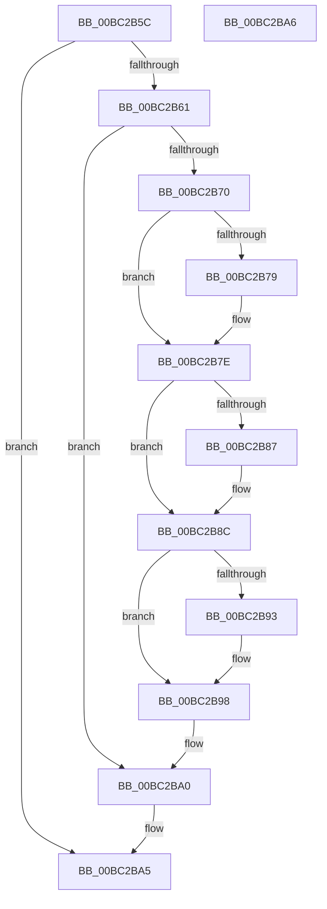

# BgpTxtDestroyRegion

- RVA: `0x00BC2B5C`–`0x00BC2BA7` (길이 `75` bytes)
- VA: `0x0000000140BC2B5C`
- 실행 섹션: `PAGEBGFX`
- PDB 이름 있음: `예`; PDB Function 태그: `아니요`
- unwind 정보 RVA: `0x000805BC`
- 디코드: `26`개 명령, `75/75` bytes 표시
- 미해석 바이트: `0` (있으면 어셈블리에 `.byte`로 보존)

> 이 문서는 커널 이미지의 기계어와 PDB 기호를 분석해 생성했습니다. 4번과 5번은 함수 원형과 자료형을 바이너리 사용 방식에서 추정한 C 해석이며 원본 소스 복구 결과는 아닙니다.

## 1. Dependencies

- 직접 호출 지점: **4**; 고유 호출 대상: **3**
- 직접 호출자로 확인된 함수: **3**
- RIP 상대 이미지 참조: **0**

### Outgoing calls
- `0x00BC2B79` → [BgpGxRectangleDestroy](BgpGxRectangleDestroy_function_00BC3F04.md) (function, `0x00BC3F04`)
- `0x00BC2B87` → [BgpGxRectangleDestroy](BgpGxRectangleDestroy_function_00BC3F04.md) (function, `0x00BC3F04`)
- `0x00BC2B93` → [BgpTxtCacheDestroy](BgpTxtCacheDestroy_function_00BC4354.md) (function, `0x00BC4354`)
- `0x00BC2B9B` → [BgpFwFreeMemory](../../text/3E/BgpFwFreeMemory_function_003E25E0.md) (function, `0x003E25E0`)

### Direct callers
- [BgpDisplayCharacterDestroyContext](BgpDisplayCharacterDestroyContext_function_00BC0834.md) at `0x00BC0845`
- [BgpDisplayCharacterGetContext](BgpDisplayCharacterGetContext_function_00BC0860.md) at `0x00BC091C`
- [BgpFwLibraryDisable](BgpFwLibraryDisable_function_00BC1724.md) at `0x00BC174E`
- [BgpFwLibraryDisable](BgpFwLibraryDisable_function_00BC1724.md) at `0x00BC1786`

### Static image references
- 디코드된 RIP-relative 메모리 참조가 없습니다.

## 2. Other-region calls and transfers

- 다른 실행 섹션으로 향하는 call: **1**
  - `0x00BC2B9B` → [BgpFwFreeMemory](../../text/3E/BgpFwFreeMemory_function_003E25E0.md) (`PAGEBGFX` → `.text`)
- 별도 외부 분기/꼬리 이동을 확인하지 못했습니다.

## 3. Assembly (complete function range)

```asm
00BC2B5C  48 85 C9                        test rcx, rcx
00BC2B5F  74 44                           je 0x140bc2ba5
00BC2B61  53                              push rbx
00BC2B62  48 83 EC 20                     sub rsp, 0x20
00BC2B66  8B 41 48                        mov eax, dword ptr [rcx + 0x48]
00BC2B69  48 8B D9                        mov rbx, rcx
00BC2B6C  A8 01                           test al, 1
00BC2B6E  74 30                           je 0x140bc2ba0
00BC2B70  48 8B 49 18                     mov rcx, qword ptr [rcx + 0x18]
00BC2B74  48 85 C9                        test rcx, rcx
00BC2B77  74 05                           je 0x140bc2b7e
00BC2B79  E8 86 13 00 00                  call 0x140bc3f04
00BC2B7E  48 8B 4B 20                     mov rcx, qword ptr [rbx + 0x20]
00BC2B82  48 85 C9                        test rcx, rcx
00BC2B85  74 05                           je 0x140bc2b8c
00BC2B87  E8 78 13 00 00                  call 0x140bc3f04
00BC2B8C  8B 43 3C                        mov eax, dword ptr [rbx + 0x3c]
00BC2B8F  A8 01                           test al, 1
00BC2B91  74 05                           je 0x140bc2b98
00BC2B93  E8 BC 17 00 00                  call 0x140bc4354
00BC2B98  48 8B CB                        mov rcx, rbx
00BC2B9B  E8 40 FA 81 FF                  call 0x1403e25e0
00BC2BA0  48 83 C4 20                     add rsp, 0x20
00BC2BA4  5B                              pop rbx
00BC2BA5  C3                              ret
00BC2BA6  CC                              int3
```

## 4. C-style interpretation (structured pseudocode)

```c
__int64 __fastcall BgpTxtDestroyRegion(__int64 a1)
{
    __int64 result;
    __int64 v_rsp;

    if (a1 == 0) goto loc_00BC2BA5;
    v_rsp = (v_rsp) - (32);
    if ((((unsigned __int8)((unsigned int)(*(unsigned int *)(a1 + 72)))) & (1)) == 0) goto loc_00BC2BA0;
    result = (unsigned int)(*(unsigned int *)(a1 + 72));
    if (*(unsigned __int64 *)(a1 + 24) != 0) {
        result = BgpGxRectangleDestroy(*(unsigned __int64 *)(a1 + 24), a2, a3, a4);
    }
    if (*(unsigned __int64 *)(a1 + 32) != 0) {
        result = BgpGxRectangleDestroy(*(unsigned __int64 *)(a1 + 32), a2, a3, a4);
    }
    result = (unsigned int)(*(unsigned int *)(a1 + 60));
    if ((((unsigned __int8)((unsigned int)(*(unsigned int *)(a1 + 60)))) & (1)) != 0) {
        result = BgpTxtCacheDestroy(*(unsigned __int64 *)(a1 + 32), a2, a3, a4);
    }
    result = BgpFwFreeMemory(a1, a2, a3, a4);
loc_00BC2BA0:
    v_rsp = (v_rsp) + (32);
loc_00BC2BA5:
    return result;
}
```

## 5. (Beta) C Style

```c
int64_t BgpTxtDestroyRegion(int64_t Arg1)
{
    int64_t result;
    int64_t local_rsp;

    if (Arg1 == 0) goto loc_00BC2BA5;
    local_rsp = (local_rsp) - (32);
    if ((((uint8_t)((uint32_t)(*(uint32_t *)(Arg1 + 0x48)))) & (1)) == 0) goto loc_00BC2BA0;
    result = (uint32_t)(*(uint32_t *)(Arg1 + 0x48));
    if (*(uint64_t *)(Arg1 + 0x18) != 0) {
        result = BgpGxRectangleDestroy(*(uint64_t *)(Arg1 + 0x18), a2, a3, a4);
    }
    if (*(uint64_t *)(Arg1 + 0x20) != 0) {
        result = BgpGxRectangleDestroy(*(uint64_t *)(Arg1 + 0x20), a2, a3, a4);
    }
    result = (uint32_t)(*(uint32_t *)(Arg1 + 0x3C));
    if ((((uint8_t)((uint32_t)(*(uint32_t *)(Arg1 + 0x3C)))) & (1)) != 0) {
        result = BgpTxtCacheDestroy(*(uint64_t *)(Arg1 + 0x20), a2, a3, a4);
    }
    result = BgpFwFreeMemory(Arg1, a2, a3, a4);
loc_00BC2BA0:
    local_rsp = (local_rsp) + (32);
loc_00BC2BA5:
    return result;
}
```

## 6. Execution-region graph

[열기: 2D/3D 그래프와 함수 탐색 컨트롤 패널](../../../control-panel.html?section=pagebgfx&rva=0x00BC2B5C&view=graph)

- 2D 그래프는 위에서 아래로 흐르고, 3D 그래프는 빈 공간을 드래그해 회전합니다. Shift+드래그는 이동, 휠은 확대·축소, 함수 노드 선택은 대상 보고서 이동입니다.

### Static fallback


