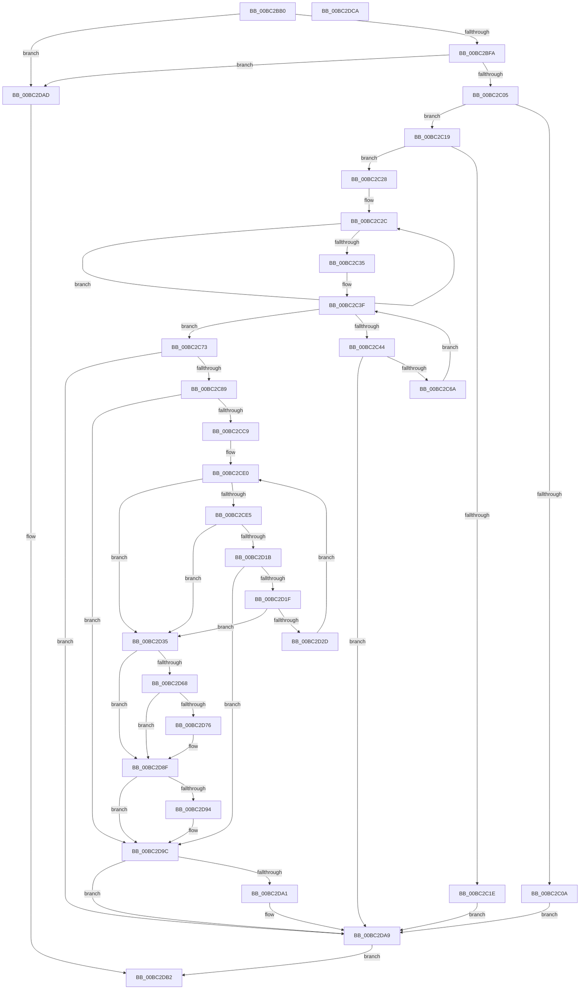

# BgpTxtDisplayString

- RVA: `0x00BC2BB0`–`0x00BC2DCB` (길이 `539` bytes)
- VA: `0x0000000140BC2BB0`
- 실행 섹션: `PAGEBGFX`
- PDB 이름 있음: `예`; PDB Function 태그: `아니요`
- unwind 정보 RVA: `0x000DA538`
- 디코드: `164`개 명령, `539/539` bytes 표시
- 미해석 바이트: `0` (있으면 어셈블리에 `.byte`로 보존)

> 이 문서는 커널 이미지의 기계어와 PDB 기호를 분석해 생성했습니다. 4번과 5번은 함수 원형과 자료형을 바이너리 사용 방식에서 추정한 C 해석이며 원본 소스 복구 결과는 아닙니다.

## 1. Dependencies

- 직접 호출 지점: **12**; 고유 호출 대상: **10**
- 직접 호출자로 확인된 함수: **1**
- RIP 상대 이미지 참조: **0**

### Outgoing calls
- `0x00BC2C0D` → [BgpTxtClearRegion](BgpTxtClearRegion_function_00BC28D8.md) (function, `0x00BC28D8`)
- `0x00BC2C59` → [BgpFoGetAdvanceWidth](../../text/69/BgpFoGetAdvanceWidth_function_0069F350.md) (function, `0x0069F350`)
- `0x00BC2C7A` → [BgpFoGetTextMetrics](../../text/4E/BgpFoGetTextMetrics_function_004E3FC4.md) (function, `0x004E3FC4`)
- `0x00BC2CB6` → [BgpGxRectangleCreate](BgpGxRectangleCreate_function_00BC3E78.md) (function, `0x00BC3E78`)
- `0x00BC2CD0` → [BgpGxFillRectangle](../../text/47/BgpGxFillRectangle_function_0047F808.md) (function, `0x0047F808`)
- `0x00BC2D0D` → [BgpRasPrintGlyph](../../text/47/BgpRasPrintGlyph_function_0047F3B4.md) (function, `0x0047F3B4`)
- `0x00BC2D40` → [TxtpJustifyRectangle](TxtpJustifyRectangle_function_00BC2DD4.md) (function, `0x00BC2DD4`)
- `0x00BC2D59` → [BgpGxBlendRectangle](BgpGxBlendRectangle_function_00BC2400.md) (function, `0x00BC2400`)
- `0x00BC2D6B` → [BgpTxtClearRegion](BgpTxtClearRegion_function_00BC28D8.md) (function, `0x00BC28D8`)
- `0x00BC2D88` → [BgpGxDrawRectangle](../../text/48/BgpGxDrawRectangle_function_0048C91C.md) (function, `0x0048C91C`)
- `0x00BC2D97` → [BgpGxRectangleDestroy](BgpGxRectangleDestroy_function_00BC3F04.md) (function, `0x00BC3F04`)
- `0x00BC2DA4` → [BgpGxRectangleDestroy](BgpGxRectangleDestroy_function_00BC3F04.md) (function, `0x00BC3F04`)

### Direct callers
- [BgkDrawText](BgkDrawText_function_00BC02DC.md) at `0x00BC033B`

### Static image references
- 디코드된 RIP-relative 메모리 참조가 없습니다.

## 2. Other-region calls and transfers

- 다른 실행 섹션으로 향하는 call: **5**
  - `0x00BC2C59` → [BgpFoGetAdvanceWidth](../../text/69/BgpFoGetAdvanceWidth_function_0069F350.md) (`PAGEBGFX` → `.text`)
  - `0x00BC2C7A` → [BgpFoGetTextMetrics](../../text/4E/BgpFoGetTextMetrics_function_004E3FC4.md) (`PAGEBGFX` → `.text`)
  - `0x00BC2CD0` → [BgpGxFillRectangle](../../text/47/BgpGxFillRectangle_function_0047F808.md) (`PAGEBGFX` → `.text`)
  - `0x00BC2D0D` → [BgpRasPrintGlyph](../../text/47/BgpRasPrintGlyph_function_0047F3B4.md) (`PAGEBGFX` → `.text`)
  - `0x00BC2D88` → [BgpGxDrawRectangle](../../text/48/BgpGxDrawRectangle_function_0048C91C.md) (`PAGEBGFX` → `.text`)
- 별도 외부 분기/꼬리 이동을 확인하지 못했습니다.

## 3. Assembly (complete function range)

```asm
00BC2BB0  48 89 5C 24 10                  mov qword ptr [rsp + 0x10], rbx
00BC2BB5  4C 89 4C 24 20                  mov qword ptr [rsp + 0x20], r9
00BC2BBA  44 89 44 24 18                  mov dword ptr [rsp + 0x18], r8d
00BC2BBF  55                              push rbp
00BC2BC0  56                              push rsi
00BC2BC1  57                              push rdi
00BC2BC2  41 54                           push r12
00BC2BC4  41 55                           push r13
00BC2BC6  41 56                           push r14
00BC2BC8  41 57                           push r15
00BC2BCA  48 8B EC                        mov rbp, rsp
00BC2BCD  48 83 EC 60                     sub rsp, 0x60
00BC2BD1  33 C0                           xor eax, eax
00BC2BD3  48 8B F9                        mov rdi, rcx
00BC2BD6  33 C9                           xor ecx, ecx
00BC2BD8  48 89 45 F0                     mov qword ptr [rbp - 0x10], rax
00BC2BDC  89 4D 50                        mov dword ptr [rbp + 0x50], ecx
00BC2BDF  4C 8B EA                        mov r13, rdx
00BC2BE2  48 89 4D 58                     mov qword ptr [rbp + 0x58], rcx
00BC2BE6  89 45 F8                        mov dword ptr [rbp - 8], eax
00BC2BE9  48 89 4D 40                     mov qword ptr [rbp + 0x40], rcx
00BC2BED  48 89 4D 60                     mov qword ptr [rbp + 0x60], rcx
00BC2BF1  48 85 FF                        test rdi, rdi
00BC2BF4  0F 84 B3 01 00 00               je 0x140bc2dad
00BC2BFA  8B 47 48                        mov eax, dword ptr [rdi + 0x48]
00BC2BFD  A8 01                           test al, 1
00BC2BFF  0F 84 A8 01 00 00               je 0x140bc2dad
00BC2C05  48 85 D2                        test rdx, rdx
00BC2C08  75 0F                           jne 0x140bc2c19
00BC2C0A  48 8B CF                        mov rcx, rdi
00BC2C0D  E8 C6 FC FF FF                  call 0x140bc28d8
00BC2C12  8B D8                           mov ebx, eax
00BC2C14  E9 90 01 00 00                  jmp 0x140bc2da9
00BC2C19  39 4F 4C                        cmp dword ptr [rdi + 0x4c], ecx
00BC2C1C  74 0A                           je 0x140bc2c28
00BC2C1E  BB 0D 00 00 C0                  mov ebx, 0xc000000d
00BC2C23  E9 81 01 00 00                  jmp 0x140bc2da9
00BC2C28  48 83 CE FF                     or rsi, 0xffffffffffffffff
00BC2C2C  48 FF C6                        inc rsi
00BC2C2F  66 39 0C 72                     cmp word ptr [rdx + rsi*2], cx
00BC2C33  75 F7                           jne 0x140bc2c2c
00BC2C35  44 8B F9                        mov r15d, ecx
00BC2C38  4C 8D 67 28                     lea r12, [rdi + 0x28]
00BC2C3C  44 8B F1                        mov r14d, ecx
00BC2C3F  44 3B F6                        cmp r14d, esi
00BC2C42  73 2F                           jae 0x140bc2c73
00BC2C44  41 8B D6                        mov edx, r14d
00BC2C47  4C 8D 45 50                     lea r8, [rbp + 0x50]
00BC2C4B  48 89 4C 24 20                  mov qword ptr [rsp + 0x20], rcx
00BC2C50  49 8B CC                        mov rcx, r12
00BC2C53  41 0F B7 54 55 00               movzx edx, word ptr [r13 + rdx*2]
00BC2C59  E8 F2 C6 AD FF                  call 0x14069f350
00BC2C5E  33 C9                           xor ecx, ecx
00BC2C60  8B D8                           mov ebx, eax
00BC2C62  85 C0                           test eax, eax
00BC2C64  0F 88 3F 01 00 00               js 0x140bc2da9
00BC2C6A  44 03 7D 50                     add r15d, dword ptr [rbp + 0x50]
00BC2C6E  41 FF C6                        inc r14d
00BC2C71  EB CC                           jmp 0x140bc2c3f
00BC2C73  48 8D 55 40                     lea rdx, [rbp + 0x40]
00BC2C77  49 8B CC                        mov rcx, r12
00BC2C7A  E8 45 13 92 FF                  call 0x1404e3fc4
00BC2C7F  8B D8                           mov ebx, eax
00BC2C81  85 C0                           test eax, eax
00BC2C83  0F 88 20 01 00 00               js 0x140bc2da9
00BC2C89  8B 47 0C                        mov eax, dword ptr [rdi + 0xc]
00BC2C8C  4C 8D 45 60                     lea r8, [rbp + 0x60]
00BC2C90  8B 4D 44                        mov ecx, dword ptr [rbp + 0x44]
00BC2C93  BA 20 00 00 00                  mov edx, 0x20
00BC2C98  3B C8                           cmp ecx, eax
00BC2C9A  44 89 7D F8                     mov dword ptr [rbp - 8], r15d
00BC2C9E  0F 47 C8                        cmova ecx, eax
00BC2CA1  8B 47 08                        mov eax, dword ptr [rdi + 8]
00BC2CA4  44 3B F8                        cmp r15d, eax
00BC2CA7  89 4D F4                        mov dword ptr [rbp - 0xc], ecx
00BC2CAA  48 8D 4D F0                     lea rcx, [rbp - 0x10]
00BC2CAE  44 0F 47 F8                     cmova r15d, eax
00BC2CB2  44 89 7D F0                     mov dword ptr [rbp - 0x10], r15d
00BC2CB6  E8 BD 11 00 00                  call 0x140bc3e78
00BC2CBB  4C 8B 75 60                     mov r14, qword ptr [rbp + 0x60]
00BC2CBF  8B D8                           mov ebx, eax
00BC2CC1  85 C0                           test eax, eax
00BC2CC3  0F 88 D3 00 00 00               js 0x140bc2d9c
00BC2CC9  41 8B 14 24                     mov edx, dword ptr [r12]
00BC2CCD  49 8B CE                        mov rcx, r14
00BC2CD0  E8 33 CB 8B FF                  call 0x14047f808
00BC2CD5  33 C9                           xor ecx, ecx
00BC2CD7  33 C0                           xor eax, eax
00BC2CD9  45 33 E4                        xor r12d, r12d
00BC2CDC  48 89 4D 58                     mov qword ptr [rbp + 0x58], rcx
00BC2CE0  44 3B E6                        cmp r12d, esi
00BC2CE3  73 50                           jae 0x140bc2d35
00BC2CE5  48 83 64 24 40 00               and qword ptr [rsp + 0x40], 0
00BC2CEB  48 8D 55 50                     lea rdx, [rbp + 0x50]
00BC2CEF  47 0F B7 44 65 00               movzx r8d, word ptr [r13 + r12*2]
00BC2CF5  44 8B C9                        mov r9d, ecx
00BC2CF8  48 89 54 24 30                  mov qword ptr [rsp + 0x30], rdx
00BC2CFD  49 8B CE                        mov rcx, r14
00BC2D00  83 64 24 28 00                  and dword ptr [rsp + 0x28], 0
00BC2D05  48 8D 57 28                     lea rdx, [rdi + 0x28]
00BC2D09  89 44 24 20                     mov dword ptr [rsp + 0x20], eax
00BC2D0D  E8 A2 C6 8B FF                  call 0x14047f3b4
00BC2D12  8B D8                           mov ebx, eax
00BC2D14  3D 05 00 00 80                  cmp eax, 0x80000005
00BC2D19  74 1A                           je 0x140bc2d35
00BC2D1B  85 C0                           test eax, eax
00BC2D1D  78 7D                           js 0x140bc2d9c
00BC2D1F  8B 4D 58                        mov ecx, dword ptr [rbp + 0x58]
00BC2D22  03 4D 50                        add ecx, dword ptr [rbp + 0x50]
00BC2D25  89 4D 58                        mov dword ptr [rbp + 0x58], ecx
00BC2D28  41 3B CF                        cmp ecx, r15d
00BC2D2B  77 08                           ja 0x140bc2d35
00BC2D2D  8B 45 5C                        mov eax, dword ptr [rbp + 0x5c]
00BC2D30  41 FF C4                        inc r12d
00BC2D33  EB AB                           jmp 0x140bc2ce0
00BC2D35  4C 8D 45 58                     lea r8, [rbp + 0x58]
00BC2D39  48 8B CF                        mov rcx, rdi
00BC2D3C  48 8D 55 F0                     lea rdx, [rbp - 0x10]
00BC2D40  E8 8F 00 00 00                  call 0x140bc2dd4
00BC2D45  48 8B 4F 18                     mov rcx, qword ptr [rdi + 0x18]
00BC2D49  4C 8D 4D 40                     lea r9, [rbp + 0x40]
00BC2D4D  48 83 65 40 00                  and qword ptr [rbp + 0x40], 0
00BC2D52  4C 8D 45 58                     lea r8, [rbp + 0x58]
00BC2D56  49 8B D6                        mov rdx, r14
00BC2D59  E8 A2 F6 FF FF                  call 0x140bc2400
00BC2D5E  48 8B 75 40                     mov rsi, qword ptr [rbp + 0x40]
00BC2D62  8B D8                           mov ebx, eax
00BC2D64  85 C0                           test eax, eax
00BC2D66  78 27                           js 0x140bc2d8f
00BC2D68  48 8B CF                        mov rcx, rdi
00BC2D6B  E8 68 FB FF FF                  call 0x140bc28d8
00BC2D70  8B D8                           mov ebx, eax
00BC2D72  85 C0                           test eax, eax
00BC2D74  78 19                           js 0x140bc2d8f
00BC2D76  8B 47 04                        mov eax, dword ptr [rdi + 4]
00BC2D79  48 8D 55 58                     lea rdx, [rbp + 0x58]
00BC2D7D  89 45 5C                        mov dword ptr [rbp + 0x5c], eax
00BC2D80  48 8B CE                        mov rcx, rsi
00BC2D83  8B 07                           mov eax, dword ptr [rdi]
00BC2D85  01 45 58                        add dword ptr [rbp + 0x58], eax
00BC2D88  E8 8F 9B 8C FF                  call 0x14048c91c
00BC2D8D  8B D8                           mov ebx, eax
00BC2D8F  48 85 F6                        test rsi, rsi
00BC2D92  74 08                           je 0x140bc2d9c
00BC2D94  48 8B CE                        mov rcx, rsi
00BC2D97  E8 68 11 00 00                  call 0x140bc3f04
00BC2D9C  4D 85 F6                        test r14, r14
00BC2D9F  74 08                           je 0x140bc2da9
00BC2DA1  49 8B CE                        mov rcx, r14
00BC2DA4  E8 5B 11 00 00                  call 0x140bc3f04
00BC2DA9  8B C3                           mov eax, ebx
00BC2DAB  EB 05                           jmp 0x140bc2db2
00BC2DAD  B8 0D 00 00 C0                  mov eax, 0xc000000d
00BC2DB2  48 8B 9C 24 A8 00 00 00         mov rbx, qword ptr [rsp + 0xa8]
00BC2DBA  48 83 C4 60                     add rsp, 0x60
00BC2DBE  41 5F                           pop r15
00BC2DC0  41 5E                           pop r14
00BC2DC2  41 5D                           pop r13
00BC2DC4  41 5C                           pop r12
00BC2DC6  5F                              pop rdi
00BC2DC7  5E                              pop rsi
00BC2DC8  5D                              pop rbp
00BC2DC9  C3                              ret
00BC2DCA  CC                              int3
```

## 4. C-style interpretation (structured pseudocode)

```c
__int64 __fastcall BgpTxtDisplayString(__int64 a1, __int64 a2, int a3, __int64 a4, __int64 a5)
{
    __int64 result;
    __int64 v_r12;
    __int64 v_r14;
    __int64 v_r15;
    __int64 v_rbx;
    __int64 v_rsi;
    __int64 v_rsp;
    unsigned int v_stack_m40;
    unsigned int v_stack_m44;
    unsigned __int64 v_stack_m48;
    unsigned __int64 v_stack_m58;
    unsigned __int64 v_stack_m68;
    unsigned int v_stack_m70;
    unsigned __int64 v_stack_m78;
    unsigned __int64 v_stack_p10;
    unsigned int v_stack_p18;
    unsigned __int64 v_stack_p20;
    unsigned int v_stack_p24;
    unsigned __int64 v_stack_p28;
    unsigned __int64 v_stack_p8;
    unsigned int v_stack_pC;

    v_stack_p10 = v_rbx;
    v_stack_p20 = a4;
    v_stack_p18 = a3;
    v_rsp = (v_rsp) - (96);
    result = 0;
    a1 = 0;
    v_stack_m48 = 0;
    v_stack_p18 = 0;
    v_stack_p20 = 0;
    v_stack_m40 = 0;
    v_stack_p8 = 0;
    v_stack_p28 = 0;
    if (0 == 0) goto loc_00BC2DAD;
    if ((((unsigned __int8)((unsigned int)(*(unsigned int *)(a1 + 72)))) & (1)) == 0) goto loc_00BC2DAD;
    if (a2 != 0) goto loc_00BC2C19;
    result = BgpTxtClearRegion(0, a2, a3, a4);
    goto loc_00BC2DA9;
loc_00BC2C19:
    if ((*(unsigned int *)(a1 + 76)) == 0) goto loc_00BC2C28;
    goto loc_00BC2DA9;
loc_00BC2C28:
    v_rsi = (v_rsi) | (-1);
loc_00BC2C2C:
    v_rsi = (v_rsi) + 1;
    if ((*(unsigned __int16 *)(a2 + v_rsi * 2)) != 0) goto loc_00BC2C2C;
loc_00BC2C3F:
    if (0 >= ((unsigned int)(v_rsi))) goto loc_00BC2C73;
    v_stack_m78 = 0;
    result = BgpFoGetAdvanceWidth(a1 + 40, *(unsigned __int16 *)(a2 + 0 * 2), v_stack_p18, a4);
    a1 = 0;
    if (sign_flag) goto loc_00BC2DA9;
    v_r15 = (unsigned int)((0) + (v_stack_p18));
    v_r14 = (unsigned int)((0) + 1);
    goto loc_00BC2C3F;
loc_00BC2C73:
    result = BgpFoGetTextMetrics(a1 + 40, v_stack_p8, v_stack_p18, a4);
    if (sign_flag) goto loc_00BC2DA9;
    v_stack_m40 = (unsigned int)(v_r15);
    a1 = (unsigned int)(v_stack_pC);
    if (((unsigned int)((unsigned int)(v_stack_pC))) > ((unsigned int)((unsigned int)(*(unsigned int *)(a1 + 12))))) { a1 = (unsigned int)((unsigned int)(*(unsigned int *)(a1 + 12))); }
    v_stack_m44 = (unsigned int)(a1);
    if (((unsigned int)(v_r15)) > ((unsigned int)((unsigned int)(*(unsigned int *)(a1 + 8))))) { v_r15 = (unsigned int)((unsigned int)(*(unsigned int *)(a1 + 8))); }
    v_stack_m48 = (unsigned int)(v_r15);
    result = BgpGxRectangleCreate(v_stack_m48, 32, a5, a4);
    if (sign_flag) goto loc_00BC2D9C;
    result = BgpGxFillRectangle(a5, (unsigned int)(*(unsigned int *)(a1 + 40)), a5, a4);
    a1 = 0;
    result = 0;
    v_r12 = 0;
    v_stack_p20 = 0;
loc_00BC2CE0:
    if (0 >= ((unsigned int)(v_rsi))) goto loc_00BC2D35;
    v_stack_m68 = v_stack_p18;
    v_stack_m78 = 0;
    result = BgpRasPrintGlyph(a5, a1 + 40, *(unsigned __int16 *)(a2 + v_r12 * 2), 0);
    if (((unsigned int)(result)) == 0x80000005ULL) goto loc_00BC2D35;
    if (sign_flag) goto loc_00BC2D9C;
    a1 = (unsigned int)(((unsigned int)(v_stack_p20)) + (v_stack_p18));
    v_stack_p20 = (unsigned int)(a1);
    if (((unsigned int)(a1)) > ((unsigned int)(v_r15))) goto loc_00BC2D35;
    v_r12 = (unsigned int)((v_r12) + 1);
    goto loc_00BC2CE0;
loc_00BC2D35:
    result = TxtpJustifyRectangle(a1, v_stack_m48, v_stack_p20, 0);
    result = BgpGxBlendRectangle(*(unsigned __int64 *)(a1 + 24), a5, v_stack_p20, v_stack_p8);
    if (sign_flag) goto loc_00BC2D8F;
    result = BgpTxtClearRegion(a1, a5, v_stack_p20, v_stack_p8);
    v_rbx = (unsigned int)((unsigned int)(result));
    if (!(sign_flag)) {
        result = *(unsigned int *)(a1 + 4);
        a2 = v_stack_p20;
        v_stack_p24 = (unsigned int)(result);
        a1 = v_stack_p8;
        result = *(unsigned int *)(a1);
        result = BgpGxDrawRectangle(a1, a2, v_stack_p20, v_stack_p8);
        v_rbx = (unsigned int)(result);
    }
    if (v_stack_p8 != 0) {
        a1 = v_stack_p8;
        result = BgpGxRectangleDestroy(a1, a2, v_stack_p20, v_stack_p8);
    }
    if (a5 != 0) {
        a1 = a5;
        result = BgpGxRectangleDestroy(a1, a2, v_stack_p20, v_stack_p8);
    }
    goto loc_00BC2DB2;
loc_00BC2DAD:
loc_00BC2DB2:
    v_rsp = (v_rsp) + (96);
    return (unsigned int)(0xC000000DULL);
}
```

## 5. (Beta) C Style

```c
int64_t BgpTxtDisplayString(int64_t Arg1, void *Arg2, int32_t Arg3, int64_t Arg4, int64_t Arg5)
{
    uint8_t *arg2 = (uint8_t *)Arg2;

    int64_t result;
    int64_t local_r12;
    int64_t local_r14;
    int64_t local_r15;
    int64_t local_rbx;
    int64_t local_rsi;
    int64_t local_rsp;
    uint32_t v_stack_m40;
    uint32_t v_stack_m44;
    uint64_t v_stack_m48;
    uint64_t v_stack_m58;
    uint64_t v_stack_m68;
    uint32_t v_stack_m70;
    uint64_t v_stack_m78;
    uint64_t v_stack_p10;
    uint32_t v_stack_p18;
    uint64_t v_stack_p20;
    uint32_t v_stack_p24;
    uint64_t v_stack_p28;
    uint64_t v_stack_p8;
    uint32_t v_stack_pC;

    v_stack_p10 = local_rbx;
    v_stack_p20 = Arg4;
    v_stack_p18 = Arg3;
    local_rsp = (local_rsp) - (96);
    result = 0;
    Arg1 = 0;
    v_stack_m48 = 0;
    v_stack_p18 = 0;
    v_stack_p20 = 0;
    v_stack_m40 = 0;
    v_stack_p8 = 0;
    v_stack_p28 = 0;
    if (0 == 0) goto loc_00BC2DAD;
    if ((((uint8_t)((uint32_t)(*(uint32_t *)(Arg1 + 0x48)))) & (1)) == 0) goto loc_00BC2DAD;
    if (Arg2 != NULL) goto loc_00BC2C19;
    result = BgpTxtClearRegion(0, Arg2, Arg3, Arg4);
    goto loc_00BC2DA9;
loc_00BC2C19:
    if ((*(uint32_t *)(Arg1 + 0x4C)) == 0) goto loc_00BC2C28;
    goto loc_00BC2DA9;
loc_00BC2C28:
    local_rsi = (local_rsi) | (-1);
loc_00BC2C2C:
    local_rsi = (local_rsi) + 1;
    if ((*(uint16_t *)(arg2 + local_rsi * 2)) != 0) goto loc_00BC2C2C;
loc_00BC2C3F:
    if (0 >= ((uint32_t)(local_rsi))) goto loc_00BC2C73;
    v_stack_m78 = 0;
    result = BgpFoGetAdvanceWidth(Arg1 + 40, *(uint16_t *)(arg2 + 0x0 * 2), v_stack_p18, Arg4);
    Arg1 = 0;
    if (sign_flag) goto loc_00BC2DA9;
    local_r15 = (uint32_t)((0) + (v_stack_p18));
    local_r14 = (uint32_t)((0) + 1);
    goto loc_00BC2C3F;
loc_00BC2C73:
    result = BgpFoGetTextMetrics(Arg1 + 40, v_stack_p8, v_stack_p18, Arg4);
    if (sign_flag) goto loc_00BC2DA9;
    v_stack_m40 = (uint32_t)(local_r15);
    Arg1 = (uint32_t)(v_stack_pC);
    if (((uint32_t)((uint32_t)(v_stack_pC))) > ((uint32_t)((uint32_t)(*(uint32_t *)(Arg1 + 0xC))))) { Arg1 = (uint32_t)((uint32_t)(*(uint32_t *)(Arg1 + 0xC))); }
    v_stack_m44 = (uint32_t)(Arg1);
    if (((uint32_t)(local_r15)) > ((uint32_t)((uint32_t)(*(uint32_t *)(Arg1 + 0x8))))) { local_r15 = (uint32_t)((uint32_t)(*(uint32_t *)(Arg1 + 0x8))); }
    v_stack_m48 = (uint32_t)(local_r15);
    result = BgpGxRectangleCreate(v_stack_m48, 32, Arg5, Arg4);
    if (sign_flag) goto loc_00BC2D9C;
    result = BgpGxFillRectangle(Arg5, (uint32_t)(*(uint32_t *)(Arg1 + 0x28)), Arg5, Arg4);
    Arg1 = 0;
    result = 0;
    local_r12 = 0;
    v_stack_p20 = 0;
loc_00BC2CE0:
    if (0 >= ((uint32_t)(local_rsi))) goto loc_00BC2D35;
    v_stack_m68 = v_stack_p18;
    v_stack_m78 = 0;
    result = BgpRasPrintGlyph(Arg5, Arg1 + 40, *(uint16_t *)(arg2 + local_r12 * 2), 0);
    if (((uint32_t)(result)) == 0x80000005ULL) goto loc_00BC2D35;
    if (sign_flag) goto loc_00BC2D9C;
    Arg1 = (uint32_t)(((uint32_t)(v_stack_p20)) + (v_stack_p18));
    v_stack_p20 = (uint32_t)(Arg1);
    if (((uint32_t)(Arg1)) > ((uint32_t)(local_r15))) goto loc_00BC2D35;
    local_r12 = (uint32_t)((local_r12) + 1);
    goto loc_00BC2CE0;
loc_00BC2D35:
    result = TxtpJustifyRectangle(Arg1, v_stack_m48, v_stack_p20, 0);
    result = BgpGxBlendRectangle(*(uint64_t *)(Arg1 + 0x18), Arg5, v_stack_p20, v_stack_p8);
    if (sign_flag) goto loc_00BC2D8F;
    result = BgpTxtClearRegion(Arg1, Arg5, v_stack_p20, v_stack_p8);
    local_rbx = (uint32_t)((uint32_t)(result));
    if (!(sign_flag)) {
        result = *(uint32_t *)(Arg1 + 0x4);
        Arg2 = v_stack_p20;
        v_stack_p24 = (uint32_t)(result);
        Arg1 = v_stack_p8;
        result = *(uint32_t *)(Arg1);
        result = BgpGxDrawRectangle(Arg1, Arg2, v_stack_p20, v_stack_p8);
        local_rbx = (uint32_t)(result);
    }
    if (v_stack_p8 != 0) {
        Arg1 = v_stack_p8;
        result = BgpGxRectangleDestroy(Arg1, Arg2, v_stack_p20, v_stack_p8);
    }
    if (Arg5 != 0) {
        Arg1 = Arg5;
        result = BgpGxRectangleDestroy(Arg1, Arg2, v_stack_p20, v_stack_p8);
    }
    goto loc_00BC2DB2;
loc_00BC2DAD:
loc_00BC2DB2:
    local_rsp = (local_rsp) + (96);
    return (uint32_t)(0xC000000DULL);
}
```

### 관측된 메모리 오프셋

구조체 형식이 확인되지 않은 접근은 인자 기준의 오프셋으로만 기록했습니다.

| 기준 인자 | 오프셋 표현 | 폭 (bit) | 접근 |
|---|---:|---:|---|
| `Arg2` | `+ 0x0 + r12*2` | `16` | `R` |
| `Arg2` | `+ 0x0 + rdx*2` | `16` | `R` |

## 6. Execution-region graph

[열기: 2D/3D 그래프와 함수 탐색 컨트롤 패널](../../../control-panel.html?section=pagebgfx&rva=0x00BC2BB0&view=graph)

- 2D 그래프는 위에서 아래로 흐르고, 3D 그래프는 빈 공간을 드래그해 회전합니다. Shift+드래그는 이동, 휠은 확대·축소, 함수 노드 선택은 대상 보고서 이동입니다.

### Static fallback


