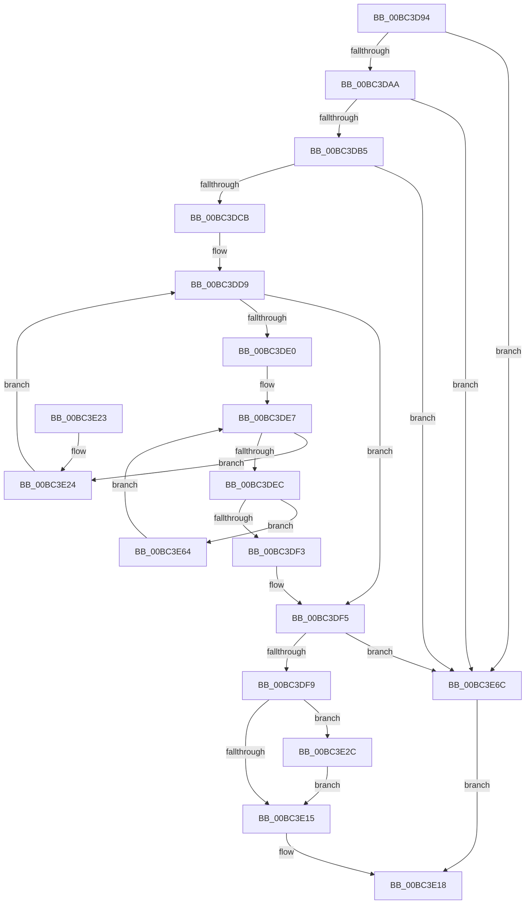

# BgpTxtGetRegionContext

- RVA: `0x00BC3D94`–`0x00BC3E70` (길이 `220` bytes)
- VA: `0x0000000140BC3D94`
- 실행 섹션: `PAGEBGFX`
- PDB 이름 있음: `예`; PDB Function 태그: `아니요`
- unwind 정보 RVA: `0x000AA5B4`
- 디코드: `66`개 명령, `220/220` bytes 표시
- 미해석 바이트: `0` (있으면 어셈블리에 `.byte`로 보존)

> 이 문서는 커널 이미지의 기계어와 PDB 기호를 분석해 생성했습니다. 4번과 5번은 함수 원형과 자료형을 바이너리 사용 방식에서 추정한 C 해석이며 원본 소스 복구 결과는 아닙니다.

## 1. Dependencies

- 직접 호출 지점: **1**; 고유 호출 대상: **1**
- 직접 호출자로 확인된 함수: **1**
- RIP 상대 이미지 참조: **2**

### Outgoing calls
- `0x00BC3E08` → [BgpFwAllocateMemory](../../text/3E/BgpFwAllocateMemory_function_003E4374.md) (function, `0x003E4374`)

### Direct callers
- [AnFwDisplayFade](AnFwDisplayFade_function_00BC36EC.md) at `0x00BC378D`
- [AnFwDisplayFade](AnFwDisplayFade_function_00BC36EC.md) at `0x00BC379C`

### Static image references
- `0x00BC3DB5` → RVA `0x00EF03B4` (`.data`; read)
- `0x00BC3DCB` → RVA `0x00EF03C0` (`.data`; read)

## 2. Other-region calls and transfers

- 다른 실행 섹션으로 향하는 call: **1**
  - `0x00BC3E08` → [BgpFwAllocateMemory](../../text/3E/BgpFwAllocateMemory_function_003E4374.md) (`PAGEBGFX` → `.text`)
- 별도 외부 분기/꼬리 이동을 확인하지 못했습니다.

## 3. Assembly (complete function range)

```asm
00BC3D94  48 89 5C 24 08                  mov qword ptr [rsp + 8], rbx
00BC3D99  57                              push rdi
00BC3D9A  48 83 EC 20                     sub rsp, 0x20
00BC3D9E  48 8B D9                        mov rbx, rcx
00BC3DA1  48 85 C9                        test rcx, rcx
00BC3DA4  0F 84 C2 00 00 00               je 0x140bc3e6c
00BC3DAA  8B 41 48                        mov eax, dword ptr [rcx + 0x48]
00BC3DAD  A8 01                           test al, 1
00BC3DAF  0F 84 B7 00 00 00               je 0x140bc3e6c
00BC3DB5  80 3D F8 C5 32 00 00            cmp byte ptr [rip + 0x32c5f8], 0
00BC3DBC  41 B9 25 02 00 C0               mov r9d, 0xc0000225
00BC3DC2  41 8B C1                        mov eax, r9d
00BC3DC5  0F 84 A1 00 00 00               je 0x140bc3e6c
00BC3DCB  48 8B 15 EE C5 32 00            mov rdx, qword ptr [rip + 0x32c5ee]
00BC3DD2  4C 8D 15 E7 C5 32 00            lea r10, [rip + 0x32c5e7]
00BC3DD9  33 C9                           xor ecx, ecx
00BC3DDB  49 3B D2                        cmp rdx, r10
00BC3DDE  74 15                           je 0x140bc3df5
00BC3DE0  4C 8D 42 28                     lea r8, [rdx + 0x28]
00BC3DE4  49 8B 08                        mov rcx, qword ptr [r8]
00BC3DE7  49 3B C8                        cmp rcx, r8
00BC3DEA  74 38                           je 0x140bc3e24
00BC3DEC  8B 42 1C                        mov eax, dword ptr [rdx + 0x1c]
00BC3DEF  A8 01                           test al, 1
00BC3DF1  74 71                           je 0x140bc3e64
00BC3DF3  33 C0                           xor eax, eax
00BC3DF5  85 C0                           test eax, eax
00BC3DF7  78 73                           js 0x140bc3e6c
00BC3DF9  33 FF                           xor edi, edi
00BC3DFB  48 39 4B 30                     cmp qword ptr [rbx + 0x30], rcx
00BC3DFF  B9 24 00 00 00                  mov ecx, 0x24
00BC3E04  40 0F 94 C7                     sete dil
00BC3E08  E8 67 05 82 FF                  call 0x1403e4374
00BC3E0D  48 8B D0                        mov rdx, rax
00BC3E10  48 85 C0                        test rax, rax
00BC3E13  75 17                           jne 0x140bc3e2c
00BC3E15  48 8B C2                        mov rax, rdx
00BC3E18  48 8B 5C 24 30                  mov rbx, qword ptr [rsp + 0x30]
00BC3E1D  48 83 C4 20                     add rsp, 0x20
00BC3E21  5F                              pop rdi
00BC3E22  C3                              ret
00BC3E23  CC                              int3
00BC3E24  48 8B 12                        mov rdx, qword ptr [rdx]
00BC3E27  41 8B C1                        mov eax, r9d
00BC3E2A  EB AD                           jmp 0x140bc3dd9
00BC3E2C  33 C0                           xor eax, eax
00BC3E2E  0F 57 C0                        xorps xmm0, xmm0
00BC3E31  0F 11 02                        movups xmmword ptr [rdx], xmm0
00BC3E34  0F 11 42 10                     movups xmmword ptr [rdx + 0x10], xmm0
00BC3E38  89 42 20                        mov dword ptr [rdx + 0x20], eax
00BC3E3B  48 8B 0B                        mov rcx, qword ptr [rbx]
00BC3E3E  48 89 0A                        mov qword ptr [rdx], rcx
00BC3E41  F2 0F 10 43 08                  movsd xmm0, qword ptr [rbx + 8]
00BC3E46  F2 0F 11 42 08                  movsd qword ptr [rdx + 8], xmm0
00BC3E4B  8B 43 10                        mov eax, dword ptr [rbx + 0x10]
00BC3E4E  89 42 10                        mov dword ptr [rdx + 0x10], eax
00BC3E51  48 8B 43 40                     mov rax, qword ptr [rbx + 0x40]
00BC3E55  48 89 42 1C                     mov qword ptr [rdx + 0x1c], rax
00BC3E59  8B 43 38                        mov eax, dword ptr [rbx + 0x38]
00BC3E5C  89 42 14                        mov dword ptr [rdx + 0x14], eax
00BC3E5F  89 7A 18                        mov dword ptr [rdx + 0x18], edi
00BC3E62  EB B1                           jmp 0x140bc3e15
00BC3E64  48 8B 09                        mov rcx, qword ptr [rcx]
00BC3E67  E9 7B FF FF FF                  jmp 0x140bc3de7
00BC3E6C  33 C0                           xor eax, eax
00BC3E6E  EB A8                           jmp 0x140bc3e18
```

## 4. C-style interpretation (structured pseudocode)

```c
__int64 __fastcall BgpTxtGetRegionContext(__int64 a1)
{
    __int64 result;
    __int64 v_rdi;
    __int64 v_rsp;
    unsigned __int64 v_stack_p8;

    v_stack_p8 = v_rbx;
    v_rsp = (v_rsp) - (32);
    if (a1 == 0) goto loc_00BC3E6C;
    if ((((unsigned __int8)((unsigned int)(*(unsigned int *)(a1 + 72)))) & (1)) == 0) goto loc_00BC3E6C;
    if ((*(unsigned __int8 *)(v_rip + 3327480)) == 0) goto loc_00BC3E6C;
loc_00BC3DD9:
    a1 = 0;
    if ((*(unsigned __int64 *)(v_rip + 3327470)) == (v_rip + 3327463)) goto loc_00BC3DF5;
loc_00BC3DE7:
    if ((*(unsigned __int64 *)(*(unsigned __int64 *)(v_rip + 3327470) + 40)) == (*(unsigned __int64 *)(v_rip + 3327470) + 40)) goto loc_00BC3E24;
    if ((((unsigned __int8)((unsigned int)(*(unsigned int *)(*(unsigned __int64 *)(v_rip + 3327470) + 28)))) & (1)) == 0) goto loc_00BC3E64;
    result = 0;
loc_00BC3DF5:
    if (sign_flag) goto loc_00BC3E6C;
    v_rdi = 0;
    v_rdi = ((*(unsigned __int64 *)(a1 + 48)) == (*(unsigned __int64 *)(*(unsigned __int64 *)(v_rip + 3327470) + 40))) ? 1 : 0;
    result = BgpFwAllocateMemory(36, *(unsigned __int64 *)(v_rip + 3327470), *(unsigned __int64 *)(v_rip + 3327470) + 40, (unsigned int)(0xC0000225ULL));
    if (result != 0) goto loc_00BC3E2C;
loc_00BC3E15:
loc_00BC3E18:
    v_rsp = (v_rsp) + (32);
    return result;
loc_00BC3E24:
    goto loc_00BC3DD9;
loc_00BC3E2C:
    result = 0;
    *(unsigned __int64 *)(*(unsigned __int64 *)(result)) = v_xmm0;
    *(unsigned __int64 *)(*(unsigned __int64 *)(result) + 16) = v_xmm0;
    *(unsigned int *)(*(unsigned __int64 *)(result) + 32) = 0;
    *(unsigned __int64 *)(*(unsigned __int64 *)(result)) = *(unsigned __int64 *)(v_stack_p8);
    *(unsigned __int64 *)(*(unsigned __int64 *)(result) + 8) = v_xmm0;
    *(unsigned int *)(*(unsigned __int64 *)(result) + 16) = (unsigned int)((unsigned int)(*(unsigned int *)(v_stack_p8 + 16)));
    *(unsigned __int64 *)(*(unsigned __int64 *)(result) + 28) = *(unsigned __int64 *)(v_stack_p8 + 64);
    *(unsigned int *)(*(unsigned __int64 *)(result) + 20) = (unsigned int)((unsigned int)(*(unsigned int *)(v_stack_p8 + 56)));
    *(unsigned int *)(*(unsigned __int64 *)(result) + 24) = (unsigned int)(v_rdi);
    goto loc_00BC3E15;
loc_00BC3E64:
    goto loc_00BC3DE7;
loc_00BC3E6C:
    result = 0;
    goto loc_00BC3E18;
}
```

## 5. (Beta) C Style

```c
int64_t BgpTxtGetRegionContext(void *Arg1)
{
    uint8_t *arg1 = (uint8_t *)Arg1;

    int64_t result;
    int64_t local_rdi;
    int64_t local_rsp;
    uint64_t v_stack_p8;

    v_stack_p8 = local_rbx;
    local_rsp = (local_rsp) - (32);
    if (Arg1 == NULL) goto loc_00BC3E6C;
    if ((((uint8_t)((uint32_t)(*(uint32_t *)(arg1 + 0x48)))) & (1)) == 0) goto loc_00BC3E6C;
    if ((*(uint8_t *)(v_rip + 0x32C5F8)) == 0) goto loc_00BC3E6C;
loc_00BC3DD9:
    Arg1 = 0;
    if ((*(uint64_t *)(v_rip + 0x32C5EE)) == (v_rip + 3327463)) goto loc_00BC3DF5;
loc_00BC3DE7:
    if ((*(uint64_t *)(*(uint64_t *)(v_rip + 0x32C5EE) + 0x28)) == (*(uint64_t *)(v_rip + 0x32C5EE) + 40)) goto loc_00BC3E24;
    if ((((uint8_t)((uint32_t)(*(uint32_t *)(*(uint64_t *)(v_rip + 0x32C5EE) + 0x1C)))) & (1)) == 0) goto loc_00BC3E64;
    result = 0;
loc_00BC3DF5:
    if (sign_flag) goto loc_00BC3E6C;
    local_rdi = 0;
    local_rdi = ((*(uint64_t *)(arg1 + 0x30)) == (*(uint64_t *)(*(uint64_t *)(v_rip + 0x32C5EE) + 0x28))) ? 1 : 0;
    result = BgpFwAllocateMemory(36, *(uint64_t *)(v_rip + 0x32C5EE), *(uint64_t *)(v_rip + 0x32C5EE) + 40, (uint32_t)(0xC0000225ULL));
    if (result != 0) goto loc_00BC3E2C;
loc_00BC3E15:
loc_00BC3E18:
    local_rsp = (local_rsp) + (32);
    return result;
loc_00BC3E24:
    goto loc_00BC3DD9;
loc_00BC3E2C:
    result = 0;
    *(uint64_t *)(*(uint64_t *)(result)) = v_xmm0;
    *(uint64_t *)(*(uint64_t *)(result) + 0x10) = v_xmm0;
    *(uint32_t *)(*(uint64_t *)(result) + 0x20) = 0;
    *(uint64_t *)(*(uint64_t *)(result)) = *(uint64_t *)(v_stack_p8);
    *(uint64_t *)(*(uint64_t *)(result) + 0x8) = v_xmm0;
    *(uint32_t *)(*(uint64_t *)(result) + 0x10) = (uint32_t)((uint32_t)(*(uint32_t *)(v_stack_p8 + 0x10)));
    *(uint64_t *)(*(uint64_t *)(result) + 0x1C) = *(uint64_t *)(v_stack_p8 + 0x40);
    *(uint32_t *)(*(uint64_t *)(result) + 0x14) = (uint32_t)((uint32_t)(*(uint32_t *)(v_stack_p8 + 0x38)));
    *(uint32_t *)(*(uint64_t *)(result) + 0x18) = (uint32_t)(local_rdi);
    goto loc_00BC3E15;
loc_00BC3E64:
    goto loc_00BC3DE7;
loc_00BC3E6C:
    result = 0;
    goto loc_00BC3E18;
}
```

### 관측된 메모리 오프셋

구조체 형식이 확인되지 않은 접근은 인자 기준의 오프셋으로만 기록했습니다.

| 기준 인자 | 오프셋 표현 | 폭 (bit) | 접근 |
|---|---:|---:|---|
| `Arg1` | `+ 0x0` | `64` | `R` |
| `Arg1` | `+ 0x8` | `64` | `R` |
| `Arg1` | `+ 0x10` | `32` | `R` |
| `Arg1` | `+ 0x30` | `64` | `R` |
| `Arg1` | `+ 0x38` | `32` | `R` |
| `Arg1` | `+ 0x40` | `64` | `R` |

## 6. Execution-region graph

[열기: 2D/3D 그래프와 함수 탐색 컨트롤 패널](../../../control-panel.html?section=pagebgfx&rva=0x00BC3D94&view=graph)

- 2D 그래프는 위에서 아래로 흐르고, 3D 그래프는 빈 공간을 드래그해 회전합니다. Shift+드래그는 이동, 휠은 확대·축소, 함수 노드 선택은 대상 보고서 이동입니다.

### Static fallback


