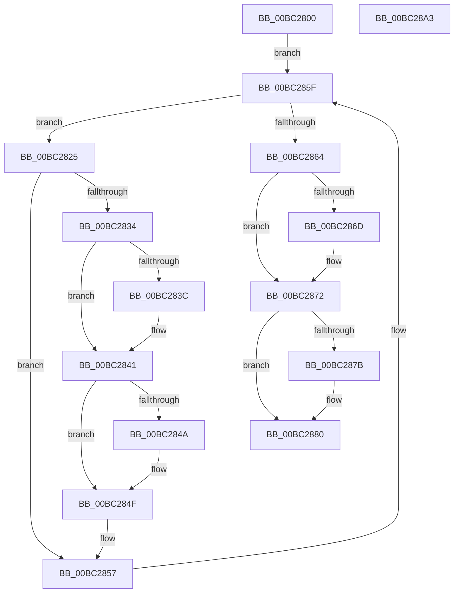

# FopFreeFontData

- RVA: `0x00BC2800`–`0x00BC28A4` (길이 `164` bytes)
- VA: `0x0000000140BC2800`
- 실행 섹션: `PAGEBGFX`
- PDB 이름 있음: `예`; PDB Function 태그: `아니요`
- unwind 정보 RVA: `0x0005E6B4`
- 디코드: `48`개 명령, `164/164` bytes 표시
- 미해석 바이트: `0` (있으면 어셈블리에 `.byte`로 보존)

> 이 문서는 커널 이미지의 기계어와 PDB 기호를 분석해 생성했습니다. 4번과 5번은 함수 원형과 자료형을 바이너리 사용 방식에서 추정한 C 해석이며 원본 소스 복구 결과는 아닙니다.

## 1. Dependencies

- 직접 호출 지점: **7**; 고유 호출 대상: **2**
- 직접 호출자로 확인된 함수: **2**
- RIP 상대 이미지 참조: **0**

### Outgoing calls
- `0x00BC283C` → [BgpFwFreeMemory](../../text/3E/BgpFwFreeMemory_function_003E25E0.md) (function, `0x003E25E0`)
- `0x00BC284A` → [BgpFwFreeMemory](../../text/3E/BgpFwFreeMemory_function_003E25E0.md) (function, `0x003E25E0`)
- `0x00BC2852` → [BgpFwFreeMemory](../../text/3E/BgpFwFreeMemory_function_003E25E0.md) (function, `0x003E25E0`)
- `0x00BC285A` → [BgpFwFreeMemory](../../text/3E/BgpFwFreeMemory_function_003E25E0.md) (function, `0x003E25E0`)
- `0x00BC286D` → [BgpFwFreeMemory](../../text/3E/BgpFwFreeMemory_function_003E25E0.md) (function, `0x003E25E0`)
- `0x00BC287B` → [FopFreeMappingTable](FopFreeMappingTable_function_00BC28AC.md) (function, `0x00BC28AC`)
- `0x00BC2883` → [BgpFwFreeMemory](../../text/3E/BgpFwFreeMemory_function_003E25E0.md) (function, `0x003E25E0`)

### Direct callers
- [BgpFoDestroy](BgpFoDestroy_function_00BC273C.md) at `0x00BC27A6`
- [FopInitializeFonts](../../init/C8/FopInitializeFonts_function_00C808FC.md) at `0x00C80A0B`

### Static image references
- 디코드된 RIP-relative 메모리 참조가 없습니다.

## 2. Other-region calls and transfers

- 다른 실행 섹션으로 향하는 call: **6**
  - `0x00BC283C` → [BgpFwFreeMemory](../../text/3E/BgpFwFreeMemory_function_003E25E0.md) (`PAGEBGFX` → `.text`)
  - `0x00BC284A` → [BgpFwFreeMemory](../../text/3E/BgpFwFreeMemory_function_003E25E0.md) (`PAGEBGFX` → `.text`)
  - `0x00BC2852` → [BgpFwFreeMemory](../../text/3E/BgpFwFreeMemory_function_003E25E0.md) (`PAGEBGFX` → `.text`)
  - `0x00BC285A` → [BgpFwFreeMemory](../../text/3E/BgpFwFreeMemory_function_003E25E0.md) (`PAGEBGFX` → `.text`)
  - `0x00BC286D` → [BgpFwFreeMemory](../../text/3E/BgpFwFreeMemory_function_003E25E0.md) (`PAGEBGFX` → `.text`)
  - `0x00BC2883` → [BgpFwFreeMemory](../../text/3E/BgpFwFreeMemory_function_003E25E0.md) (`PAGEBGFX` → `.text`)
- 별도 외부 분기/꼬리 이동을 확인하지 못했습니다.

## 3. Assembly (complete function range)

```asm
00BC2800  48 8B C4                        mov rax, rsp
00BC2803  48 89 58 08                     mov qword ptr [rax + 8], rbx
00BC2807  48 89 68 10                     mov qword ptr [rax + 0x10], rbp
00BC280B  48 89 70 18                     mov qword ptr [rax + 0x18], rsi
00BC280F  48 89 78 20                     mov qword ptr [rax + 0x20], rdi
00BC2813  41 56                           push r14
00BC2815  48 83 EC 20                     sub rsp, 0x20
00BC2819  4C 8D 71 68                     lea r14, [rcx + 0x68]
00BC281D  48 8B D9                        mov rbx, rcx
00BC2820  49 8B 3E                        mov rdi, qword ptr [r14]
00BC2823  EB 3A                           jmp 0x140bc285f
00BC2825  48 8B EF                        mov rbp, rdi
00BC2828  48 8B 3F                        mov rdi, qword ptr [rdi]
00BC282B  48 8B 75 50                     mov rsi, qword ptr [rbp + 0x50]
00BC282F  48 85 F6                        test rsi, rsi
00BC2832  74 23                           je 0x140bc2857
00BC2834  48 8B 0E                        mov rcx, qword ptr [rsi]
00BC2837  48 85 C9                        test rcx, rcx
00BC283A  74 05                           je 0x140bc2841
00BC283C  E8 9F FD 81 FF                  call 0x1403e25e0
00BC2841  48 8B 4E 10                     mov rcx, qword ptr [rsi + 0x10]
00BC2845  48 85 C9                        test rcx, rcx
00BC2848  74 05                           je 0x140bc284f
00BC284A  E8 91 FD 81 FF                  call 0x1403e25e0
00BC284F  48 8B CE                        mov rcx, rsi
00BC2852  E8 89 FD 81 FF                  call 0x1403e25e0
00BC2857  48 8B CD                        mov rcx, rbp
00BC285A  E8 81 FD 81 FF                  call 0x1403e25e0
00BC285F  49 3B FE                        cmp rdi, r14
00BC2862  75 C1                           jne 0x140bc2825
00BC2864  48 8B 4B 20                     mov rcx, qword ptr [rbx + 0x20]
00BC2868  48 85 C9                        test rcx, rcx
00BC286B  74 05                           je 0x140bc2872
00BC286D  E8 6E FD 81 FF                  call 0x1403e25e0
00BC2872  48 8B 4B 18                     mov rcx, qword ptr [rbx + 0x18]
00BC2876  48 85 C9                        test rcx, rcx
00BC2879  74 05                           je 0x140bc2880
00BC287B  E8 2C 00 00 00                  call 0x140bc28ac
00BC2880  48 8B CB                        mov rcx, rbx
00BC2883  E8 58 FD 81 FF                  call 0x1403e25e0
00BC2888  48 8B 5C 24 30                  mov rbx, qword ptr [rsp + 0x30]
00BC288D  48 8B 6C 24 38                  mov rbp, qword ptr [rsp + 0x38]
00BC2892  48 8B 74 24 40                  mov rsi, qword ptr [rsp + 0x40]
00BC2897  48 8B 7C 24 48                  mov rdi, qword ptr [rsp + 0x48]
00BC289C  48 83 C4 20                     add rsp, 0x20
00BC28A0  41 5E                           pop r14
00BC28A2  C3                              ret
00BC28A3  CC                              int3
```

## 4. C-style interpretation (structured pseudocode)

```c
__int64 __fastcall FopFreeFontData(__int64 a1)
{
    __int64 result;
    __int64 v_rsp;
    unsigned __int64 v_stack_p10;
    unsigned __int64 v_stack_p18;
    unsigned __int64 v_stack_p20;
    unsigned __int64 v_stack_p8;

    *(unsigned __int64 *)(v_rsp + 8) = v_rbx;
    *(unsigned __int64 *)(v_rsp + 16) = v_rbp;
    *(unsigned __int64 *)(v_rsp + 24) = v_rsi;
    *(unsigned __int64 *)(v_rsp + 32) = v_rdi;
    v_rsp = (v_rsp) - (32);
    goto loc_00BC285F;
loc_00BC2825:
    if (*(unsigned __int64 *)(*(unsigned __int64 *)(a1 + 104) + 80) == 0) goto loc_00BC2857;
    result = v_rsp;
    if (*(unsigned __int64 *)(*(unsigned __int64 *)(*(unsigned __int64 *)(a1 + 104) + 80)) != 0) {
        result = BgpFwFreeMemory(*(unsigned __int64 *)(*(unsigned __int64 *)(*(unsigned __int64 *)(a1 + 104) + 80)), a2, a3, a4);
    }
    if (*(unsigned __int64 *)(*(unsigned __int64 *)(*(unsigned __int64 *)(a1 + 104) + 80) + 16) != 0) {
        result = BgpFwFreeMemory(*(unsigned __int64 *)(*(unsigned __int64 *)(*(unsigned __int64 *)(a1 + 104) + 80) + 16), a2, a3, a4);
    }
    result = BgpFwFreeMemory(*(unsigned __int64 *)(*(unsigned __int64 *)(a1 + 104) + 80), a2, a3, a4);
loc_00BC2857:
    result = BgpFwFreeMemory(*(unsigned __int64 *)(a1 + 104), a2, a3, a4);
loc_00BC285F:
    if ((*(unsigned __int64 *)(*(unsigned __int64 *)(a1 + 104))) != (a1 + 104)) goto loc_00BC2825;
    if (*(unsigned __int64 *)(a1 + 32) != 0) {
        result = BgpFwFreeMemory(*(unsigned __int64 *)(a1 + 32), a2, a3, a4);
    }
    if (*(unsigned __int64 *)(a1 + 24) != 0) {
        result = FopFreeMappingTable(*(unsigned __int64 *)(a1 + 24), a2, a3, a4);
    }
    result = BgpFwFreeMemory(a1, a2, a3, a4);
    v_rsp = (v_rsp) + (32);
    return result;
}
```

## 5. (Beta) C Style

```c
int64_t FopFreeFontData(void *Arg1)
{
    uint8_t *arg1 = (uint8_t *)Arg1;

    int64_t result;
    int64_t local_rsp;
    uint64_t v_stack_p10;
    uint64_t v_stack_p18;
    uint64_t v_stack_p20;
    uint64_t v_stack_p8;

    *(uint64_t *)(local_rsp + 0x8) = local_rbx;
    *(uint64_t *)(local_rsp + 0x10) = local_rbp;
    *(uint64_t *)(local_rsp + 0x18) = local_rsi;
    *(uint64_t *)(local_rsp + 0x20) = local_rdi;
    local_rsp = (local_rsp) - (32);
    goto loc_00BC285F;
loc_00BC2825:
    if (*(uint64_t *)(*(uint64_t *)(arg1 + 0x68) + 0x50) == 0) goto loc_00BC2857;
    result = local_rsp;
    if (*(uint64_t *)(*(uint64_t *)(*(uint64_t *)(arg1 + 0x68) + 0x50)) != 0) {
        result = BgpFwFreeMemory(*(uint64_t *)(*(uint64_t *)(*(uint64_t *)(arg1 + 0x68) + 0x50)), a2, a3, a4);
    }
    if (*(uint64_t *)(*(uint64_t *)(*(uint64_t *)(arg1 + 0x68) + 0x50) + 0x10) != 0) {
        result = BgpFwFreeMemory(*(uint64_t *)(*(uint64_t *)(*(uint64_t *)(arg1 + 0x68) + 0x50) + 0x10), a2, a3, a4);
    }
    result = BgpFwFreeMemory(*(uint64_t *)(*(uint64_t *)(arg1 + 0x68) + 0x50), a2, a3, a4);
loc_00BC2857:
    result = BgpFwFreeMemory(*(uint64_t *)(arg1 + 0x68), a2, a3, a4);
loc_00BC285F:
    if ((*(uint64_t *)(*(uint64_t *)(arg1 + 0x68))) != (Arg1 + 104)) goto loc_00BC2825;
    if (*(uint64_t *)(arg1 + 0x20) != 0) {
        result = BgpFwFreeMemory(*(uint64_t *)(arg1 + 0x20), a2, a3, a4);
    }
    if (*(uint64_t *)(arg1 + 0x18) != 0) {
        result = FopFreeMappingTable(*(uint64_t *)(arg1 + 0x18), a2, a3, a4);
    }
    result = BgpFwFreeMemory(Arg1, a2, a3, a4);
    local_rsp = (local_rsp) + (32);
    return result;
}
```

### 관측된 메모리 오프셋

구조체 형식이 확인되지 않은 접근은 인자 기준의 오프셋으로만 기록했습니다.

| 기준 인자 | 오프셋 표현 | 폭 (bit) | 접근 |
|---|---:|---:|---|
| `Arg1` | `+ 0x0` | `64` | `R` |
| `Arg1` | `+ 0x18` | `64` | `R` |
| `Arg1` | `+ 0x20` | `64` | `R` |
| `Arg1` | `+ 0x68` | `64` | `R` |

## 6. Execution-region graph

[열기: 2D/3D 그래프와 함수 탐색 컨트롤 패널](../../../control-panel.html?section=pagebgfx&rva=0x00BC2800&view=graph)

- 2D 그래프는 위에서 아래로 흐르고, 3D 그래프는 빈 공간을 드래그해 회전합니다. Shift+드래그는 이동, 휠은 확대·축소, 함수 노드 선택은 대상 보고서 이동입니다.

### Static fallback


