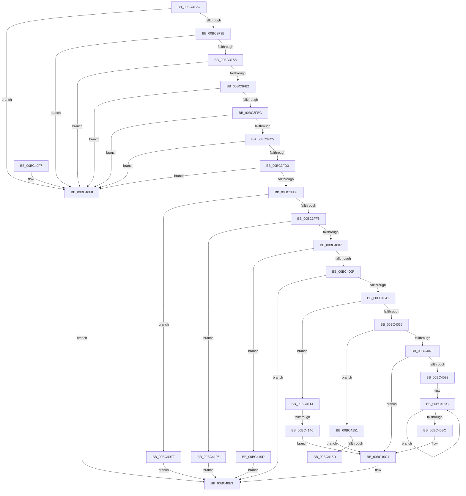

# GxpReadFrameBufferPixels

- RVA: `0x00BC3F2C`–`0x00BC4162` (길이 `566` bytes)
- VA: `0x0000000140BC3F2C`
- 실행 섹션: `PAGEBGFX`
- PDB 이름 있음: `예`; PDB Function 태그: `예`
- unwind 정보 RVA: `0x000AA5C4`
- 디코드: `158`개 명령, `566/566` bytes 표시
- 미해석 바이트: `0` (있으면 어셈블리에 `.byte`로 보존)

> 이 문서는 커널 이미지의 기계어와 PDB 기호를 분석해 생성했습니다. 4번과 5번은 함수 원형과 자료형을 바이너리 사용 방식에서 추정한 C 해석이며 원본 소스 복구 결과는 아닙니다.

## 1. Dependencies

- 직접 호출 지점: **4**; 고유 호출 대상: **4**
- 직접 호출자로 확인된 함수: **1**
- RIP 상대 이미지 참조: **5**

### Outgoing calls
- `0x00BC3F6B` → [BgpGetBitsPerPixel](../../text/48/BgpGetBitsPerPixel_function_0048CDA0.md) (function, `0x0048CDA0`)
- `0x00BC3F7E` → [BgpGetResolution](../../text/4E/BgpGetResolution_function_004E3294.md) (function, `0x004E3294`)
- `0x00BC4034` → [GxpAdjustRectangleToFrameBuffer](../../text/48/GxpAdjustRectangleToFrameBuffer_function_0048CDC8.md) (function, `0x0048CDC8`)
- `0x00BC40A5` → [memcpy](../../text/6C/memcpy_function_006C6840.md) (function, `0x006C6840`)

### Direct callers
- [BgpGxReadRectangle](BgpGxReadRectangle_function_00BC3D18.md) at `0x00BC3D5D`

### Static image references
- `0x00BC3FE8` → RVA `0x00EF0450` (`.data`; read)
- `0x00BC4041` → RVA `0x00EF03E0` (`.data`; read)
- `0x00BC4055` → RVA `0x00EF03E2` (`.data`; read)
- `0x00BC405C` → RVA `0x00EF0400` (`.data`; read)
- `0x00BC4125` → RVA `0x00EF03F0` (`.data`; read)

## 2. Other-region calls and transfers

- 다른 실행 섹션으로 향하는 call: **4**
  - `0x00BC3F6B` → [BgpGetBitsPerPixel](../../text/48/BgpGetBitsPerPixel_function_0048CDA0.md) (`PAGEBGFX` → `.text`)
  - `0x00BC3F7E` → [BgpGetResolution](../../text/4E/BgpGetResolution_function_004E3294.md) (`PAGEBGFX` → `.text`)
  - `0x00BC4034` → [GxpAdjustRectangleToFrameBuffer](../../text/48/GxpAdjustRectangleToFrameBuffer_function_0048CDC8.md) (`PAGEBGFX` → `.text`)
  - `0x00BC40A5` → [memcpy](../../text/6C/memcpy_function_006C6840.md) (`PAGEBGFX` → `.text`)
- call이 아닌 외부 분기/꼬리 이동: **2**
  - `0x00BC4140` → [sub_00BC6824](Unknown_function_00BC6824.md) (`tail-transfer`)
  - `0x00BC415D` → [sub_00BC6824 + 0x17](Unknown_function_00BC6824.md) (`tail-transfer`)

## 3. Assembly (complete function range)

```asm
00BC3F2C  48 89 54 24 10                  mov qword ptr [rsp + 0x10], rdx
00BC3F31  55                              push rbp
00BC3F32  53                              push rbx
00BC3F33  56                              push rsi
00BC3F34  57                              push rdi
00BC3F35  41 54                           push r12
00BC3F37  41 55                           push r13
00BC3F39  41 56                           push r14
00BC3F3B  41 57                           push r15
00BC3F3D  48 8D 6C 24 E1                  lea rbp, [rsp - 0x1f]
00BC3F42  48 81 EC C8 00 00 00            sub rsp, 0xc8
00BC3F49  45 33 E4                        xor r12d, r12d
00BC3F4C  33 C0                           xor eax, eax
00BC3F4E  48 89 45 AF                     mov qword ptr [rbp - 0x51], rax
00BC3F52  48 8B F2                        mov rsi, rdx
00BC3F55  89 45 B7                        mov dword ptr [rbp - 0x49], eax
00BC3F58  48 8B F9                        mov rdi, rcx
00BC3F5B  4C 89 65 BF                     mov qword ptr [rbp - 0x41], r12
00BC3F5F  44 89 65 77                     mov dword ptr [rbp + 0x77], r12d
00BC3F63  4C 89 65 97                     mov qword ptr [rbp - 0x69], r12
00BC3F67  44 89 65 67                     mov dword ptr [rbp + 0x67], r12d
00BC3F6B  E8 30 8E 8C FF                  call 0x14048cda0
00BC3F70  44 8B F8                        mov r15d, eax
00BC3F73  48 8D 4D C7                     lea rcx, [rbp - 0x39]
00BC3F77  41 C1 EF 03                     shr r15d, 3
00BC3F7B  44 8B C8                        mov r9d, eax
00BC3F7E  E8 11 F3 91 FF                  call 0x1404e3294
00BC3F83  F2 0F 10 00                     movsd xmm0, qword ptr [rax]
00BC3F87  8B 48 08                        mov ecx, dword ptr [rax + 8]
00BC3F8A  F2 0F 11 45 9F                  movsd qword ptr [rbp - 0x61], xmm0
00BC3F8F  89 4D A7                        mov dword ptr [rbp - 0x59], ecx
00BC3F92  48 85 FF                        test rdi, rdi
00BC3F95  0F 84 5D 01 00 00               je 0x140bc40f8
00BC3F9B  44 8B 47 04                     mov r8d, dword ptr [rdi + 4]
00BC3F9F  45 85 C0                        test r8d, r8d
00BC3FA2  0F 84 50 01 00 00               je 0x140bc40f8
00BC3FA8  8B 17                           mov edx, dword ptr [rdi]
00BC3FAA  85 D2                           test edx, edx
00BC3FAC  0F 84 46 01 00 00               je 0x140bc40f8
00BC3FB2  44 39 4F 08                     cmp dword ptr [rdi + 8], r9d
00BC3FB6  0F 85 3C 01 00 00               jne 0x140bc40f8
00BC3FBC  48 85 F6                        test rsi, rsi
00BC3FBF  0F 84 33 01 00 00               je 0x140bc40f8
00BC3FC5  8B 0E                           mov ecx, dword ptr [rsi]
00BC3FC7  41 03 C8                        add ecx, r8d
00BC3FCA  3B 4D 9F                        cmp ecx, dword ptr [rbp - 0x61]
00BC3FCD  0F 87 25 01 00 00               ja 0x140bc40f8
00BC3FD3  8B 4E 04                        mov ecx, dword ptr [rsi + 4]
00BC3FD6  48 8B 45 9F                     mov rax, qword ptr [rbp - 0x61]
00BC3FDA  03 CA                           add ecx, edx
00BC3FDC  48 C1 E8 20                     shr rax, 0x20
00BC3FE0  3B C8                           cmp ecx, eax
00BC3FE2  0F 87 10 01 00 00               ja 0x140bc40f8
00BC3FE8  8B 05 62 C4 32 00               mov eax, dword ptr [rip + 0x32c462]
00BC3FEE  A8 08                           test al, 8
00BC3FF0  0F 85 09 01 00 00               jne 0x140bc40ff
00BC3FF6  41 0F AF D0                     imul edx, r8d
00BC3FFA  41 0F AF D7                     imul edx, r15d
00BC3FFE  39 57 0C                        cmp dword ptr [rdi + 0xc], edx
00BC4001  0F 82 FF 00 00 00               jb 0x140bc4106
00BC4007  A8 02                           test al, 2
00BC4009  0F 84 FE 00 00 00               je 0x140bc410d
00BC400F  48 8D 45 77                     lea rax, [rbp + 0x77]
00BC4013  44 88 64 24 30                  mov byte ptr [rsp + 0x30], r12b
00BC4018  48 89 44 24 28                  mov qword ptr [rsp + 0x28], rax
00BC401D  4C 8D 4D AF                     lea r9, [rbp - 0x51]
00BC4021  48 8D 45 BF                     lea rax, [rbp - 0x41]
00BC4025  48 8B D6                        mov rdx, rsi
00BC4028  4C 8D 45 9F                     lea r8, [rbp - 0x61]
00BC402C  48 89 44 24 20                  mov qword ptr [rsp + 0x20], rax
00BC4031  48 8B CF                        mov rcx, rdi
00BC4034  E8 8F 8D 8C FF                  call 0x14048cdc8
00BC4039  85 C0                           test eax, eax
00BC403B  0F 88 A2 00 00 00               js 0x140bc40e3
00BC4041  44 38 25 98 C3 32 00            cmp byte ptr [rip + 0x32c398], r12b
00BC4048  45 8B F4                        mov r14d, r12d
00BC404B  44 89 65 7F                     mov dword ptr [rbp + 0x7f], r12d
00BC404F  0F 84 BF 00 00 00               je 0x140bc4114
00BC4055  44 38 25 86 C3 32 00            cmp byte ptr [rip + 0x32c386], r12b
00BC405C  4C 8B 05 9D C3 32 00            mov r8, qword ptr [rip + 0x32c39d]
00BC4063  4C 8B 6F 18                     mov r13, qword ptr [rdi + 0x18]
00BC4067  8B 1F                           mov ebx, dword ptr [rdi]
00BC4069  4C 89 45 D7                     mov qword ptr [rbp - 0x29], r8
00BC406D  0F 85 DE 00 00 00               jne 0x140bc4151
00BC4073  8B 4D A7                        mov ecx, dword ptr [rbp - 0x59]
00BC4076  41 8B D7                        mov edx, r15d
00BC4079  0F AF 57 04                     imul edx, dword ptr [rdi + 4]
00BC407D  44 8B E1                        mov r12d, ecx
00BC4080  44 0F AF 66 04                  imul r12d, dword ptr [rsi + 4]
00BC4085  44 03 26                        add r12d, dword ptr [rsi]
00BC4088  45 0F AF E7                     imul r12d, r15d
00BC408C  4D 03 E0                        add r12, r8
00BC408F  85 DB                           test ebx, ebx
00BC4091  74 31                           je 0x140bc40c4
00BC4093  41 0F AF CF                     imul ecx, r15d
00BC4097  44 8B F2                        mov r14d, edx
00BC409A  8B F1                           mov esi, ecx
00BC409C  4D 8B C6                        mov r8, r14
00BC409F  49 8B D4                        mov rdx, r12
00BC40A2  49 8B CD                        mov rcx, r13
00BC40A5  E8 96 27 B0 FF                  call 0x1406c6840
00BC40AA  41 8B C7                        mov eax, r15d
00BC40AD  4C 03 E6                        add r12, rsi
00BC40B0  0F AF 47 04                     imul eax, dword ptr [rdi + 4]
00BC40B4  4C 03 E8                        add r13, rax
00BC40B7  83 C3 FF                        add ebx, -1
00BC40BA  75 E0                           jne 0x140bc409c
00BC40BC  48 8B 75 6F                     mov rsi, qword ptr [rbp + 0x6f]
00BC40C0  44 8B 75 7F                     mov r14d, dword ptr [rbp + 0x7f]
00BC40C4  8B 45 B3                        mov eax, dword ptr [rbp - 0x4d]
00BC40C7  89 07                           mov dword ptr [rdi], eax
00BC40C9  8B 45 AF                        mov eax, dword ptr [rbp - 0x51]
00BC40CC  89 47 04                        mov dword ptr [rdi + 4], eax
00BC40CF  8B 45 77                        mov eax, dword ptr [rbp + 0x77]
00BC40D2  89 47 0C                        mov dword ptr [rdi + 0xc], eax
00BC40D5  8B 45 BF                        mov eax, dword ptr [rbp - 0x41]
00BC40D8  89 06                           mov dword ptr [rsi], eax
00BC40DA  8B 45 C3                        mov eax, dword ptr [rbp - 0x3d]
00BC40DD  89 46 04                        mov dword ptr [rsi + 4], eax
00BC40E0  41 8B C6                        mov eax, r14d
00BC40E3  48 81 C4 C8 00 00 00            add rsp, 0xc8
00BC40EA  41 5F                           pop r15
00BC40EC  41 5E                           pop r14
00BC40EE  41 5D                           pop r13
00BC40F0  41 5C                           pop r12
00BC40F2  5F                              pop rdi
00BC40F3  5E                              pop rsi
00BC40F4  5B                              pop rbx
00BC40F5  5D                              pop rbp
00BC40F6  C3                              ret
00BC40F7  CC                              int3
00BC40F8  B8 0D 00 00 C0                  mov eax, 0xc000000d
00BC40FD  EB E4                           jmp 0x140bc40e3
00BC40FF  B8 BB 00 00 C0                  mov eax, 0xc00000bb
00BC4104  EB DD                           jmp 0x140bc40e3
00BC4106  B8 23 00 00 C0                  mov eax, 0xc0000023
00BC410B  EB D6                           jmp 0x140bc40e3
00BC410D  B8 01 00 00 C0                  mov eax, 0xc0000001
00BC4112  EB CF                           jmp 0x140bc40e3
00BC4114  8B 07                           mov eax, dword ptr [rdi]
00BC4116  89 45 F7                        mov dword ptr [rbp - 9], eax
00BC4119  8B 47 04                        mov eax, dword ptr [rdi + 4]
00BC411C  89 45 FB                        mov dword ptr [rbp - 5], eax
00BC411F  8B 47 0C                        mov eax, dword ptr [rdi + 0xc]
00BC4122  89 45 03                        mov dword ptr [rbp + 3], eax
00BC4125  8B 05 C5 C2 32 00               mov eax, dword ptr [rip + 0x32c2c5]
00BC412B  89 45 FF                        mov dword ptr [rbp - 1], eax
00BC412E  48 8B 47 18                     mov rax, qword ptr [rdi + 0x18]
00BC4132  48 89 45 07                     mov qword ptr [rbp + 7], rax
00BC4136  48 8B 05 C3 C2 32 00            mov rax, qword ptr [rip + 0x32c2c3]
00BC413D  48 85 C0                        test rax, rax
00BC4140  0F 85 DE 26 00 00               jne 0x140bc6824
00BC4146  41 BE 01 00 00 C0               mov r14d, 0xc0000001
00BC414C  E9 73 FF FF FF                  jmp 0x140bc40c4
00BC4151  44 89 65 9B                     mov dword ptr [rbp - 0x65], r12d
00BC4155  85 DB                           test ebx, ebx
00BC4157  0F 84 67 FF FF FF               je 0x140bc40c4
00BC415D  E9 D9 26 00 00                  jmp 0x140bc683b
```

## 4. C-style interpretation (structured pseudocode)

```c
__int64 __fastcall GxpReadFrameBufferPixels(__int64 a1, __int64 a2)
{
    __int64 result;
    __int64 v_r12;
    __int64 v_r13;
    __int64 v_r15;
    __int64 v_rbx;
    __int64 v_rsp;
    unsigned __int64 v_stack_m58;
    unsigned int v_stack_m5C;
    unsigned __int64 v_stack_m5F;
    unsigned int v_stack_m60;
    unsigned int v_stack_m64;
    unsigned int v_stack_m68;
    unsigned __int64 v_stack_m88;
    unsigned __int64 v_stack_m98;
    unsigned int v_stack_m9C;
    unsigned __int64 v_stack_mA0;
    unsigned int v_stack_mA8;
    unsigned int v_stack_mAC;
    unsigned __int64 v_stack_mB0;
    unsigned int v_stack_mB8;
    unsigned __int64 v_stack_mC0;
    unsigned int v_stack_mC4;
    unsigned __int64 v_stack_mC8;
    unsigned __int8 v_stack_mD8;
    unsigned __int64 v_stack_mE0;
    unsigned __int64 v_stack_mE8;
    unsigned __int64 v_stack_p10;
    unsigned int v_stack_p18;
    unsigned int v_stack_p20;
    unsigned int v_stack_p8;

    v_stack_p10 = a2;
    v_rsp = (v_rsp) - (200);
    v_r12 = 0;
    result = 0;
    v_stack_mB0 = 0;
    v_stack_mA8 = 0;
    v_stack_mA0 = 0;
    v_stack_p18 = 0;
    v_stack_mC8 = 0;
    v_stack_p8 = 0;
    result = BgpGetBitsPerPixel(a1, a2, a3, a4);
    v_r15 = (unsigned int)(((unsigned int)((unsigned int)(result))) >> (3));
    result = BgpGetResolution(v_stack_m98, a2, a3, (unsigned int)((unsigned int)(result)));
    v_stack_mC0 = v_xmm0;
    v_stack_mB8 = (unsigned int)((unsigned int)(*(unsigned int *)(result + 8)));
    if (a1 == 0) goto loc_00BC40F8;
    if ((unsigned int)((unsigned int)(*(unsigned int *)(a1 + 4))) == 0) goto loc_00BC40F8;
    if ((unsigned int)((unsigned int)(*(unsigned int *)(a1))) == 0) goto loc_00BC40F8;
    if ((*(unsigned int *)(a1 + 8)) != ((unsigned int)((unsigned int)((unsigned int)(result))))) goto loc_00BC40F8;
    if (a2 == 0) goto loc_00BC40F8;
    a1 = (unsigned int)(((unsigned int)(*(unsigned int *)(a2))) + ((unsigned int)((unsigned int)(*(unsigned int *)(a1 + 4)))));
    if (((unsigned int)(a1)) > v_stack_mC0) goto loc_00BC40F8;
    a1 = (unsigned int)(((unsigned int)(*(unsigned int *)(a2 + 4))) + ((unsigned int)((unsigned int)(*(unsigned int *)(a1)))));
    result = (v_stack_mC0) >> (32);
    if (((unsigned int)(a1)) > ((unsigned int)(result))) goto loc_00BC40F8;
    if ((((unsigned __int8)((unsigned int)(*(unsigned int *)(v_rip + 3327074)))) & (8)) != 0) goto loc_00BC40FF;
    a2 = (unsigned int)(((unsigned int)(*(unsigned int *)(a1))) * ((unsigned int)((unsigned int)(*(unsigned int *)(a1 + 4)))));
    a2 = (unsigned int)((a2) * ((unsigned int)(v_r15)));
    if ((*(unsigned int *)(a1 + 12)) < ((unsigned int)(a2))) goto loc_00BC4106;
    if ((((unsigned __int8)((unsigned int)(*(unsigned int *)(v_rip + 3327074)))) & (2)) == 0) goto loc_00BC410D;
    v_stack_mD8 = 0;
    v_stack_mE0 = v_stack_p18;
    v_stack_mE8 = v_stack_mA0;
    result = GxpAdjustRectangleToFrameBuffer(a1, a2, v_stack_mC0, v_stack_mB0);
    if (sign_flag) goto loc_00BC40E3;
    v_stack_p20 = 0;
    if ((*(unsigned __int8 *)(v_rip + 3326872)) == 0) goto loc_00BC4114;
    v_stack_m88 = *(unsigned __int64 *)(v_rip + 3326877);
    if ((*(unsigned __int8 *)(v_rip + 3326854)) != 0) goto loc_00BC4151;
    a2 = (unsigned int)(((unsigned int)((unsigned int)(v_r15))) * (*(unsigned int *)(a1 + 4)));
    v_r12 = (unsigned int)(((unsigned int)((unsigned int)((unsigned int)(v_stack_mB8)))) * (*(unsigned int *)(a2 + 4)));
    v_r12 = (unsigned int)((v_r12) + (*(unsigned int *)(a2)));
    v_r12 = (unsigned int)((v_r12) * ((unsigned int)(v_r15)));
    v_r12 = (v_r12) + (*(unsigned __int64 *)(v_rip + 3326877));
    if ((unsigned int)((unsigned int)(*(unsigned int *)(a1))) == 0) goto loc_00BC40C4;
    a1 = (unsigned int)(((unsigned int)(v_stack_mB8)) * ((unsigned int)(v_r15)));
loc_00BC409C:
    result = memcpy(*(unsigned __int64 *)(a1 + 24), v_r12, (unsigned int)((unsigned int)(a2)), v_stack_mB0);
    v_r12 = (v_r12) + ((unsigned int)((unsigned int)(a1)));
    result = (unsigned int)(((unsigned int)((unsigned int)(v_r15))) * (*(unsigned int *)(a1 + 4)));
    v_r13 = (*(unsigned __int64 *)(a1 + 24)) + (result);
    v_rbx = (unsigned int)(((unsigned int)(*(unsigned int *)(a1))) + (-1));
    if (condition_is_not_equal) goto loc_00BC409C;
loc_00BC40C4:
    *(unsigned int *)(a1) = (unsigned int)((unsigned int)(v_stack_mAC));
    *(unsigned int *)(a1 + 4) = (unsigned int)((unsigned int)(v_stack_mB0));
    *(unsigned int *)(a1 + 12) = (unsigned int)((unsigned int)(v_stack_p18));
    *(unsigned int *)(v_stack_p10) = (unsigned int)((unsigned int)(v_stack_mA0));
    *(unsigned int *)(v_stack_p10 + 4) = (unsigned int)((unsigned int)(v_stack_m9C));
loc_00BC40E3:
    v_rsp = (v_rsp) + (200);
    return (unsigned int)((unsigned int)((unsigned int)(v_stack_p20)));
loc_00BC40F8:
    goto loc_00BC40E3;
loc_00BC40FF:
    goto loc_00BC40E3;
loc_00BC4106:
    goto loc_00BC40E3;
loc_00BC410D:
    goto loc_00BC40E3;
loc_00BC4114:
    v_stack_m68 = (unsigned int)((unsigned int)(*(unsigned int *)(a1)));
    v_stack_m64 = (unsigned int)((unsigned int)(*(unsigned int *)(a1 + 4)));
    v_stack_m5C = (unsigned int)((unsigned int)(*(unsigned int *)(a1 + 12)));
    v_stack_m60 = (unsigned int)((unsigned int)(*(unsigned int *)(v_rip + 3326661)));
    v_stack_m58 = *(unsigned __int64 *)(a1 + 24);
    goto loc_00BC40C4;
loc_00BC4151:
    v_stack_mC4 = (unsigned int)(v_r12);
    if ((unsigned int)(v_rbx) == 0) goto loc_00BC40C4;
}
```

## 5. (Beta) C Style

```c
int64_t GxpReadFrameBufferPixels(int64_t Arg1, int64_t Arg2)
{
    int64_t result;
    int64_t local_r12;
    int64_t local_r13;
    int64_t local_r15;
    int64_t local_rbx;
    int64_t local_rsp;
    uint64_t v_stack_m58;
    uint32_t v_stack_m5C;
    uint64_t v_stack_m5F;
    uint32_t v_stack_m60;
    uint32_t v_stack_m64;
    uint32_t v_stack_m68;
    uint64_t v_stack_m88;
    uint64_t v_stack_m98;
    uint32_t v_stack_m9C;
    uint64_t v_stack_mA0;
    uint32_t v_stack_mA8;
    uint32_t v_stack_mAC;
    uint64_t v_stack_mB0;
    uint32_t v_stack_mB8;
    uint64_t v_stack_mC0;
    uint32_t v_stack_mC4;
    uint64_t v_stack_mC8;
    uint8_t v_stack_mD8;
    uint64_t v_stack_mE0;
    uint64_t v_stack_mE8;
    uint64_t v_stack_p10;
    uint32_t v_stack_p18;
    uint32_t v_stack_p20;
    uint32_t v_stack_p8;

    v_stack_p10 = Arg2;
    local_rsp = (local_rsp) - (200);
    local_r12 = 0;
    result = 0;
    v_stack_mB0 = 0;
    v_stack_mA8 = 0;
    v_stack_mA0 = 0;
    v_stack_p18 = 0;
    v_stack_mC8 = 0;
    v_stack_p8 = 0;
    result = BgpGetBitsPerPixel(Arg1, Arg2, a3, a4);
    local_r15 = (uint32_t)(((uint32_t)((uint32_t)(result))) >> (3));
    result = BgpGetResolution(v_stack_m98, Arg2, a3, (uint32_t)((uint32_t)(result)));
    v_stack_mC0 = v_xmm0;
    v_stack_mB8 = (uint32_t)((uint32_t)(*(uint32_t *)(result + 0x8)));
    if (Arg1 == 0) goto loc_00BC40F8;
    if ((uint32_t)((uint32_t)(*(uint32_t *)(Arg1 + 0x4))) == 0) goto loc_00BC40F8;
    if ((uint32_t)((uint32_t)(*(uint32_t *)(Arg1))) == 0) goto loc_00BC40F8;
    if ((*(uint32_t *)(Arg1 + 0x8)) != ((uint32_t)((uint32_t)((uint32_t)(result))))) goto loc_00BC40F8;
    if (Arg2 == 0) goto loc_00BC40F8;
    Arg1 = (uint32_t)(((uint32_t)(*(uint32_t *)(Arg2))) + ((uint32_t)((uint32_t)(*(uint32_t *)(Arg1 + 0x4)))));
    if (((uint32_t)(Arg1)) > v_stack_mC0) goto loc_00BC40F8;
    Arg1 = (uint32_t)(((uint32_t)(*(uint32_t *)(Arg2 + 0x4))) + ((uint32_t)((uint32_t)(*(uint32_t *)(Arg1)))));
    result = (v_stack_mC0) >> (32);
    if (((uint32_t)(Arg1)) > ((uint32_t)(result))) goto loc_00BC40F8;
    if ((((uint8_t)((uint32_t)(*(uint32_t *)(v_rip + 0x32C462)))) & (8)) != 0) goto loc_00BC40FF;
    Arg2 = (uint32_t)(((uint32_t)(*(uint32_t *)(Arg1))) * ((uint32_t)((uint32_t)(*(uint32_t *)(Arg1 + 0x4)))));
    Arg2 = (uint32_t)((Arg2) * ((uint32_t)(local_r15)));
    if ((*(uint32_t *)(Arg1 + 0xC)) < ((uint32_t)(Arg2))) goto loc_00BC4106;
    if ((((uint8_t)((uint32_t)(*(uint32_t *)(v_rip + 0x32C462)))) & (2)) == 0) goto loc_00BC410D;
    v_stack_mD8 = 0;
    v_stack_mE0 = v_stack_p18;
    v_stack_mE8 = v_stack_mA0;
    result = GxpAdjustRectangleToFrameBuffer(Arg1, Arg2, v_stack_mC0, v_stack_mB0);
    if (sign_flag) goto loc_00BC40E3;
    v_stack_p20 = 0;
    if ((*(uint8_t *)(v_rip + 0x32C398)) == 0) goto loc_00BC4114;
    v_stack_m88 = *(uint64_t *)(v_rip + 0x32C39D);
    if ((*(uint8_t *)(v_rip + 0x32C386)) != 0) goto loc_00BC4151;
    Arg2 = (uint32_t)(((uint32_t)((uint32_t)(local_r15))) * (*(uint32_t *)(Arg1 + 0x4)));
    local_r12 = (uint32_t)(((uint32_t)((uint32_t)((uint32_t)(v_stack_mB8)))) * (*(uint32_t *)(Arg2 + 0x4)));
    local_r12 = (uint32_t)((local_r12) + (*(uint32_t *)(Arg2)));
    local_r12 = (uint32_t)((local_r12) * ((uint32_t)(local_r15)));
    local_r12 = (local_r12) + (*(uint64_t *)(v_rip + 0x32C39D));
    if ((uint32_t)((uint32_t)(*(uint32_t *)(Arg1))) == 0) goto loc_00BC40C4;
    Arg1 = (uint32_t)(((uint32_t)(v_stack_mB8)) * ((uint32_t)(local_r15)));
loc_00BC409C:
    result = memcpy(*(uint64_t *)(Arg1 + 0x18), local_r12, (uint32_t)((uint32_t)(Arg2)), v_stack_mB0);
    local_r12 = (local_r12) + ((uint32_t)((uint32_t)(Arg1)));
    result = (uint32_t)(((uint32_t)((uint32_t)(local_r15))) * (*(uint32_t *)(Arg1 + 0x4)));
    local_r13 = (*(uint64_t *)(Arg1 + 0x18)) + (result);
    local_rbx = (uint32_t)(((uint32_t)(*(uint32_t *)(Arg1))) + (-1));
    if (condition_is_not_equal) goto loc_00BC409C;
loc_00BC40C4:
    *(uint32_t *)(Arg1) = (uint32_t)((uint32_t)(v_stack_mAC));
    *(uint32_t *)(Arg1 + 0x4) = (uint32_t)((uint32_t)(v_stack_mB0));
    *(uint32_t *)(Arg1 + 0xC) = (uint32_t)((uint32_t)(v_stack_p18));
    *(uint32_t *)(v_stack_p10) = (uint32_t)((uint32_t)(v_stack_mA0));
    *(uint32_t *)(v_stack_p10 + 0x4) = (uint32_t)((uint32_t)(v_stack_m9C));
loc_00BC40E3:
    local_rsp = (local_rsp) + (200);
    return (uint32_t)((uint32_t)((uint32_t)(v_stack_p20)));
loc_00BC40F8:
    goto loc_00BC40E3;
loc_00BC40FF:
    goto loc_00BC40E3;
loc_00BC4106:
    goto loc_00BC40E3;
loc_00BC410D:
    goto loc_00BC40E3;
loc_00BC4114:
    v_stack_m68 = (uint32_t)((uint32_t)(*(uint32_t *)(Arg1)));
    v_stack_m64 = (uint32_t)((uint32_t)(*(uint32_t *)(Arg1 + 0x4)));
    v_stack_m5C = (uint32_t)((uint32_t)(*(uint32_t *)(Arg1 + 0xC)));
    v_stack_m60 = (uint32_t)((uint32_t)(*(uint32_t *)(v_rip + 0x32C2C5)));
    v_stack_m58 = *(uint64_t *)(Arg1 + 0x18);
    goto loc_00BC40C4;
loc_00BC4151:
    v_stack_mC4 = (uint32_t)(local_r12);
    if ((uint32_t)(local_rbx) == 0) goto loc_00BC40C4;
}
```

## 6. Execution-region graph

[열기: 2D/3D 그래프와 함수 탐색 컨트롤 패널](../../../control-panel.html?section=pagebgfx&rva=0x00BC3F2C&view=graph)

- 2D 그래프는 위에서 아래로 흐르고, 3D 그래프는 빈 공간을 드래그해 회전합니다. Shift+드래그는 이동, 휠은 확대·축소, 함수 노드 선택은 대상 보고서 이동입니다.

### Static fallback


