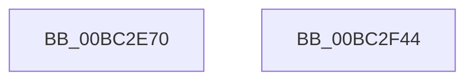

# LogFwInitialize

- RVA: `0x00BC2E70`–`0x00BC2F45` (길이 `213` bytes)
- VA: `0x0000000140BC2E70`
- 실행 섹션: `PAGEBGFX`
- PDB 이름 있음: `예`; PDB Function 태그: `아니요`
- unwind 정보 RVA: `0x0005C788`
- 디코드: `35`개 명령, `213/213` bytes 표시
- 미해석 바이트: `0` (있으면 어셈블리에 `.byte`로 보존)

> 이 문서는 커널 이미지의 기계어와 PDB 기호를 분석해 생성했습니다. 4번과 5번은 함수 원형과 자료형을 바이너리 사용 방식에서 추정한 C 해석이며 원본 소스 복구 결과는 아닙니다.

## 1. Dependencies

- 직접 호출 지점: **1**; 고유 호출 대상: **1**
- 직접 호출자로 확인된 함수: **1**
- RIP 상대 이미지 참조: **26**

### Outgoing calls
- `0x00BC2F3A` → [memset](../../text/6C/memset_function_006C6C40.md) (function, `0x006C6C40`)

### Direct callers
- [BgpFwLibraryInitialize](BgpFwLibraryInitialize_function_00BC5400.md) at `0x00BC550B`

### Static image references
- `0x00BC2E74` → RVA `0x00EF0450` (`.data`; read/write)
- `0x00BC2E88` → RVA `0x00EEFF20` (`.data`; write)
- `0x00BC2E8F` → RVA `0x00EEFF88` (`.data`; write)
- `0x00BC2E98` → RVA `0x00EEFF70` (`.data`; write)
- `0x00BC2EA3` → RVA `0x00EEFF78` (`.data`; write)
- `0x00BC2EA9` → RVA `0x00EEFF60` (`.data`; write)
- `0x00BC2EB0` → RVA `0x00EEFF80` (`.data`; write)
- `0x00BC2EB7` → RVA `0x00EEFF40` (`.data`; write)
- `0x00BC2EBE` → RVA `0x00EEFF58` (`.data`; write)
- `0x00BC2EC5` → RVA `0x00EEFF30` (`.data`; write)
- `0x00BC2ECC` → RVA `0x00EEFF50` (`.data`; write)
- `0x00BC2ED3` → RVA `0x00EEFF48` (`.data`; write)
- `0x00BC2EDA` → RVA `0x00EEFFA0` (`.data`; write)
- `0x00BC2EE1` → RVA `0x00EEFFB8` (`.data`; write)
- `0x00BC2EE8` → RVA `0x00EEFFB0` (`.data`; write)
- `0x00BC2EEF` → RVA `0x00EEFF90` (`.data`; write)
- `0x00BC2EF6` → RVA `0x00EEFF2C` (`.data`; write)
- `0x00BC2EFC` → RVA `0x00EEFF38` (`.data`; write)
- `0x00BC2F02` → RVA `0x00EEFF68` (`.data`; write)
- `0x00BC2F08` → RVA `0x00EEFFA8` (`.data`; write)
- `0x00BC2F0E` → RVA `0x00EEFF7C` (`.data`; write)
- `0x00BC2F14` → RVA `0x00EEFF28` (`.data`; write)
- `0x00BC2F1A` → RVA `0x00E65120` (`.data`; read)
- `0x00BC2F21` → RVA `0x00E0F110` (`.data`; write)
- `0x00BC2F2C` → RVA `0x00E0F108` (`.data`; write)
- `0x00BC2F33` → RVA `0x00E0F118` (`.data`; write)

## 2. Other-region calls and transfers

- 다른 실행 섹션으로 향하는 call: **1**
  - `0x00BC2F3A` → [memset](../../text/6C/memset_function_006C6C40.md) (`PAGEBGFX` → `.text`)
- 별도 외부 분기/꼬리 이동을 확인하지 못했습니다.

## 3. Assembly (complete function range)

```asm
00BC2E70  48 83 EC 28                     sub rsp, 0x28
00BC2E74  0F BA 2D D4 D5 32 00 07         bts dword ptr [rip + 0x32d5d4], 7
00BC2E7C  33 C9                           xor ecx, ecx
00BC2E7E  48 B8 FF FF FF FF FF FF FF 7F   movabs rax, 0x7fffffffffffffff
00BC2E88  48 89 0D 91 D0 32 00            mov qword ptr [rip + 0x32d091], rcx
00BC2E8F  48 89 0D F2 D0 32 00            mov qword ptr [rip + 0x32d0f2], rcx
00BC2E96  33 D2                           xor edx, edx
00BC2E98  48 89 0D D1 D0 32 00            mov qword ptr [rip + 0x32d0d1], rcx
00BC2E9F  44 8D 41 48                     lea r8d, [rcx + 0x48]
00BC2EA3  89 0D CF D0 32 00               mov dword ptr [rip + 0x32d0cf], ecx
00BC2EA9  48 89 0D B0 D0 32 00            mov qword ptr [rip + 0x32d0b0], rcx
00BC2EB0  48 89 0D C9 D0 32 00            mov qword ptr [rip + 0x32d0c9], rcx
00BC2EB7  48 89 0D 82 D0 32 00            mov qword ptr [rip + 0x32d082], rcx
00BC2EBE  48 89 0D 93 D0 32 00            mov qword ptr [rip + 0x32d093], rcx
00BC2EC5  48 89 0D 64 D0 32 00            mov qword ptr [rip + 0x32d064], rcx
00BC2ECC  48 89 0D 7D D0 32 00            mov qword ptr [rip + 0x32d07d], rcx
00BC2ED3  48 89 0D 6E D0 32 00            mov qword ptr [rip + 0x32d06e], rcx
00BC2EDA  48 89 0D BF D0 32 00            mov qword ptr [rip + 0x32d0bf], rcx
00BC2EE1  48 89 0D D0 D0 32 00            mov qword ptr [rip + 0x32d0d0], rcx
00BC2EE8  48 89 0D C1 D0 32 00            mov qword ptr [rip + 0x32d0c1], rcx
00BC2EEF  48 89 0D 9A D0 32 00            mov qword ptr [rip + 0x32d09a], rcx
00BC2EF6  89 0D 30 D0 32 00               mov dword ptr [rip + 0x32d030], ecx
00BC2EFC  89 0D 36 D0 32 00               mov dword ptr [rip + 0x32d036], ecx
00BC2F02  89 0D 60 D0 32 00               mov dword ptr [rip + 0x32d060], ecx
00BC2F08  89 0D 9A D0 32 00               mov dword ptr [rip + 0x32d09a], ecx
00BC2F0E  89 0D 68 D0 32 00               mov dword ptr [rip + 0x32d068], ecx
00BC2F14  89 0D 0E D0 32 00               mov dword ptr [rip + 0x32d00e], ecx
00BC2F1A  48 8D 0D FF 21 2A 00            lea rcx, [rip + 0x2a21ff]
00BC2F21  48 C7 05 E4 C1 24 00 01 00 00 00  mov qword ptr [rip + 0x24c1e4], 1
00BC2F2C  48 89 05 D5 C1 24 00            mov qword ptr [rip + 0x24c1d5], rax
00BC2F33  48 89 05 DE C1 24 00            mov qword ptr [rip + 0x24c1de], rax
00BC2F3A  E8 01 3D B0 FF                  call 0x1406c6c40
00BC2F3F  48 83 C4 28                     add rsp, 0x28
00BC2F43  C3                              ret
00BC2F44  CC                              int3
```

## 4. C-style interpretation (structured pseudocode)

```c
__int64 __fastcall LogFwInitialize(int a1, int a2)
{
    __int64 result;
    __int64 v_rsp;

    v_rsp = (v_rsp) - (40);
    a1 = 0;
    *(unsigned __int64 *)(v_rip + 3330193) = 0;
    *(unsigned __int64 *)(v_rip + 3330290) = 0;
    a2 = 0;
    *(unsigned __int64 *)(v_rip + 3330257) = 0;
    *(unsigned int *)(v_rip + 3330255) = 0;
    *(unsigned __int64 *)(v_rip + 3330224) = 0;
    *(unsigned __int64 *)(v_rip + 3330249) = 0;
    *(unsigned __int64 *)(v_rip + 3330178) = 0;
    *(unsigned __int64 *)(v_rip + 3330195) = 0;
    *(unsigned __int64 *)(v_rip + 3330148) = 0;
    *(unsigned __int64 *)(v_rip + 3330173) = 0;
    *(unsigned __int64 *)(v_rip + 3330158) = 0;
    *(unsigned __int64 *)(v_rip + 3330239) = 0;
    *(unsigned __int64 *)(v_rip + 3330256) = 0;
    *(unsigned __int64 *)(v_rip + 3330241) = 0;
    *(unsigned __int64 *)(v_rip + 3330202) = 0;
    *(unsigned int *)(v_rip + 3330096) = 0;
    *(unsigned int *)(v_rip + 3330102) = 0;
    *(unsigned int *)(v_rip + 3330144) = 0;
    *(unsigned int *)(v_rip + 3330202) = 0;
    *(unsigned int *)(v_rip + 3330152) = 0;
    *(unsigned int *)(v_rip + 3330062) = 0;
    *(unsigned __int64 *)(v_rip + 2408932) = 1;
    *(unsigned __int64 *)(v_rip + 2408917) = result;
    *(unsigned __int64 *)(v_rip + 2408926) = result;
    result = memset(v_rip + 2761215, a2, a1 + 72, a4);
    v_rsp = (v_rsp) + (40);
    return result;
}
```

## 5. (Beta) C Style

```c
int64_t LogFwInitialize(int32_t Arg1, int32_t Arg2)
{
    int64_t result;
    int64_t local_rsp;

    local_rsp = (local_rsp) - (40);
    Arg1 = 0;
    *(uint64_t *)(v_rip + 0x32D091) = 0;
    *(uint64_t *)(v_rip + 0x32D0F2) = 0;
    Arg2 = 0;
    *(uint64_t *)(v_rip + 0x32D0D1) = 0;
    *(uint32_t *)(v_rip + 0x32D0CF) = 0;
    *(uint64_t *)(v_rip + 0x32D0B0) = 0;
    *(uint64_t *)(v_rip + 0x32D0C9) = 0;
    *(uint64_t *)(v_rip + 0x32D082) = 0;
    *(uint64_t *)(v_rip + 0x32D093) = 0;
    *(uint64_t *)(v_rip + 0x32D064) = 0;
    *(uint64_t *)(v_rip + 0x32D07D) = 0;
    *(uint64_t *)(v_rip + 0x32D06E) = 0;
    *(uint64_t *)(v_rip + 0x32D0BF) = 0;
    *(uint64_t *)(v_rip + 0x32D0D0) = 0;
    *(uint64_t *)(v_rip + 0x32D0C1) = 0;
    *(uint64_t *)(v_rip + 0x32D09A) = 0;
    *(uint32_t *)(v_rip + 0x32D030) = 0;
    *(uint32_t *)(v_rip + 0x32D036) = 0;
    *(uint32_t *)(v_rip + 0x32D060) = 0;
    *(uint32_t *)(v_rip + 0x32D09A) = 0;
    *(uint32_t *)(v_rip + 0x32D068) = 0;
    *(uint32_t *)(v_rip + 0x32D00E) = 0;
    *(uint64_t *)(v_rip + 0x24C1E4) = 1;
    *(uint64_t *)(v_rip + 0x24C1D5) = result;
    *(uint64_t *)(v_rip + 0x24C1DE) = result;
    result = memset(v_rip + 2761215, Arg2, Arg1 + 72, a4);
    local_rsp = (local_rsp) + (40);
    return result;
}
```

## 6. Execution-region graph

[열기: 2D/3D 그래프와 함수 탐색 컨트롤 패널](../../../control-panel.html?section=pagebgfx&rva=0x00BC2E70&view=graph)

- 2D 그래프는 위에서 아래로 흐르고, 3D 그래프는 빈 공간을 드래그해 회전합니다. Shift+드래그는 이동, 휠은 확대·축소, 함수 노드 선택은 대상 보고서 이동입니다.

### Static fallback


