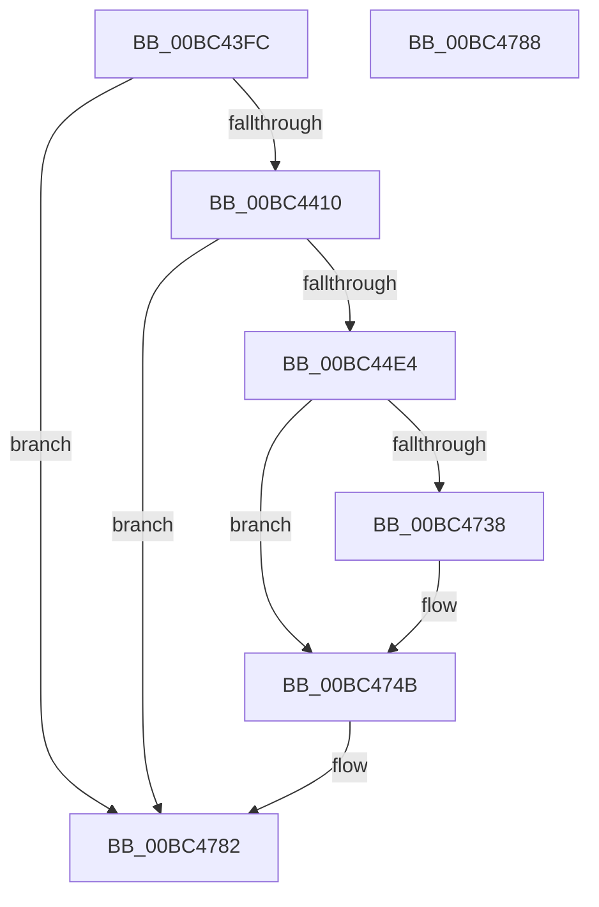

# LogFwReport

- RVA: `0x00BC43FC`–`0x00BC4789` (길이 `909` bytes)
- VA: `0x0000000140BC43FC`
- 실행 섹션: `PAGEBGFX`
- PDB 이름 있음: `예`; PDB Function 태그: `아니요`
- unwind 정보 RVA: `0x000697A4`
- 디코드: `186`개 명령, `909/909` bytes 표시
- 미해석 바이트: `0` (있으면 어셈블리에 `.byte`로 보존)

> 이 문서는 커널 이미지의 기계어와 PDB 기호를 분석해 생성했습니다. 4번과 5번은 함수 원형과 자료형을 바이너리 사용 방식에서 추정한 C 해석이며 원본 소스 복구 결과는 아닙니다.

## 1. Dependencies

- 직접 호출 지점: **23**; 고유 호출 대상: **5**
- 직접 호출자로 확인된 함수: **2**
- RIP 상대 이미지 참조: **60**

### Outgoing calls
- `0x00BC4421` → [BgpFwQueryPerformanceCounter](../../text/4C/BgpFwQueryPerformanceCounter_function_004C0614.md) (function, `0x004C0614`)
- `0x00BC442B` → [BgpGetResolution](../../text/4E/BgpGetResolution_function_004E3294.md) (function, `0x004E3294`)
- `0x00BC4445` → [BgpGetBitsPerPixel](../../text/48/BgpGetBitsPerPixel_function_0048CDA0.md) (function, `0x0048CDA0`)
- `0x00BC44CF` → [ExQueueWorkItem](../../text/2F/ExQueueWorkItem_function_002F9520.md) (function, `0x002F9520`)
- `0x00BC44F2` → [DbgPrintEx](../../text/35/DbgPrintEx_function_00359290.md) (function, `0x00359290`)
- `0x00BC451D` → [DbgPrintEx](../../text/35/DbgPrintEx_function_00359290.md) (function, `0x00359290`)
- `0x00BC4534` → [DbgPrintEx](../../text/35/DbgPrintEx_function_00359290.md) (function, `0x00359290`)
- `0x00BC455B` → [DbgPrintEx](../../text/35/DbgPrintEx_function_00359290.md) (function, `0x00359290`)
- `0x00BC4572` → [DbgPrintEx](../../text/35/DbgPrintEx_function_00359290.md) (function, `0x00359290`)
- `0x00BC4589` → [DbgPrintEx](../../text/35/DbgPrintEx_function_00359290.md) (function, `0x00359290`)
- `0x00BC45B0` → [DbgPrintEx](../../text/35/DbgPrintEx_function_00359290.md) (function, `0x00359290`)
- `0x00BC45D7` → [DbgPrintEx](../../text/35/DbgPrintEx_function_00359290.md) (function, `0x00359290`)
- `0x00BC461A` → [DbgPrintEx](../../text/35/DbgPrintEx_function_00359290.md) (function, `0x00359290`)
- `0x00BC4641` → [DbgPrintEx](../../text/35/DbgPrintEx_function_00359290.md) (function, `0x00359290`)
- `0x00BC4658` → [DbgPrintEx](../../text/35/DbgPrintEx_function_00359290.md) (function, `0x00359290`)
- `0x00BC4683` → [DbgPrintEx](../../text/35/DbgPrintEx_function_00359290.md) (function, `0x00359290`)
- `0x00BC46AA` → [DbgPrintEx](../../text/35/DbgPrintEx_function_00359290.md) (function, `0x00359290`)
- `0x00BC46D1` → [DbgPrintEx](../../text/35/DbgPrintEx_function_00359290.md) (function, `0x00359290`)
- `0x00BC4700` → [DbgPrintEx](../../text/35/DbgPrintEx_function_00359290.md) (function, `0x00359290`)
- `0x00BC4727` → [DbgPrintEx](../../text/35/DbgPrintEx_function_00359290.md) (function, `0x00359290`)
- `0x00BC4746` → [DbgPrintEx](../../text/35/DbgPrintEx_function_00359290.md) (function, `0x00359290`)
- `0x00BC476D` → [DbgPrintEx](../../text/35/DbgPrintEx_function_00359290.md) (function, `0x00359290`)
- `0x00BC477D` → [DbgPrintEx](../../text/35/DbgPrintEx_function_00359290.md) (function, `0x00359290`)

### Direct callers
- [BgpFwLibraryDisable](BgpFwLibraryDisable_function_00BC1724.md) at `0x00BC17EB`
- [ResFwFreeContext](ResFwFreeContext_function_00BC34C4.md) at `0x00BC350A`

### Static image references
- `0x00BC4402` → RVA `0x00EF0450` (`.data`; read)
- `0x00BC4414` → RVA `0x00E0F110` (`.data`; read)
- `0x00BC441B` → RVA `0x00EF0450` (`.data`; write)
- `0x00BC4437` → RVA `0x00EEFF90` (`.data`; write)
- `0x00BC443F` → RVA `0x00EEFF98` (`.data`; write)
- `0x00BC4451` → RVA `0x00E65180` (`.data`; read/write)
- `0x00BC4459` → RVA `0x00E65168` (`.data`; read/write)
- `0x00BC4461` → RVA `0x00EEFF2C` (`.data`; write)
- `0x00BC446D` → RVA `0x00EEFF68` (`.data`; write)
- `0x00BC4473` → RVA `0x00EEFF40` (`.data`; read)
- `0x00BC4483` → RVA `0x00EEFFA8` (`.data`; write)
- `0x00BC4489` → RVA `0x00EEFFB8` (`.data`; read)
- `0x00BC4499` → RVA `0x00EEFF7C` (`.data`; write)
- `0x00BC449F` → RVA `0x00EEFFB0` (`.data`; read)
- `0x00BC44B4` → RVA `0x00E65168` (`.data`; read)
- `0x00BC44BB` → RVA `0x00EEFF28` (`.data`; write)
- `0x00BC44C1` → RVA `0x00BC4B90` (`LogFwpRegisterWorker`; read)
- `0x00BC44C8` → RVA `0x00E65178` (`.data`; write)
- `0x00BC44E6` → RVA `0x00BC6090` (` ?? ::CIJCHKMG::`string'`; read)
- `0x00BC44F7` → RVA `0x00EEFF2C` (`.data`; read)
- `0x00BC44FD` → RVA `0x00BC60E0` (` ?? ::CIJCHKMG::`string'`; read)
- `0x00BC4504` → RVA `0x00EEFF90` (`.data`; read)
- `0x00BC4513` → RVA `0x00EEFF94` (`.data`; read)
- `0x00BC4522` → RVA `0x00EF04A8` (`.data`; read)
- `0x00BC4529` → RVA `0x00BC6110` (` ?? ::CIJCHKMG::`string'`; read)
- `0x00BC4539` → RVA `0x00EEFF88` (`.data`; read)
- `0x00BC4544` → RVA `0x00BC6150` (` ?? ::CIJCHKMG::`string'`; read)
- `0x00BC4560` → RVA `0x00EEFF78` (`.data`; read)
- `0x00BC4567` → RVA `0x00BC6170` (` ?? ::CIJCHKMG::`string'`; read)
- `0x00BC4577` → RVA `0x00EF0470` (`.data`; read)
- `0x00BC457E` → RVA `0x00BC6190` (` ?? ::CIJCHKMG::`string'`; read)
- `0x00BC458E` → RVA `0x00E0F108` (`.data`; read)
- `0x00BC4599` → RVA `0x00BC61B0` (` ?? ::CIJCHKMG::`string'`; read)
- `0x00BC45B5` → RVA `0x00EEFF20` (`.data`; read)
- `0x00BC45C0` → RVA `0x00BC61D0` (` ?? ::CIJCHKMG::`string'`; read)
- `0x00BC45DC` → RVA `0x00EEFF60` (`.data`; read)
- `0x00BC45F5` → RVA `0x00EEFF70` (`.data`; read)
- `0x00BC4605` → RVA `0x00BC61F0` (` ?? ::CIJCHKMG::`string'`; read)
- `0x00BC461F` → RVA `0x00EEFF80` (`.data`; read)
- `0x00BC462A` → RVA `0x00BC6250` (` ?? ::CIJCHKMG::`string'`; read)
- `0x00BC4646` → RVA `0x00EEFF38` (`.data`; read)
- `0x00BC464D` → RVA `0x00BC6270` (` ?? ::CIJCHKMG::`string'`; read)
- `0x00BC465D` → RVA `0x00EEFF28` (`.data`; read)
- `0x00BC4667` → RVA `0x00EEFF7C` (`.data`; read)
- `0x00BC466D` → RVA `0x00BC6290` (` ?? ::CIJCHKMG::`string'`; read)
- `0x00BC4674` → RVA `0x00EF046C` (`.data`; read)
- `0x00BC4688` → RVA `0x00E0F118` (`.data`; read)
- `0x00BC4693` → RVA `0x00BC62F0` (` ?? ::CIJCHKMG::`string'`; read)
- `0x00BC46AF` → RVA `0x00EEFF30` (`.data`; read)
- `0x00BC46BA` → RVA `0x00BC6310` (` ?? ::CIJCHKMG::`string'`; read)
- `0x00BC46D6` → RVA `0x00EEFF58` (`.data`; read)
- `0x00BC46E1` → RVA `0x00EEFFA8` (`.data`; read)
- `0x00BC46E8` → RVA `0x00BC6330` (` ?? ::CIJCHKMG::`string'`; read)
- `0x00BC4705` → RVA `0x00EEFF50` (`.data`; read)
- `0x00BC4710` → RVA `0x00BC6390` (` ?? ::CIJCHKMG::`string'`; read)
- `0x00BC472C` → RVA `0x00EF0480` (`.data`; read)
- `0x00BC473B` → RVA `0x00BC5E40` (` ?? ::CIJCHKMG::`string'`; read)
- `0x00BC474B` → RVA `0x00E65118` (`.data`; read)
- `0x00BC4756` → RVA `0x00BC5E80` (` ?? ::CIJCHKMG::`string'`; read)
- `0x00BC4772` → RVA `0x00BC5EC0` (` ?? ::CIJCHKMG::`string'`; read)

## 2. Other-region calls and transfers

- 다른 실행 섹션으로 향하는 call: **23**
  - `0x00BC4421` → [BgpFwQueryPerformanceCounter](../../text/4C/BgpFwQueryPerformanceCounter_function_004C0614.md) (`PAGEBGFX` → `.text`)
  - `0x00BC442B` → [BgpGetResolution](../../text/4E/BgpGetResolution_function_004E3294.md) (`PAGEBGFX` → `.text`)
  - `0x00BC4445` → [BgpGetBitsPerPixel](../../text/48/BgpGetBitsPerPixel_function_0048CDA0.md) (`PAGEBGFX` → `.text`)
  - `0x00BC44CF` → [ExQueueWorkItem](../../text/2F/ExQueueWorkItem_function_002F9520.md) (`PAGEBGFX` → `.text`)
  - `0x00BC44F2` → [DbgPrintEx](../../text/35/DbgPrintEx_function_00359290.md) (`PAGEBGFX` → `.text`)
  - `0x00BC451D` → [DbgPrintEx](../../text/35/DbgPrintEx_function_00359290.md) (`PAGEBGFX` → `.text`)
  - `0x00BC4534` → [DbgPrintEx](../../text/35/DbgPrintEx_function_00359290.md) (`PAGEBGFX` → `.text`)
  - `0x00BC455B` → [DbgPrintEx](../../text/35/DbgPrintEx_function_00359290.md) (`PAGEBGFX` → `.text`)
  - `0x00BC4572` → [DbgPrintEx](../../text/35/DbgPrintEx_function_00359290.md) (`PAGEBGFX` → `.text`)
  - `0x00BC4589` → [DbgPrintEx](../../text/35/DbgPrintEx_function_00359290.md) (`PAGEBGFX` → `.text`)
  - `0x00BC45B0` → [DbgPrintEx](../../text/35/DbgPrintEx_function_00359290.md) (`PAGEBGFX` → `.text`)
  - `0x00BC45D7` → [DbgPrintEx](../../text/35/DbgPrintEx_function_00359290.md) (`PAGEBGFX` → `.text`)
  - `0x00BC461A` → [DbgPrintEx](../../text/35/DbgPrintEx_function_00359290.md) (`PAGEBGFX` → `.text`)
  - `0x00BC4641` → [DbgPrintEx](../../text/35/DbgPrintEx_function_00359290.md) (`PAGEBGFX` → `.text`)
  - `0x00BC4658` → [DbgPrintEx](../../text/35/DbgPrintEx_function_00359290.md) (`PAGEBGFX` → `.text`)
  - `0x00BC4683` → [DbgPrintEx](../../text/35/DbgPrintEx_function_00359290.md) (`PAGEBGFX` → `.text`)
  - `0x00BC46AA` → [DbgPrintEx](../../text/35/DbgPrintEx_function_00359290.md) (`PAGEBGFX` → `.text`)
  - `0x00BC46D1` → [DbgPrintEx](../../text/35/DbgPrintEx_function_00359290.md) (`PAGEBGFX` → `.text`)
  - `0x00BC4700` → [DbgPrintEx](../../text/35/DbgPrintEx_function_00359290.md) (`PAGEBGFX` → `.text`)
  - `0x00BC4727` → [DbgPrintEx](../../text/35/DbgPrintEx_function_00359290.md) (`PAGEBGFX` → `.text`)
  - `0x00BC4746` → [DbgPrintEx](../../text/35/DbgPrintEx_function_00359290.md) (`PAGEBGFX` → `.text`)
  - `0x00BC476D` → [DbgPrintEx](../../text/35/DbgPrintEx_function_00359290.md) (`PAGEBGFX` → `.text`)
  - `0x00BC477D` → [DbgPrintEx](../../text/35/DbgPrintEx_function_00359290.md) (`PAGEBGFX` → `.text`)
- 별도 외부 분기/꼬리 이동을 확인하지 못했습니다.

## 3. Assembly (complete function range)

```asm
00BC43FC  40 53                           push rbx
00BC43FE  48 83 EC 40                     sub rsp, 0x40
00BC4402  8B 05 48 C0 32 00               mov eax, dword ptr [rip + 0x32c048]
00BC4408  84 C0                           test al, al
00BC440A  0F 89 72 03 00 00               jns 0x140bc4782
00BC4410  0F BA F0 07                     btr eax, 7
00BC4414  48 8D 0D F5 AC 24 00            lea rcx, [rip + 0x24acf5]
00BC441B  89 05 2F C0 32 00               mov dword ptr [rip + 0x32c02f], eax
00BC4421  E8 EE C1 8F FF                  call 0x1404c0614
00BC4426  48 8D 4C 24 30                  lea rcx, [rsp + 0x30]
00BC442B  E8 64 EE 91 FF                  call 0x1404e3294
00BC4430  F2 0F 10 00                     movsd xmm0, qword ptr [rax]
00BC4434  8B 40 08                        mov eax, dword ptr [rax + 8]
00BC4437  F2 0F 11 05 51 BB 32 00         movsd qword ptr [rip + 0x32bb51], xmm0
00BC443F  89 05 53 BB 32 00               mov dword ptr [rip + 0x32bb53], eax
00BC4445  E8 56 89 8C FF                  call 0x14048cda0
00BC444A  48 8B 0D BF AC 24 00            mov rcx, qword ptr [rip + 0x24acbf]
00BC4451  48 83 25 27 0D 2A 00 00         and qword ptr [rip + 0x2a0d27], 0
00BC4459  48 83 25 07 0D 2A 00 00         and qword ptr [rip + 0x2a0d07], 0
00BC4461  89 05 C5 BA 32 00               mov dword ptr [rip + 0x32bac5], eax
00BC4467  8B 05 E3 BF 32 00               mov eax, dword ptr [rip + 0x32bfe3]
00BC446D  89 05 F5 BA 32 00               mov dword ptr [rip + 0x32baf5], eax
00BC4473  48 69 05 C2 BA 32 00 40 42 0F 00  imul rax, qword ptr [rip + 0x32bac2], 0xf4240
00BC447E  48 99                           cqo
00BC4480  48 F7 F9                        idiv rcx
00BC4483  89 05 1F BB 32 00               mov dword ptr [rip + 0x32bb1f], eax
00BC4489  48 69 05 24 BB 32 00 40 42 0F 00  imul rax, qword ptr [rip + 0x32bb24], 0xf4240
00BC4494  48 99                           cqo
00BC4496  48 F7 F9                        idiv rcx
00BC4499  89 05 DD BA 32 00               mov dword ptr [rip + 0x32badd], eax
00BC449F  48 69 05 06 BB 32 00 40 42 0F 00  imul rax, qword ptr [rip + 0x32bb06], 0xf4240
00BC44AA  48 99                           cqo
00BC44AC  48 F7 F9                        idiv rcx
00BC44AF  BA 01 00 00 00                  mov edx, 1
00BC44B4  48 8D 0D AD 0C 2A 00            lea rcx, [rip + 0x2a0cad]
00BC44BB  89 05 67 BA 32 00               mov dword ptr [rip + 0x32ba67], eax
00BC44C1  48 8D 05 C8 06 00 00            lea rax, [rip + 0x6c8]
00BC44C8  48 89 05 A9 0C 2A 00            mov qword ptr [rip + 0x2a0ca9], rax
00BC44CF  E8 4C 50 73 FF                  call 0x1402f9520
00BC44D4  F7 05 72 BF 32 00 00 00 01 00   test dword ptr [rip + 0x32bf72], 0x10000
00BC44DE  0F 84 9E 02 00 00               je 0x140bc4782
00BC44E4  33 D2                           xor edx, edx
00BC44E6  4C 8D 05 A3 1B 00 00            lea r8, [rip + 0x1ba3]
00BC44ED  8D 5A 65                        lea ebx, [rdx + 0x65]
00BC44F0  8B CB                           mov ecx, ebx
00BC44F2  E8 99 4D 79 FF                  call 0x140359290
00BC44F7  8B 05 2F BA 32 00               mov eax, dword ptr [rip + 0x32ba2f]
00BC44FD  4C 8D 05 DC 1B 00 00            lea r8, [rip + 0x1bdc]
00BC4504  44 8B 0D 85 BA 32 00            mov r9d, dword ptr [rip + 0x32ba85]
00BC450B  33 D2                           xor edx, edx
00BC450D  89 44 24 28                     mov dword ptr [rsp + 0x28], eax
00BC4511  8B CB                           mov ecx, ebx
00BC4513  8B 05 7B BA 32 00               mov eax, dword ptr [rip + 0x32ba7b]
00BC4519  89 44 24 20                     mov dword ptr [rsp + 0x20], eax
00BC451D  E8 6E 4D 79 FF                  call 0x140359290
00BC4522  44 8B 0D 7F BF 32 00            mov r9d, dword ptr [rip + 0x32bf7f]
00BC4529  4C 8D 05 E0 1B 00 00            lea r8, [rip + 0x1be0]
00BC4530  33 D2                           xor edx, edx
00BC4532  8B CB                           mov ecx, ebx
00BC4534  E8 57 4D 79 FF                  call 0x140359290
00BC4539  48 69 05 44 BA 32 00 40 42 0F 00  imul rax, qword ptr [rip + 0x32ba44], 0xf4240
00BC4544  4C 8D 05 05 1C 00 00            lea r8, [rip + 0x1c05]
00BC454B  8B CB                           mov ecx, ebx
00BC454D  48 99                           cqo
00BC454F  48 F7 3D BA AB 24 00            idiv qword ptr [rip + 0x24abba]
00BC4556  33 D2                           xor edx, edx
00BC4558  4C 8B C8                        mov r9, rax
00BC455B  E8 30 4D 79 FF                  call 0x140359290
00BC4560  44 8B 0D 11 BA 32 00            mov r9d, dword ptr [rip + 0x32ba11]
00BC4567  4C 8D 05 02 1C 00 00            lea r8, [rip + 0x1c02]
00BC456E  33 D2                           xor edx, edx
00BC4570  8B CB                           mov ecx, ebx
00BC4572  E8 19 4D 79 FF                  call 0x140359290
00BC4577  44 8B 0D F2 BE 32 00            mov r9d, dword ptr [rip + 0x32bef2]
00BC457E  4C 8D 05 0B 1C 00 00            lea r8, [rip + 0x1c0b]
00BC4585  33 D2                           xor edx, edx
00BC4587  8B CB                           mov ecx, ebx
00BC4589  E8 02 4D 79 FF                  call 0x140359290
00BC458E  48 69 05 6F AB 24 00 40 42 0F 00  imul rax, qword ptr [rip + 0x24ab6f], 0xf4240
00BC4599  4C 8D 05 10 1C 00 00            lea r8, [rip + 0x1c10]
00BC45A0  8B CB                           mov ecx, ebx
00BC45A2  48 99                           cqo
00BC45A4  48 F7 3D 65 AB 24 00            idiv qword ptr [rip + 0x24ab65]
00BC45AB  33 D2                           xor edx, edx
00BC45AD  4C 8B C8                        mov r9, rax
00BC45B0  E8 DB 4C 79 FF                  call 0x140359290
00BC45B5  48 69 05 60 B9 32 00 40 42 0F 00  imul rax, qword ptr [rip + 0x32b960], 0xf4240
00BC45C0  4C 8D 05 09 1C 00 00            lea r8, [rip + 0x1c09]
00BC45C7  8B CB                           mov ecx, ebx
00BC45C9  48 99                           cqo
00BC45CB  48 F7 3D 3E AB 24 00            idiv qword ptr [rip + 0x24ab3e]
00BC45D2  33 D2                           xor edx, edx
00BC45D4  4C 8B C8                        mov r9, rax
00BC45D7  E8 B4 4C 79 FF                  call 0x140359290
00BC45DC  48 69 05 79 B9 32 00 40 42 0F 00  imul rax, qword ptr [rip + 0x32b979], 0xf4240
00BC45E7  8B CB                           mov ecx, ebx
00BC45E9  48 99                           cqo
00BC45EB  48 F7 3D 1E AB 24 00            idiv qword ptr [rip + 0x24ab1e]
00BC45F2  4C 8B C0                        mov r8, rax
00BC45F5  48 69 05 70 B9 32 00 40 42 0F 00  imul rax, qword ptr [rip + 0x32b970], 0xf4240
00BC4600  44 89 44 24 20                  mov dword ptr [rsp + 0x20], r8d
00BC4605  4C 8D 05 E4 1B 00 00            lea r8, [rip + 0x1be4]
00BC460C  48 99                           cqo
00BC460E  48 F7 3D FB AA 24 00            idiv qword ptr [rip + 0x24aafb]
00BC4615  33 D2                           xor edx, edx
00BC4617  4C 8B C8                        mov r9, rax
00BC461A  E8 71 4C 79 FF                  call 0x140359290
00BC461F  48 69 05 56 B9 32 00 40 42 0F 00  imul rax, qword ptr [rip + 0x32b956], 0xf4240
00BC462A  4C 8D 05 1F 1C 00 00            lea r8, [rip + 0x1c1f]
00BC4631  8B CB                           mov ecx, ebx
00BC4633  48 99                           cqo
00BC4635  48 F7 3D D4 AA 24 00            idiv qword ptr [rip + 0x24aad4]
00BC463C  33 D2                           xor edx, edx
00BC463E  4C 8B C8                        mov r9, rax
00BC4641  E8 4A 4C 79 FF                  call 0x140359290
00BC4646  44 8B 0D EB B8 32 00            mov r9d, dword ptr [rip + 0x32b8eb]
00BC464D  4C 8D 05 1C 1C 00 00            lea r8, [rip + 0x1c1c]
00BC4654  33 D2                           xor edx, edx
00BC4656  8B CB                           mov ecx, ebx
00BC4658  E8 33 4C 79 FF                  call 0x140359290
00BC465D  8B 05 C5 B8 32 00               mov eax, dword ptr [rip + 0x32b8c5]
00BC4663  89 44 24 28                     mov dword ptr [rsp + 0x28], eax
00BC4667  8B 05 0F B9 32 00               mov eax, dword ptr [rip + 0x32b90f]
00BC466D  4C 8D 05 1C 1C 00 00            lea r8, [rip + 0x1c1c]
00BC4674  44 8B 0D F1 BD 32 00            mov r9d, dword ptr [rip + 0x32bdf1]
00BC467B  33 D2                           xor edx, edx
00BC467D  8B CB                           mov ecx, ebx
00BC467F  89 44 24 20                     mov dword ptr [rsp + 0x20], eax
00BC4683  E8 08 4C 79 FF                  call 0x140359290
00BC4688  48 69 05 85 AA 24 00 40 42 0F 00  imul rax, qword ptr [rip + 0x24aa85], 0xf4240
00BC4693  4C 8D 05 56 1C 00 00            lea r8, [rip + 0x1c56]
00BC469A  8B CB                           mov ecx, ebx
00BC469C  48 99                           cqo
00BC469E  48 F7 3D 6B AA 24 00            idiv qword ptr [rip + 0x24aa6b]
00BC46A5  33 D2                           xor edx, edx
00BC46A7  4C 8B C8                        mov r9, rax
00BC46AA  E8 E1 4B 79 FF                  call 0x140359290
00BC46AF  48 69 05 76 B8 32 00 40 42 0F 00  imul rax, qword ptr [rip + 0x32b876], 0xf4240
00BC46BA  4C 8D 05 4F 1C 00 00            lea r8, [rip + 0x1c4f]
00BC46C1  8B CB                           mov ecx, ebx
00BC46C3  48 99                           cqo
00BC46C5  48 F7 3D 44 AA 24 00            idiv qword ptr [rip + 0x24aa44]
00BC46CC  33 D2                           xor edx, edx
00BC46CE  4C 8B C8                        mov r9, rax
00BC46D1  E8 BA 4B 79 FF                  call 0x140359290
00BC46D6  48 69 05 77 B8 32 00 40 42 0F 00  imul rax, qword ptr [rip + 0x32b877], 0xf4240
00BC46E1  44 8B 0D C0 B8 32 00            mov r9d, dword ptr [rip + 0x32b8c0]
00BC46E8  4C 8D 05 41 1C 00 00            lea r8, [rip + 0x1c41]
00BC46EF  48 99                           cqo
00BC46F1  8B CB                           mov ecx, ebx
00BC46F3  48 F7 3D 16 AA 24 00            idiv qword ptr [rip + 0x24aa16]
00BC46FA  33 D2                           xor edx, edx
00BC46FC  89 44 24 20                     mov dword ptr [rsp + 0x20], eax
00BC4700  E8 8B 4B 79 FF                  call 0x140359290
00BC4705  48 69 05 40 B8 32 00 40 42 0F 00  imul rax, qword ptr [rip + 0x32b840], 0xf4240
00BC4710  4C 8D 05 79 1C 00 00            lea r8, [rip + 0x1c79]
00BC4717  8B CB                           mov ecx, ebx
00BC4719  48 99                           cqo
00BC471B  48 F7 3D EE A9 24 00            idiv qword ptr [rip + 0x24a9ee]
00BC4722  33 D2                           xor edx, edx
00BC4724  4C 8B C8                        mov r9, rax
00BC4727  E8 64 4B 79 FF                  call 0x140359290
00BC472C  4C 8B 0D 4D BD 32 00            mov r9, qword ptr [rip + 0x32bd4d]
00BC4733  4D 85 C9                        test r9, r9
00BC4736  74 13                           je 0x140bc474b
00BC4738  45 8B 09                        mov r9d, dword ptr [r9]
00BC473B  4C 8D 05 FE 16 00 00            lea r8, [rip + 0x16fe]
00BC4742  33 D2                           xor edx, edx
00BC4744  8B CB                           mov ecx, ebx
00BC4746  E8 45 4B 79 FF                  call 0x140359290
00BC474B  48 69 05 C2 09 2A 00 40 42 0F 00  imul rax, qword ptr [rip + 0x2a09c2], 0xf4240
00BC4756  4C 8D 05 23 17 00 00            lea r8, [rip + 0x1723]
00BC475D  8B CB                           mov ecx, ebx
00BC475F  48 99                           cqo
00BC4761  48 F7 3D A8 A9 24 00            idiv qword ptr [rip + 0x24a9a8]
00BC4768  33 D2                           xor edx, edx
00BC476A  4C 8B C8                        mov r9, rax
00BC476D  E8 1E 4B 79 FF                  call 0x140359290
00BC4772  4C 8D 05 47 17 00 00            lea r8, [rip + 0x1747]
00BC4779  33 D2                           xor edx, edx
00BC477B  8B CB                           mov ecx, ebx
00BC477D  E8 0E 4B 79 FF                  call 0x140359290
00BC4782  48 83 C4 40                     add rsp, 0x40
00BC4786  5B                              pop rbx
00BC4787  C3                              ret
00BC4788  CC                              int3
```

## 4. C-style interpretation (structured pseudocode)

```c
__int64 __fastcall LogFwReport(void)
{
    __int64 result;
    __int64 v_rsp;
    unsigned __int64 v_stack_m18;
    unsigned int v_stack_m20;
    unsigned int v_stack_m28;

    v_rsp = (v_rsp) - (64);
    if (!sign_flag) goto loc_00BC4782;
    *(unsigned int *)(v_rip + 3325999) = (unsigned int)((unsigned int)(*(unsigned int *)(v_rip + 3326024)));
    result = BgpFwQueryPerformanceCounter(v_rip + 2403573, a2, a3, a4);
    result = BgpGetResolution(v_stack_m18, a2, a3, a4);
    *(unsigned __int64 *)(v_rip + 3324753) = v_xmm0;
    *(unsigned int *)(v_rip + 3324755) = (unsigned int)((unsigned int)(*(unsigned int *)(result + 8)));
    result = BgpGetBitsPerPixel(v_stack_m18, a2, a3, a4);
    *(unsigned int *)(v_rip + 3324613) = (unsigned int)(result);
    *(unsigned int *)(v_rip + 3324661) = (unsigned int)((unsigned int)(*(unsigned int *)(v_rip + 3325923)));
    result = ((unsigned int)(*(unsigned int *)(v_rip + 3325923))) * (*(unsigned __int64 *)(v_rip + 3324610));
    *(unsigned int *)(v_rip + 3324703) = (unsigned int)(result);
    result = (result) * (*(unsigned __int64 *)(v_rip + 3324708));
    *(unsigned int *)(v_rip + 3324637) = (unsigned int)(result);
    result = (result) * (*(unsigned __int64 *)(v_rip + 3324678));
    *(unsigned int *)(v_rip + 3324519) = (unsigned int)(result);
    *(unsigned __int64 *)(v_rip + 2755753) = v_rip + 1736;
    result = ExQueueWorkItem(v_rip + 2755757, 1, a3, a4);
    if (((*(unsigned int *)(v_rip + 3325810)) & (0x10000ULL)) == 0) goto loc_00BC4782;
    a2 = 0;
    result = DbgPrintEx((unsigned int)((unsigned int)(a2 + 101)), a2, v_rip + 7075, a4);
    a2 = 0;
    v_stack_m20 = (unsigned int)((unsigned int)(*(unsigned int *)(v_rip + 3324463)));
    v_stack_m28 = (unsigned int)((unsigned int)(*(unsigned int *)(v_rip + 3324539)));
    result = DbgPrintEx((unsigned int)((unsigned int)(a2 + 101)), a2, v_rip + 7132, (unsigned int)(*(unsigned int *)(v_rip + 3324549)));
    a2 = 0;
    result = DbgPrintEx((unsigned int)((unsigned int)(a2 + 101)), a2, v_rip + 7136, (unsigned int)(*(unsigned int *)(v_rip + 3325823)));
    result = (result) * (*(unsigned __int64 *)(v_rip + 3324484));
    a2 = 0;
    result = DbgPrintEx((unsigned int)((unsigned int)(a2 + 101)), a2, v_rip + 7173, result);
    a2 = 0;
    result = DbgPrintEx((unsigned int)((unsigned int)(a2 + 101)), a2, v_rip + 7170, (unsigned int)(*(unsigned int *)(v_rip + 3324433)));
    a2 = 0;
    result = DbgPrintEx((unsigned int)((unsigned int)(a2 + 101)), a2, v_rip + 7179, (unsigned int)(*(unsigned int *)(v_rip + 3325682)));
    result = (result) * (*(unsigned __int64 *)(v_rip + 2403183));
    a2 = 0;
    result = DbgPrintEx((unsigned int)((unsigned int)(a2 + 101)), a2, v_rip + 7184, result);
    result = (result) * (*(unsigned __int64 *)(v_rip + 3324256));
    a2 = 0;
    result = DbgPrintEx((unsigned int)((unsigned int)(a2 + 101)), a2, v_rip + 7177, result);
    result = (result) * (*(unsigned __int64 *)(v_rip + 3324281));
    result = (result) * (*(unsigned __int64 *)(v_rip + 3324272));
    v_stack_m28 = (unsigned int)(result);
    a2 = 0;
    result = DbgPrintEx((unsigned int)((unsigned int)(a2 + 101)), a2, v_rip + 7140, result);
    result = (result) * (*(unsigned __int64 *)(v_rip + 3324246));
    a2 = 0;
    result = DbgPrintEx((unsigned int)((unsigned int)(a2 + 101)), a2, v_rip + 7199, result);
    a2 = 0;
    result = DbgPrintEx((unsigned int)((unsigned int)(a2 + 101)), a2, v_rip + 7196, (unsigned int)(*(unsigned int *)(v_rip + 3324139)));
    v_stack_m20 = (unsigned int)((unsigned int)(*(unsigned int *)(v_rip + 3324101)));
    a2 = 0;
    v_stack_m28 = (unsigned int)((unsigned int)(*(unsigned int *)(v_rip + 3324175)));
    result = DbgPrintEx((unsigned int)((unsigned int)(a2 + 101)), a2, v_rip + 7196, (unsigned int)(*(unsigned int *)(v_rip + 3325425)));
    result = (result) * (*(unsigned __int64 *)(v_rip + 2402949));
    a2 = 0;
    result = DbgPrintEx((unsigned int)((unsigned int)(a2 + 101)), a2, v_rip + 7254, result);
    result = (result) * (*(unsigned __int64 *)(v_rip + 3324022));
    a2 = 0;
    result = DbgPrintEx((unsigned int)((unsigned int)(a2 + 101)), a2, v_rip + 7247, result);
    result = (result) * (*(unsigned __int64 *)(v_rip + 3324023));
    a2 = 0;
    v_stack_m28 = (unsigned int)(result);
    result = DbgPrintEx((unsigned int)((unsigned int)(a2 + 101)), a2, v_rip + 7233, (unsigned int)(*(unsigned int *)(v_rip + 3324096)));
    result = (result) * (*(unsigned __int64 *)(v_rip + 3323968));
    a2 = 0;
    result = DbgPrintEx((unsigned int)((unsigned int)(a2 + 101)), a2, v_rip + 7289, result);
    if (*(unsigned __int64 *)(v_rip + 3325261) != 0) {
        a4 = *(unsigned int *)(*(unsigned __int64 *)(v_rip + 3325261));
        a3 = v_rip + 5886;
        a2 = 0;
        a1 = (unsigned int)(a2 + 101);
        result = DbgPrintEx(a1, a2, a3, a4);
    }
    result = (result) * (*(unsigned __int64 *)(v_rip + 2755010));
    a2 = 0;
    result = DbgPrintEx((unsigned int)((unsigned int)(a2 + 101)), a2, v_rip + 5923, result);
    a2 = 0;
    result = DbgPrintEx((unsigned int)((unsigned int)(a2 + 101)), a2, v_rip + 5959, result);
loc_00BC4782:
    v_rsp = (v_rsp) + (64);
    return result;
}
```

## 5. (Beta) C Style

```c
void LogFwReport(void)
{
    int64_t result;
    int64_t local_rsp;
    uint64_t v_stack_m18;
    uint32_t v_stack_m20;
    uint32_t v_stack_m28;

    local_rsp = (local_rsp) - (64);
    if (!sign_flag) goto loc_00BC4782;
    *(uint32_t *)(v_rip + 0x32C02F) = (uint32_t)((uint32_t)(*(uint32_t *)(v_rip + 0x32C048)));
    result = BgpFwQueryPerformanceCounter(v_rip + 2403573, a2, a3, a4);
    result = BgpGetResolution(v_stack_m18, a2, a3, a4);
    *(uint64_t *)(v_rip + 0x32BB51) = v_xmm0;
    *(uint32_t *)(v_rip + 0x32BB53) = (uint32_t)((uint32_t)(*(uint32_t *)(result + 0x8)));
    result = BgpGetBitsPerPixel(v_stack_m18, a2, a3, a4);
    *(uint32_t *)(v_rip + 0x32BAC5) = (uint32_t)(result);
    *(uint32_t *)(v_rip + 0x32BAF5) = (uint32_t)((uint32_t)(*(uint32_t *)(v_rip + 0x32BFE3)));
    result = ((uint32_t)(*(uint32_t *)(v_rip + 0x32BFE3))) * (*(uint64_t *)(v_rip + 0x32BAC2));
    *(uint32_t *)(v_rip + 0x32BB1F) = (uint32_t)(result);
    result = (result) * (*(uint64_t *)(v_rip + 0x32BB24));
    *(uint32_t *)(v_rip + 0x32BADD) = (uint32_t)(result);
    result = (result) * (*(uint64_t *)(v_rip + 0x32BB06));
    *(uint32_t *)(v_rip + 0x32BA67) = (uint32_t)(result);
    *(uint64_t *)(v_rip + 0x2A0CA9) = v_rip + 1736;
    result = ExQueueWorkItem(v_rip + 2755757, 1, a3, a4);
    if (((*(uint32_t *)(v_rip + 0x32BF72)) & (0x10000ULL)) == 0) goto loc_00BC4782;
    a2 = 0;
    result = DbgPrintEx((uint32_t)((uint32_t)(a2 + 101)), a2, v_rip + 7075, a4);
    a2 = 0;
    v_stack_m20 = (uint32_t)((uint32_t)(*(uint32_t *)(v_rip + 0x32BA2F)));
    v_stack_m28 = (uint32_t)((uint32_t)(*(uint32_t *)(v_rip + 0x32BA7B)));
    result = DbgPrintEx((uint32_t)((uint32_t)(a2 + 101)), a2, v_rip + 7132, (uint32_t)(*(uint32_t *)(v_rip + 0x32BA85)));
    a2 = 0;
    result = DbgPrintEx((uint32_t)((uint32_t)(a2 + 101)), a2, v_rip + 7136, (uint32_t)(*(uint32_t *)(v_rip + 0x32BF7F)));
    result = (result) * (*(uint64_t *)(v_rip + 0x32BA44));
    a2 = 0;
    result = DbgPrintEx((uint32_t)((uint32_t)(a2 + 101)), a2, v_rip + 7173, result);
    a2 = 0;
    result = DbgPrintEx((uint32_t)((uint32_t)(a2 + 101)), a2, v_rip + 7170, (uint32_t)(*(uint32_t *)(v_rip + 0x32BA11)));
    a2 = 0;
    result = DbgPrintEx((uint32_t)((uint32_t)(a2 + 101)), a2, v_rip + 7179, (uint32_t)(*(uint32_t *)(v_rip + 0x32BEF2)));
    result = (result) * (*(uint64_t *)(v_rip + 0x24AB6F));
    a2 = 0;
    result = DbgPrintEx((uint32_t)((uint32_t)(a2 + 101)), a2, v_rip + 7184, result);
    result = (result) * (*(uint64_t *)(v_rip + 0x32B960));
    a2 = 0;
    result = DbgPrintEx((uint32_t)((uint32_t)(a2 + 101)), a2, v_rip + 7177, result);
    result = (result) * (*(uint64_t *)(v_rip + 0x32B979));
    result = (result) * (*(uint64_t *)(v_rip + 0x32B970));
    v_stack_m28 = (uint32_t)(result);
    a2 = 0;
    result = DbgPrintEx((uint32_t)((uint32_t)(a2 + 101)), a2, v_rip + 7140, result);
    result = (result) * (*(uint64_t *)(v_rip + 0x32B956));
    a2 = 0;
    result = DbgPrintEx((uint32_t)((uint32_t)(a2 + 101)), a2, v_rip + 7199, result);
    a2 = 0;
    result = DbgPrintEx((uint32_t)((uint32_t)(a2 + 101)), a2, v_rip + 7196, (uint32_t)(*(uint32_t *)(v_rip + 0x32B8EB)));
    v_stack_m20 = (uint32_t)((uint32_t)(*(uint32_t *)(v_rip + 0x32B8C5)));
    a2 = 0;
    v_stack_m28 = (uint32_t)((uint32_t)(*(uint32_t *)(v_rip + 0x32B90F)));
    result = DbgPrintEx((uint32_t)((uint32_t)(a2 + 101)), a2, v_rip + 7196, (uint32_t)(*(uint32_t *)(v_rip + 0x32BDF1)));
    result = (result) * (*(uint64_t *)(v_rip + 0x24AA85));
    a2 = 0;
    result = DbgPrintEx((uint32_t)((uint32_t)(a2 + 101)), a2, v_rip + 7254, result);
    result = (result) * (*(uint64_t *)(v_rip + 0x32B876));
    a2 = 0;
    result = DbgPrintEx((uint32_t)((uint32_t)(a2 + 101)), a2, v_rip + 7247, result);
    result = (result) * (*(uint64_t *)(v_rip + 0x32B877));
    a2 = 0;
    v_stack_m28 = (uint32_t)(result);
    result = DbgPrintEx((uint32_t)((uint32_t)(a2 + 101)), a2, v_rip + 7233, (uint32_t)(*(uint32_t *)(v_rip + 0x32B8C0)));
    result = (result) * (*(uint64_t *)(v_rip + 0x32B840));
    a2 = 0;
    result = DbgPrintEx((uint32_t)((uint32_t)(a2 + 101)), a2, v_rip + 7289, result);
    if (*(uint64_t *)(v_rip + 0x32BD4D) != 0) {
        a4 = *(uint32_t *)(*(uint64_t *)(v_rip + 0x32BD4D));
        a3 = v_rip + 5886;
        a2 = 0;
        a1 = (uint32_t)(a2 + 101);
        result = DbgPrintEx(a1, a2, a3, a4);
    }
    result = (result) * (*(uint64_t *)(v_rip + 0x2A09C2));
    a2 = 0;
    result = DbgPrintEx((uint32_t)((uint32_t)(a2 + 101)), a2, v_rip + 5923, result);
    a2 = 0;
    result = DbgPrintEx((uint32_t)((uint32_t)(a2 + 101)), a2, v_rip + 5959, result);
loc_00BC4782:
    local_rsp = (local_rsp) + (64);
    return result;
}
```

## 6. Execution-region graph

[열기: 2D/3D 그래프와 함수 탐색 컨트롤 패널](../../../control-panel.html?section=pagebgfx&rva=0x00BC43FC&view=graph)

- 2D 그래프는 위에서 아래로 흐르고, 3D 그래프는 빈 공간을 드래그해 회전합니다. Shift+드래그는 이동, 휠은 확대·축소, 함수 노드 선택은 대상 보고서 이동입니다.

### Static fallback


