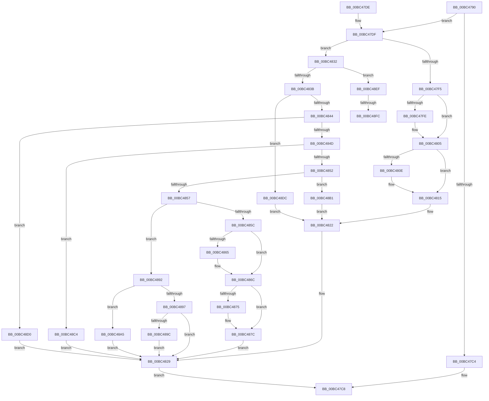

# LogFwStat

- RVA: `0x00BC4790`–`0x00BC4908` (길이 `376` bytes)
- VA: `0x0000000140BC4790`
- 실행 섹션: `PAGEBGFX`
- PDB 이름 있음: `예`; PDB Function 태그: `예`
- unwind 정보 RVA: `0x000B934C`
- 디코드: `82`개 명령, `376/376` bytes 표시
- 미해석 바이트: `0` (있으면 어셈블리에 `.byte`로 보존)

> 이 문서는 커널 이미지의 기계어와 PDB 기호를 분석해 생성했습니다. 4번과 5번은 함수 원형과 자료형을 바이너리 사용 방식에서 추정한 C 해석이며 원본 소스 복구 결과는 아닙니다.

## 1. Dependencies

- 직접 호출 지점: **2**; 고유 호출 대상: **1**
- 직접 호출자로 확인된 함수: **3**
- RIP 상대 이미지 참조: **23**

### Outgoing calls
- `0x00BC47AD` → [BgpFwQueryPerformanceCounter](../../text/4C/BgpFwQueryPerformanceCounter_function_004C0614.md) (function, `0x004C0614`)
- `0x00BC47E1` → [BgpFwQueryPerformanceCounter](../../text/4C/BgpFwQueryPerformanceCounter_function_004C0614.md) (function, `0x004C0614`)

### Direct callers
- [AnFwDisplayProgressIndicator](AnFwDisplayProgressIndicator_function_00BC1FD0.md) at `0x00BC2087`
- [AnFwDisplayProgressIndicator](AnFwDisplayProgressIndicator_function_00BC1FD0.md) at `0x00BC2110`
- [AnFwpProgressAnimationManual](AnFwpProgressAnimationManual_function_00BC227C.md) at `0x00BC234D`
- [AnFwpProgressAnimationManual](AnFwpProgressAnimationManual_function_00BC227C.md) at `0x00BC237E`
- [sub_00BC65EE](Unknown_function_00BC65EE.md) at `0x00BC66ED`
- [sub_00BC65EE](Unknown_function_00BC65EE.md) at `0x00BC679D`

### Static image references
- `0x00BC47B2` → RVA `0x00EEFF48` (`.data`; write)
- `0x00BC47B9` → RVA `0x00E65120` (`.data`; read)
- `0x00BC47EA` → RVA `0x00EEFFA0` (`.data`; write)
- `0x00BC47F5` → RVA `0x00E0F108` (`.data`; read)
- `0x00BC47FE` → RVA `0x00E0F108` (`.data`; write)
- `0x00BC4805` → RVA `0x00EEFF20` (`.data`; read)
- `0x00BC480E` → RVA `0x00EEFF20` (`.data`; write)
- `0x00BC4815` → RVA `0x00EEFF60` (`.data`; read/write)
- `0x00BC481C` → RVA `0x00EEFF78` (`.data`; read/write)
- `0x00BC4822` → RVA `0x00EEFF50` (`.data`; read/write)
- `0x00BC4829` → RVA `0x00EEFF48` (`.data`; read)
- `0x00BC485C` → RVA `0x00E0F118` (`.data`; read)
- `0x00BC4865` → RVA `0x00E0F118` (`.data`; write)
- `0x00BC486C` → RVA `0x00EEFF30` (`.data`; read)
- `0x00BC4875` → RVA `0x00EEFF30` (`.data`; write)
- `0x00BC487C` → RVA `0x00EEFF58` (`.data`; read/write)
- `0x00BC488A` → RVA `0x00EEFF38` (`.data`; read/write)
- `0x00BC489C` → RVA `0x00E65118` (`.data`; read/write)
- `0x00BC48A5` → RVA `0x00EEFF40` (`.data`; write)
- `0x00BC48B8` → RVA `0x00EEFF80` (`.data`; write)
- `0x00BC48C4` → RVA `0x00EEFFB0` (`.data`; read/write)
- `0x00BC48D0` → RVA `0x00EEFFB8` (`.data`; read/write)
- `0x00BC48E3` → RVA `0x00EEFF88` (`.data`; write)

## 2. Other-region calls and transfers

- 다른 실행 섹션으로 향하는 call: **2**
  - `0x00BC47AD` → [BgpFwQueryPerformanceCounter](../../text/4C/BgpFwQueryPerformanceCounter_function_004C0614.md) (`PAGEBGFX` → `.text`)
  - `0x00BC47E1` → [BgpFwQueryPerformanceCounter](../../text/4C/BgpFwQueryPerformanceCounter_function_004C0614.md) (`PAGEBGFX` → `.text`)
- call이 아닌 외부 분기/꼬리 이동: **2**
  - `0x00BC48F6` → [sub_00BC6948](Unknown_function_00BC6948.md) (`tail-transfer`)
  - `0x00BC4903` → [sub_00BC6948](Unknown_function_00BC6948.md) (`tail-transfer`)

## 3. Assembly (complete function range)

```asm
00BC4790  48 89 5C 24 08                  mov qword ptr [rsp + 8], rbx
00BC4795  48 89 74 24 10                  mov qword ptr [rsp + 0x10], rsi
00BC479A  48 89 7C 24 18                  mov qword ptr [rsp + 0x18], rdi
00BC479F  41 56                           push r14
00BC47A1  48 83 EC 20                     sub rsp, 0x20
00BC47A5  8B D9                           mov ebx, ecx
00BC47A7  48 63 FA                        movsxd rdi, edx
00BC47AA  49 8B C8                        mov rcx, r8
00BC47AD  E8 62 BE 8F FF                  call 0x1404c0614
00BC47B2  48 89 05 8F B7 32 00            mov qword ptr [rip + 0x32b78f], rax
00BC47B9  4C 8D 35 60 09 2A 00            lea r14, [rip + 0x2a0960]
00BC47C0  85 DB                           test ebx, ebx
00BC47C2  74 1B                           je 0x140bc47df
00BC47C4  49 89 04 FE                     mov qword ptr [r14 + rdi*8], rax
00BC47C8  48 8B 5C 24 30                  mov rbx, qword ptr [rsp + 0x30]
00BC47CD  48 8B 74 24 38                  mov rsi, qword ptr [rsp + 0x38]
00BC47D2  48 8B 7C 24 40                  mov rdi, qword ptr [rsp + 0x40]
00BC47D7  48 83 C4 20                     add rsp, 0x20
00BC47DB  41 5E                           pop r14
00BC47DD  C3                              ret
00BC47DE  CC                              int3
00BC47DF  33 C9                           xor ecx, ecx
00BC47E1  E8 2E BE 8F FF                  call 0x1404c0614
00BC47E6  49 2B 04 FE                     sub rax, qword ptr [r14 + rdi*8]
00BC47EA  48 89 05 AF B7 32 00            mov qword ptr [rip + 0x32b7af], rax
00BC47F1  85 FF                           test edi, edi
00BC47F3  75 3D                           jne 0x140bc4832
00BC47F5  48 3B 05 0C A9 24 00            cmp rax, qword ptr [rip + 0x24a90c]
00BC47FC  7D 07                           jge 0x140bc4805
00BC47FE  48 89 05 03 A9 24 00            mov qword ptr [rip + 0x24a903], rax
00BC4805  48 3B 05 14 B7 32 00            cmp rax, qword ptr [rip + 0x32b714]
00BC480C  7E 07                           jle 0x140bc4815
00BC480E  48 89 05 0B B7 32 00            mov qword ptr [rip + 0x32b70b], rax
00BC4815  48 01 05 44 B7 32 00            add qword ptr [rip + 0x32b744], rax
00BC481C  FF 05 56 B7 32 00               inc dword ptr [rip + 0x32b756]
00BC4822  48 01 05 27 B7 32 00            add qword ptr [rip + 0x32b727], rax
00BC4829  48 8B 05 18 B7 32 00            mov rax, qword ptr [rip + 0x32b718]
00BC4830  EB 96                           jmp 0x140bc47c8
00BC4832  83 EF 01                        sub edi, 1
00BC4835  0F 84 B4 00 00 00               je 0x140bc48ef
00BC483B  83 EF 01                        sub edi, 1
00BC483E  0F 84 98 00 00 00               je 0x140bc48dc
00BC4844  83 EF 01                        sub edi, 1
00BC4847  0F 84 83 00 00 00               je 0x140bc48d0
00BC484D  83 EF 01                        sub edi, 1
00BC4850  74 72                           je 0x140bc48c4
00BC4852  83 EF 01                        sub edi, 1
00BC4855  74 5A                           je 0x140bc48b1
00BC4857  83 EF 01                        sub edi, 1
00BC485A  75 36                           jne 0x140bc4892
00BC485C  48 3B 05 B5 A8 24 00            cmp rax, qword ptr [rip + 0x24a8b5]
00BC4863  7D 07                           jge 0x140bc486c
00BC4865  48 89 05 AC A8 24 00            mov qword ptr [rip + 0x24a8ac], rax
00BC486C  48 3B 05 BD B6 32 00            cmp rax, qword ptr [rip + 0x32b6bd]
00BC4873  7E 07                           jle 0x140bc487c
00BC4875  48 89 05 B4 B6 32 00            mov qword ptr [rip + 0x32b6b4], rax
00BC487C  48 01 05 D5 B6 32 00            add qword ptr [rip + 0x32b6d5], rax
00BC4883  48 01 05 C6 B6 32 00            add qword ptr [rip + 0x32b6c6], rax
00BC488A  FF 05 A8 B6 32 00               inc dword ptr [rip + 0x32b6a8]
00BC4890  EB 97                           jmp 0x140bc4829
00BC4892  83 EF 01                        sub edi, 1
00BC4895  74 0E                           je 0x140bc48a5
00BC4897  83 FF 01                        cmp edi, 1
00BC489A  75 8D                           jne 0x140bc4829
00BC489C  48 01 05 75 08 2A 00            add qword ptr [rip + 0x2a0875], rax
00BC48A3  EB 84                           jmp 0x140bc4829
00BC48A5  48 89 05 94 B6 32 00            mov qword ptr [rip + 0x32b694], rax
00BC48AC  E9 78 FF FF FF                  jmp 0x140bc4829
00BC48B1  48 01 05 A0 B6 32 00            add qword ptr [rip + 0x32b6a0], rax
00BC48B8  48 89 05 C1 B6 32 00            mov qword ptr [rip + 0x32b6c1], rax
00BC48BF  E9 5E FF FF FF                  jmp 0x140bc4822
00BC48C4  48 01 05 E5 B6 32 00            add qword ptr [rip + 0x32b6e5], rax
00BC48CB  E9 59 FF FF FF                  jmp 0x140bc4829
00BC48D0  48 01 05 E1 B6 32 00            add qword ptr [rip + 0x32b6e1], rax
00BC48D7  E9 4D FF FF FF                  jmp 0x140bc4829
00BC48DC  48 01 05 7D B6 32 00            add qword ptr [rip + 0x32b67d], rax
00BC48E3  48 89 05 9E B6 32 00            mov qword ptr [rip + 0x32b69e], rax
00BC48EA  E9 33 FF FF FF                  jmp 0x140bc4822
00BC48EF  48 3B 05 12 A8 24 00            cmp rax, qword ptr [rip + 0x24a812]
00BC48F6  0F 8D 4C 20 00 00               jge 0x140bc6948
00BC48FC  48 89 05 05 A8 24 00            mov qword ptr [rip + 0x24a805], rax
00BC4903  E9 40 20 00 00                  jmp 0x140bc6948
```

## 4. C-style interpretation (structured pseudocode)

```c
__int64 __fastcall LogFwStat(int a1, int a2, __int64 a3)
{
    __int64 result;
    __int64 v_rdi;
    __int64 v_rsp;
    unsigned __int64 v_stack_p10;
    unsigned __int64 v_stack_p18;
    unsigned __int64 v_stack_p8;

    v_stack_p8 = v_rbx;
    v_stack_p10 = v_rsi;
    v_stack_p18 = v_rdi;
    v_rsp = (v_rsp) - (32);
    result = BgpFwQueryPerformanceCounter(a3, a2, a3, a4);
    *(unsigned __int64 *)(v_rip + 3323791) = result;
    if ((unsigned int)((unsigned int)(a1)) == 0) goto loc_00BC47DF;
    *(unsigned __int64 *)(v_rip + 2754912 + (int)(a2) * 8) = result;
loc_00BC47C8:
    v_rsp = (v_rsp) + (32);
    return result;
loc_00BC47DF:
    a1 = 0;
    result = BgpFwQueryPerformanceCounter(a1, a2, a3, a4);
    result = (result) - (*(unsigned __int64 *)(v_rip + 2754912 + v_stack_p18 * 8));
    *(unsigned __int64 *)(v_rip + 3323823) = result;
    if ((unsigned int)(v_stack_p18) != 0) goto loc_00BC4832;
    if (result < (*(unsigned __int64 *)(v_rip + 2402572))) {
        *(unsigned __int64 *)(v_rip + 2402563) = result;
    }
    if (result >= = (*(unsigned __int64 *)(v_rip + 3323668))) {
        *(unsigned __int64 *)(v_rip + 3323659) = result;
    }
loc_00BC4822:
loc_00BC4829:
    goto loc_00BC47C8;
loc_00BC4832:
    v_rdi = (unsigned int)((v_stack_p18) - (1));
    if (condition_is_equal) goto loc_00BC48EF;
    v_rdi = (unsigned int)((v_rdi) - (1));
    if (condition_is_equal) goto loc_00BC48DC;
    v_rdi = (unsigned int)((v_rdi) - (1));
    if (condition_is_equal) goto loc_00BC48D0;
    v_rdi = (unsigned int)((v_rdi) - (1));
    if (condition_is_equal) goto loc_00BC48C4;
    v_rdi = (unsigned int)((v_rdi) - (1));
    if (condition_is_equal) goto loc_00BC48B1;
    v_rdi = (unsigned int)((v_rdi) - (1));
    if (condition_is_not_equal) goto loc_00BC4892;
    if ((*(unsigned __int64 *)(v_rip + 3323672)) < (*(unsigned __int64 *)(v_rip + 2402485))) {
        *(unsigned __int64 *)(v_rip + 2402476) = *(unsigned __int64 *)(v_rip + 3323672);
    }
    if ((*(unsigned __int64 *)(v_rip + 3323672)) >= = (*(unsigned __int64 *)(v_rip + 3323581))) {
        *(unsigned __int64 *)(v_rip + 3323572) = *(unsigned __int64 *)(v_rip + 3323672);
    }
    goto loc_00BC4829;
loc_00BC4892:
    v_rdi = (unsigned int)((v_rdi) - (1));
    if (condition_is_equal) goto loc_00BC48A5;
    if (((unsigned int)(v_rdi)) != 1) goto loc_00BC4829;
    goto loc_00BC4829;
loc_00BC48A5:
    *(unsigned __int64 *)(v_rip + 3323540) = *(unsigned __int64 *)(v_rip + 3323672);
    goto loc_00BC4829;
loc_00BC48B1:
    *(unsigned __int64 *)(v_rip + 3323585) = *(unsigned __int64 *)(v_rip + 3323672);
    goto loc_00BC4822;
loc_00BC48C4:
    goto loc_00BC4829;
loc_00BC48D0:
    goto loc_00BC4829;
loc_00BC48DC:
    *(unsigned __int64 *)(v_rip + 3323550) = *(unsigned __int64 *)(v_rip + 3323672);
    goto loc_00BC4822;
loc_00BC48EF:
    *(unsigned __int64 *)(v_rip + 2402309) = *(unsigned __int64 *)(v_rip + 3323672);
}
```

## 5. (Beta) C Style

```c
int64_t LogFwStat(int32_t Arg1, int32_t Arg2, int64_t Arg3)
{
    int64_t result;
    int64_t local_rdi;
    int64_t local_rsp;
    uint64_t v_stack_p10;
    uint64_t v_stack_p18;
    uint64_t v_stack_p8;

    v_stack_p8 = local_rbx;
    v_stack_p10 = local_rsi;
    v_stack_p18 = local_rdi;
    local_rsp = (local_rsp) - (32);
    result = BgpFwQueryPerformanceCounter(Arg3, Arg2, Arg3, a4);
    *(uint64_t *)(v_rip + 0x32B78F) = result;
    if ((uint32_t)((uint32_t)(Arg1)) == 0) goto loc_00BC47DF;
    *(uint64_t *)(v_rip + 0x2A0960 + (int32_t)(Arg2) * 8) = result;
loc_00BC47C8:
    local_rsp = (local_rsp) + (32);
    return result;
loc_00BC47DF:
    Arg1 = 0;
    result = BgpFwQueryPerformanceCounter(Arg1, Arg2, Arg3, a4);
    result = (result) - (*(uint64_t *)(v_rip + 0x2A0960 + v_stack_p18 * 8));
    *(uint64_t *)(v_rip + 0x32B7AF) = result;
    if ((uint32_t)(v_stack_p18) != 0) goto loc_00BC4832;
    if (result < (*(uint64_t *)(v_rip + 0x24A90C))) {
        *(uint64_t *)(v_rip + 0x24A903) = result;
    }
    if (result >= = (*(uint64_t *)(v_rip + 0x32B714))) {
        *(uint64_t *)(v_rip + 0x32B70B) = result;
    }
loc_00BC4822:
loc_00BC4829:
    goto loc_00BC47C8;
loc_00BC4832:
    local_rdi = (uint32_t)((v_stack_p18) - (1));
    if (condition_is_equal) goto loc_00BC48EF;
    local_rdi = (uint32_t)((local_rdi) - (1));
    if (condition_is_equal) goto loc_00BC48DC;
    local_rdi = (uint32_t)((local_rdi) - (1));
    if (condition_is_equal) goto loc_00BC48D0;
    local_rdi = (uint32_t)((local_rdi) - (1));
    if (condition_is_equal) goto loc_00BC48C4;
    local_rdi = (uint32_t)((local_rdi) - (1));
    if (condition_is_equal) goto loc_00BC48B1;
    local_rdi = (uint32_t)((local_rdi) - (1));
    if (condition_is_not_equal) goto loc_00BC4892;
    if ((*(uint64_t *)(v_rip + 0x32B718)) < (*(uint64_t *)(v_rip + 0x24A8B5))) {
        *(uint64_t *)(v_rip + 0x24A8AC) = *(uint64_t *)(v_rip + 0x32B718);
    }
    if ((*(uint64_t *)(v_rip + 0x32B718)) >= = (*(uint64_t *)(v_rip + 0x32B6BD))) {
        *(uint64_t *)(v_rip + 0x32B6B4) = *(uint64_t *)(v_rip + 0x32B718);
    }
    goto loc_00BC4829;
loc_00BC4892:
    local_rdi = (uint32_t)((local_rdi) - (1));
    if (condition_is_equal) goto loc_00BC48A5;
    if (((uint32_t)(local_rdi)) != 1) goto loc_00BC4829;
    goto loc_00BC4829;
loc_00BC48A5:
    *(uint64_t *)(v_rip + 0x32B694) = *(uint64_t *)(v_rip + 0x32B718);
    goto loc_00BC4829;
loc_00BC48B1:
    *(uint64_t *)(v_rip + 0x32B6C1) = *(uint64_t *)(v_rip + 0x32B718);
    goto loc_00BC4822;
loc_00BC48C4:
    goto loc_00BC4829;
loc_00BC48D0:
    goto loc_00BC4829;
loc_00BC48DC:
    *(uint64_t *)(v_rip + 0x32B69E) = *(uint64_t *)(v_rip + 0x32B718);
    goto loc_00BC4822;
loc_00BC48EF:
    *(uint64_t *)(v_rip + 0x24A805) = *(uint64_t *)(v_rip + 0x32B718);
}
```

## 6. Execution-region graph

[열기: 2D/3D 그래프와 함수 탐색 컨트롤 패널](../../../control-panel.html?section=pagebgfx&rva=0x00BC4790&view=graph)

- 2D 그래프는 위에서 아래로 흐르고, 3D 그래프는 빈 공간을 드래그해 회전합니다. Shift+드래그는 이동, 휠은 확대·축소, 함수 노드 선택은 대상 보고서 이동입니다.

### Static fallback


