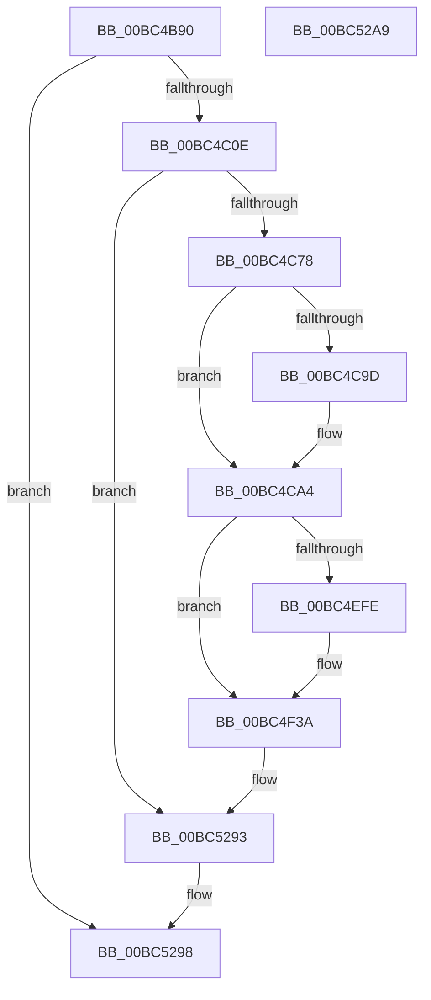

# LogFwpRegisterWorker

- RVA: `0x00BC4B90`–`0x00BC52AA` (길이 `1,818` bytes)
- VA: `0x0000000140BC4B90`
- 실행 섹션: `PAGEBGFX`
- PDB 이름 있음: `예`; PDB Function 태그: `아니요`
- unwind 정보 RVA: `0x000B6310`
- 디코드: `402`개 명령, `1,818/1,818` bytes 표시
- 미해석 바이트: `0` (있으면 어셈블리에 `.byte`로 보존)

> 이 문서는 커널 이미지의 기계어와 PDB 기호를 분석해 생성했습니다. 4번과 5번은 함수 원형과 자료형을 바이너리 사용 방식에서 추정한 C 해석이며 원본 소스 복구 결과는 아닙니다.

## 1. Dependencies

- 직접 호출 지점: **54**; 고유 호출 대상: **5**
- 직접 호출자로 확인된 함수: **0**
- RIP 상대 이미지 참조: **51**

### Outgoing calls
- `0x00BC4BCB` → [RtlInitUnicodeString](../../text/42/RtlInitUnicodeString_function_0042A780.md) (function, `0x0042A780`)
- `0x00BC4C01` → [ZwOpenKey](../../text/6A/ZwOpenKey_function_006AD310.md) (function, `0x006AD310`)
- `0x00BC4C19` → [RtlInitUnicodeString](../../text/42/RtlInitUnicodeString_function_0042A780.md) (function, `0x0042A780`)
- `0x00BC4C67` → [ZwCreateKey](../../text/6A/ZwCreateKey_function_006AD470.md) (function, `0x006AD470`)
- `0x00BC4C7E` → [ZwClose](../../text/6A/ZwClose_function_006AD2B0.md) (function, `0x006AD2B0`)
- `0x00BC4C8E` → [RtlInitUnicodeString](../../text/42/RtlInitUnicodeString_function_0042A780.md) (function, `0x0042A780`)
- `0x00BC4CC4` → [ZwSetValueKey](../../text/6A/ZwSetValueKey_function_006ADCD0.md) (function, `0x006ADCD0`)
- `0x00BC4CD4` → [RtlInitUnicodeString](../../text/42/RtlInitUnicodeString_function_0042A780.md) (function, `0x0042A780`)
- `0x00BC4CFD` → [ZwSetValueKey](../../text/6A/ZwSetValueKey_function_006ADCD0.md) (function, `0x006ADCD0`)
- `0x00BC4D0D` → [RtlInitUnicodeString](../../text/42/RtlInitUnicodeString_function_0042A780.md) (function, `0x0042A780`)
- `0x00BC4D36` → [ZwSetValueKey](../../text/6A/ZwSetValueKey_function_006ADCD0.md) (function, `0x006ADCD0`)
- `0x00BC4D46` → [RtlInitUnicodeString](../../text/42/RtlInitUnicodeString_function_0042A780.md) (function, `0x0042A780`)
- `0x00BC4D6F` → [ZwSetValueKey](../../text/6A/ZwSetValueKey_function_006ADCD0.md) (function, `0x006ADCD0`)
- `0x00BC4D7F` → [RtlInitUnicodeString](../../text/42/RtlInitUnicodeString_function_0042A780.md) (function, `0x0042A780`)
- `0x00BC4DA8` → [ZwSetValueKey](../../text/6A/ZwSetValueKey_function_006ADCD0.md) (function, `0x006ADCD0`)
- `0x00BC4DB8` → [RtlInitUnicodeString](../../text/42/RtlInitUnicodeString_function_0042A780.md) (function, `0x0042A780`)
- `0x00BC4DE1` → [ZwSetValueKey](../../text/6A/ZwSetValueKey_function_006ADCD0.md) (function, `0x006ADCD0`)
- `0x00BC4DF1` → [RtlInitUnicodeString](../../text/42/RtlInitUnicodeString_function_0042A780.md) (function, `0x0042A780`)
- `0x00BC4E1A` → [ZwSetValueKey](../../text/6A/ZwSetValueKey_function_006ADCD0.md) (function, `0x006ADCD0`)
- `0x00BC4E2A` → [RtlInitUnicodeString](../../text/42/RtlInitUnicodeString_function_0042A780.md) (function, `0x0042A780`)
- `0x00BC4E61` → [ZwSetValueKey](../../text/6A/ZwSetValueKey_function_006ADCD0.md) (function, `0x006ADCD0`)
- `0x00BC4E71` → [RtlInitUnicodeString](../../text/42/RtlInitUnicodeString_function_0042A780.md) (function, `0x0042A780`)
- `0x00BC4EA8` → [ZwSetValueKey](../../text/6A/ZwSetValueKey_function_006ADCD0.md) (function, `0x006ADCD0`)
- `0x00BC4EB8` → [RtlInitUnicodeString](../../text/42/RtlInitUnicodeString_function_0042A780.md) (function, `0x0042A780`)
- `0x00BC4EEF` → [ZwSetValueKey](../../text/6A/ZwSetValueKey_function_006ADCD0.md) (function, `0x006ADCD0`)
- `0x00BC4F09` → [RtlInitUnicodeString](../../text/42/RtlInitUnicodeString_function_0042A780.md) (function, `0x0042A780`)
- `0x00BC4F35` → [ZwSetValueKey](../../text/6A/ZwSetValueKey_function_006ADCD0.md) (function, `0x006ADCD0`)
- `0x00BC4F45` → [RtlInitUnicodeString](../../text/42/RtlInitUnicodeString_function_0042A780.md) (function, `0x0042A780`)
- `0x00BC4F7C` → [ZwSetValueKey](../../text/6A/ZwSetValueKey_function_006ADCD0.md) (function, `0x006ADCD0`)
- `0x00BC4F8C` → [RtlInitUnicodeString](../../text/42/RtlInitUnicodeString_function_0042A780.md) (function, `0x0042A780`)
- `0x00BC4FC3` → [ZwSetValueKey](../../text/6A/ZwSetValueKey_function_006ADCD0.md) (function, `0x006ADCD0`)
- `0x00BC4FD3` → [RtlInitUnicodeString](../../text/42/RtlInitUnicodeString_function_0042A780.md) (function, `0x0042A780`)
- `0x00BC500A` → [ZwSetValueKey](../../text/6A/ZwSetValueKey_function_006ADCD0.md) (function, `0x006ADCD0`)
- `0x00BC501A` → [RtlInitUnicodeString](../../text/42/RtlInitUnicodeString_function_0042A780.md) (function, `0x0042A780`)
- `0x00BC5043` → [ZwSetValueKey](../../text/6A/ZwSetValueKey_function_006ADCD0.md) (function, `0x006ADCD0`)
- `0x00BC5053` → [RtlInitUnicodeString](../../text/42/RtlInitUnicodeString_function_0042A780.md) (function, `0x0042A780`)
- `0x00BC507C` → [ZwSetValueKey](../../text/6A/ZwSetValueKey_function_006ADCD0.md) (function, `0x006ADCD0`)
- `0x00BC508C` → [RtlInitUnicodeString](../../text/42/RtlInitUnicodeString_function_0042A780.md) (function, `0x0042A780`)
- `0x00BC50B5` → [ZwSetValueKey](../../text/6A/ZwSetValueKey_function_006ADCD0.md) (function, `0x006ADCD0`)
- `0x00BC50C5` → [RtlInitUnicodeString](../../text/42/RtlInitUnicodeString_function_0042A780.md) (function, `0x0042A780`)
- `0x00BC50EE` → [ZwSetValueKey](../../text/6A/ZwSetValueKey_function_006ADCD0.md) (function, `0x006ADCD0`)
- `0x00BC50FE` → [RtlInitUnicodeString](../../text/42/RtlInitUnicodeString_function_0042A780.md) (function, `0x0042A780`)
- `0x00BC5127` → [ZwSetValueKey](../../text/6A/ZwSetValueKey_function_006ADCD0.md) (function, `0x006ADCD0`)
- `0x00BC5137` → [RtlInitUnicodeString](../../text/42/RtlInitUnicodeString_function_0042A780.md) (function, `0x0042A780`)
- `0x00BC516E` → [ZwSetValueKey](../../text/6A/ZwSetValueKey_function_006ADCD0.md) (function, `0x006ADCD0`)
- `0x00BC517E` → [RtlInitUnicodeString](../../text/42/RtlInitUnicodeString_function_0042A780.md) (function, `0x0042A780`)
- `0x00BC51B5` → [ZwSetValueKey](../../text/6A/ZwSetValueKey_function_006ADCD0.md) (function, `0x006ADCD0`)
- `0x00BC51C5` → [RtlInitUnicodeString](../../text/42/RtlInitUnicodeString_function_0042A780.md) (function, `0x0042A780`)
- `0x00BC51FC` → [ZwSetValueKey](../../text/6A/ZwSetValueKey_function_006ADCD0.md) (function, `0x006ADCD0`)
- `0x00BC520C` → [RtlInitUnicodeString](../../text/42/RtlInitUnicodeString_function_0042A780.md) (function, `0x0042A780`)
- `0x00BC5243` → [ZwSetValueKey](../../text/6A/ZwSetValueKey_function_006ADCD0.md) (function, `0x006ADCD0`)
- `0x00BC5253` → [RtlInitUnicodeString](../../text/42/RtlInitUnicodeString_function_0042A780.md) (function, `0x0042A780`)
- `0x00BC528A` → [ZwSetValueKey](../../text/6A/ZwSetValueKey_function_006ADCD0.md) (function, `0x006ADCD0`)
- `0x00BC5293` → [ZwClose](../../text/6A/ZwClose_function_006AD2B0.md) (function, `0x006AD2B0`)

### Direct callers
- 이 함수 시작 RVA로 연결되는 직접 call은 확인되지 않았습니다. 간접 호출은 완전히 역산할 수 없습니다.

### Static image references
- `0x00BC4BA6` → RVA `0x00BC5EF0` (` ?? ::CIJCHKMG::`string'`; read)
- `0x00BC4C0E` → RVA `0x00BC5F60` (` ?? ::CIJCHKMG::`string'`; read)
- `0x00BC4C78` → RVA `0x00EEFF68` (`.data`; read)
- `0x00BC4C83` → RVA `0x00BC5F70` (` ?? ::CIJCHKMG::`string'`; read)
- `0x00BC4CC9` → RVA `0x00BC5F80` (` ?? ::CIJCHKMG::`string'`; read)
- `0x00BC4CD9` → RVA `0x00EEFF90` (`.data`; read)
- `0x00BC4D02` → RVA `0x00BC5F90` (` ?? ::CIJCHKMG::`string'`; read)
- `0x00BC4D12` → RVA `0x00EEFF94` (`.data`; read)
- `0x00BC4D3B` → RVA `0x00BC5FA0` (` ?? ::CIJCHKMG::`string'`; read)
- `0x00BC4D4B` → RVA `0x00EEFF2C` (`.data`; read)
- `0x00BC4D74` → RVA `0x00BC5FB0` (` ?? ::CIJCHKMG::`string'`; read)
- `0x00BC4D84` → RVA `0x00EF04A8` (`.data`; read)
- `0x00BC4DAD` → RVA `0x00BC5FD0` (` ?? ::CIJCHKMG::`string'`; read)
- `0x00BC4DBD` → RVA `0x00EEFF78` (`.data`; read)
- `0x00BC4DE6` → RVA `0x00BC5FF0` (` ?? ::CIJCHKMG::`string'`; read)
- `0x00BC4DF6` → RVA `0x00EF0470` (`.data`; read)
- `0x00BC4E1F` → RVA `0x00BC6010` (` ?? ::CIJCHKMG::`string'`; read)
- `0x00BC4E2F` → RVA `0x00EEFF88` (`.data`; read)
- `0x00BC4E47` → RVA `0x00E0F110` (`.data`; read)
- `0x00BC4E66` → RVA `0x00BC6030` (` ?? ::CIJCHKMG::`string'`; read)
- `0x00BC4E76` → RVA `0x00E0F108` (`.data`; read)
- `0x00BC4EAD` → RVA `0x00BC6050` (` ?? ::CIJCHKMG::`string'`; read)
- `0x00BC4EBD` → RVA `0x00EEFF20` (`.data`; read)
- `0x00BC4EF4` → RVA `0x00EF0480` (`.data`; read)
- `0x00BC4EFE` → RVA `0x00BC6070` (` ?? ::CIJCHKMG::`string'`; read)
- `0x00BC4F3A` → RVA `0x00BC63D0` (` ?? ::CIJCHKMG::`string'`; read)
- `0x00BC4F4A` → RVA `0x00EEFF60` (`.data`; read)
- `0x00BC4F81` → RVA `0x00BC63F0` (` ?? ::CIJCHKMG::`string'`; read)
- `0x00BC4F91` → RVA `0x00EEFF70` (`.data`; read)
- `0x00BC4FC8` → RVA `0x00BC6410` (` ?? ::CIJCHKMG::`string'`; read)
- `0x00BC4FD8` → RVA `0x00EEFF80` (`.data`; read)
- `0x00BC500F` → RVA `0x00BC6430` (` ?? ::CIJCHKMG::`string'`; read)
- `0x00BC501F` → RVA `0x00EEFFA8` (`.data`; read)
- `0x00BC5048` → RVA `0x00BC6450` (` ?? ::CIJCHKMG::`string'`; read)
- `0x00BC5058` → RVA `0x00EEFF7C` (`.data`; read)
- `0x00BC5081` → RVA `0x00BC6460` (` ?? ::CIJCHKMG::`string'`; read)
- `0x00BC5091` → RVA `0x00EEFF28` (`.data`; read)
- `0x00BC50BA` → RVA `0x00BC6470` (` ?? ::CIJCHKMG::`string'`; read)
- `0x00BC50CA` → RVA `0x00EEFF38` (`.data`; read)
- `0x00BC50F3` → RVA `0x00BC6490` (` ?? ::CIJCHKMG::`string'`; read)
- `0x00BC5103` → RVA `0x00EF046C` (`.data`; read)
- `0x00BC512C` → RVA `0x00BC64B0` (` ?? ::CIJCHKMG::`string'`; read)
- `0x00BC513C` → RVA `0x00E0F118` (`.data`; read)
- `0x00BC5173` → RVA `0x00BC64C0` (` ?? ::CIJCHKMG::`string'`; read)
- `0x00BC5183` → RVA `0x00EEFF30` (`.data`; read)
- `0x00BC51BA` → RVA `0x00BC64E0` (` ?? ::CIJCHKMG::`string'`; read)
- `0x00BC51CA` → RVA `0x00EEFF58` (`.data`; read)
- `0x00BC5201` → RVA `0x00BC6500` (` ?? ::CIJCHKMG::`string'`; read)
- `0x00BC5211` → RVA `0x00EEFF50` (`.data`; read)
- `0x00BC5248` → RVA `0x00BC6520` (` ?? ::CIJCHKMG::`string'`; read)
- `0x00BC5258` → RVA `0x00E65118` (`.data`; read)

## 2. Other-region calls and transfers

- 다른 실행 섹션으로 향하는 call: **54**
  - `0x00BC4BCB` → [RtlInitUnicodeString](../../text/42/RtlInitUnicodeString_function_0042A780.md) (`PAGEBGFX` → `.text`)
  - `0x00BC4C01` → [ZwOpenKey](../../text/6A/ZwOpenKey_function_006AD310.md) (`PAGEBGFX` → `.text`)
  - `0x00BC4C19` → [RtlInitUnicodeString](../../text/42/RtlInitUnicodeString_function_0042A780.md) (`PAGEBGFX` → `.text`)
  - `0x00BC4C67` → [ZwCreateKey](../../text/6A/ZwCreateKey_function_006AD470.md) (`PAGEBGFX` → `.text`)
  - `0x00BC4C7E` → [ZwClose](../../text/6A/ZwClose_function_006AD2B0.md) (`PAGEBGFX` → `.text`)
  - `0x00BC4C8E` → [RtlInitUnicodeString](../../text/42/RtlInitUnicodeString_function_0042A780.md) (`PAGEBGFX` → `.text`)
  - `0x00BC4CC4` → [ZwSetValueKey](../../text/6A/ZwSetValueKey_function_006ADCD0.md) (`PAGEBGFX` → `.text`)
  - `0x00BC4CD4` → [RtlInitUnicodeString](../../text/42/RtlInitUnicodeString_function_0042A780.md) (`PAGEBGFX` → `.text`)
  - `0x00BC4CFD` → [ZwSetValueKey](../../text/6A/ZwSetValueKey_function_006ADCD0.md) (`PAGEBGFX` → `.text`)
  - `0x00BC4D0D` → [RtlInitUnicodeString](../../text/42/RtlInitUnicodeString_function_0042A780.md) (`PAGEBGFX` → `.text`)
  - `0x00BC4D36` → [ZwSetValueKey](../../text/6A/ZwSetValueKey_function_006ADCD0.md) (`PAGEBGFX` → `.text`)
  - `0x00BC4D46` → [RtlInitUnicodeString](../../text/42/RtlInitUnicodeString_function_0042A780.md) (`PAGEBGFX` → `.text`)
  - `0x00BC4D6F` → [ZwSetValueKey](../../text/6A/ZwSetValueKey_function_006ADCD0.md) (`PAGEBGFX` → `.text`)
  - `0x00BC4D7F` → [RtlInitUnicodeString](../../text/42/RtlInitUnicodeString_function_0042A780.md) (`PAGEBGFX` → `.text`)
  - `0x00BC4DA8` → [ZwSetValueKey](../../text/6A/ZwSetValueKey_function_006ADCD0.md) (`PAGEBGFX` → `.text`)
  - `0x00BC4DB8` → [RtlInitUnicodeString](../../text/42/RtlInitUnicodeString_function_0042A780.md) (`PAGEBGFX` → `.text`)
  - `0x00BC4DE1` → [ZwSetValueKey](../../text/6A/ZwSetValueKey_function_006ADCD0.md) (`PAGEBGFX` → `.text`)
  - `0x00BC4DF1` → [RtlInitUnicodeString](../../text/42/RtlInitUnicodeString_function_0042A780.md) (`PAGEBGFX` → `.text`)
  - `0x00BC4E1A` → [ZwSetValueKey](../../text/6A/ZwSetValueKey_function_006ADCD0.md) (`PAGEBGFX` → `.text`)
  - `0x00BC4E2A` → [RtlInitUnicodeString](../../text/42/RtlInitUnicodeString_function_0042A780.md) (`PAGEBGFX` → `.text`)
  - `0x00BC4E61` → [ZwSetValueKey](../../text/6A/ZwSetValueKey_function_006ADCD0.md) (`PAGEBGFX` → `.text`)
  - `0x00BC4E71` → [RtlInitUnicodeString](../../text/42/RtlInitUnicodeString_function_0042A780.md) (`PAGEBGFX` → `.text`)
  - `0x00BC4EA8` → [ZwSetValueKey](../../text/6A/ZwSetValueKey_function_006ADCD0.md) (`PAGEBGFX` → `.text`)
  - `0x00BC4EB8` → [RtlInitUnicodeString](../../text/42/RtlInitUnicodeString_function_0042A780.md) (`PAGEBGFX` → `.text`)
  - `0x00BC4EEF` → [ZwSetValueKey](../../text/6A/ZwSetValueKey_function_006ADCD0.md) (`PAGEBGFX` → `.text`)
  - `0x00BC4F09` → [RtlInitUnicodeString](../../text/42/RtlInitUnicodeString_function_0042A780.md) (`PAGEBGFX` → `.text`)
  - `0x00BC4F35` → [ZwSetValueKey](../../text/6A/ZwSetValueKey_function_006ADCD0.md) (`PAGEBGFX` → `.text`)
  - `0x00BC4F45` → [RtlInitUnicodeString](../../text/42/RtlInitUnicodeString_function_0042A780.md) (`PAGEBGFX` → `.text`)
  - `0x00BC4F7C` → [ZwSetValueKey](../../text/6A/ZwSetValueKey_function_006ADCD0.md) (`PAGEBGFX` → `.text`)
  - `0x00BC4F8C` → [RtlInitUnicodeString](../../text/42/RtlInitUnicodeString_function_0042A780.md) (`PAGEBGFX` → `.text`)
  - `0x00BC4FC3` → [ZwSetValueKey](../../text/6A/ZwSetValueKey_function_006ADCD0.md) (`PAGEBGFX` → `.text`)
  - `0x00BC4FD3` → [RtlInitUnicodeString](../../text/42/RtlInitUnicodeString_function_0042A780.md) (`PAGEBGFX` → `.text`)
  - `0x00BC500A` → [ZwSetValueKey](../../text/6A/ZwSetValueKey_function_006ADCD0.md) (`PAGEBGFX` → `.text`)
  - `0x00BC501A` → [RtlInitUnicodeString](../../text/42/RtlInitUnicodeString_function_0042A780.md) (`PAGEBGFX` → `.text`)
  - `0x00BC5043` → [ZwSetValueKey](../../text/6A/ZwSetValueKey_function_006ADCD0.md) (`PAGEBGFX` → `.text`)
  - `0x00BC5053` → [RtlInitUnicodeString](../../text/42/RtlInitUnicodeString_function_0042A780.md) (`PAGEBGFX` → `.text`)
  - `0x00BC507C` → [ZwSetValueKey](../../text/6A/ZwSetValueKey_function_006ADCD0.md) (`PAGEBGFX` → `.text`)
  - `0x00BC508C` → [RtlInitUnicodeString](../../text/42/RtlInitUnicodeString_function_0042A780.md) (`PAGEBGFX` → `.text`)
  - `0x00BC50B5` → [ZwSetValueKey](../../text/6A/ZwSetValueKey_function_006ADCD0.md) (`PAGEBGFX` → `.text`)
  - `0x00BC50C5` → [RtlInitUnicodeString](../../text/42/RtlInitUnicodeString_function_0042A780.md) (`PAGEBGFX` → `.text`)
  - `0x00BC50EE` → [ZwSetValueKey](../../text/6A/ZwSetValueKey_function_006ADCD0.md) (`PAGEBGFX` → `.text`)
  - `0x00BC50FE` → [RtlInitUnicodeString](../../text/42/RtlInitUnicodeString_function_0042A780.md) (`PAGEBGFX` → `.text`)
  - `0x00BC5127` → [ZwSetValueKey](../../text/6A/ZwSetValueKey_function_006ADCD0.md) (`PAGEBGFX` → `.text`)
  - `0x00BC5137` → [RtlInitUnicodeString](../../text/42/RtlInitUnicodeString_function_0042A780.md) (`PAGEBGFX` → `.text`)
  - `0x00BC516E` → [ZwSetValueKey](../../text/6A/ZwSetValueKey_function_006ADCD0.md) (`PAGEBGFX` → `.text`)
  - `0x00BC517E` → [RtlInitUnicodeString](../../text/42/RtlInitUnicodeString_function_0042A780.md) (`PAGEBGFX` → `.text`)
  - `0x00BC51B5` → [ZwSetValueKey](../../text/6A/ZwSetValueKey_function_006ADCD0.md) (`PAGEBGFX` → `.text`)
  - `0x00BC51C5` → [RtlInitUnicodeString](../../text/42/RtlInitUnicodeString_function_0042A780.md) (`PAGEBGFX` → `.text`)
  - `0x00BC51FC` → [ZwSetValueKey](../../text/6A/ZwSetValueKey_function_006ADCD0.md) (`PAGEBGFX` → `.text`)
  - `0x00BC520C` → [RtlInitUnicodeString](../../text/42/RtlInitUnicodeString_function_0042A780.md) (`PAGEBGFX` → `.text`)
  - `0x00BC5243` → [ZwSetValueKey](../../text/6A/ZwSetValueKey_function_006ADCD0.md) (`PAGEBGFX` → `.text`)
  - `0x00BC5253` → [RtlInitUnicodeString](../../text/42/RtlInitUnicodeString_function_0042A780.md) (`PAGEBGFX` → `.text`)
  - `0x00BC528A` → [ZwSetValueKey](../../text/6A/ZwSetValueKey_function_006ADCD0.md) (`PAGEBGFX` → `.text`)
  - `0x00BC5293` → [ZwClose](../../text/6A/ZwClose_function_006AD2B0.md) (`PAGEBGFX` → `.text`)
- 별도 외부 분기/꼬리 이동을 확인하지 못했습니다.

## 3. Assembly (complete function range)

```asm
00BC4B90  48 89 5C 24 08                  mov qword ptr [rsp + 8], rbx
00BC4B95  55                              push rbp
00BC4B96  48 8D 6C 24 A9                  lea rbp, [rsp - 0x57]
00BC4B9B  48 81 EC 90 00 00 00            sub rsp, 0x90
00BC4BA2  83 65 77 00                     and dword ptr [rbp + 0x77], 0
00BC4BA6  48 8D 15 43 13 00 00            lea rdx, [rip + 0x1343]
00BC4BAD  33 C0                           xor eax, eax
00BC4BAF  48 8D 4D 0F                     lea rcx, [rbp + 0xf]
00BC4BB3  21 45 3B                        and dword ptr [rbp + 0x3b], eax
00BC4BB6  0F 57 C0                        xorps xmm0, xmm0
00BC4BB9  48 21 45 07                     and qword ptr [rbp + 7], rax
00BC4BBD  48 21 45 7F                     and qword ptr [rbp + 0x7f], rax
00BC4BC1  89 45 23                        mov dword ptr [rbp + 0x23], eax
00BC4BC4  21 45 23                        and dword ptr [rbp + 0x23], eax
00BC4BC7  0F 11 45 0F                     movups xmmword ptr [rbp + 0xf], xmm0
00BC4BCB  E8 B0 5B 86 FF                  call 0x14042a780
00BC4BD0  48 83 65 27 00                  and qword ptr [rbp + 0x27], 0
00BC4BD5  48 8D 45 0F                     lea rax, [rbp + 0xf]
00BC4BD9  0F 57 C0                        xorps xmm0, xmm0
00BC4BDC  48 89 45 2F                     mov qword ptr [rbp + 0x2f], rax
00BC4BE0  BB 30 00 00 00                  mov ebx, 0x30
00BC4BE5  C7 45 37 40 02 00 00            mov dword ptr [rbp + 0x37], 0x240
00BC4BEC  4C 8D 45 1F                     lea r8, [rbp + 0x1f]
00BC4BF0  89 5D 1F                        mov dword ptr [rbp + 0x1f], ebx
00BC4BF3  BA 19 00 02 00                  mov edx, 0x20019
00BC4BF8  48 8D 4D 07                     lea rcx, [rbp + 7]
00BC4BFC  F3 0F 7F 45 3F                  movdqu xmmword ptr [rbp + 0x3f], xmm0
00BC4C01  E8 0A 87 AE FF                  call 0x1406ad310
00BC4C06  85 C0                           test eax, eax
00BC4C08  0F 88 8A 06 00 00               js 0x140bc5298
00BC4C0E  48 8D 15 4B 13 00 00            lea rdx, [rip + 0x134b]
00BC4C15  48 8D 4D 0F                     lea rcx, [rbp + 0xf]
00BC4C19  E8 62 5B 86 FF                  call 0x14042a780
00BC4C1E  48 8B 45 07                     mov rax, qword ptr [rbp + 7]
00BC4C22  4C 8D 45 1F                     lea r8, [rbp + 0x1f]
00BC4C26  48 89 45 27                     mov qword ptr [rbp + 0x27], rax
00BC4C2A  48 8D 4D 7F                     lea rcx, [rbp + 0x7f]
00BC4C2E  48 8D 45 0F                     lea rax, [rbp + 0xf]
00BC4C32  89 5D 1F                        mov dword ptr [rbp + 0x1f], ebx
00BC4C35  48 89 45 2F                     mov qword ptr [rbp + 0x2f], rax
00BC4C39  0F 57 C0                        xorps xmm0, xmm0
00BC4C3C  48 8D 45 77                     lea rax, [rbp + 0x77]
00BC4C40  C7 45 37 40 02 00 00            mov dword ptr [rbp + 0x37], 0x240
00BC4C47  48 89 44 24 30                  mov qword ptr [rsp + 0x30], rax
00BC4C4C  45 33 C9                        xor r9d, r9d
00BC4C4F  C7 44 24 28 01 00 00 00         mov dword ptr [rsp + 0x28], 1
00BC4C57  BA 19 00 02 00                  mov edx, 0x20019
00BC4C5C  48 83 64 24 20 00               and qword ptr [rsp + 0x20], 0
00BC4C62  F3 0F 7F 45 3F                  movdqu xmmword ptr [rbp + 0x3f], xmm0
00BC4C67  E8 04 88 AE FF                  call 0x1406ad470
00BC4C6C  48 8B 4D 07                     mov rcx, qword ptr [rbp + 7]
00BC4C70  85 C0                           test eax, eax
00BC4C72  0F 88 1B 06 00 00               js 0x140bc5293
00BC4C78  8B 1D EA B2 32 00               mov ebx, dword ptr [rip + 0x32b2ea]
00BC4C7E  E8 2D 86 AE FF                  call 0x1406ad2b0
00BC4C83  48 8D 15 E6 12 00 00            lea rdx, [rip + 0x12e6]
00BC4C8A  48 8D 4D 0F                     lea rcx, [rbp + 0xf]
00BC4C8E  E8 ED 5A 86 FF                  call 0x14042a780
00BC4C93  83 65 6F 00                     and dword ptr [rbp + 0x6f], 0
00BC4C97  0F BA E3 14                     bt ebx, 0x14
00BC4C9B  73 07                           jae 0x140bc4ca4
00BC4C9D  C7 45 6F 01 00 00 00            mov dword ptr [rbp + 0x6f], 1
00BC4CA4  48 8B 4D 7F                     mov rcx, qword ptr [rbp + 0x7f]
00BC4CA8  48 8D 45 6F                     lea rax, [rbp + 0x6f]
00BC4CAC  BB 04 00 00 00                  mov ebx, 4
00BC4CB1  48 8D 55 0F                     lea rdx, [rbp + 0xf]
00BC4CB5  89 5C 24 28                     mov dword ptr [rsp + 0x28], ebx
00BC4CB9  44 8B CB                        mov r9d, ebx
00BC4CBC  45 33 C0                        xor r8d, r8d
00BC4CBF  48 89 44 24 20                  mov qword ptr [rsp + 0x20], rax
00BC4CC4  E8 07 90 AE FF                  call 0x1406adcd0
00BC4CC9  48 8D 15 B0 12 00 00            lea rdx, [rip + 0x12b0]
00BC4CD0  48 8D 4D 0F                     lea rcx, [rbp + 0xf]
00BC4CD4  E8 A7 5A 86 FF                  call 0x14042a780
00BC4CD9  8B 05 B1 B2 32 00               mov eax, dword ptr [rip + 0x32b2b1]
00BC4CDF  48 8D 55 0F                     lea rdx, [rbp + 0xf]
00BC4CE3  48 8B 4D 7F                     mov rcx, qword ptr [rbp + 0x7f]
00BC4CE7  44 8B CB                        mov r9d, ebx
00BC4CEA  89 45 6F                        mov dword ptr [rbp + 0x6f], eax
00BC4CED  45 33 C0                        xor r8d, r8d
00BC4CF0  48 8D 45 6F                     lea rax, [rbp + 0x6f]
00BC4CF4  89 5C 24 28                     mov dword ptr [rsp + 0x28], ebx
00BC4CF8  48 89 44 24 20                  mov qword ptr [rsp + 0x20], rax
00BC4CFD  E8 CE 8F AE FF                  call 0x1406adcd0
00BC4D02  48 8D 15 87 12 00 00            lea rdx, [rip + 0x1287]
00BC4D09  48 8D 4D 0F                     lea rcx, [rbp + 0xf]
00BC4D0D  E8 6E 5A 86 FF                  call 0x14042a780
00BC4D12  8B 05 7C B2 32 00               mov eax, dword ptr [rip + 0x32b27c]
00BC4D18  48 8D 55 0F                     lea rdx, [rbp + 0xf]
00BC4D1C  48 8B 4D 7F                     mov rcx, qword ptr [rbp + 0x7f]
00BC4D20  44 8B CB                        mov r9d, ebx
00BC4D23  89 45 6F                        mov dword ptr [rbp + 0x6f], eax
00BC4D26  45 33 C0                        xor r8d, r8d
00BC4D29  48 8D 45 6F                     lea rax, [rbp + 0x6f]
00BC4D2D  89 5C 24 28                     mov dword ptr [rsp + 0x28], ebx
00BC4D31  48 89 44 24 20                  mov qword ptr [rsp + 0x20], rax
00BC4D36  E8 95 8F AE FF                  call 0x1406adcd0
00BC4D3B  48 8D 15 5E 12 00 00            lea rdx, [rip + 0x125e]
00BC4D42  48 8D 4D 0F                     lea rcx, [rbp + 0xf]
00BC4D46  E8 35 5A 86 FF                  call 0x14042a780
00BC4D4B  8B 05 DB B1 32 00               mov eax, dword ptr [rip + 0x32b1db]
00BC4D51  48 8D 55 0F                     lea rdx, [rbp + 0xf]
00BC4D55  48 8B 4D 7F                     mov rcx, qword ptr [rbp + 0x7f]
00BC4D59  44 8B CB                        mov r9d, ebx
00BC4D5C  89 45 6F                        mov dword ptr [rbp + 0x6f], eax
00BC4D5F  45 33 C0                        xor r8d, r8d
00BC4D62  48 8D 45 6F                     lea rax, [rbp + 0x6f]
00BC4D66  89 5C 24 28                     mov dword ptr [rsp + 0x28], ebx
00BC4D6A  48 89 44 24 20                  mov qword ptr [rsp + 0x20], rax
00BC4D6F  E8 5C 8F AE FF                  call 0x1406adcd0
00BC4D74  48 8D 15 35 12 00 00            lea rdx, [rip + 0x1235]
00BC4D7B  48 8D 4D 0F                     lea rcx, [rbp + 0xf]
00BC4D7F  E8 FC 59 86 FF                  call 0x14042a780
00BC4D84  8B 05 1E B7 32 00               mov eax, dword ptr [rip + 0x32b71e]
00BC4D8A  48 8D 55 0F                     lea rdx, [rbp + 0xf]
00BC4D8E  48 8B 4D 7F                     mov rcx, qword ptr [rbp + 0x7f]
00BC4D92  44 8B CB                        mov r9d, ebx
00BC4D95  89 45 6F                        mov dword ptr [rbp + 0x6f], eax
00BC4D98  45 33 C0                        xor r8d, r8d
00BC4D9B  48 8D 45 6F                     lea rax, [rbp + 0x6f]
00BC4D9F  89 5C 24 28                     mov dword ptr [rsp + 0x28], ebx
00BC4DA3  48 89 44 24 20                  mov qword ptr [rsp + 0x20], rax
00BC4DA8  E8 23 8F AE FF                  call 0x1406adcd0
00BC4DAD  48 8D 15 1C 12 00 00            lea rdx, [rip + 0x121c]
00BC4DB4  48 8D 4D 0F                     lea rcx, [rbp + 0xf]
00BC4DB8  E8 C3 59 86 FF                  call 0x14042a780
00BC4DBD  8B 05 B5 B1 32 00               mov eax, dword ptr [rip + 0x32b1b5]
00BC4DC3  48 8D 55 0F                     lea rdx, [rbp + 0xf]
00BC4DC7  48 8B 4D 7F                     mov rcx, qword ptr [rbp + 0x7f]
00BC4DCB  44 8B CB                        mov r9d, ebx
00BC4DCE  89 45 6F                        mov dword ptr [rbp + 0x6f], eax
00BC4DD1  45 33 C0                        xor r8d, r8d
00BC4DD4  48 8D 45 6F                     lea rax, [rbp + 0x6f]
00BC4DD8  89 5C 24 28                     mov dword ptr [rsp + 0x28], ebx
00BC4DDC  48 89 44 24 20                  mov qword ptr [rsp + 0x20], rax
00BC4DE1  E8 EA 8E AE FF                  call 0x1406adcd0
00BC4DE6  48 8D 15 03 12 00 00            lea rdx, [rip + 0x1203]
00BC4DED  48 8D 4D 0F                     lea rcx, [rbp + 0xf]
00BC4DF1  E8 8A 59 86 FF                  call 0x14042a780
00BC4DF6  8B 05 74 B6 32 00               mov eax, dword ptr [rip + 0x32b674]
00BC4DFC  89 45 6F                        mov dword ptr [rbp + 0x6f], eax
00BC4DFF  48 8D 45 6F                     lea rax, [rbp + 0x6f]
00BC4E03  89 5C 24 28                     mov dword ptr [rsp + 0x28], ebx
00BC4E07  48 8B 4D 7F                     mov rcx, qword ptr [rbp + 0x7f]
00BC4E0B  48 8D 55 0F                     lea rdx, [rbp + 0xf]
00BC4E0F  44 8B CB                        mov r9d, ebx
00BC4E12  48 89 44 24 20                  mov qword ptr [rsp + 0x20], rax
00BC4E17  45 33 C0                        xor r8d, r8d
00BC4E1A  E8 B1 8E AE FF                  call 0x1406adcd0
00BC4E1F  48 8D 15 EA 11 00 00            lea rdx, [rip + 0x11ea]
00BC4E26  48 8D 4D 0F                     lea rcx, [rbp + 0xf]
00BC4E2A  E8 51 59 86 FF                  call 0x14042a780
00BC4E2F  48 69 05 4E B1 32 00 40 42 0F 00  imul rax, qword ptr [rip + 0x32b14e], 0xf4240
00BC4E3A  48 8B 4D 7F                     mov rcx, qword ptr [rbp + 0x7f]
00BC4E3E  44 8B CB                        mov r9d, ebx
00BC4E41  48 99                           cqo
00BC4E43  89 5C 24 28                     mov dword ptr [rsp + 0x28], ebx
00BC4E47  48 F7 3D C2 A2 24 00            idiv qword ptr [rip + 0x24a2c2]
00BC4E4E  45 33 C0                        xor r8d, r8d
00BC4E51  48 8D 55 0F                     lea rdx, [rbp + 0xf]
00BC4E55  89 45 6F                        mov dword ptr [rbp + 0x6f], eax
00BC4E58  48 8D 45 6F                     lea rax, [rbp + 0x6f]
00BC4E5C  48 89 44 24 20                  mov qword ptr [rsp + 0x20], rax
00BC4E61  E8 6A 8E AE FF                  call 0x1406adcd0
00BC4E66  48 8D 15 C3 11 00 00            lea rdx, [rip + 0x11c3]
00BC4E6D  48 8D 4D 0F                     lea rcx, [rbp + 0xf]
00BC4E71  E8 0A 59 86 FF                  call 0x14042a780
00BC4E76  48 69 05 87 A2 24 00 40 42 0F 00  imul rax, qword ptr [rip + 0x24a287], 0xf4240
00BC4E81  48 8B 4D 7F                     mov rcx, qword ptr [rbp + 0x7f]
00BC4E85  44 8B CB                        mov r9d, ebx
00BC4E88  48 99                           cqo
00BC4E8A  89 5C 24 28                     mov dword ptr [rsp + 0x28], ebx
00BC4E8E  48 F7 3D 7B A2 24 00            idiv qword ptr [rip + 0x24a27b]
00BC4E95  45 33 C0                        xor r8d, r8d
00BC4E98  48 8D 55 0F                     lea rdx, [rbp + 0xf]
00BC4E9C  89 45 6F                        mov dword ptr [rbp + 0x6f], eax
00BC4E9F  48 8D 45 6F                     lea rax, [rbp + 0x6f]
00BC4EA3  48 89 44 24 20                  mov qword ptr [rsp + 0x20], rax
00BC4EA8  E8 23 8E AE FF                  call 0x1406adcd0
00BC4EAD  48 8D 15 9C 11 00 00            lea rdx, [rip + 0x119c]
00BC4EB4  48 8D 4D 0F                     lea rcx, [rbp + 0xf]
00BC4EB8  E8 C3 58 86 FF                  call 0x14042a780
00BC4EBD  48 69 05 58 B0 32 00 40 42 0F 00  imul rax, qword ptr [rip + 0x32b058], 0xf4240
00BC4EC8  48 8B 4D 7F                     mov rcx, qword ptr [rbp + 0x7f]
00BC4ECC  44 8B CB                        mov r9d, ebx
00BC4ECF  48 99                           cqo
00BC4ED1  89 5C 24 28                     mov dword ptr [rsp + 0x28], ebx
00BC4ED5  48 F7 3D 34 A2 24 00            idiv qword ptr [rip + 0x24a234]
00BC4EDC  45 33 C0                        xor r8d, r8d
00BC4EDF  48 8D 55 0F                     lea rdx, [rbp + 0xf]
00BC4EE3  89 45 6F                        mov dword ptr [rbp + 0x6f], eax
00BC4EE6  48 8D 45 6F                     lea rax, [rbp + 0x6f]
00BC4EEA  48 89 44 24 20                  mov qword ptr [rsp + 0x20], rax
00BC4EEF  E8 DC 8D AE FF                  call 0x1406adcd0
00BC4EF4  48 83 3D 84 B5 32 00 00         cmp qword ptr [rip + 0x32b584], 0
00BC4EFC  74 3C                           je 0x140bc4f3a
00BC4EFE  48 8D 15 6B 11 00 00            lea rdx, [rip + 0x116b]
00BC4F05  48 8D 4D 0F                     lea rcx, [rbp + 0xf]
00BC4F09  E8 72 58 86 FF                  call 0x14042a780
00BC4F0E  48 8B 05 6B B5 32 00            mov rax, qword ptr [rip + 0x32b56b]
00BC4F15  48 8D 55 0F                     lea rdx, [rbp + 0xf]
00BC4F19  89 5C 24 28                     mov dword ptr [rsp + 0x28], ebx
00BC4F1D  44 8B CB                        mov r9d, ebx
00BC4F20  45 33 C0                        xor r8d, r8d
00BC4F23  8B 08                           mov ecx, dword ptr [rax]
00BC4F25  48 8D 45 6F                     lea rax, [rbp + 0x6f]
00BC4F29  89 4D 6F                        mov dword ptr [rbp + 0x6f], ecx
00BC4F2C  48 8B 4D 7F                     mov rcx, qword ptr [rbp + 0x7f]
00BC4F30  48 89 44 24 20                  mov qword ptr [rsp + 0x20], rax
00BC4F35  E8 96 8D AE FF                  call 0x1406adcd0
00BC4F3A  48 8D 15 8F 14 00 00            lea rdx, [rip + 0x148f]
00BC4F41  48 8D 4D 0F                     lea rcx, [rbp + 0xf]
00BC4F45  E8 36 58 86 FF                  call 0x14042a780
00BC4F4A  48 69 05 0B B0 32 00 40 42 0F 00  imul rax, qword ptr [rip + 0x32b00b], 0xf4240
00BC4F55  48 8B 4D 7F                     mov rcx, qword ptr [rbp + 0x7f]
00BC4F59  44 8B CB                        mov r9d, ebx
00BC4F5C  48 99                           cqo
00BC4F5E  89 5C 24 28                     mov dword ptr [rsp + 0x28], ebx
00BC4F62  48 F7 3D A7 A1 24 00            idiv qword ptr [rip + 0x24a1a7]
00BC4F69  45 33 C0                        xor r8d, r8d
00BC4F6C  48 8D 55 0F                     lea rdx, [rbp + 0xf]
00BC4F70  89 45 6F                        mov dword ptr [rbp + 0x6f], eax
00BC4F73  48 8D 45 6F                     lea rax, [rbp + 0x6f]
00BC4F77  48 89 44 24 20                  mov qword ptr [rsp + 0x20], rax
00BC4F7C  E8 4F 8D AE FF                  call 0x1406adcd0
00BC4F81  48 8D 15 68 14 00 00            lea rdx, [rip + 0x1468]
00BC4F88  48 8D 4D 0F                     lea rcx, [rbp + 0xf]
00BC4F8C  E8 EF 57 86 FF                  call 0x14042a780
00BC4F91  48 69 05 D4 AF 32 00 40 42 0F 00  imul rax, qword ptr [rip + 0x32afd4], 0xf4240
00BC4F9C  48 8B 4D 7F                     mov rcx, qword ptr [rbp + 0x7f]
00BC4FA0  44 8B CB                        mov r9d, ebx
00BC4FA3  48 99                           cqo
00BC4FA5  89 5C 24 28                     mov dword ptr [rsp + 0x28], ebx
00BC4FA9  48 F7 3D 60 A1 24 00            idiv qword ptr [rip + 0x24a160]
00BC4FB0  45 33 C0                        xor r8d, r8d
00BC4FB3  48 8D 55 0F                     lea rdx, [rbp + 0xf]
00BC4FB7  89 45 6F                        mov dword ptr [rbp + 0x6f], eax
00BC4FBA  48 8D 45 6F                     lea rax, [rbp + 0x6f]
00BC4FBE  48 89 44 24 20                  mov qword ptr [rsp + 0x20], rax
00BC4FC3  E8 08 8D AE FF                  call 0x1406adcd0
00BC4FC8  48 8D 15 41 14 00 00            lea rdx, [rip + 0x1441]
00BC4FCF  48 8D 4D 0F                     lea rcx, [rbp + 0xf]
00BC4FD3  E8 A8 57 86 FF                  call 0x14042a780
00BC4FD8  48 69 05 9D AF 32 00 40 42 0F 00  imul rax, qword ptr [rip + 0x32af9d], 0xf4240
00BC4FE3  48 8B 4D 7F                     mov rcx, qword ptr [rbp + 0x7f]
00BC4FE7  44 8B CB                        mov r9d, ebx
00BC4FEA  48 99                           cqo
00BC4FEC  89 5C 24 28                     mov dword ptr [rsp + 0x28], ebx
00BC4FF0  48 F7 3D 19 A1 24 00            idiv qword ptr [rip + 0x24a119]
00BC4FF7  45 33 C0                        xor r8d, r8d
00BC4FFA  48 8D 55 0F                     lea rdx, [rbp + 0xf]
00BC4FFE  89 45 6F                        mov dword ptr [rbp + 0x6f], eax
00BC5001  48 8D 45 6F                     lea rax, [rbp + 0x6f]
00BC5005  48 89 44 24 20                  mov qword ptr [rsp + 0x20], rax
00BC500A  E8 C1 8C AE FF                  call 0x1406adcd0
00BC500F  48 8D 15 1A 14 00 00            lea rdx, [rip + 0x141a]
00BC5016  48 8D 4D 0F                     lea rcx, [rbp + 0xf]
00BC501A  E8 61 57 86 FF                  call 0x14042a780
00BC501F  8B 05 83 AF 32 00               mov eax, dword ptr [rip + 0x32af83]
00BC5025  48 8D 55 0F                     lea rdx, [rbp + 0xf]
00BC5029  48 8B 4D 7F                     mov rcx, qword ptr [rbp + 0x7f]
00BC502D  44 8B CB                        mov r9d, ebx
00BC5030  89 45 6F                        mov dword ptr [rbp + 0x6f], eax
00BC5033  45 33 C0                        xor r8d, r8d
00BC5036  48 8D 45 6F                     lea rax, [rbp + 0x6f]
00BC503A  89 5C 24 28                     mov dword ptr [rsp + 0x28], ebx
00BC503E  48 89 44 24 20                  mov qword ptr [rsp + 0x20], rax
00BC5043  E8 88 8C AE FF                  call 0x1406adcd0
00BC5048  48 8D 15 01 14 00 00            lea rdx, [rip + 0x1401]
00BC504F  48 8D 4D 0F                     lea rcx, [rbp + 0xf]
00BC5053  E8 28 57 86 FF                  call 0x14042a780
00BC5058  8B 05 1E AF 32 00               mov eax, dword ptr [rip + 0x32af1e]
00BC505E  48 8D 55 0F                     lea rdx, [rbp + 0xf]
00BC5062  48 8B 4D 7F                     mov rcx, qword ptr [rbp + 0x7f]
00BC5066  44 8B CB                        mov r9d, ebx
00BC5069  89 45 6F                        mov dword ptr [rbp + 0x6f], eax
00BC506C  45 33 C0                        xor r8d, r8d
00BC506F  48 8D 45 6F                     lea rax, [rbp + 0x6f]
00BC5073  89 5C 24 28                     mov dword ptr [rsp + 0x28], ebx
00BC5077  48 89 44 24 20                  mov qword ptr [rsp + 0x20], rax
00BC507C  E8 4F 8C AE FF                  call 0x1406adcd0
00BC5081  48 8D 15 D8 13 00 00            lea rdx, [rip + 0x13d8]
00BC5088  48 8D 4D 0F                     lea rcx, [rbp + 0xf]
00BC508C  E8 EF 56 86 FF                  call 0x14042a780
00BC5091  8B 05 91 AE 32 00               mov eax, dword ptr [rip + 0x32ae91]
00BC5097  44 8B CB                        mov r9d, ebx
00BC509A  89 45 6F                        mov dword ptr [rbp + 0x6f], eax
00BC509D  45 33 C0                        xor r8d, r8d
00BC50A0  48 8D 45 6F                     lea rax, [rbp + 0x6f]
00BC50A4  89 5C 24 28                     mov dword ptr [rsp + 0x28], ebx
00BC50A8  48 89 44 24 20                  mov qword ptr [rsp + 0x20], rax
00BC50AD  48 8B 4D 7F                     mov rcx, qword ptr [rbp + 0x7f]
00BC50B1  48 8D 55 0F                     lea rdx, [rbp + 0xf]
00BC50B5  E8 16 8C AE FF                  call 0x1406adcd0
00BC50BA  48 8D 15 AF 13 00 00            lea rdx, [rip + 0x13af]
00BC50C1  48 8D 4D 0F                     lea rcx, [rbp + 0xf]
00BC50C5  E8 B6 56 86 FF                  call 0x14042a780
00BC50CA  8B 05 68 AE 32 00               mov eax, dword ptr [rip + 0x32ae68]
00BC50D0  48 8D 55 0F                     lea rdx, [rbp + 0xf]
00BC50D4  48 8B 4D 7F                     mov rcx, qword ptr [rbp + 0x7f]
00BC50D8  44 8B CB                        mov r9d, ebx
00BC50DB  89 45 6F                        mov dword ptr [rbp + 0x6f], eax
00BC50DE  45 33 C0                        xor r8d, r8d
00BC50E1  48 8D 45 6F                     lea rax, [rbp + 0x6f]
00BC50E5  89 5C 24 28                     mov dword ptr [rsp + 0x28], ebx
00BC50E9  48 89 44 24 20                  mov qword ptr [rsp + 0x20], rax
00BC50EE  E8 DD 8B AE FF                  call 0x1406adcd0
00BC50F3  48 8D 15 96 13 00 00            lea rdx, [rip + 0x1396]
00BC50FA  48 8D 4D 0F                     lea rcx, [rbp + 0xf]
00BC50FE  E8 7D 56 86 FF                  call 0x14042a780
00BC5103  8B 05 63 B3 32 00               mov eax, dword ptr [rip + 0x32b363]
00BC5109  48 8D 55 0F                     lea rdx, [rbp + 0xf]
00BC510D  48 8B 4D 7F                     mov rcx, qword ptr [rbp + 0x7f]
00BC5111  44 8B CB                        mov r9d, ebx
00BC5114  89 45 6F                        mov dword ptr [rbp + 0x6f], eax
00BC5117  45 33 C0                        xor r8d, r8d
00BC511A  48 8D 45 6F                     lea rax, [rbp + 0x6f]
00BC511E  89 5C 24 28                     mov dword ptr [rsp + 0x28], ebx
00BC5122  48 89 44 24 20                  mov qword ptr [rsp + 0x20], rax
00BC5127  E8 A4 8B AE FF                  call 0x1406adcd0
00BC512C  48 8D 15 7D 13 00 00            lea rdx, [rip + 0x137d]
00BC5133  48 8D 4D 0F                     lea rcx, [rbp + 0xf]
00BC5137  E8 44 56 86 FF                  call 0x14042a780
00BC513C  48 69 05 D1 9F 24 00 40 42 0F 00  imul rax, qword ptr [rip + 0x249fd1], 0xf4240
00BC5147  48 8B 4D 7F                     mov rcx, qword ptr [rbp + 0x7f]
00BC514B  44 8B CB                        mov r9d, ebx
00BC514E  48 99                           cqo
00BC5150  89 5C 24 28                     mov dword ptr [rsp + 0x28], ebx
00BC5154  48 F7 3D B5 9F 24 00            idiv qword ptr [rip + 0x249fb5]
00BC515B  45 33 C0                        xor r8d, r8d
00BC515E  48 8D 55 0F                     lea rdx, [rbp + 0xf]
00BC5162  89 45 6F                        mov dword ptr [rbp + 0x6f], eax
00BC5165  48 8D 45 6F                     lea rax, [rbp + 0x6f]
00BC5169  48 89 44 24 20                  mov qword ptr [rsp + 0x20], rax
00BC516E  E8 5D 8B AE FF                  call 0x1406adcd0
00BC5173  48 8D 15 46 13 00 00            lea rdx, [rip + 0x1346]
00BC517A  48 8D 4D 0F                     lea rcx, [rbp + 0xf]
00BC517E  E8 FD 55 86 FF                  call 0x14042a780
00BC5183  48 69 05 A2 AD 32 00 40 42 0F 00  imul rax, qword ptr [rip + 0x32ada2], 0xf4240
00BC518E  48 8B 4D 7F                     mov rcx, qword ptr [rbp + 0x7f]
00BC5192  44 8B CB                        mov r9d, ebx
00BC5195  48 99                           cqo
00BC5197  89 5C 24 28                     mov dword ptr [rsp + 0x28], ebx
00BC519B  48 F7 3D 6E 9F 24 00            idiv qword ptr [rip + 0x249f6e]
00BC51A2  45 33 C0                        xor r8d, r8d
00BC51A5  48 8D 55 0F                     lea rdx, [rbp + 0xf]
00BC51A9  89 45 6F                        mov dword ptr [rbp + 0x6f], eax
00BC51AC  48 8D 45 6F                     lea rax, [rbp + 0x6f]
00BC51B0  48 89 44 24 20                  mov qword ptr [rsp + 0x20], rax
00BC51B5  E8 16 8B AE FF                  call 0x1406adcd0
00BC51BA  48 8D 15 1F 13 00 00            lea rdx, [rip + 0x131f]
00BC51C1  48 8D 4D 0F                     lea rcx, [rbp + 0xf]
00BC51C5  E8 B6 55 86 FF                  call 0x14042a780
00BC51CA  48 69 05 83 AD 32 00 40 42 0F 00  imul rax, qword ptr [rip + 0x32ad83], 0xf4240
00BC51D5  48 8B 4D 7F                     mov rcx, qword ptr [rbp + 0x7f]
00BC51D9  44 8B CB                        mov r9d, ebx
00BC51DC  48 99                           cqo
00BC51DE  89 5C 24 28                     mov dword ptr [rsp + 0x28], ebx
00BC51E2  48 F7 3D 27 9F 24 00            idiv qword ptr [rip + 0x249f27]
00BC51E9  45 33 C0                        xor r8d, r8d
00BC51EC  48 8D 55 0F                     lea rdx, [rbp + 0xf]
00BC51F0  89 45 6F                        mov dword ptr [rbp + 0x6f], eax
00BC51F3  48 8D 45 6F                     lea rax, [rbp + 0x6f]
00BC51F7  48 89 44 24 20                  mov qword ptr [rsp + 0x20], rax
00BC51FC  E8 CF 8A AE FF                  call 0x1406adcd0
00BC5201  48 8D 15 F8 12 00 00            lea rdx, [rip + 0x12f8]
00BC5208  48 8D 4D 0F                     lea rcx, [rbp + 0xf]
00BC520C  E8 6F 55 86 FF                  call 0x14042a780
00BC5211  48 69 05 34 AD 32 00 40 42 0F 00  imul rax, qword ptr [rip + 0x32ad34], 0xf4240
00BC521C  48 99                           cqo
00BC521E  48 F7 3D EB 9E 24 00            idiv qword ptr [rip + 0x249eeb]
00BC5225  89 45 6F                        mov dword ptr [rbp + 0x6f], eax
00BC5228  48 8B 4D 7F                     mov rcx, qword ptr [rbp + 0x7f]
00BC522C  48 8D 45 6F                     lea rax, [rbp + 0x6f]
00BC5230  89 5C 24 28                     mov dword ptr [rsp + 0x28], ebx
00BC5234  48 8D 55 0F                     lea rdx, [rbp + 0xf]
00BC5238  44 8B CB                        mov r9d, ebx
00BC523B  48 89 44 24 20                  mov qword ptr [rsp + 0x20], rax
00BC5240  45 33 C0                        xor r8d, r8d
00BC5243  E8 88 8A AE FF                  call 0x1406adcd0
00BC5248  48 8D 15 D1 12 00 00            lea rdx, [rip + 0x12d1]
00BC524F  48 8D 4D 0F                     lea rcx, [rbp + 0xf]
00BC5253  E8 28 55 86 FF                  call 0x14042a780
00BC5258  48 69 05 B5 FE 29 00 40 42 0F 00  imul rax, qword ptr [rip + 0x29feb5], 0xf4240
00BC5263  48 8B 4D 7F                     mov rcx, qword ptr [rbp + 0x7f]
00BC5267  44 8B CB                        mov r9d, ebx
00BC526A  48 99                           cqo
00BC526C  89 5C 24 28                     mov dword ptr [rsp + 0x28], ebx
00BC5270  48 F7 3D 99 9E 24 00            idiv qword ptr [rip + 0x249e99]
00BC5277  45 33 C0                        xor r8d, r8d
00BC527A  48 8D 55 0F                     lea rdx, [rbp + 0xf]
00BC527E  89 45 6F                        mov dword ptr [rbp + 0x6f], eax
00BC5281  48 8D 45 6F                     lea rax, [rbp + 0x6f]
00BC5285  48 89 44 24 20                  mov qword ptr [rsp + 0x20], rax
00BC528A  E8 41 8A AE FF                  call 0x1406adcd0
00BC528F  48 8B 4D 7F                     mov rcx, qword ptr [rbp + 0x7f]
00BC5293  E8 18 80 AE FF                  call 0x1406ad2b0
00BC5298  48 8B 9C 24 A0 00 00 00         mov rbx, qword ptr [rsp + 0xa0]
00BC52A0  48 81 C4 90 00 00 00            add rsp, 0x90
00BC52A7  5D                              pop rbp
00BC52A8  C3                              ret
00BC52A9  CC                              int3
```

## 4. C-style interpretation (structured pseudocode)

```c
__int64 __fastcall LogFwpRegisterWorker(__int64 a1, __int64 a2, __int64 a3, int a4)
{
    __int64 result;
    __int64 v_rsp;
    unsigned __int64 v_stack_m20;
    unsigned int v_stack_m24;
    unsigned int v_stack_m28;
    unsigned __int64 v_stack_m30;
    unsigned __int64 v_stack_m38;
    unsigned int v_stack_m3C;
    unsigned __int64 v_stack_m40;
    unsigned __int64 v_stack_m50;
    unsigned __int64 v_stack_m58;
    unsigned __int64 v_stack_m5F;
    unsigned __int64 v_stack_m68;
    unsigned int v_stack_m70;
    unsigned __int64 v_stack_m78;
    unsigned int v_stack_p10;
    unsigned int v_stack_p18;
    unsigned __int64 v_stack_p20;
    unsigned __int64 v_stack_p8;

    v_stack_p8 = v_rbx;
    v_rsp = (v_rsp) - (144);
    result = 0;
    v_stack_m3C = 0;
    v_stack_m50 = v_xmm0;
    result = RtlInitUnicodeString(v_stack_m50, v_rip + 4931, a3, a4);
    v_stack_m30 = v_stack_m50;
    v_stack_m28 = 576;
    v_stack_m40 = 48;
    v_stack_m20 = v_xmm0;
    result = ZwOpenKey(v_stack_m58, (unsigned int)(0x20019ULL), v_stack_m40, a4);
    if (sign_flag) goto loc_00BC5298;
    result = RtlInitUnicodeString(v_stack_m50, v_rip + 4939, v_stack_m40, a4);
    v_stack_m38 = v_stack_m58;
    v_stack_m40 = 48;
    v_stack_m30 = v_stack_m50;
    v_stack_m28 = 576;
    v_stack_m68 = v_stack_p18;
    a4 = 0;
    v_stack_m70 = 1;
    v_stack_m20 = v_xmm0;
    result = ZwCreateKey(v_stack_p20, (unsigned int)(0x20019ULL), v_stack_m40, a4);
    if (sign_flag) goto loc_00BC5293;
    result = ZwClose(v_stack_m58, (unsigned int)(0x20019ULL), v_stack_m40, a4);
    result = RtlInitUnicodeString(v_stack_m50, v_rip + 4838, v_stack_m40, a4);
    if (!(condition_is_above_or_equal)) {
        v_stack_p10 = 1;
    }
    v_stack_m70 = 4;
    a3 = 0;
    v_stack_m78 = v_stack_p10;
    result = ZwSetValueKey(v_stack_p20, v_stack_m50, a3, 4);
    result = RtlInitUnicodeString(v_stack_m50, v_rip + 4784, a3, 4);
    v_stack_p10 = (unsigned int)((unsigned int)(*(unsigned int *)(v_rip + 3322545)));
    a3 = 0;
    v_stack_m70 = 4;
    v_stack_m78 = v_stack_p10;
    result = ZwSetValueKey(v_stack_p20, v_stack_m50, a3, 4);
    result = RtlInitUnicodeString(v_stack_m50, v_rip + 4743, a3, 4);
    v_stack_p10 = (unsigned int)((unsigned int)(*(unsigned int *)(v_rip + 3322492)));
    a3 = 0;
    v_stack_m70 = 4;
    v_stack_m78 = v_stack_p10;
    result = ZwSetValueKey(v_stack_p20, v_stack_m50, a3, 4);
    result = RtlInitUnicodeString(v_stack_m50, v_rip + 4702, a3, 4);
    v_stack_p10 = (unsigned int)((unsigned int)(*(unsigned int *)(v_rip + 3322331)));
    a3 = 0;
    v_stack_m70 = 4;
    v_stack_m78 = v_stack_p10;
    result = ZwSetValueKey(v_stack_p20, v_stack_m50, a3, 4);
    result = RtlInitUnicodeString(v_stack_m50, v_rip + 4661, a3, 4);
    v_stack_p10 = (unsigned int)((unsigned int)(*(unsigned int *)(v_rip + 3323678)));
    a3 = 0;
    v_stack_m70 = 4;
    v_stack_m78 = v_stack_p10;
    result = ZwSetValueKey(v_stack_p20, v_stack_m50, a3, 4);
    result = RtlInitUnicodeString(v_stack_m50, v_rip + 4636, a3, 4);
    v_stack_p10 = (unsigned int)((unsigned int)(*(unsigned int *)(v_rip + 3322293)));
    a3 = 0;
    v_stack_m70 = 4;
    v_stack_m78 = v_stack_p10;
    result = ZwSetValueKey(v_stack_p20, v_stack_m50, a3, 4);
    result = RtlInitUnicodeString(v_stack_m50, v_rip + 4611, a3, 4);
    v_stack_p10 = (unsigned int)((unsigned int)(*(unsigned int *)(v_rip + 3323508)));
    v_stack_m70 = 4;
    v_stack_m78 = v_stack_p10;
    a3 = 0;
    result = ZwSetValueKey(v_stack_p20, v_stack_m50, a3, 4);
    result = RtlInitUnicodeString(v_stack_m50, v_rip + 4586, a3, 4);
    result = (result) * (*(unsigned __int64 *)(v_rip + 3322190));
    v_stack_m70 = 4;
    a3 = 0;
    v_stack_p10 = (unsigned int)(result);
    v_stack_m78 = v_stack_p10;
    result = ZwSetValueKey(v_stack_p20, v_stack_m50, a3, 4);
    result = RtlInitUnicodeString(v_stack_m50, v_rip + 4547, a3, 4);
    result = (result) * (*(unsigned __int64 *)(v_rip + 2400903));
    v_stack_m70 = 4;
    a3 = 0;
    v_stack_p10 = (unsigned int)(result);
    v_stack_m78 = v_stack_p10;
    result = ZwSetValueKey(v_stack_p20, v_stack_m50, a3, 4);
    result = RtlInitUnicodeString(v_stack_m50, v_rip + 4508, a3, 4);
    result = (result) * (*(unsigned __int64 *)(v_rip + 3321944));
    v_stack_m70 = 4;
    a3 = 0;
    v_stack_p10 = (unsigned int)(result);
    v_stack_m78 = v_stack_p10;
    result = ZwSetValueKey(v_stack_p20, v_stack_m50, a3, 4);
    if ((*(unsigned __int64 *)(v_rip + 3323268)) != 0) {
        a2 = v_rip + 4459;
        a1 = v_stack_m50;
        result = RtlInitUnicodeString(a1, a2, a3, 4);
        result = *(unsigned __int64 *)(v_rip + 3323243);
        a2 = v_stack_m50;
        v_stack_m70 = 4;
        a4 = 4;
        a3 = 0;
        a1 = *(unsigned int *)(result);
        result = v_stack_p10;
        v_stack_p10 = (unsigned int)(a1);
        a1 = v_stack_p20;
        v_stack_m78 = result;
        result = ZwSetValueKey(a1, a2, a3, a4);
    }
    result = RtlInitUnicodeString(v_stack_m50, v_rip + 5263, a3, a4);
    result = (result) * (*(unsigned __int64 *)(v_rip + 3321867));
    v_stack_m70 = 4;
    a3 = 0;
    v_stack_p10 = (unsigned int)(result);
    v_stack_m78 = v_stack_p10;
    result = ZwSetValueKey(v_stack_p20, v_stack_m50, a3, 4);
    result = RtlInitUnicodeString(v_stack_m50, v_rip + 5224, a3, 4);
    result = (result) * (*(unsigned __int64 *)(v_rip + 3321812));
    v_stack_m70 = 4;
    a3 = 0;
    v_stack_p10 = (unsigned int)(result);
    v_stack_m78 = v_stack_p10;
    result = ZwSetValueKey(v_stack_p20, v_stack_m50, a3, 4);
    result = RtlInitUnicodeString(v_stack_m50, v_rip + 5185, a3, 4);
    result = (result) * (*(unsigned __int64 *)(v_rip + 3321757));
    v_stack_m70 = 4;
    a3 = 0;
    v_stack_p10 = (unsigned int)(result);
    v_stack_m78 = v_stack_p10;
    result = ZwSetValueKey(v_stack_p20, v_stack_m50, a3, 4);
    result = RtlInitUnicodeString(v_stack_m50, v_rip + 5146, a3, 4);
    v_stack_p10 = (unsigned int)((unsigned int)(*(unsigned int *)(v_rip + 3321731)));
    a3 = 0;
    v_stack_m70 = 4;
    v_stack_m78 = v_stack_p10;
    result = ZwSetValueKey(v_stack_p20, v_stack_m50, a3, 4);
    result = RtlInitUnicodeString(v_stack_m50, v_rip + 5121, a3, 4);
    v_stack_p10 = (unsigned int)((unsigned int)(*(unsigned int *)(v_rip + 3321630)));
    a3 = 0;
    v_stack_m70 = 4;
    v_stack_m78 = v_stack_p10;
    result = ZwSetValueKey(v_stack_p20, v_stack_m50, a3, 4);
    result = RtlInitUnicodeString(v_stack_m50, v_rip + 5080, a3, 4);
    v_stack_p10 = (unsigned int)((unsigned int)(*(unsigned int *)(v_rip + 3321489)));
    a3 = 0;
    v_stack_m70 = 4;
    v_stack_m78 = v_stack_p10;
    result = ZwSetValueKey(v_stack_p20, v_stack_m50, a3, 4);
    result = RtlInitUnicodeString(v_stack_m50, v_rip + 5039, a3, 4);
    v_stack_p10 = (unsigned int)((unsigned int)(*(unsigned int *)(v_rip + 3321448)));
    a3 = 0;
    v_stack_m70 = 4;
    v_stack_m78 = v_stack_p10;
    result = ZwSetValueKey(v_stack_p20, v_stack_m50, a3, 4);
    result = RtlInitUnicodeString(v_stack_m50, v_rip + 5014, a3, 4);
    v_stack_p10 = (unsigned int)((unsigned int)(*(unsigned int *)(v_rip + 3322723)));
    a3 = 0;
    v_stack_m70 = 4;
    v_stack_m78 = v_stack_p10;
    result = ZwSetValueKey(v_stack_p20, v_stack_m50, a3, 4);
    result = RtlInitUnicodeString(v_stack_m50, v_rip + 4989, a3, 4);
    result = (result) * (*(unsigned __int64 *)(v_rip + 2400209));
    v_stack_m70 = 4;
    a3 = 0;
    v_stack_p10 = (unsigned int)(result);
    v_stack_m78 = v_stack_p10;
    result = ZwSetValueKey(v_stack_p20, v_stack_m50, a3, 4);
    result = RtlInitUnicodeString(v_stack_m50, v_rip + 4934, a3, 4);
    result = (result) * (*(unsigned __int64 *)(v_rip + 3321250));
    v_stack_m70 = 4;
    a3 = 0;
    v_stack_p10 = (unsigned int)(result);
    v_stack_m78 = v_stack_p10;
    result = ZwSetValueKey(v_stack_p20, v_stack_m50, a3, 4);
    result = RtlInitUnicodeString(v_stack_m50, v_rip + 4895, a3, 4);
    result = (result) * (*(unsigned __int64 *)(v_rip + 3321219));
    v_stack_m70 = 4;
    a3 = 0;
    v_stack_p10 = (unsigned int)(result);
    v_stack_m78 = v_stack_p10;
    result = ZwSetValueKey(v_stack_p20, v_stack_m50, a3, 4);
    result = RtlInitUnicodeString(v_stack_m50, v_rip + 4856, a3, 4);
    result = (result) * (*(unsigned __int64 *)(v_rip + 3321140));
    v_stack_p10 = (unsigned int)(result);
    v_stack_m70 = 4;
    v_stack_m78 = v_stack_p10;
    a3 = 0;
    result = ZwSetValueKey(v_stack_p20, v_stack_m50, a3, 4);
    result = RtlInitUnicodeString(v_stack_m50, v_rip + 4817, a3, 4);
    result = (result) * (*(unsigned __int64 *)(v_rip + 2752181));
    v_stack_m70 = 4;
    a3 = 0;
    v_stack_p10 = (unsigned int)(result);
    v_stack_m78 = v_stack_p10;
    result = ZwSetValueKey(v_stack_p20, v_stack_m50, a3, 4);
loc_00BC5293:
    result = ZwClose(v_stack_p20, v_stack_m50, a3, 4);
loc_00BC5298:
    v_rsp = (v_rsp) + (144);
    return result;
}
```

## 5. (Beta) C Style

```c
int64_t LogFwpRegisterWorker(int64_t Arg1, int64_t Arg2, int64_t Arg3, int32_t Arg4)
{
    int64_t result;
    int64_t local_rsp;
    uint64_t v_stack_m20;
    uint32_t v_stack_m24;
    uint32_t v_stack_m28;
    uint64_t v_stack_m30;
    uint64_t v_stack_m38;
    uint32_t v_stack_m3C;
    uint64_t v_stack_m40;
    uint64_t v_stack_m50;
    uint64_t v_stack_m58;
    uint64_t v_stack_m5F;
    uint64_t v_stack_m68;
    uint32_t v_stack_m70;
    uint64_t v_stack_m78;
    uint32_t v_stack_p10;
    uint32_t v_stack_p18;
    uint64_t v_stack_p20;
    uint64_t v_stack_p8;

    v_stack_p8 = local_rbx;
    local_rsp = (local_rsp) - (144);
    result = 0;
    v_stack_m3C = 0;
    v_stack_m50 = v_xmm0;
    result = RtlInitUnicodeString(v_stack_m50, v_rip + 4931, Arg3, Arg4);
    v_stack_m30 = v_stack_m50;
    v_stack_m28 = 576;
    v_stack_m40 = 48;
    v_stack_m20 = v_xmm0;
    result = ZwOpenKey(v_stack_m58, (uint32_t)(0x20019ULL), v_stack_m40, Arg4);
    if (sign_flag) goto loc_00BC5298;
    result = RtlInitUnicodeString(v_stack_m50, v_rip + 4939, v_stack_m40, Arg4);
    v_stack_m38 = v_stack_m58;
    v_stack_m40 = 48;
    v_stack_m30 = v_stack_m50;
    v_stack_m28 = 576;
    v_stack_m68 = v_stack_p18;
    Arg4 = 0;
    v_stack_m70 = 1;
    v_stack_m20 = v_xmm0;
    result = ZwCreateKey(v_stack_p20, (uint32_t)(0x20019ULL), v_stack_m40, Arg4);
    if (sign_flag) goto loc_00BC5293;
    result = ZwClose(v_stack_m58, (uint32_t)(0x20019ULL), v_stack_m40, Arg4);
    result = RtlInitUnicodeString(v_stack_m50, v_rip + 4838, v_stack_m40, Arg4);
    if (!(condition_is_above_or_equal)) {
        v_stack_p10 = 1;
    }
    v_stack_m70 = 4;
    Arg3 = 0;
    v_stack_m78 = v_stack_p10;
    result = ZwSetValueKey(v_stack_p20, v_stack_m50, Arg3, 4);
    result = RtlInitUnicodeString(v_stack_m50, v_rip + 4784, Arg3, 4);
    v_stack_p10 = (uint32_t)((uint32_t)(*(uint32_t *)(v_rip + 0x32B2B1)));
    Arg3 = 0;
    v_stack_m70 = 4;
    v_stack_m78 = v_stack_p10;
    result = ZwSetValueKey(v_stack_p20, v_stack_m50, Arg3, 4);
    result = RtlInitUnicodeString(v_stack_m50, v_rip + 4743, Arg3, 4);
    v_stack_p10 = (uint32_t)((uint32_t)(*(uint32_t *)(v_rip + 0x32B27C)));
    Arg3 = 0;
    v_stack_m70 = 4;
    v_stack_m78 = v_stack_p10;
    result = ZwSetValueKey(v_stack_p20, v_stack_m50, Arg3, 4);
    result = RtlInitUnicodeString(v_stack_m50, v_rip + 4702, Arg3, 4);
    v_stack_p10 = (uint32_t)((uint32_t)(*(uint32_t *)(v_rip + 0x32B1DB)));
    Arg3 = 0;
    v_stack_m70 = 4;
    v_stack_m78 = v_stack_p10;
    result = ZwSetValueKey(v_stack_p20, v_stack_m50, Arg3, 4);
    result = RtlInitUnicodeString(v_stack_m50, v_rip + 4661, Arg3, 4);
    v_stack_p10 = (uint32_t)((uint32_t)(*(uint32_t *)(v_rip + 0x32B71E)));
    Arg3 = 0;
    v_stack_m70 = 4;
    v_stack_m78 = v_stack_p10;
    result = ZwSetValueKey(v_stack_p20, v_stack_m50, Arg3, 4);
    result = RtlInitUnicodeString(v_stack_m50, v_rip + 4636, Arg3, 4);
    v_stack_p10 = (uint32_t)((uint32_t)(*(uint32_t *)(v_rip + 0x32B1B5)));
    Arg3 = 0;
    v_stack_m70 = 4;
    v_stack_m78 = v_stack_p10;
    result = ZwSetValueKey(v_stack_p20, v_stack_m50, Arg3, 4);
    result = RtlInitUnicodeString(v_stack_m50, v_rip + 4611, Arg3, 4);
    v_stack_p10 = (uint32_t)((uint32_t)(*(uint32_t *)(v_rip + 0x32B674)));
    v_stack_m70 = 4;
    v_stack_m78 = v_stack_p10;
    Arg3 = 0;
    result = ZwSetValueKey(v_stack_p20, v_stack_m50, Arg3, 4);
    result = RtlInitUnicodeString(v_stack_m50, v_rip + 4586, Arg3, 4);
    result = (result) * (*(uint64_t *)(v_rip + 0x32B14E));
    v_stack_m70 = 4;
    Arg3 = 0;
    v_stack_p10 = (uint32_t)(result);
    v_stack_m78 = v_stack_p10;
    result = ZwSetValueKey(v_stack_p20, v_stack_m50, Arg3, 4);
    result = RtlInitUnicodeString(v_stack_m50, v_rip + 4547, Arg3, 4);
    result = (result) * (*(uint64_t *)(v_rip + 0x24A287));
    v_stack_m70 = 4;
    Arg3 = 0;
    v_stack_p10 = (uint32_t)(result);
    v_stack_m78 = v_stack_p10;
    result = ZwSetValueKey(v_stack_p20, v_stack_m50, Arg3, 4);
    result = RtlInitUnicodeString(v_stack_m50, v_rip + 4508, Arg3, 4);
    result = (result) * (*(uint64_t *)(v_rip + 0x32B058));
    v_stack_m70 = 4;
    Arg3 = 0;
    v_stack_p10 = (uint32_t)(result);
    v_stack_m78 = v_stack_p10;
    result = ZwSetValueKey(v_stack_p20, v_stack_m50, Arg3, 4);
    if ((*(uint64_t *)(v_rip + 0x32B584)) != 0) {
        Arg2 = v_rip + 4459;
        Arg1 = v_stack_m50;
        result = RtlInitUnicodeString(Arg1, Arg2, Arg3, 4);
        result = *(uint64_t *)(v_rip + 0x32B56B);
        Arg2 = v_stack_m50;
        v_stack_m70 = 4;
        Arg4 = 4;
        Arg3 = 0;
        Arg1 = *(uint32_t *)(result);
        result = v_stack_p10;
        v_stack_p10 = (uint32_t)(Arg1);
        Arg1 = v_stack_p20;
        v_stack_m78 = result;
        result = ZwSetValueKey(Arg1, Arg2, Arg3, Arg4);
    }
    result = RtlInitUnicodeString(v_stack_m50, v_rip + 5263, Arg3, Arg4);
    result = (result) * (*(uint64_t *)(v_rip + 0x32B00B));
    v_stack_m70 = 4;
    Arg3 = 0;
    v_stack_p10 = (uint32_t)(result);
    v_stack_m78 = v_stack_p10;
    result = ZwSetValueKey(v_stack_p20, v_stack_m50, Arg3, 4);
    result = RtlInitUnicodeString(v_stack_m50, v_rip + 5224, Arg3, 4);
    result = (result) * (*(uint64_t *)(v_rip + 0x32AFD4));
    v_stack_m70 = 4;
    Arg3 = 0;
    v_stack_p10 = (uint32_t)(result);
    v_stack_m78 = v_stack_p10;
    result = ZwSetValueKey(v_stack_p20, v_stack_m50, Arg3, 4);
    result = RtlInitUnicodeString(v_stack_m50, v_rip + 5185, Arg3, 4);
    result = (result) * (*(uint64_t *)(v_rip + 0x32AF9D));
    v_stack_m70 = 4;
    Arg3 = 0;
    v_stack_p10 = (uint32_t)(result);
    v_stack_m78 = v_stack_p10;
    result = ZwSetValueKey(v_stack_p20, v_stack_m50, Arg3, 4);
    result = RtlInitUnicodeString(v_stack_m50, v_rip + 5146, Arg3, 4);
    v_stack_p10 = (uint32_t)((uint32_t)(*(uint32_t *)(v_rip + 0x32AF83)));
    Arg3 = 0;
    v_stack_m70 = 4;
    v_stack_m78 = v_stack_p10;
    result = ZwSetValueKey(v_stack_p20, v_stack_m50, Arg3, 4);
    result = RtlInitUnicodeString(v_stack_m50, v_rip + 5121, Arg3, 4);
    v_stack_p10 = (uint32_t)((uint32_t)(*(uint32_t *)(v_rip + 0x32AF1E)));
    Arg3 = 0;
    v_stack_m70 = 4;
    v_stack_m78 = v_stack_p10;
    result = ZwSetValueKey(v_stack_p20, v_stack_m50, Arg3, 4);
    result = RtlInitUnicodeString(v_stack_m50, v_rip + 5080, Arg3, 4);
    v_stack_p10 = (uint32_t)((uint32_t)(*(uint32_t *)(v_rip + 0x32AE91)));
    Arg3 = 0;
    v_stack_m70 = 4;
    v_stack_m78 = v_stack_p10;
    result = ZwSetValueKey(v_stack_p20, v_stack_m50, Arg3, 4);
    result = RtlInitUnicodeString(v_stack_m50, v_rip + 5039, Arg3, 4);
    v_stack_p10 = (uint32_t)((uint32_t)(*(uint32_t *)(v_rip + 0x32AE68)));
    Arg3 = 0;
    v_stack_m70 = 4;
    v_stack_m78 = v_stack_p10;
    result = ZwSetValueKey(v_stack_p20, v_stack_m50, Arg3, 4);
    result = RtlInitUnicodeString(v_stack_m50, v_rip + 5014, Arg3, 4);
    v_stack_p10 = (uint32_t)((uint32_t)(*(uint32_t *)(v_rip + 0x32B363)));
    Arg3 = 0;
    v_stack_m70 = 4;
    v_stack_m78 = v_stack_p10;
    result = ZwSetValueKey(v_stack_p20, v_stack_m50, Arg3, 4);
    result = RtlInitUnicodeString(v_stack_m50, v_rip + 4989, Arg3, 4);
    result = (result) * (*(uint64_t *)(v_rip + 0x249FD1));
    v_stack_m70 = 4;
    Arg3 = 0;
    v_stack_p10 = (uint32_t)(result);
    v_stack_m78 = v_stack_p10;
    result = ZwSetValueKey(v_stack_p20, v_stack_m50, Arg3, 4);
    result = RtlInitUnicodeString(v_stack_m50, v_rip + 4934, Arg3, 4);
    result = (result) * (*(uint64_t *)(v_rip + 0x32ADA2));
    v_stack_m70 = 4;
    Arg3 = 0;
    v_stack_p10 = (uint32_t)(result);
    v_stack_m78 = v_stack_p10;
    result = ZwSetValueKey(v_stack_p20, v_stack_m50, Arg3, 4);
    result = RtlInitUnicodeString(v_stack_m50, v_rip + 4895, Arg3, 4);
    result = (result) * (*(uint64_t *)(v_rip + 0x32AD83));
    v_stack_m70 = 4;
    Arg3 = 0;
    v_stack_p10 = (uint32_t)(result);
    v_stack_m78 = v_stack_p10;
    result = ZwSetValueKey(v_stack_p20, v_stack_m50, Arg3, 4);
    result = RtlInitUnicodeString(v_stack_m50, v_rip + 4856, Arg3, 4);
    result = (result) * (*(uint64_t *)(v_rip + 0x32AD34));
    v_stack_p10 = (uint32_t)(result);
    v_stack_m70 = 4;
    v_stack_m78 = v_stack_p10;
    Arg3 = 0;
    result = ZwSetValueKey(v_stack_p20, v_stack_m50, Arg3, 4);
    result = RtlInitUnicodeString(v_stack_m50, v_rip + 4817, Arg3, 4);
    result = (result) * (*(uint64_t *)(v_rip + 0x29FEB5));
    v_stack_m70 = 4;
    Arg3 = 0;
    v_stack_p10 = (uint32_t)(result);
    v_stack_m78 = v_stack_p10;
    result = ZwSetValueKey(v_stack_p20, v_stack_m50, Arg3, 4);
loc_00BC5293:
    result = ZwClose(v_stack_p20, v_stack_m50, Arg3, 4);
loc_00BC5298:
    local_rsp = (local_rsp) + (144);
    return result;
}
```

## 6. Execution-region graph

[열기: 2D/3D 그래프와 함수 탐색 컨트롤 패널](../../../control-panel.html?section=pagebgfx&rva=0x00BC4B90&view=graph)

- 2D 그래프는 위에서 아래로 흐르고, 3D 그래프는 빈 공간을 드래그해 회전합니다. Shift+드래그는 이동, 휠은 확대·축소, 함수 노드 선택은 대상 보고서 이동입니다.

### Static fallback


