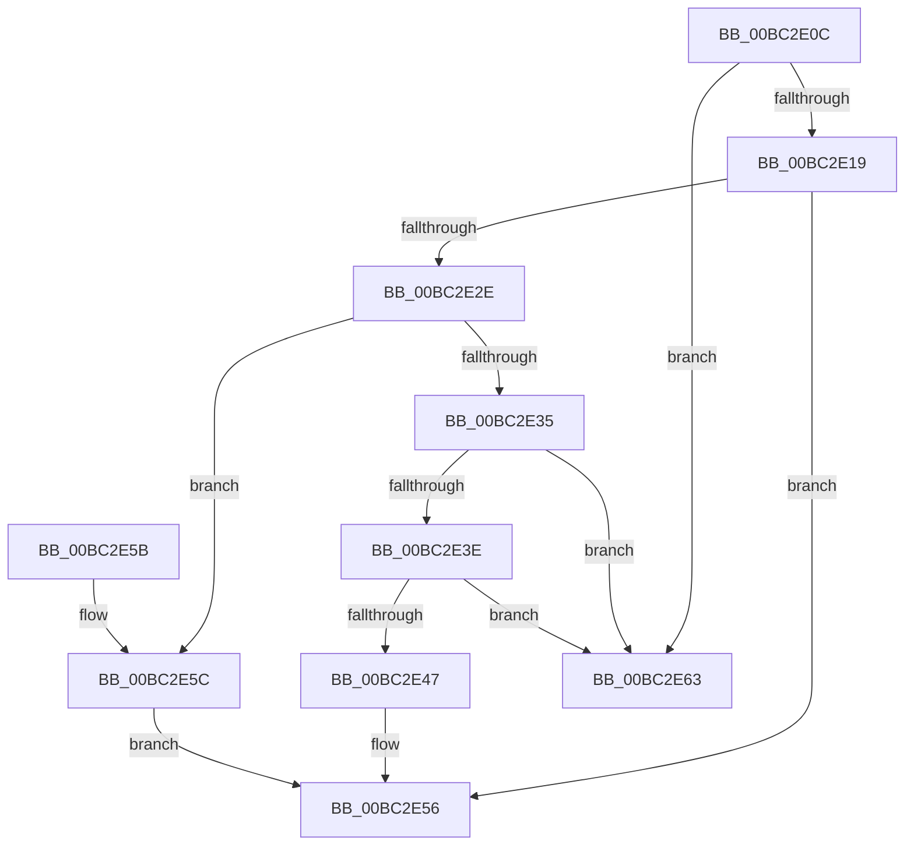

# RaspAddCacheEntry

- RVA: `0x00BC2E0C`–`0x00BC2E6A` (길이 `94` bytes)
- VA: `0x0000000140BC2E0C`
- 실행 섹션: `PAGEBGFX`
- PDB 이름 있음: `예`; PDB Function 태그: `아니요`
- unwind 정보 RVA: `0x00064C74`
- 디코드: `32`개 명령, `94/94` bytes 표시
- 미해석 바이트: `0` (있으면 어셈블리에 `.byte`로 보존)

> 이 문서는 커널 이미지의 기계어와 PDB 기호를 분석해 생성했습니다. 4번과 5번은 함수 원형과 자료형을 바이너리 사용 방식에서 추정한 C 해석이며 원본 소스 복구 결과는 아닙니다.

## 1. Dependencies

- 직접 호출 지점: **1**; 고유 호출 대상: **1**
- 직접 호출자로 확인된 함수: **2**
- RIP 상대 이미지 참조: **0**

### Outgoing calls
- `0x00BC2E51` → [RaspDestroyCachedBitmap](RaspDestroyCachedBitmap_function_00BC5CE8.md) (function, `0x00BC5CE8`)

### Direct callers
- [BgpRasPrintGlyph](../../text/47/BgpRasPrintGlyph_function_0047F3B4.md) at `0x0047F773`
- [RaspGetXExtent](../../text/6A/RaspGetXExtent_function_006A1F7C.md) at `0x006A20E3`

### Static image references
- 디코드된 RIP-relative 메모리 참조가 없습니다.

## 2. Other-region calls and transfers

- 다른 실행 섹션으로 향하는 call: **0**
- 별도 외부 분기/꼬리 이동을 확인하지 못했습니다.

## 3. Assembly (complete function range)

```asm
00BC2E0C  48 83 EC 28                     sub rsp, 0x28
00BC2E10  48 8B 01                        mov rax, qword ptr [rcx]
00BC2E13  48 39 48 08                     cmp qword ptr [rax + 8], rcx
00BC2E17  75 4A                           jne 0x140bc2e63
00BC2E19  48 89 02                        mov qword ptr [rdx], rax
00BC2E1C  48 89 4A 08                     mov qword ptr [rdx + 8], rcx
00BC2E20  48 89 50 08                     mov qword ptr [rax + 8], rdx
00BC2E24  48 89 11                        mov qword ptr [rcx], rdx
00BC2E27  8B 51 30                        mov edx, dword ptr [rcx + 0x30]
00BC2E2A  85 D2                           test edx, edx
00BC2E2C  74 28                           je 0x140bc2e56
00BC2E2E  8B 41 34                        mov eax, dword ptr [rcx + 0x34]
00BC2E31  3B C2                           cmp eax, edx
00BC2E33  75 27                           jne 0x140bc2e5c
00BC2E35  48 8B 41 08                     mov rax, qword ptr [rcx + 8]
00BC2E39  48 39 08                        cmp qword ptr [rax], rcx
00BC2E3C  75 25                           jne 0x140bc2e63
00BC2E3E  48 8B 50 08                     mov rdx, qword ptr [rax + 8]
00BC2E42  48 39 02                        cmp qword ptr [rdx], rax
00BC2E45  75 1C                           jne 0x140bc2e63
00BC2E47  48 89 51 08                     mov qword ptr [rcx + 8], rdx
00BC2E4B  48 89 0A                        mov qword ptr [rdx], rcx
00BC2E4E  48 8B C8                        mov rcx, rax
00BC2E51  E8 92 2E 00 00                  call 0x140bc5ce8
00BC2E56  48 83 C4 28                     add rsp, 0x28
00BC2E5A  C3                              ret
00BC2E5B  CC                              int3
00BC2E5C  FF C0                           inc eax
00BC2E5E  89 41 34                        mov dword ptr [rcx + 0x34], eax
00BC2E61  EB F3                           jmp 0x140bc2e56
00BC2E63  B9 03 00 00 00                  mov ecx, 3
00BC2E68  CD 29                           int 0x29
```

## 4. C-style interpretation (structured pseudocode)

```c
__int64 __fastcall RaspAddCacheEntry(__int64 a1, __int64 a2)
{
    __int64 result;
    __int64 v_rsp;

    v_rsp = (v_rsp) - (40);
    if ((*(unsigned __int64 *)(*(unsigned __int64 *)(a1) + 8)) != a1) goto loc_00BC2E63;
    *(unsigned __int64 *)(a2) = *(unsigned __int64 *)(a1);
    *(unsigned __int64 *)(a2 + 8) = a1;
    *(unsigned __int64 *)(*(unsigned __int64 *)(a1) + 8) = a2;
    *(unsigned __int64 *)(a1) = a2;
    if ((unsigned int)((unsigned int)(*(unsigned int *)(a1 + 48))) == 0) goto loc_00BC2E56;
    if (((unsigned int)((unsigned int)(*(unsigned int *)(a1 + 52)))) != ((unsigned int)((unsigned int)(*(unsigned int *)(a1 + 48))))) goto loc_00BC2E5C;
    if ((*(unsigned __int64 *)(*(unsigned __int64 *)(a1 + 8))) != a1) goto loc_00BC2E63;
    if ((*(unsigned __int64 *)(*(unsigned __int64 *)(*(unsigned __int64 *)(a1 + 8) + 8))) != (*(unsigned __int64 *)(a1 + 8))) goto loc_00BC2E63;
    *(unsigned __int64 *)(a1 + 8) = *(unsigned __int64 *)(*(unsigned __int64 *)(a1 + 8) + 8);
    *(unsigned __int64 *)(*(unsigned __int64 *)(*(unsigned __int64 *)(a1 + 8) + 8)) = a1;
    result = RaspDestroyCachedBitmap(*(unsigned __int64 *)(a1 + 8), *(unsigned __int64 *)(*(unsigned __int64 *)(a1 + 8) + 8), a3, a4);
loc_00BC2E56:
    v_rsp = (v_rsp) + (40);
    return result;
loc_00BC2E5C:
    result = (unsigned int)((result) + 1);
    *(unsigned int *)(*(unsigned __int64 *)(a1 + 8) + 52) = (unsigned int)(result);
    goto loc_00BC2E56;
loc_00BC2E63:
    return result;
}
```

## 5. (Beta) C Style

```c
int64_t RaspAddCacheEntry(void *Arg1, void *Arg2)
{
    uint8_t *arg1 = (uint8_t *)Arg1;
    uint8_t *arg2 = (uint8_t *)Arg2;

    int64_t result;
    int64_t local_rsp;

    local_rsp = (local_rsp) - (40);
    if ((*(uint64_t *)(*(uint64_t *)(arg1) + 0x8)) != Arg1) goto loc_00BC2E63;
    *(uint64_t *)(arg2) = *(uint64_t *)(arg1);
    *(void **)(arg2 + 0x8) = Arg1;
    *(void **)(*(uint64_t *)(arg1) + 0x8) = Arg2;
    *(void **)(arg1) = Arg2;
    if ((uint32_t)((uint32_t)(*(uint32_t *)(arg1 + 0x30))) == 0) goto loc_00BC2E56;
    if (((uint32_t)((uint32_t)(*(uint32_t *)(arg1 + 0x34)))) != ((uint32_t)((uint32_t)(*(uint32_t *)(arg1 + 0x30))))) goto loc_00BC2E5C;
    if ((*(uint64_t *)(*(uint64_t *)(arg1 + 0x8))) != Arg1) goto loc_00BC2E63;
    if ((*(uint64_t *)(*(uint64_t *)(*(uint64_t *)(arg1 + 0x8) + 0x8))) != (*(uint64_t *)(arg1 + 0x8))) goto loc_00BC2E63;
    *(uint64_t *)(arg1 + 0x8) = *(uint64_t *)(*(uint64_t *)(arg1 + 0x8) + 0x8);
    *(void **)(*(uint64_t *)(*(uint64_t *)(arg1 + 0x8) + 0x8)) = Arg1;
    result = RaspDestroyCachedBitmap(*(uint64_t *)(arg1 + 0x8), *(uint64_t *)(*(uint64_t *)(arg1 + 0x8) + 0x8), a3, a4);
loc_00BC2E56:
    local_rsp = (local_rsp) + (40);
    return result;
loc_00BC2E5C:
    result = (uint32_t)((result) + 1);
    *(uint32_t *)(*(uint64_t *)(arg1 + 0x8) + 0x34) = (uint32_t)(result);
    goto loc_00BC2E56;
loc_00BC2E63:
    return result;
}
```

### 관측된 메모리 오프셋

구조체 형식이 확인되지 않은 접근은 인자 기준의 오프셋으로만 기록했습니다.

| 기준 인자 | 오프셋 표현 | 폭 (bit) | 접근 |
|---|---:|---:|---|
| `Arg1` | `+ 0x0` | `64` | `R` |
| `Arg1` | `+ 0x0` | `64` | `W` |
| `Arg1` | `+ 0x8` | `64` | `R` |
| `Arg1` | `+ 0x8` | `64` | `W` |
| `Arg1` | `+ 0x30` | `32` | `R` |
| `Arg1` | `+ 0x34` | `32` | `R` |
| `Arg1` | `+ 0x34` | `32` | `W` |
| `Arg2` | `+ 0x0` | `64` | `W` |
| `Arg2` | `+ 0x8` | `64` | `W` |

## 6. Execution-region graph

[열기: 2D/3D 그래프와 함수 탐색 컨트롤 패널](../../../control-panel.html?section=pagebgfx&rva=0x00BC2E0C&view=graph)

- 2D 그래프는 위에서 아래로 흐르고, 3D 그래프는 빈 공간을 드래그해 회전합니다. Shift+드래그는 이동, 휠은 확대·축소, 함수 노드 선택은 대상 보고서 이동입니다.

### Static fallback


