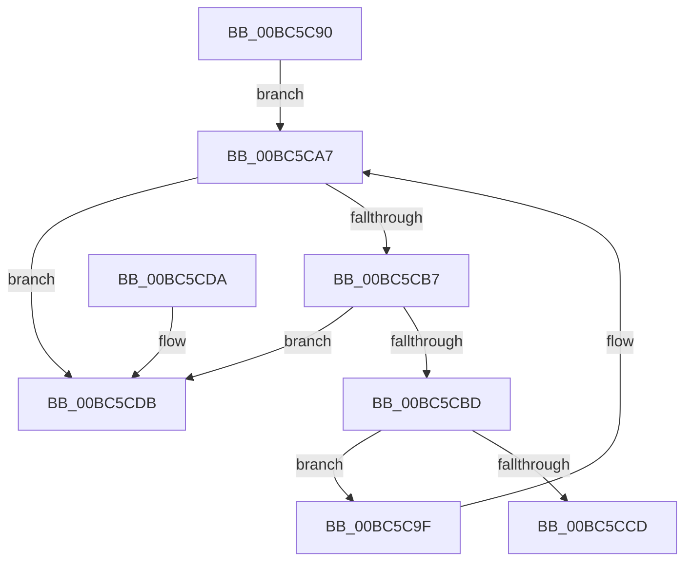

# RaspClearCache

- RVA: `0x00BC5C90`–`0x00BC5CE2` (길이 `82` bytes)
- VA: `0x0000000140BC5C90`
- 실행 섹션: `PAGEBGFX`
- PDB 이름 있음: `예`; PDB Function 태그: `아니요`
- unwind 정보 RVA: `0x0005DAC8`
- 디코드: `23`개 명령, `82/82` bytes 표시
- 미해석 바이트: `0` (있으면 어셈블리에 `.byte`로 보존)

> 이 문서는 커널 이미지의 기계어와 PDB 기호를 분석해 생성했습니다. 4번과 5번은 함수 원형과 자료형을 바이너리 사용 방식에서 추정한 C 해석이며 원본 소스 복구 결과는 아닙니다.

## 1. Dependencies

- 직접 호출 지점: **1**; 고유 호출 대상: **1**
- 직접 호출자로 확인된 함수: **1**
- RIP 상대 이미지 참조: **3**

### Outgoing calls
- `0x00BC5CA2` → [RaspDestroyCachedBitmap](RaspDestroyCachedBitmap_function_00BC5CE8.md) (function, `0x00BC5CE8`)

### Direct callers
- [BgpTxtCacheDestroy](BgpTxtCacheDestroy_function_00BC4354.md) at `0x00BC436C`

### Static image references
- `0x00BC5C96` → RVA `0x00EF0300` (`.data`; read)
- `0x00BC5CBD` → RVA `0x00EF0300` (`.data`; write)
- `0x00BC5CCD` → RVA `0x00EF0334` (`.data`; read/write)

## 2. Other-region calls and transfers

- 다른 실행 섹션으로 향하는 call: **0**
- 별도 외부 분기/꼬리 이동을 확인하지 못했습니다.

## 3. Assembly (complete function range)

```asm
00BC5C90  40 53                           push rbx
00BC5C92  48 83 EC 20                     sub rsp, 0x20
00BC5C96  48 8D 1D 63 A6 32 00            lea rbx, [rip + 0x32a663]
00BC5C9D  EB 08                           jmp 0x140bc5ca7
00BC5C9F  48 8B C8                        mov rcx, rax
00BC5CA2  E8 41 00 00 00                  call 0x140bc5ce8
00BC5CA7  48 8B 05 52 A6 32 00            mov rax, qword ptr [rip + 0x32a652]
00BC5CAE  48 8B 08                        mov rcx, qword ptr [rax]
00BC5CB1  48 39 58 08                     cmp qword ptr [rax + 8], rbx
00BC5CB5  75 24                           jne 0x140bc5cdb
00BC5CB7  48 39 41 08                     cmp qword ptr [rcx + 8], rax
00BC5CBB  75 1E                           jne 0x140bc5cdb
00BC5CBD  48 89 0D 3C A6 32 00            mov qword ptr [rip + 0x32a63c], rcx
00BC5CC4  48 89 59 08                     mov qword ptr [rcx + 8], rbx
00BC5CC8  48 3B C3                        cmp rax, rbx
00BC5CCB  75 D2                           jne 0x140bc5c9f
00BC5CCD  83 25 60 A6 32 00 00            and dword ptr [rip + 0x32a660], 0
00BC5CD4  48 83 C4 20                     add rsp, 0x20
00BC5CD8  5B                              pop rbx
00BC5CD9  C3                              ret
00BC5CDA  CC                              int3
00BC5CDB  B9 03 00 00 00                  mov ecx, 3
00BC5CE0  CD 29                           int 0x29
```

## 4. C-style interpretation (structured pseudocode)

```c
__int64 __fastcall RaspClearCache(void)
{
    __int64 result;
    __int64 v_rsp;

    v_rsp = (v_rsp) - (32);
    goto loc_00BC5CA7;
loc_00BC5C9F:
    result = RaspDestroyCachedBitmap(result, a2, a3, a4);
loc_00BC5CA7:
    if ((*(unsigned __int64 *)(*(unsigned __int64 *)(v_rip + 3319378) + 8)) != (v_rip + 3319395)) goto loc_00BC5CDB;
    if ((*(unsigned __int64 *)(*(unsigned __int64 *)(*(unsigned __int64 *)(v_rip + 3319378)) + 8)) != (*(unsigned __int64 *)(v_rip + 3319378))) goto loc_00BC5CDB;
    *(unsigned __int64 *)(v_rip + 3319356) = *(unsigned __int64 *)(*(unsigned __int64 *)(v_rip + 3319378));
    *(unsigned __int64 *)(*(unsigned __int64 *)(*(unsigned __int64 *)(v_rip + 3319378)) + 8) = v_rip + 3319395;
    if ((*(unsigned __int64 *)(v_rip + 3319378)) != (v_rip + 3319395)) goto loc_00BC5C9F;
    v_rsp = (v_rsp) + (32);
    return *(unsigned __int64 *)(v_rip + 3319378);
loc_00BC5CDB:
    return *(unsigned __int64 *)(v_rip + 3319378);
}
```

## 5. (Beta) C Style

```c
void RaspClearCache(void)
{
    int64_t result;
    int64_t local_rsp;

    local_rsp = (local_rsp) - (32);
    goto loc_00BC5CA7;
loc_00BC5C9F:
    result = RaspDestroyCachedBitmap(result, a2, a3, a4);
loc_00BC5CA7:
    if ((*(uint64_t *)(*(uint64_t *)(v_rip + 0x32A652) + 0x8)) != (v_rip + 3319395)) goto loc_00BC5CDB;
    if ((*(uint64_t *)(*(uint64_t *)(*(uint64_t *)(v_rip + 0x32A652)) + 0x8)) != (*(uint64_t *)(v_rip + 0x32A652))) goto loc_00BC5CDB;
    *(uint64_t *)(v_rip + 0x32A63C) = *(uint64_t *)(*(uint64_t *)(v_rip + 0x32A652));
    *(uint64_t *)(*(uint64_t *)(*(uint64_t *)(v_rip + 0x32A652)) + 0x8) = v_rip + 3319395;
    if ((*(uint64_t *)(v_rip + 0x32A652)) != (v_rip + 3319395)) goto loc_00BC5C9F;
    local_rsp = (local_rsp) + (32);
    return *(uint64_t *)(v_rip + 0x32A652);
loc_00BC5CDB:
    return *(uint64_t *)(v_rip + 0x32A652);
}
```

## 6. Execution-region graph

[열기: 2D/3D 그래프와 함수 탐색 컨트롤 패널](../../../control-panel.html?section=pagebgfx&rva=0x00BC5C90&view=graph)

- 2D 그래프는 위에서 아래로 흐르고, 3D 그래프는 빈 공간을 드래그해 회전합니다. Shift+드래그는 이동, 휠은 확대·축소, 함수 노드 선택은 대상 보고서 이동입니다.

### Static fallback


