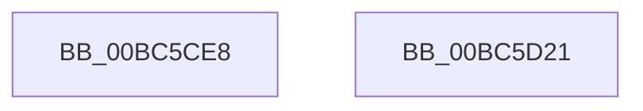

# RaspDestroyCachedBitmap

- RVA: `0x00BC5CE8`–`0x00BC5D22` (길이 `58` bytes)
- VA: `0x0000000140BC5CE8`
- 실행 섹션: `PAGEBGFX`
- PDB 이름 있음: `예`; PDB Function 태그: `아니요`
- unwind 정보 RVA: `0x000697A4`
- 디코드: `17`개 명령, `58/58` bytes 표시
- 미해석 바이트: `0` (있으면 어셈블리에 `.byte`로 보존)

> 이 문서는 커널 이미지의 기계어와 PDB 기호를 분석해 생성했습니다. 4번과 5번은 함수 원형과 자료형을 바이너리 사용 방식에서 추정한 C 해석이며 원본 소스 복구 결과는 아닙니다.

## 1. Dependencies

- 직접 호출 지점: **2**; 고유 호출 대상: **2**
- 직접 호출자로 확인된 함수: **3**
- RIP 상대 이미지 참조: **0**

### Outgoing calls
- `0x00BC5D09` → [RaspRectangleDestroy](../../text/4F/RaspRectangleDestroy_function_004FC9E0.md) (function, `0x004FC9E0`)
- `0x00BC5D16` → [RaspFreeMemory](../../text/3E/RaspFreeMemory_function_003E28E4.md) (function, `0x003E28E4`)

### Direct callers
- [BgpRasPrintGlyph](../../text/47/BgpRasPrintGlyph_function_0047F3B4.md) at `0x0047F799`
- [RaspAddCacheEntry](RaspAddCacheEntry_function_00BC2E0C.md) at `0x00BC2E51`
- [RaspClearCache](RaspClearCache_function_00BC5C90.md) at `0x00BC5CA2`

### Static image references
- 디코드된 RIP-relative 메모리 참조가 없습니다.

## 2. Other-region calls and transfers

- 다른 실행 섹션으로 향하는 call: **2**
  - `0x00BC5D09` → [RaspRectangleDestroy](../../text/4F/RaspRectangleDestroy_function_004FC9E0.md) (`PAGEBGFX` → `.text`)
  - `0x00BC5D16` → [RaspFreeMemory](../../text/3E/RaspFreeMemory_function_003E28E4.md) (`PAGEBGFX` → `.text`)
- 별도 외부 분기/꼬리 이동을 확인하지 못했습니다.

## 3. Assembly (complete function range)

```asm
00BC5CE8  40 53                           push rbx
00BC5CEA  48 83 EC 40                     sub rsp, 0x40
00BC5CEE  48 8B D9                        mov rbx, rcx
00BC5CF1  48 8D 54 24 20                  lea rdx, [rsp + 0x20]
00BC5CF6  48 8B 49 10                     mov rcx, qword ptr [rcx + 0x10]
00BC5CFA  0F 57 C0                        xorps xmm0, xmm0
00BC5CFD  33 C0                           xor eax, eax
00BC5CFF  0F 11 44 24 20                  movups xmmword ptr [rsp + 0x20], xmm0
00BC5D04  48 89 44 24 30                  mov qword ptr [rsp + 0x30], rax
00BC5D09  E8 D2 6C 93 FF                  call 0x1404fc9e0
00BC5D0E  48 8D 54 24 20                  lea rdx, [rsp + 0x20]
00BC5D13  48 8B CB                        mov rcx, rbx
00BC5D16  E8 C9 CB 81 FF                  call 0x1403e28e4
00BC5D1B  48 83 C4 40                     add rsp, 0x40
00BC5D1F  5B                              pop rbx
00BC5D20  C3                              ret
00BC5D21  CC                              int3
```

## 4. C-style interpretation (structured pseudocode)

```c
__int64 __fastcall RaspDestroyCachedBitmap(__int64 a1)
{
    __int64 result;
    __int64 v_rsp;
    unsigned __int64 v_stack_m18;
    unsigned __int64 v_stack_m28;

    v_rsp = (v_rsp) - (64);
    result = 0;
    v_stack_m28 = v_xmm0;
    v_stack_m18 = 0;
    result = RaspRectangleDestroy(*(unsigned __int64 *)(a1 + 16), v_stack_m28, a3, a4);
    result = RaspFreeMemory(a1, v_stack_m28, a3, a4);
    v_rsp = (v_rsp) + (64);
    return result;
}
```

## 5. (Beta) C Style

```c
int64_t RaspDestroyCachedBitmap(void *Arg1)
{
    uint8_t *arg1 = (uint8_t *)Arg1;

    int64_t result;
    int64_t local_rsp;
    uint64_t v_stack_m18;
    uint64_t v_stack_m28;

    local_rsp = (local_rsp) - (64);
    result = 0;
    v_stack_m28 = v_xmm0;
    v_stack_m18 = 0;
    result = RaspRectangleDestroy(*(uint64_t *)(arg1 + 0x10), v_stack_m28, a3, a4);
    result = RaspFreeMemory(Arg1, v_stack_m28, a3, a4);
    local_rsp = (local_rsp) + (64);
    return result;
}
```

### 관측된 메모리 오프셋

구조체 형식이 확인되지 않은 접근은 인자 기준의 오프셋으로만 기록했습니다.

| 기준 인자 | 오프셋 표현 | 폭 (bit) | 접근 |
|---|---:|---:|---|
| `Arg1` | `+ 0x10` | `64` | `R` |

## 6. Execution-region graph

[열기: 2D/3D 그래프와 함수 탐색 컨트롤 패널](../../../control-panel.html?section=pagebgfx&rva=0x00BC5CE8&view=graph)

- 2D 그래프는 위에서 아래로 흐르고, 3D 그래프는 빈 공간을 드래그해 회전합니다. Shift+드래그는 이동, 휠은 확대·축소, 함수 노드 선택은 대상 보고서 이동입니다.

### Static fallback


