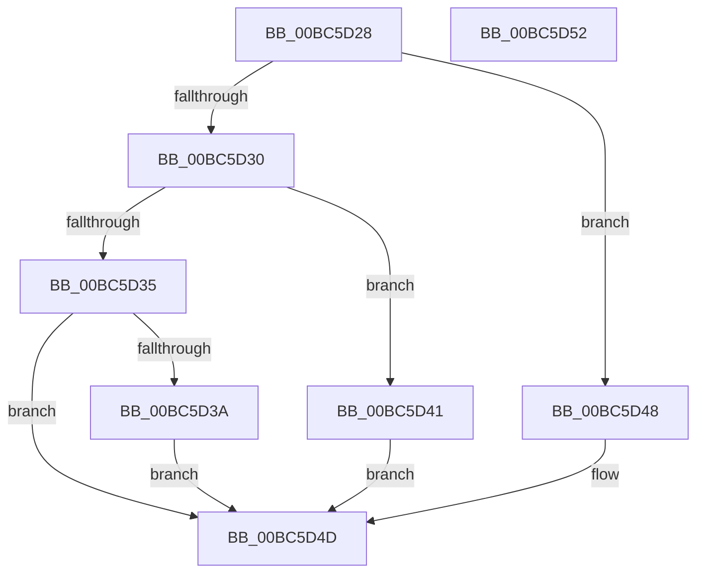

# ResFwBackgroundTransition

- RVA: `0x00BC5D28`–`0x00BC5D53` (길이 `43` bytes)
- VA: `0x0000000140BC5D28`
- 실행 섹션: `PAGEBGFX`
- PDB 이름 있음: `예`; PDB Function 태그: `아니요`
- unwind 정보 RVA: `0x0005C788`
- 디코드: `15`개 명령, `43/43` bytes 표시
- 미해석 바이트: `0` (있으면 어셈블리에 `.byte`로 보존)

> 이 문서는 커널 이미지의 기계어와 PDB 기호를 분석해 생성했습니다. 4번과 5번은 함수 원형과 자료형을 바이너리 사용 방식에서 추정한 C 해석이며 원본 소스 복구 결과는 아닙니다.

## 1. Dependencies

- 직접 호출 지점: **3**; 고유 호출 대상: **3**
- 직접 호출자로 확인된 함수: **3**
- RIP 상대 이미지 참조: **0**

### Outgoing calls
- `0x00BC5D3A` → [ResFwpDestroyBackground](ResFwpDestroyBackground_function_00BC1B3C.md) (function, `0x00BC1B3C`)
- `0x00BC5D41` → [ResFwpPageOutBackground](ResFwpPageOutBackground_function_00BC1C34.md) (function, `0x00BC1C34`)
- `0x00BC5D48` → [ResFwpPageInBackground](ResFwpPageInBackground_function_00BC1BB0.md) (function, `0x00BC1BB0`)

### Direct callers
- [BgpFwLibraryEnable](../../text/69/BgpFwLibraryEnable_function_0069ED8C.md) at `0x0069EF3F`
- [BgpFwLibraryDestroy](BgpFwLibraryDestroy_function_00BC1678.md) at `0x00BC170A`
- [BgpFwLibraryDisable](BgpFwLibraryDisable_function_00BC1724.md) at `0x00BC17F5`

### Static image references
- 디코드된 RIP-relative 메모리 참조가 없습니다.

## 2. Other-region calls and transfers

- 다른 실행 섹션으로 향하는 call: **0**
- 별도 외부 분기/꼬리 이동을 확인하지 못했습니다.

## 3. Assembly (complete function range)

```asm
00BC5D28  48 83 EC 28                     sub rsp, 0x28
00BC5D2C  85 C9                           test ecx, ecx
00BC5D2E  74 18                           je 0x140bc5d48
00BC5D30  83 E9 01                        sub ecx, 1
00BC5D33  74 0C                           je 0x140bc5d41
00BC5D35  83 F9 01                        cmp ecx, 1
00BC5D38  75 13                           jne 0x140bc5d4d
00BC5D3A  E8 FD BD FF FF                  call 0x140bc1b3c
00BC5D3F  EB 0C                           jmp 0x140bc5d4d
00BC5D41  E8 EE BE FF FF                  call 0x140bc1c34
00BC5D46  EB 05                           jmp 0x140bc5d4d
00BC5D48  E8 63 BE FF FF                  call 0x140bc1bb0
00BC5D4D  48 83 C4 28                     add rsp, 0x28
00BC5D51  C3                              ret
00BC5D52  CC                              int3
```

## 4. C-style interpretation (structured pseudocode)

```c
__int64 __fastcall ResFwBackgroundTransition(int a1)
{
    __int64 result;
    __int64 v_rsp;

    v_rsp = (v_rsp) - (40);
    if (a1 == 0) goto loc_00BC5D48;
    a1 = (unsigned int)((a1) - (1));
    if (condition_is_equal) goto loc_00BC5D41;
    if (a1 != 1) goto loc_00BC5D4D;
    result = ResFwpDestroyBackground(a1, a2, a3, a4);
    goto loc_00BC5D4D;
loc_00BC5D41:
    result = ResFwpPageOutBackground(a1, a2, a3, a4);
    goto loc_00BC5D4D;
loc_00BC5D48:
    result = ResFwpPageInBackground(a1, a2, a3, a4);
loc_00BC5D4D:
    v_rsp = (v_rsp) + (40);
    return result;
}
```

## 5. (Beta) C Style

```c
int64_t ResFwBackgroundTransition(int32_t Arg1)
{
    int64_t result;
    int64_t local_rsp;

    local_rsp = (local_rsp) - (40);
    if (Arg1 == 0) goto loc_00BC5D48;
    Arg1 = (uint32_t)((Arg1) - (1));
    if (condition_is_equal) goto loc_00BC5D41;
    if (Arg1 != 1) goto loc_00BC5D4D;
    result = ResFwpDestroyBackground(Arg1, a2, a3, a4);
    goto loc_00BC5D4D;
loc_00BC5D41:
    result = ResFwpPageOutBackground(Arg1, a2, a3, a4);
    goto loc_00BC5D4D;
loc_00BC5D48:
    result = ResFwpPageInBackground(Arg1, a2, a3, a4);
loc_00BC5D4D:
    local_rsp = (local_rsp) + (40);
    return result;
}
```

## 6. Execution-region graph

[열기: 2D/3D 그래프와 함수 탐색 컨트롤 패널](../../../control-panel.html?section=pagebgfx&rva=0x00BC5D28&view=graph)

- 2D 그래프는 위에서 아래로 흐르고, 3D 그래프는 빈 공간을 드래그해 회전합니다. Shift+드래그는 이동, 휠은 확대·축소, 함수 노드 선택은 대상 보고서 이동입니다.

### Static fallback


