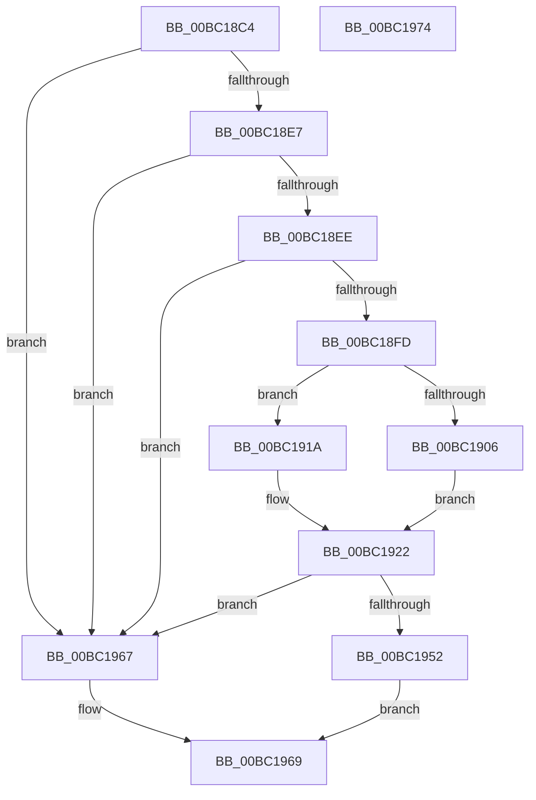

# ResFwConfigureDisplayStringResources

- RVA: `0x00BC18C4`–`0x00BC1975` (길이 `177` bytes)
- VA: `0x0000000140BC18C4`
- 실행 섹션: `PAGEBGFX`
- PDB 이름 있음: `예`; PDB Function 태그: `아니요`
- unwind 정보 RVA: `0x000C4610`
- 디코드: `50`개 명령, `177/177` bytes 표시
- 미해석 바이트: `0` (있으면 어셈블리에 `.byte`로 보존)

> 이 문서는 커널 이미지의 기계어와 PDB 기호를 분석해 생성했습니다. 4번과 5번은 함수 원형과 자료형을 바이너리 사용 방식에서 추정한 C 해석이며 원본 소스 복구 결과는 아닙니다.

## 1. Dependencies

- 직접 호출 지점: **3**; 고유 호출 대상: **3**
- 직접 호출자로 확인된 함수: **1**
- RIP 상대 이미지 참조: **4**

### Outgoing calls
- `0x00BC18F4` → [BgpFoGetFontHandle](BgpFoGetFontHandle_function_00BC52B0.md) (function, `0x00BC52B0`)
- `0x00BC1949` → [BgpTxtCreateRegion](BgpTxtCreateRegion_function_00BC2908.md) (function, `0x00BC2908`)
- `0x00BC1956` → [BgpTxtRegionSize](../../text/69/BgpTxtRegionSize_function_0069F484.md) (function, `0x0069F484`)

### Direct callers
- [BgpFwLibraryInitialize](BgpFwLibraryInitialize_function_00BC5400.md) at `0x00BC54EC`
- [BgpFwLibraryInitialize](BgpFwLibraryInitialize_function_00BC5400.md) at `0x00BC5BFD`

### Static image references
- `0x00BC18FD` → RVA `0x00EF05D0` (`.data`; read)
- `0x00BC1906` → RVA `0x00EF05D4` (`.data`; read)
- `0x00BC190F` → RVA `0x00EF05D8` (`.data`; read)
- `0x00BC195B` → RVA `0x00EF047C` (`.data`; write)

## 2. Other-region calls and transfers

- 다른 실행 섹션으로 향하는 call: **1**
  - `0x00BC1956` → [BgpTxtRegionSize](../../text/69/BgpTxtRegionSize_function_0069F484.md) (`PAGEBGFX` → `.text`)
- 별도 외부 분기/꼬리 이동을 확인하지 못했습니다.

## 3. Assembly (complete function range)

```asm
00BC18C4  48 89 5C 24 10                  mov qword ptr [rsp + 0x10], rbx
00BC18C9  55                              push rbp
00BC18CA  48 8B EC                        mov rbp, rsp
00BC18CD  48 83 EC 60                     sub rsp, 0x60
00BC18D1  48 83 65 10 00                  and qword ptr [rbp + 0x10], 0
00BC18D6  48 8B D9                        mov rbx, rcx
00BC18D9  48 83 65 E8 00                  and qword ptr [rbp - 0x18], 0
00BC18DE  48 85 C9                        test rcx, rcx
00BC18E1  0F 84 80 00 00 00               je 0x140bc1967
00BC18E7  8B 41 18                        mov eax, dword ptr [rcx + 0x18]
00BC18EA  A8 01                           test al, 1
00BC18EC  74 79                           je 0x140bc1967
00BC18EE  48 8D 55 E8                     lea rdx, [rbp - 0x18]
00BC18F2  33 C9                           xor ecx, ecx
00BC18F4  E8 B7 39 00 00                  call 0x140bc52b0
00BC18F9  85 C0                           test eax, eax
00BC18FB  78 6A                           js 0x140bc1967
00BC18FD  80 3D CC EC 32 00 00            cmp byte ptr [rip + 0x32eccc], 0
00BC1904  74 14                           je 0x140bc191a
00BC1906  8B 05 C8 EC 32 00               mov eax, dword ptr [rip + 0x32ecc8]
00BC190C  89 45 E0                        mov dword ptr [rbp - 0x20], eax
00BC190F  8B 05 C3 EC 32 00               mov eax, dword ptr [rip + 0x32ecc3]
00BC1915  89 45 E4                        mov dword ptr [rbp - 0x1c], eax
00BC1918  EB 08                           jmp 0x140bc1922
00BC191A  83 65 E0 00                     and dword ptr [rbp - 0x20], 0
00BC191E  83 4D E4 FF                     or dword ptr [rbp - 0x1c], 0xffffffff
00BC1922  8B 43 14                        mov eax, dword ptr [rbx + 0x14]
00BC1925  4C 8D 4B 1C                     lea r9, [rbx + 0x1c]
00BC1929  83 64 24 28 00                  and dword ptr [rsp + 0x28], 0
00BC192E  48 8D 53 08                     lea rdx, [rbx + 8]
00BC1932  83 65 F4 00                     and dword ptr [rbp - 0xc], 0
00BC1936  4C 8D 45 E0                     lea r8, [rbp - 0x20]
00BC193A  89 45 F0                        mov dword ptr [rbp - 0x10], eax
00BC193D  48 8B CB                        mov rcx, rbx
00BC1940  48 8D 45 10                     lea rax, [rbp + 0x10]
00BC1944  48 89 44 24 20                  mov qword ptr [rsp + 0x20], rax
00BC1949  E8 BA 0F 00 00                  call 0x140bc2908
00BC194E  85 C0                           test eax, eax
00BC1950  78 15                           js 0x140bc1967
00BC1952  48 8B 4D 10                     mov rcx, qword ptr [rbp + 0x10]
00BC1956  E8 29 DB AD FF                  call 0x14069f484
00BC195B  89 05 1B EB 32 00               mov dword ptr [rip + 0x32eb1b], eax
00BC1961  48 8B 45 10                     mov rax, qword ptr [rbp + 0x10]
00BC1965  EB 02                           jmp 0x140bc1969
00BC1967  33 C0                           xor eax, eax
00BC1969  48 8B 5C 24 78                  mov rbx, qword ptr [rsp + 0x78]
00BC196E  48 83 C4 60                     add rsp, 0x60
00BC1972  5D                              pop rbp
00BC1973  C3                              ret
00BC1974  CC                              int3
```

## 4. C-style interpretation (structured pseudocode)

```c
__int64 __fastcall ResFwConfigureDisplayStringResources(__int64 a1)
{
    __int64 result;
    __int64 v_rsp;
    unsigned int v_stack_m14;
    unsigned int v_stack_m18;
    unsigned __int64 v_stack_m20;
    unsigned int v_stack_m24;
    unsigned int v_stack_m28;
    unsigned int v_stack_m40;
    unsigned __int64 v_stack_m48;
    unsigned __int64 v_stack_p10;
    unsigned __int64 v_stack_p8;

    v_stack_p10 = v_rbx;
    v_rsp = (v_rsp) - (96);
    if (a1 == 0) goto loc_00BC1967;
    if ((((unsigned __int8)((unsigned int)(*(unsigned int *)(a1 + 24)))) & (1)) == 0) goto loc_00BC1967;
    a1 = 0;
    result = BgpFoGetFontHandle(a1, v_stack_m20, a3, a4);
    if (sign_flag) goto loc_00BC1967;
    if ((*(unsigned __int8 *)(v_rip + 3337420)) == 0) goto loc_00BC191A;
    v_stack_m28 = (unsigned int)((unsigned int)(*(unsigned int *)(v_rip + 3337416)));
    v_stack_m24 = (unsigned int)((unsigned int)(*(unsigned int *)(v_rip + 3337411)));
    goto loc_00BC1922;
loc_00BC191A:
loc_00BC1922:
    v_stack_m18 = (unsigned int)((unsigned int)(*(unsigned int *)(a1 + 20)));
    v_stack_m48 = v_stack_p8;
    result = BgpTxtCreateRegion(0, a1 + 8, v_stack_m28, a1 + 28);
    if (sign_flag) goto loc_00BC1967;
    result = BgpTxtRegionSize(v_stack_p8, a1 + 8, v_stack_m28, a1 + 28);
    *(unsigned int *)(v_rip + 3336987) = (unsigned int)(result);
    goto loc_00BC1969;
loc_00BC1967:
    result = 0;
loc_00BC1969:
    v_rsp = (v_rsp) + (96);
    return result;
}
```

## 5. (Beta) C Style

```c
int64_t ResFwConfigureDisplayStringResources(void *Arg1)
{
    uint8_t *arg1 = (uint8_t *)Arg1;

    int64_t result;
    int64_t local_rsp;
    uint32_t v_stack_m14;
    uint32_t v_stack_m18;
    uint64_t v_stack_m20;
    uint32_t v_stack_m24;
    uint32_t v_stack_m28;
    uint32_t v_stack_m40;
    uint64_t v_stack_m48;
    uint64_t v_stack_p10;
    uint64_t v_stack_p8;

    v_stack_p10 = local_rbx;
    local_rsp = (local_rsp) - (96);
    if (Arg1 == NULL) goto loc_00BC1967;
    if ((((uint8_t)((uint32_t)(*(uint32_t *)(arg1 + 0x18)))) & (1)) == 0) goto loc_00BC1967;
    Arg1 = 0;
    result = BgpFoGetFontHandle(Arg1, v_stack_m20, a3, a4);
    if (sign_flag) goto loc_00BC1967;
    if ((*(uint8_t *)(v_rip + 0x32ECCC)) == 0) goto loc_00BC191A;
    v_stack_m28 = (uint32_t)((uint32_t)(*(uint32_t *)(v_rip + 0x32ECC8)));
    v_stack_m24 = (uint32_t)((uint32_t)(*(uint32_t *)(v_rip + 0x32ECC3)));
    goto loc_00BC1922;
loc_00BC191A:
loc_00BC1922:
    v_stack_m18 = (uint32_t)((uint32_t)(*(uint32_t *)(arg1 + 0x14)));
    v_stack_m48 = v_stack_p8;
    result = BgpTxtCreateRegion(0, Arg1 + 8, v_stack_m28, Arg1 + 28);
    if (sign_flag) goto loc_00BC1967;
    result = BgpTxtRegionSize(v_stack_p8, Arg1 + 8, v_stack_m28, Arg1 + 28);
    *(uint32_t *)(v_rip + 0x32EB1B) = (uint32_t)(result);
    goto loc_00BC1969;
loc_00BC1967:
    result = 0;
loc_00BC1969:
    local_rsp = (local_rsp) + (96);
    return result;
}
```

### 관측된 메모리 오프셋

구조체 형식이 확인되지 않은 접근은 인자 기준의 오프셋으로만 기록했습니다.

| 기준 인자 | 오프셋 표현 | 폭 (bit) | 접근 |
|---|---:|---:|---|
| `Arg1` | `+ 0x8` | `64` | `R` |
| `Arg1` | `+ 0x14` | `32` | `R` |
| `Arg1` | `+ 0x1C` | `64` | `R` |

## 6. Execution-region graph

[열기: 2D/3D 그래프와 함수 탐색 컨트롤 패널](../../../control-panel.html?section=pagebgfx&rva=0x00BC18C4&view=graph)

- 2D 그래프는 위에서 아래로 흐르고, 3D 그래프는 빈 공간을 드래그해 회전합니다. Shift+드래그는 이동, 휠은 확대·축소, 함수 노드 선택은 대상 보고서 이동입니다.

### Static fallback


