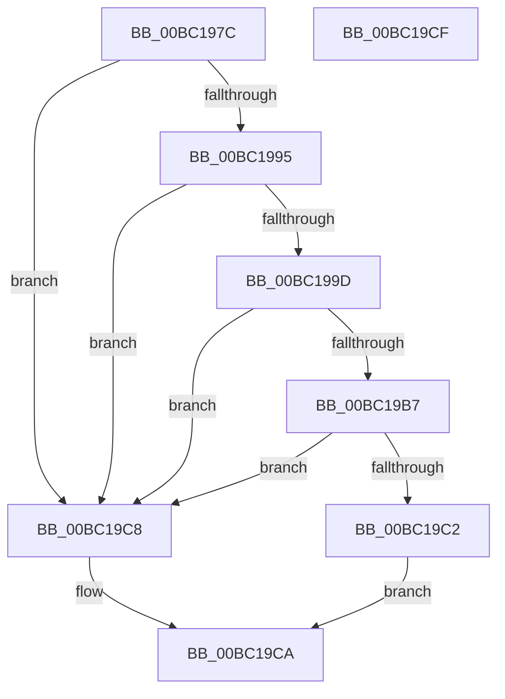

# ResFwFindMessage

- RVA: `0x00BC197C`–`0x00BC19D0` (길이 `84` bytes)
- VA: `0x0000000140BC197C`
- 실행 섹션: `PAGEBGFX`
- PDB 이름 있음: `예`; PDB Function 태그: `아니요`
- unwind 정보 RVA: `0x0005D2F4`
- 디코드: `25`개 명령, `84/84` bytes 표시
- 미해석 바이트: `0` (있으면 어셈블리에 `.byte`로 보존)

> 이 문서는 커널 이미지의 기계어와 PDB 기호를 분석해 생성했습니다. 4번과 5번은 함수 원형과 자료형을 바이너리 사용 방식에서 추정한 C 해석이며 원본 소스 복구 결과는 아닙니다.

## 1. Dependencies

- 직접 호출 지점: **1**; 고유 호출 대상: **1**
- 직접 호출자로 확인된 함수: **1**
- RIP 상대 이미지 참조: **1**

### Outgoing calls
- `0x00BC19AE` → [RtlFindMessage](../../page/99/RtlFindMessage_function_0099B220.md) (function, `0x0099B220`)

### Direct callers
- [BcpFindMessage](../../init/C8/BcpFindMessage_function_00C81294.md) at `0x00C812BA`

### Static image references
- `0x00BC1989` → RVA `0x00EF0508` (`.data`; read)

## 2. Other-region calls and transfers

- 다른 실행 섹션으로 향하는 call: **1**
  - `0x00BC19AE` → [RtlFindMessage](../../page/99/RtlFindMessage_function_0099B220.md) (`PAGEBGFX` → `PAGE`)
- 별도 외부 분기/꼬리 이동을 확인하지 못했습니다.

## 3. Assembly (complete function range)

```asm
00BC197C  48 83 EC 38                     sub rsp, 0x38
00BC1980  48 83 64 24 48 00               and qword ptr [rsp + 0x48], 0
00BC1986  44 8B C9                        mov r9d, ecx
00BC1989  48 8B 05 78 EB 32 00            mov rax, qword ptr [rip + 0x32eb78]
00BC1990  48 85 C0                        test rax, rax
00BC1993  74 33                           je 0x140bc19c8
00BC1995  48 8B 08                        mov rcx, qword ptr [rax]
00BC1998  48 85 C9                        test rcx, rcx
00BC199B  74 2B                           je 0x140bc19c8
00BC199D  45 33 C0                        xor r8d, r8d
00BC19A0  48 8D 44 24 48                  lea rax, [rsp + 0x48]
00BC19A5  48 89 44 24 20                  mov qword ptr [rsp + 0x20], rax
00BC19AA  41 8D 50 0B                     lea edx, [r8 + 0xb]
00BC19AE  E8 6D 98 DD FF                  call 0x14099b220
00BC19B3  85 C0                           test eax, eax
00BC19B5  78 11                           js 0x140bc19c8
00BC19B7  48 8B 4C 24 48                  mov rcx, qword ptr [rsp + 0x48]
00BC19BC  F6 41 02 01                     test byte ptr [rcx + 2], 1
00BC19C0  74 06                           je 0x140bc19c8
00BC19C2  48 8D 41 04                     lea rax, [rcx + 4]
00BC19C6  EB 02                           jmp 0x140bc19ca
00BC19C8  33 C0                           xor eax, eax
00BC19CA  48 83 C4 38                     add rsp, 0x38
00BC19CE  C3                              ret
00BC19CF  CC                              int3
```

## 4. C-style interpretation (structured pseudocode)

```c
__int64 __fastcall ResFwFindMessage(int a1, __int64 a2, int a3)
{
    __int64 result;
    __int64 v_rsp;
    unsigned __int64 v_stack_m18;
    unsigned __int64 v_stack_p10;

    v_rsp = (v_rsp) - (56);
    if (*(unsigned __int64 *)(v_rip + 3337080) == 0) goto loc_00BC19C8;
    if (*(unsigned __int64 *)(*(unsigned __int64 *)(v_rip + 3337080)) == 0) goto loc_00BC19C8;
    a3 = 0;
    v_stack_m18 = v_stack_p10;
    result = RtlFindMessage(*(unsigned __int64 *)(*(unsigned __int64 *)(v_rip + 3337080)), a3 + 11, a3, (unsigned int)(a1));
    if (sign_flag) goto loc_00BC19C8;
    if (((*(unsigned __int8 *)(v_stack_p10 + 2)) & (1)) == 0) goto loc_00BC19C8;
    goto loc_00BC19CA;
loc_00BC19C8:
    result = 0;
loc_00BC19CA:
    v_rsp = (v_rsp) + (56);
    return result;
}
```

## 5. (Beta) C Style

```c
int64_t ResFwFindMessage(int32_t Arg1, int64_t Arg2, int32_t Arg3)
{
    int64_t result;
    int64_t local_rsp;
    uint64_t v_stack_m18;
    uint64_t v_stack_p10;

    local_rsp = (local_rsp) - (56);
    if (*(uint64_t *)(v_rip + 0x32EB78) == 0) goto loc_00BC19C8;
    if (*(uint64_t *)(*(uint64_t *)(v_rip + 0x32EB78)) == 0) goto loc_00BC19C8;
    Arg3 = 0;
    v_stack_m18 = v_stack_p10;
    result = RtlFindMessage(*(uint64_t *)(*(uint64_t *)(v_rip + 0x32EB78)), Arg3 + 11, Arg3, (uint32_t)(Arg1));
    if (sign_flag) goto loc_00BC19C8;
    if (((*(uint8_t *)(v_stack_p10 + 0x2)) & (1)) == 0) goto loc_00BC19C8;
    goto loc_00BC19CA;
loc_00BC19C8:
    result = 0;
loc_00BC19CA:
    local_rsp = (local_rsp) + (56);
    return result;
}
```

## 6. Execution-region graph

[열기: 2D/3D 그래프와 함수 탐색 컨트롤 패널](../../../control-panel.html?section=pagebgfx&rva=0x00BC197C&view=graph)

- 2D 그래프는 위에서 아래로 흐르고, 3D 그래프는 빈 공간을 드래그해 회전합니다. Shift+드래그는 이동, 휠은 확대·축소, 함수 노드 선택은 대상 보고서 이동입니다.

### Static fallback


