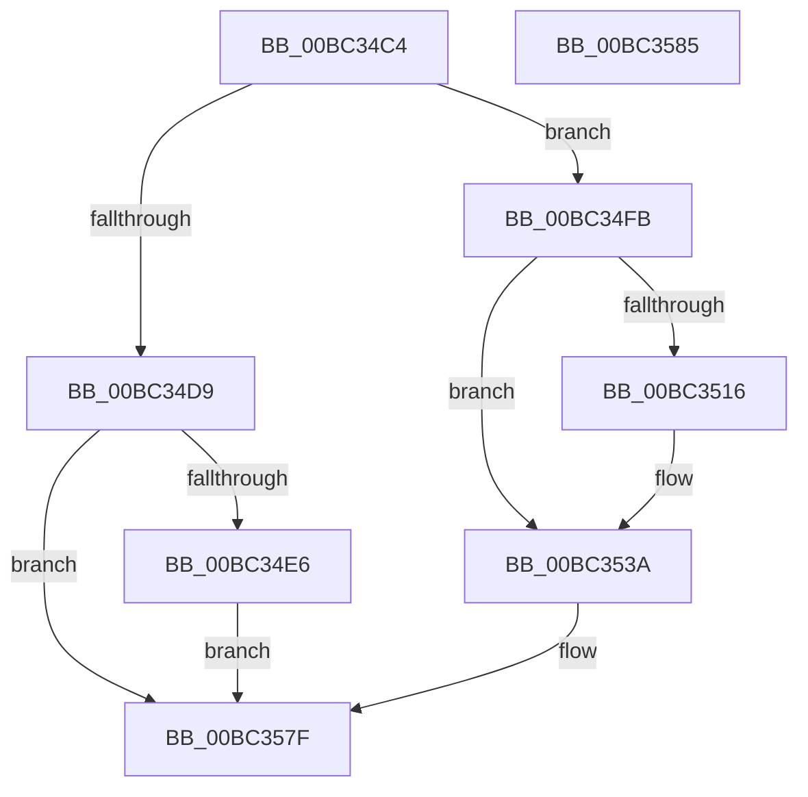

# ResFwFreeContext

- RVA: `0x00BC34C4`–`0x00BC3586` (길이 `194` bytes)
- VA: `0x0000000140BC34C4`
- 실행 섹션: `PAGEBGFX`
- PDB 이름 있음: `예`; PDB Function 태그: `아니요`
- unwind 정보 RVA: `0x0005CF00`
- 디코드: `44`개 명령, `194/194` bytes 표시
- 미해석 바이트: `0` (있으면 어셈블리에 `.byte`로 보존)

> 이 문서는 커널 이미지의 기계어와 PDB 기호를 분석해 생성했습니다. 4번과 5번은 함수 원형과 자료형을 바이너리 사용 방식에서 추정한 C 해석이며 원본 소스 복구 결과는 아닙니다.

## 1. Dependencies

- 직접 호출 지점: **10**; 고유 호출 대상: **8**
- 직접 호출자로 확인된 함수: **1**
- RIP 상대 이미지 참조: **9**

### Outgoing calls
- `0x00BC34E6` → [MmFreePagesFromMdl](../../text/3F/MmFreePagesFromMdl_function_003F82E0.md) (function, `0x003F82E0`)
- `0x00BC34F1` → [ExFreePoolWithTag](../../poolcode/B8/ExFreePoolWithTag_function_00B82870.md) (function, `0x00B82870`)
- `0x00BC34FB` → [BgpTxtCacheDestroy](BgpTxtCacheDestroy_function_00BC4354.md) (function, `0x00BC4354`)
- `0x00BC3500` → [AnFwDisableBackgroundUpdateTimer](AnFwDisableBackgroundUpdateTimer_function_00BC008C.md) (function, `0x00BC008C`)
- `0x00BC3505` → [AnFwFadeCompletion](AnFwFadeCompletion_function_00BC358C.md) (function, `0x00BC358C`)
- `0x00BC350A` → [LogFwReport](LogFwReport_function_00BC43FC.md) (function, `0x00BC43FC`)
- `0x00BC3521` → [BgpFwReservePoolSwap](BgpFwReservePoolSwap_function_00BC1828.md) (function, `0x00BC1828`)
- `0x00BC352A` → [MmFreePagesFromMdl](../../text/3F/MmFreePagesFromMdl_function_003F82E0.md) (function, `0x003F82E0`)
- `0x00BC3535` → [ExFreePoolWithTag](../../poolcode/B8/ExFreePoolWithTag_function_00B82870.md) (function, `0x00B82870`)
- `0x00BC357A` → [ResFwpPageOutBackground](ResFwpPageOutBackground_function_00BC1C34.md) (function, `0x00BC1C34`)

### Direct callers
- [BgFreeContext](BgFreeContext_function_00BC0664.md) at `0x00BC0690`

### Static image references
- `0x00BC34CA` → RVA `0x00EF0450` (`.data`; read)
- `0x00BC353A` → RVA `0x00EEFED8` (`.data`; read)
- `0x00BC3544` → RVA `0x00EF0450` (`.data`; read/write)
- `0x00BC354E` → RVA `0x00EF0510` (`.data`; write)
- `0x00BC3555` → RVA `0x00EEFED0` (`.data`; read)
- `0x00BC355C` → RVA `0x00EF0518` (`.data`; write)
- `0x00BC3565` → RVA `0x00EF0400` (`.data`; write)
- `0x00BC356C` → RVA `0x00EF03E0` (`.data`; read)
- `0x00BC3573` → RVA `0x00EF03F0` (`.data`; read)

## 2. Other-region calls and transfers

- 다른 실행 섹션으로 향하는 call: **4**
  - `0x00BC34E6` → [MmFreePagesFromMdl](../../text/3F/MmFreePagesFromMdl_function_003F82E0.md) (`PAGEBGFX` → `.text`)
  - `0x00BC34F1` → [ExFreePoolWithTag](../../poolcode/B8/ExFreePoolWithTag_function_00B82870.md) (`PAGEBGFX` → `POOLCODE`)
  - `0x00BC352A` → [MmFreePagesFromMdl](../../text/3F/MmFreePagesFromMdl_function_003F82E0.md) (`PAGEBGFX` → `.text`)
  - `0x00BC3535` → [ExFreePoolWithTag](../../poolcode/B8/ExFreePoolWithTag_function_00B82870.md) (`PAGEBGFX` → `POOLCODE`)
- 별도 외부 분기/꼬리 이동을 확인하지 못했습니다.

## 3. Assembly (complete function range)

```asm
00BC34C4  40 53                           push rbx
00BC34C6  48 83 EC 20                     sub rsp, 0x20
00BC34CA  F7 05 7C CF 32 00 00 00 10 00   test dword ptr [rip + 0x32cf7c], 0x100000
00BC34D4  48 8B D9                        mov rbx, rcx
00BC34D7  75 22                           jne 0x140bc34fb
00BC34D9  48 8B 49 08                     mov rcx, qword ptr [rcx + 8]
00BC34DD  48 85 C9                        test rcx, rcx
00BC34E0  0F 84 99 00 00 00               je 0x140bc357f
00BC34E6  E8 F5 4D 83 FF                  call 0x1403f82e0
00BC34EB  48 8B 4B 08                     mov rcx, qword ptr [rbx + 8]
00BC34EF  33 D2                           xor edx, edx
00BC34F1  E8 7A F3 FB FF                  call 0x140b82870
00BC34F6  E9 84 00 00 00                  jmp 0x140bc357f
00BC34FB  E8 54 0E 00 00                  call 0x140bc4354
00BC3500  E8 87 CB FF FF                  call 0x140bc008c
00BC3505  E8 82 00 00 00                  call 0x140bc358c
00BC350A  E8 ED 0E 00 00                  call 0x140bc43fc
00BC350F  48 83 7B 10 00                  cmp qword ptr [rbx + 0x10], 0
00BC3514  74 24                           je 0x140bc353a
00BC3516  33 D2                           xor edx, edx
00BC3518  45 33 C9                        xor r9d, r9d
00BC351B  45 33 C0                        xor r8d, r8d
00BC351E  8D 4A 01                        lea ecx, [rdx + 1]
00BC3521  E8 02 E3 FF FF                  call 0x140bc1828
00BC3526  48 8B 4B 08                     mov rcx, qword ptr [rbx + 8]
00BC352A  E8 B1 4D 83 FF                  call 0x1403f82e0
00BC352F  48 8B 4B 08                     mov rcx, qword ptr [rbx + 8]
00BC3533  33 D2                           xor edx, edx
00BC3535  E8 36 F3 FB FF                  call 0x140b82870
00BC353A  48 8B 05 97 C9 32 00            mov rax, qword ptr [rip + 0x32c997]
00BC3541  0F 57 C0                        xorps xmm0, xmm0
00BC3544  81 25 02 CF 32 00 FD F7 EF FF   and dword ptr [rip + 0x32cf02], 0xffeff7fd
00BC354E  48 89 05 BB CF 32 00            mov qword ptr [rip + 0x32cfbb], rax
00BC3555  48 8B 05 74 C9 32 00            mov rax, qword ptr [rip + 0x32c974]
00BC355C  48 89 05 B5 CF 32 00            mov qword ptr [rip + 0x32cfb5], rax
00BC3563  33 C0                           xor eax, eax
00BC3565  48 89 05 94 CE 32 00            mov qword ptr [rip + 0x32ce94], rax
00BC356C  0F 11 05 6D CE 32 00            movups xmmword ptr [rip + 0x32ce6d], xmm0
00BC3573  0F 11 05 76 CE 32 00            movups xmmword ptr [rip + 0x32ce76], xmm0
00BC357A  E8 B5 E6 FF FF                  call 0x140bc1c34
00BC357F  48 83 C4 20                     add rsp, 0x20
00BC3583  5B                              pop rbx
00BC3584  C3                              ret
00BC3585  CC                              int3
```

## 4. C-style interpretation (structured pseudocode)

```c
__int64 __fastcall ResFwFreeContext(__int64 a1, int a2, int a3, int a4)
{
    __int64 result;
    __int64 v_rsp;

    v_rsp = (v_rsp) - (32);
    if (((*(unsigned int *)(v_rip + 3329916)) & (0x100000ULL)) != 0) goto loc_00BC34FB;
    if (*(unsigned __int64 *)(a1 + 8) == 0) goto loc_00BC357F;
    result = MmFreePagesFromMdl(*(unsigned __int64 *)(a1 + 8), a2, a3, a4);
    a2 = 0;
    result = ExFreePoolWithTag(*(unsigned __int64 *)(a1 + 8), a2, a3, a4);
    goto loc_00BC357F;
loc_00BC34FB:
    result = BgpTxtCacheDestroy(*(unsigned __int64 *)(a1 + 8), a2, a3, a4);
    result = AnFwDisableBackgroundUpdateTimer(*(unsigned __int64 *)(a1 + 8), a2, a3, a4);
    result = AnFwFadeCompletion(*(unsigned __int64 *)(a1 + 8), a2, a3, a4);
    result = LogFwReport(*(unsigned __int64 *)(a1 + 8), a2, a3, a4);
    if ((*(unsigned __int64 *)(a1 + 16)) != 0) {
        a2 = 0;
        a4 = 0;
        a3 = 0;
        a1 = a2 + 1;
        result = BgpFwReservePoolSwap(a1, a2, a3, a4);
        a1 = *(unsigned __int64 *)(a1 + 8);
        result = MmFreePagesFromMdl(a1, a2, a3, a4);
        a1 = *(unsigned __int64 *)(a1 + 8);
        a2 = 0;
        result = ExFreePoolWithTag(a1, a2, a3, a4);
    }
    *(unsigned __int64 *)(v_rip + 3329979) = *(unsigned __int64 *)(v_rip + 3328407);
    *(unsigned __int64 *)(v_rip + 3329973) = *(unsigned __int64 *)(v_rip + 3328372);
    result = 0;
    *(unsigned __int64 *)(v_rip + 3329684) = 0;
    *(unsigned __int64 *)(v_rip + 3329645) = v_xmm0;
    *(unsigned __int64 *)(v_rip + 3329654) = v_xmm0;
    result = ResFwpPageOutBackground(a1, a2, a3, a4);
loc_00BC357F:
    v_rsp = (v_rsp) + (32);
    return result;
}
```

## 5. (Beta) C Style

```c
int64_t ResFwFreeContext(void *Arg1, int32_t Arg2, int32_t Arg3, int32_t Arg4)
{
    uint8_t *arg1 = (uint8_t *)Arg1;

    int64_t result;
    int64_t local_rsp;

    local_rsp = (local_rsp) - (32);
    if (((*(uint32_t *)(v_rip + 0x32CF7C)) & (0x100000ULL)) != 0) goto loc_00BC34FB;
    if (*(uint64_t *)(arg1 + 0x8) == 0) goto loc_00BC357F;
    result = MmFreePagesFromMdl(*(uint64_t *)(arg1 + 0x8), Arg2, Arg3, Arg4);
    Arg2 = 0;
    result = ExFreePoolWithTag(*(uint64_t *)(arg1 + 0x8), Arg2, Arg3, Arg4);
    goto loc_00BC357F;
loc_00BC34FB:
    result = BgpTxtCacheDestroy(*(uint64_t *)(arg1 + 0x8), Arg2, Arg3, Arg4);
    result = AnFwDisableBackgroundUpdateTimer(*(uint64_t *)(arg1 + 0x8), Arg2, Arg3, Arg4);
    result = AnFwFadeCompletion(*(uint64_t *)(arg1 + 0x8), Arg2, Arg3, Arg4);
    result = LogFwReport(*(uint64_t *)(arg1 + 0x8), Arg2, Arg3, Arg4);
    if ((*(uint64_t *)(arg1 + 0x10)) != 0) {
        Arg2 = 0;
        Arg4 = 0;
        Arg3 = 0;
        Arg1 = Arg2 + 1;
        result = BgpFwReservePoolSwap(Arg1, Arg2, Arg3, Arg4);
        Arg1 = *(uint64_t *)(arg1 + 0x8);
        result = MmFreePagesFromMdl(Arg1, Arg2, Arg3, Arg4);
        Arg1 = *(uint64_t *)(arg1 + 0x8);
        Arg2 = 0;
        result = ExFreePoolWithTag(Arg1, Arg2, Arg3, Arg4);
    }
    *(uint64_t *)(v_rip + 0x32CFBB) = *(uint64_t *)(v_rip + 0x32C997);
    *(uint64_t *)(v_rip + 0x32CFB5) = *(uint64_t *)(v_rip + 0x32C974);
    result = 0;
    *(uint64_t *)(v_rip + 0x32CE94) = 0;
    *(uint64_t *)(v_rip + 0x32CE6D) = v_xmm0;
    *(uint64_t *)(v_rip + 0x32CE76) = v_xmm0;
    result = ResFwpPageOutBackground(Arg1, Arg2, Arg3, Arg4);
loc_00BC357F:
    local_rsp = (local_rsp) + (32);
    return result;
}
```

### 관측된 메모리 오프셋

구조체 형식이 확인되지 않은 접근은 인자 기준의 오프셋으로만 기록했습니다.

| 기준 인자 | 오프셋 표현 | 폭 (bit) | 접근 |
|---|---:|---:|---|
| `Arg1` | `+ 0x8` | `64` | `R` |
| `Arg1` | `+ 0x10` | `64` | `R` |

## 6. Execution-region graph

[열기: 2D/3D 그래프와 함수 탐색 컨트롤 패널](../../../control-panel.html?section=pagebgfx&rva=0x00BC34C4&view=graph)

- 2D 그래프는 위에서 아래로 흐르고, 3D 그래프는 빈 공간을 드래그해 회전합니다. Shift+드래그는 이동, 휠은 확대·축소, 함수 노드 선택은 대상 보고서 이동입니다.

### Static fallback


