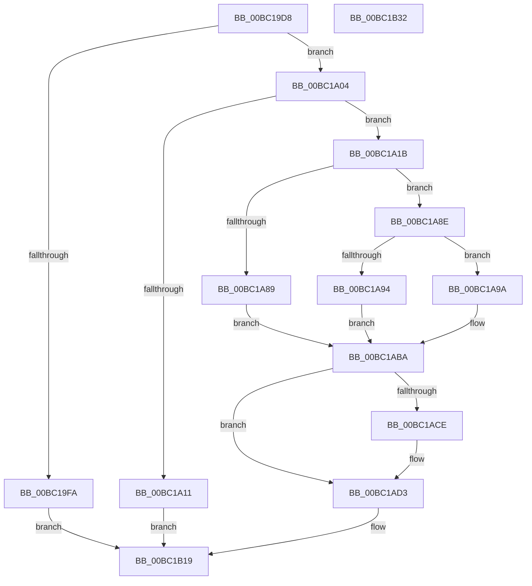

# ResFwGetContext

- RVA: `0x00BC19D8`–`0x00BC1B33` (길이 `347` bytes)
- VA: `0x0000000140BC19D8`
- 실행 섹션: `PAGEBGFX`
- PDB 이름 있음: `예`; PDB Function 태그: `아니요`
- unwind 정보 RVA: `0x00084C9C`
- 디코드: `89`개 명령, `347/347` bytes 표시
- 미해석 바이트: `0` (있으면 어셈블리에 `.byte`로 보존)

> 이 문서는 커널 이미지의 기계어와 PDB 기호를 분석해 생성했습니다. 4번과 5번은 함수 원형과 자료형을 바이너리 사용 방식에서 추정한 C 해석이며 원본 소스 복구 결과는 아닙니다.

## 1. Dependencies

- 직접 호출 지점: **2**; 고유 호출 대상: **2**
- 직접 호출자로 확인된 함수: **1**
- RIP 상대 이미지 참조: **10**

### Outgoing calls
- `0x00BC1A7C` → [MmAllocatePagesForMdlEx](../../text/3E/MmAllocatePagesForMdlEx_function_003EA8C0.md) (function, `0x003EA8C0`)
- `0x00BC1AB2` → [MmMapLockedPagesSpecifyCache](../../text/31/MmMapLockedPagesSpecifyCache_function_00318800.md) (function, `0x00318800`)

### Direct callers
- [BgGetContext](BgGetContext_function_00BC06A8.md) at `0x00BC06D5`

### Static image references
- `0x00BC1A04` → RVA `0x00EF0450` (`.data`; read)
- `0x00BC1A1B` → RVA `0x00EF046C` (`.data`; read)
- `0x00BC1A26` → RVA `0x00EF0470` (`.data`; read)
- `0x00BC1A2F` → RVA `0x00EF0478` (`.data`; read)
- `0x00BC1A44` → RVA `0x00EF047C` (`.data`; read)
- `0x00BC1ABA` → RVA `0x00EF0480` (`.data`; read)
- `0x00BC1AF8` → RVA `0x00EF0510` (`.data`; read)
- `0x00BC1AFF` → RVA `0x00EEFED8` (`.data`; write)
- `0x00BC1B06` → RVA `0x00EF0518` (`.data`; read)
- `0x00BC1B0D` → RVA `0x00EEFED0` (`.data`; write)

## 2. Other-region calls and transfers

- 다른 실행 섹션으로 향하는 call: **2**
  - `0x00BC1A7C` → [MmAllocatePagesForMdlEx](../../text/3E/MmAllocatePagesForMdlEx_function_003EA8C0.md) (`PAGEBGFX` → `.text`)
  - `0x00BC1AB2` → [MmMapLockedPagesSpecifyCache](../../text/31/MmMapLockedPagesSpecifyCache_function_00318800.md) (`PAGEBGFX` → `.text`)
- 별도 외부 분기/꼬리 이동을 확인하지 못했습니다.

## 3. Assembly (complete function range)

```asm
00BC19D8  48 89 5C 24 08                  mov qword ptr [rsp + 8], rbx
00BC19DD  48 89 6C 24 10                  mov qword ptr [rsp + 0x10], rbp
00BC19E2  48 89 74 24 18                  mov qword ptr [rsp + 0x18], rsi
00BC19E7  57                              push rdi
00BC19E8  41 56                           push r14
00BC19EA  41 57                           push r15
00BC19EC  48 83 EC 30                     sub rsp, 0x30
00BC19F0  33 DB                           xor ebx, ebx
00BC19F2  48 8B F1                        mov rsi, rcx
00BC19F5  48 85 C9                        test rcx, rcx
00BC19F8  75 0A                           jne 0x140bc1a04
00BC19FA  B8 0D 00 00 C0                  mov eax, 0xc000000d
00BC19FF  E9 15 01 00 00                  jmp 0x140bc1b19
00BC1A04  8B 05 46 EA 32 00               mov eax, dword ptr [rip + 0x32ea46]
00BC1A0A  48 89 19                        mov qword ptr [rcx], rbx
00BC1A0D  A8 01                           test al, 1
00BC1A0F  75 0A                           jne 0x140bc1a1b
00BC1A11  B8 01 00 00 C0                  mov eax, 0xc0000001
00BC1A16  E9 FE 00 00 00                  jmp 0x140bc1b19
00BC1A1B  8B 0D 4B EA 32 00               mov ecx, dword ptr [rip + 0x32ea4b]
00BC1A21  B8 00 F0 FF FF                  mov eax, 0xfffff000
00BC1A26  39 0D 44 EA 32 00               cmp dword ptr [rip + 0x32ea44], ecx
00BC1A2C  4C 8B C3                        mov r8, rbx
00BC1A2F  44 8B 35 42 EA 32 00            mov r14d, dword ptr [rip + 0x32ea42]
00BC1A36  0F 43 0D 33 EA 32 00            cmovae ecx, dword ptr [rip + 0x32ea33]
00BC1A3D  41 81 C6 FF 4F 00 00            add r14d, 0x4fff
00BC1A44  03 0D 32 EA 32 00               add ecx, dword ptr [rip + 0x32ea32]
00BC1A4A  48 83 CA FF                     or rdx, 0xffffffffffffffff
00BC1A4E  44 03 F1                        add r14d, ecx
00BC1A51  C7 44 24 28 05 00 00 00         mov dword ptr [rsp + 0x28], 5
00BC1A59  44 23 F0                        and r14d, eax
00BC1A5C  C7 44 24 20 01 00 00 00         mov dword ptr [rsp + 0x20], 1
00BC1A64  41 8B EE                        mov ebp, r14d
00BC1A67  48 8B CB                        mov rcx, rbx
00BC1A6A  C1 ED 03                        shr ebp, 3
00BC1A6D  81 C5 FF 0F 00 00               add ebp, 0xfff
00BC1A73  23 E8                           and ebp, eax
00BC1A75  45 8D 3C 2E                     lea r15d, [r14 + rbp]
00BC1A79  45 8B CF                        mov r9d, r15d
00BC1A7C  E8 3F 8E 82 FF                  call 0x1403ea8c0
00BC1A81  48 8B F8                        mov rdi, rax
00BC1A84  48 85 C0                        test rax, rax
00BC1A87  75 05                           jne 0x140bc1a8e
00BC1A89  48 8B D3                        mov rdx, rbx
00BC1A8C  EB 2C                           jmp 0x140bc1aba
00BC1A8E  F6 40 0A 05                     test byte ptr [rax + 0xa], 5
00BC1A92  74 06                           je 0x140bc1a9a
00BC1A94  48 8B 50 18                     mov rdx, qword ptr [rax + 0x18]
00BC1A98  EB 20                           jmp 0x140bc1aba
00BC1A9A  45 33 C9                        xor r9d, r9d
00BC1A9D  C7 44 24 28 20 00 00 40         mov dword ptr [rsp + 0x28], 0x40000020
00BC1AA5  33 D2                           xor edx, edx
00BC1AA7  89 5C 24 20                     mov dword ptr [rsp + 0x20], ebx
00BC1AAB  48 8B CF                        mov rcx, rdi
00BC1AAE  45 8D 41 01                     lea r8d, [r9 + 1]
00BC1AB2  E8 49 6D 75 FF                  call 0x140318800
00BC1AB7  48 8B D0                        mov rdx, rax
00BC1ABA  4C 8B 05 BF E9 32 00            mov r8, qword ptr [rip + 0x32e9bf]
00BC1AC1  49 89 78 08                     mov qword ptr [r8 + 8], rdi
00BC1AC5  49 89 50 10                     mov qword ptr [r8 + 0x10], rdx
00BC1AC9  48 85 D2                        test rdx, rdx
00BC1ACC  74 05                           je 0x140bc1ad3
00BC1ACE  8B DD                           mov ebx, ebp
00BC1AD0  48 03 DA                        add rbx, rdx
00BC1AD3  48 8B C2                        mov rax, rdx
00BC1AD6  48 F7 D8                        neg rax
00BC1AD9  1B C9                           sbb ecx, ecx
00BC1ADB  41 23 CF                        and ecx, r15d
00BC1ADE  41 89 48 18                     mov dword ptr [r8 + 0x18], ecx
00BC1AE2  48 F7 DA                        neg rdx
00BC1AE5  1B C0                           sbb eax, eax
00BC1AE7  41 23 C6                        and eax, r14d
00BC1AEA  41 89 80 F8 00 00 00            mov dword ptr [r8 + 0xf8], eax
00BC1AF1  49 89 98 F0 00 00 00            mov qword ptr [r8 + 0xf0], rbx
00BC1AF8  48 8B 05 11 EA 32 00            mov rax, qword ptr [rip + 0x32ea11]
00BC1AFF  48 89 05 D2 E3 32 00            mov qword ptr [rip + 0x32e3d2], rax
00BC1B06  48 8B 05 0B EA 32 00            mov rax, qword ptr [rip + 0x32ea0b]
00BC1B0D  48 89 05 BC E3 32 00            mov qword ptr [rip + 0x32e3bc], rax
00BC1B14  33 C0                           xor eax, eax
00BC1B16  4C 89 06                        mov qword ptr [rsi], r8
00BC1B19  48 8B 5C 24 50                  mov rbx, qword ptr [rsp + 0x50]
00BC1B1E  48 8B 6C 24 58                  mov rbp, qword ptr [rsp + 0x58]
00BC1B23  48 8B 74 24 60                  mov rsi, qword ptr [rsp + 0x60]
00BC1B28  48 83 C4 30                     add rsp, 0x30
00BC1B2C  41 5F                           pop r15
00BC1B2E  41 5E                           pop r14
00BC1B30  5F                              pop rdi
00BC1B31  C3                              ret
00BC1B32  CC                              int3
```

## 4. C-style interpretation (structured pseudocode)

```c
__int64 __fastcall ResFwGetContext(__int64 a1, __int64 a2)
{
    __int64 result;
    __int64 v_r14;
    __int64 v_rbp;
    __int64 v_rbx;
    __int64 v_rsp;
    unsigned int v_stack_m20;
    unsigned int v_stack_m28;
    unsigned __int64 v_stack_p10;
    unsigned __int64 v_stack_p18;
    unsigned __int64 v_stack_p8;

    v_stack_p8 = v_rbx;
    v_stack_p10 = v_rbp;
    v_stack_p18 = v_rsi;
    v_rsp = (v_rsp) - (48);
    v_rbx = 0;
    if (a1 != 0) goto loc_00BC1A04;
    goto loc_00BC1B19;
loc_00BC1A04:
    *(unsigned __int64 *)(a1) = 0;
    if ((((unsigned __int8)((unsigned int)(*(unsigned int *)(v_rip + 3336774)))) & (1)) != 0) goto loc_00BC1A1B;
    goto loc_00BC1B19;
loc_00BC1A1B:
    a1 = (unsigned int)(*(unsigned int *)(v_rip + 3336779));
    if ((*(unsigned int *)(v_rip + 3336772)) >= ((unsigned int)((unsigned int)(*(unsigned int *)(v_rip + 3336779))))) { a1 = *(unsigned int *)(v_rip + 3336755); }
    v_r14 = (unsigned int)(((unsigned int)(*(unsigned int *)(v_rip + 3336770))) + (0x4FFFULL));
    a1 = (unsigned int)((a1) + (*(unsigned int *)(v_rip + 3336754)));
    a2 = (a2) | (-1);
    v_r14 = (unsigned int)((v_r14) + ((unsigned int)(a1)));
    v_stack_m20 = 5;
    v_r14 = (unsigned int)((v_r14) & ((unsigned int)((unsigned int)(0xFFFFF000ULL))));
    v_stack_m28 = 1;
    v_rbp = (unsigned int)(((unsigned int)((unsigned int)(v_r14))) >> (3));
    v_rbp = (unsigned int)((v_rbp) + (0xFFFULL));
    v_rbp = (unsigned int)((v_rbp) & ((unsigned int)((unsigned int)(0xFFFFF000ULL))));
    result = MmAllocatePagesForMdlEx(0, a2, 0, (unsigned int)((unsigned int)(v_r14 + v_rbp * 1)));
    if (result != 0) goto loc_00BC1A8E;
    goto loc_00BC1ABA;
loc_00BC1A8E:
    if (((*(unsigned __int8 *)(result + 10)) & (5)) == 0) goto loc_00BC1A9A;
    goto loc_00BC1ABA;
loc_00BC1A9A:
    a4 = 0;
    v_stack_m20 = 0x40000020ULL;
    a2 = 0;
    v_stack_m28 = 0;
    result = MmMapLockedPagesSpecifyCache(result, a2, a4 + 1, a4);
loc_00BC1ABA:
    *(unsigned __int64 *)(*(unsigned __int64 *)(v_rip + 3336639) + 8) = result;
    *(unsigned __int64 *)(*(unsigned __int64 *)(v_rip + 3336639) + 16) = result;
    if (result != 0) {
        v_rbx = (unsigned int)(v_rbp);
        v_rbx = (v_rbx) + (result);
    }
    result = -(result);
    a1 = (unsigned int)((result) & ((unsigned int)(v_r14 + v_rbp * 1)));
    *(unsigned int *)(*(unsigned __int64 *)(v_rip + 3336639) + 24) = (unsigned int)(a1);
    a2 = -(result);
    result = (unsigned int)((result) & ((unsigned int)(v_r14)));
    *(unsigned int *)(*(unsigned __int64 *)(v_rip + 3336639) + 248) = (unsigned int)(result);
    *(unsigned __int64 *)(*(unsigned __int64 *)(v_rip + 3336639) + 240) = v_rbx;
    *(unsigned __int64 *)(v_rip + 3335122) = *(unsigned __int64 *)(v_rip + 3336721);
    *(unsigned __int64 *)(v_rip + 3335100) = *(unsigned __int64 *)(v_rip + 3336715);
    result = 0;
    *(unsigned __int64 *)(a1) = *(unsigned __int64 *)(v_rip + 3336639);
loc_00BC1B19:
    v_rsp = (v_rsp) + (48);
    return result;
}
```

## 5. (Beta) C Style

```c
int64_t ResFwGetContext(void *Arg1, int64_t Arg2)
{
    uint8_t *arg1 = (uint8_t *)Arg1;

    int64_t result;
    int64_t local_r14;
    int64_t local_rbp;
    int64_t local_rbx;
    int64_t local_rsp;
    uint32_t v_stack_m20;
    uint32_t v_stack_m28;
    uint64_t v_stack_p10;
    uint64_t v_stack_p18;
    uint64_t v_stack_p8;

    v_stack_p8 = local_rbx;
    v_stack_p10 = local_rbp;
    v_stack_p18 = local_rsi;
    local_rsp = (local_rsp) - (48);
    local_rbx = 0;
    if (Arg1 != NULL) goto loc_00BC1A04;
    goto loc_00BC1B19;
loc_00BC1A04:
    *(uint64_t *)(arg1) = 0;
    if ((((uint8_t)((uint32_t)(*(uint32_t *)(v_rip + 0x32EA46)))) & (1)) != 0) goto loc_00BC1A1B;
    goto loc_00BC1B19;
loc_00BC1A1B:
    Arg1 = (uint32_t)(*(uint32_t *)(v_rip + 0x32EA4B));
    if ((*(uint32_t *)(v_rip + 0x32EA44)) >= ((uint32_t)((uint32_t)(*(uint32_t *)(v_rip + 0x32EA4B))))) { Arg1 = *(uint32_t *)(v_rip + 0x32EA33); }
    local_r14 = (uint32_t)(((uint32_t)(*(uint32_t *)(v_rip + 0x32EA42))) + (0x4FFFULL));
    Arg1 = (uint32_t)((Arg1) + (*(uint32_t *)(v_rip + 0x32EA32)));
    Arg2 = (Arg2) | (-1);
    local_r14 = (uint32_t)((local_r14) + ((uint32_t)(Arg1)));
    v_stack_m20 = 5;
    local_r14 = (uint32_t)((local_r14) & ((uint32_t)((uint32_t)(0xFFFFF000ULL))));
    v_stack_m28 = 1;
    local_rbp = (uint32_t)(((uint32_t)((uint32_t)(local_r14))) >> (3));
    local_rbp = (uint32_t)((local_rbp) + (0xFFFULL));
    local_rbp = (uint32_t)((local_rbp) & ((uint32_t)((uint32_t)(0xFFFFF000ULL))));
    result = MmAllocatePagesForMdlEx(0, Arg2, 0, (uint32_t)((uint32_t)(local_r14 + local_rbp * 1)));
    if (result != 0) goto loc_00BC1A8E;
    goto loc_00BC1ABA;
loc_00BC1A8E:
    if (((*(uint8_t *)(result + 0xA)) & (5)) == 0) goto loc_00BC1A9A;
    goto loc_00BC1ABA;
loc_00BC1A9A:
    a4 = 0;
    v_stack_m20 = 0x40000020ULL;
    Arg2 = 0;
    v_stack_m28 = 0;
    result = MmMapLockedPagesSpecifyCache(result, Arg2, a4 + 1, a4);
loc_00BC1ABA:
    *(uint64_t *)(*(uint64_t *)(v_rip + 0x32E9BF) + 0x8) = result;
    *(uint64_t *)(*(uint64_t *)(v_rip + 0x32E9BF) + 0x10) = result;
    if (result != 0) {
        local_rbx = (uint32_t)(local_rbp);
        local_rbx = (local_rbx) + (result);
    }
    result = -(result);
    Arg1 = (uint32_t)((result) & ((uint32_t)(local_r14 + local_rbp * 1)));
    *(uint32_t *)(*(uint64_t *)(v_rip + 0x32E9BF) + 0x18) = (uint32_t)(Arg1);
    Arg2 = -(result);
    result = (uint32_t)((result) & ((uint32_t)(local_r14)));
    *(uint32_t *)(*(uint64_t *)(v_rip + 0x32E9BF) + 0xF8) = (uint32_t)(result);
    *(uint64_t *)(*(uint64_t *)(v_rip + 0x32E9BF) + 0xF0) = local_rbx;
    *(uint64_t *)(v_rip + 0x32E3D2) = *(uint64_t *)(v_rip + 0x32EA11);
    *(uint64_t *)(v_rip + 0x32E3BC) = *(uint64_t *)(v_rip + 0x32EA0B);
    result = 0;
    *(uint64_t *)(arg1) = *(uint64_t *)(v_rip + 0x32E9BF);
loc_00BC1B19:
    local_rsp = (local_rsp) + (48);
    return result;
}
```

### 관측된 메모리 오프셋

구조체 형식이 확인되지 않은 접근은 인자 기준의 오프셋으로만 기록했습니다.

| 기준 인자 | 오프셋 표현 | 폭 (bit) | 접근 |
|---|---:|---:|---|
| `Arg1` | `+ 0x0` | `64` | `W` |

## 6. Execution-region graph

[열기: 2D/3D 그래프와 함수 탐색 컨트롤 패널](../../../control-panel.html?section=pagebgfx&rva=0x00BC19D8&view=graph)

- 2D 그래프는 위에서 아래로 흐르고, 3D 그래프는 빈 공간을 드래그해 회전합니다. Shift+드래그는 이동, 휠은 확대·축소, 함수 노드 선택은 대상 보고서 이동입니다.

### Static fallback


