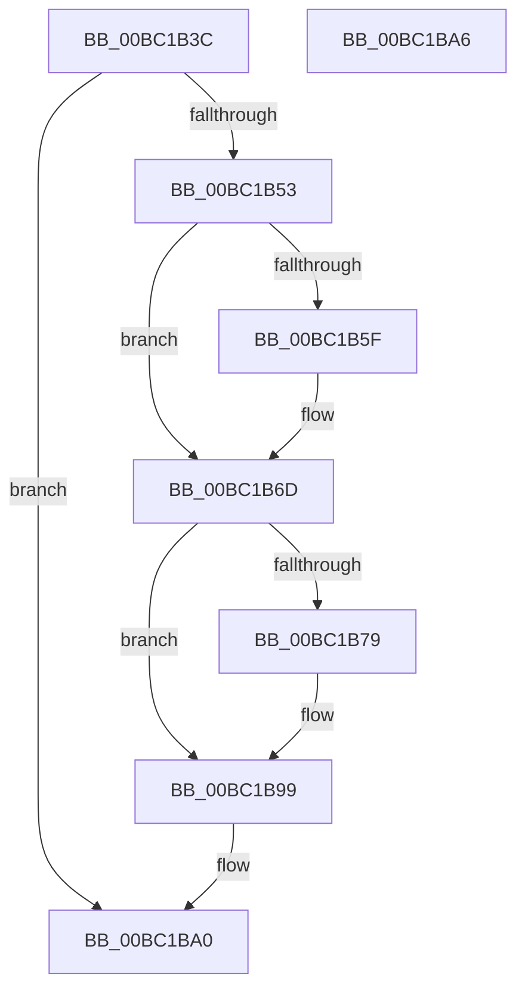

# ResFwpDestroyBackground

- RVA: `0x00BC1B3C`–`0x00BC1BA7` (길이 `107` bytes)
- VA: `0x0000000140BC1B3C`
- 실행 섹션: `PAGEBGFX`
- PDB 이름 있음: `예`; PDB Function 태그: `아니요`
- unwind 정보 RVA: `0x0005CF00`
- 디코드: `28`개 명령, `107/107` bytes 표시
- 미해석 바이트: `0` (있으면 어셈블리에 `.byte`로 보존)

> 이 문서는 커널 이미지의 기계어와 PDB 기호를 분석해 생성했습니다. 4번과 5번은 함수 원형과 자료형을 바이너리 사용 방식에서 추정한 C 해석이며 원본 소스 복구 결과는 아닙니다.

## 1. Dependencies

- 직접 호출 지점: **4**; 고유 호출 대상: **4**
- 직접 호출자로 확인된 함수: **1**
- RIP 상대 이미지 참조: **6**

### Outgoing calls
- `0x00BC1B68` → [BgpFwFreeMemory](../../text/3E/BgpFwFreeMemory_function_003E25E0.md) (function, `0x003E25E0`)
- `0x00BC1B82` → [BgpFwReleaseLock](../../text/4B/BgpFwReleaseLock_function_004B357C.md) (function, `0x004B357C`)
- `0x00BC1B8F` → [ExFreePoolWithTag](../../poolcode/B8/ExFreePoolWithTag_function_00B82870.md) (function, `0x00B82870`)
- `0x00BC1B94` → [BgpFwAcquireLock](../../text/4B/BgpFwAcquireLock_function_004B3AA4.md) (function, `0x004B3AA4`)

### Direct callers
- [ResFwBackgroundTransition](ResFwBackgroundTransition_function_00BC5D28.md) at `0x00BC5D3A`

### Static image references
- `0x00BC1B42` → RVA `0x00EF0450` (`.data`; read)
- `0x00BC1B53` → RVA `0x00EF0498` (`.data`; read)
- `0x00BC1B61` → RVA `0x00EF0498` (`.data`; read/write)
- `0x00BC1B6D` → RVA `0x00EF04A0` (`.data`; read)
- `0x00BC1B7B` → RVA `0x00EF04A0` (`.data`; read/write)
- `0x00BC1B99` → RVA `0x00EF04A8` (`.data`; read/write)

## 2. Other-region calls and transfers

- 다른 실행 섹션으로 향하는 call: **4**
  - `0x00BC1B68` → [BgpFwFreeMemory](../../text/3E/BgpFwFreeMemory_function_003E25E0.md) (`PAGEBGFX` → `.text`)
  - `0x00BC1B82` → [BgpFwReleaseLock](../../text/4B/BgpFwReleaseLock_function_004B357C.md) (`PAGEBGFX` → `.text`)
  - `0x00BC1B8F` → [ExFreePoolWithTag](../../poolcode/B8/ExFreePoolWithTag_function_00B82870.md) (`PAGEBGFX` → `POOLCODE`)
  - `0x00BC1B94` → [BgpFwAcquireLock](../../text/4B/BgpFwAcquireLock_function_004B3AA4.md) (`PAGEBGFX` → `.text`)
- 별도 외부 분기/꼬리 이동을 확인하지 못했습니다.

## 3. Assembly (complete function range)

```asm
00BC1B3C  40 53                           push rbx
00BC1B3E  48 83 EC 20                     sub rsp, 0x20
00BC1B42  8B 05 08 E9 32 00               mov eax, dword ptr [rip + 0x32e908]
00BC1B48  B9 00 0C 00 00                  mov ecx, 0xc00
00BC1B4D  23 C1                           and eax, ecx
00BC1B4F  3B C1                           cmp eax, ecx
00BC1B51  74 4D                           je 0x140bc1ba0
00BC1B53  48 8B 0D 3E E9 32 00            mov rcx, qword ptr [rip + 0x32e93e]
00BC1B5A  48 85 C9                        test rcx, rcx
00BC1B5D  74 0E                           je 0x140bc1b6d
00BC1B5F  33 C0                           xor eax, eax
00BC1B61  48 87 05 30 E9 32 00            xchg qword ptr [rip + 0x32e930], rax
00BC1B68  E8 73 0A 82 FF                  call 0x1403e25e0
00BC1B6D  48 8B 1D 2C E9 32 00            mov rbx, qword ptr [rip + 0x32e92c]
00BC1B74  48 85 DB                        test rbx, rbx
00BC1B77  74 20                           je 0x140bc1b99
00BC1B79  33 C0                           xor eax, eax
00BC1B7B  48 87 05 1E E9 32 00            xchg qword ptr [rip + 0x32e91e], rax
00BC1B82  E8 F5 19 8F FF                  call 0x1404b357c
00BC1B87  BA 42 47 49 4B                  mov edx, 0x4b494742
00BC1B8C  48 8B CB                        mov rcx, rbx
00BC1B8F  E8 DC 0C FC FF                  call 0x140b82870
00BC1B94  E8 0B 1F 8F FF                  call 0x1404b3aa4
00BC1B99  83 25 08 E9 32 00 00            and dword ptr [rip + 0x32e908], 0
00BC1BA0  48 83 C4 20                     add rsp, 0x20
00BC1BA4  5B                              pop rbx
00BC1BA5  C3                              ret
00BC1BA6  CC                              int3
```

## 4. C-style interpretation (structured pseudocode)

```c
__int64 __fastcall ResFwpDestroyBackground(void)
{
    __int64 result;
    __int64 v_rsp;

    v_rsp = (v_rsp) - (32);
    result = (unsigned int)(((unsigned int)(*(unsigned int *)(v_rip + 3336456))) & ((unsigned int)((unsigned int)(0xC00ULL))));
    if (((unsigned int)(result)) == ((unsigned int)((unsigned int)(0xC00ULL)))) goto loc_00BC1BA0;
    if (*(unsigned __int64 *)(v_rip + 3336510) != 0) {
        result = 0;
        result = BgpFwFreeMemory(*(unsigned __int64 *)(v_rip + 3336510), a2, a3, a4);
    }
    if (*(unsigned __int64 *)(v_rip + 3336492) != 0) {
        result = 0;
        result = BgpFwReleaseLock(*(unsigned __int64 *)(v_rip + 3336510), a2, a3, a4);
        a2 = 0x4B494742ULL;
        a1 = *(unsigned __int64 *)(v_rip + 3336492);
        result = ExFreePoolWithTag(a1, a2, a3, a4);
        result = BgpFwAcquireLock(a1, a2, a3, a4);
    }
loc_00BC1BA0:
    v_rsp = (v_rsp) + (32);
    return result;
}
```

## 5. (Beta) C Style

```c
void ResFwpDestroyBackground(void)
{
    int64_t result;
    int64_t local_rsp;

    local_rsp = (local_rsp) - (32);
    result = (uint32_t)(((uint32_t)(*(uint32_t *)(v_rip + 0x32E908))) & ((uint32_t)((uint32_t)(0xC00ULL))));
    if (((uint32_t)(result)) == ((uint32_t)((uint32_t)(0xC00ULL)))) goto loc_00BC1BA0;
    if (*(uint64_t *)(v_rip + 0x32E93E) != 0) {
        result = 0;
        result = BgpFwFreeMemory(*(uint64_t *)(v_rip + 0x32E93E), a2, a3, a4);
    }
    if (*(uint64_t *)(v_rip + 0x32E92C) != 0) {
        result = 0;
        result = BgpFwReleaseLock(*(uint64_t *)(v_rip + 0x32E93E), a2, a3, a4);
        a2 = 0x4B494742ULL;
        a1 = *(uint64_t *)(v_rip + 0x32E92C);
        result = ExFreePoolWithTag(a1, a2, a3, a4);
        result = BgpFwAcquireLock(a1, a2, a3, a4);
    }
loc_00BC1BA0:
    local_rsp = (local_rsp) + (32);
    return result;
}
```

## 6. Execution-region graph

[열기: 2D/3D 그래프와 함수 탐색 컨트롤 패널](../../../control-panel.html?section=pagebgfx&rva=0x00BC1B3C&view=graph)

- 2D 그래프는 위에서 아래로 흐르고, 3D 그래프는 빈 공간을 드래그해 회전합니다. Shift+드래그는 이동, 휠은 확대·축소, 함수 노드 선택은 대상 보고서 이동입니다.

### Static fallback


