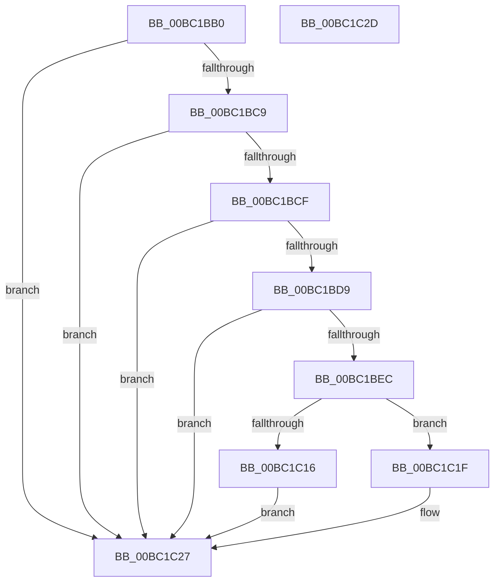

# ResFwpPageInBackground

- RVA: `0x00BC1BB0`–`0x00BC1C2E` (길이 `126` bytes)
- VA: `0x0000000140BC1BB0`
- 실행 섹션: `PAGEBGFX`
- PDB 이름 있음: `예`; PDB Function 태그: `아니요`
- unwind 정보 RVA: `0x0005CF00`
- 디코드: `33`개 명령, `126/126` bytes 표시
- 미해석 바이트: `0` (있으면 어셈블리에 `.byte`로 보존)

> 이 문서는 커널 이미지의 기계어와 PDB 기호를 분석해 생성했습니다. 4번과 5번은 함수 원형과 자료형을 바이너리 사용 방식에서 추정한 C 해석이며 원본 소스 복구 결과는 아닙니다.

## 1. Dependencies

- 직접 호출 지점: **5**; 고유 호출 대상: **5**
- 직접 호출자로 확인된 함수: **1**
- RIP 상대 이미지 참조: **5**

### Outgoing calls
- `0x00BC1BDF` → [BgpFwAllocateMemory](../../text/3E/BgpFwAllocateMemory_function_003E4374.md) (function, `0x003E4374`)
- `0x00BC1BEC` → [BgpFwReleaseLock](../../text/4B/BgpFwReleaseLock_function_004B357C.md) (function, `0x004B357C`)
- `0x00BC1C02` → [memcpy](../../text/6C/memcpy_function_006C6840.md) (function, `0x006C6840`)
- `0x00BC1C07` → [BgpFwAcquireLock](../../text/4B/BgpFwAcquireLock_function_004B3AA4.md) (function, `0x004B3AA4`)
- `0x00BC1C22` → [BgpFwFreeMemory](../../text/3E/BgpFwFreeMemory_function_003E25E0.md) (function, `0x003E25E0`)

### Direct callers
- [ResFwBackgroundTransition](ResFwBackgroundTransition_function_00BC5D28.md) at `0x00BC5D48`

### Static image references
- `0x00BC1BB6` → RVA `0x00EF0450` (`.data`; read)
- `0x00BC1BCF` → RVA `0x00EF04A0` (`.data`; read)
- `0x00BC1BD9` → RVA `0x00EF04A8` (`.data`; read)
- `0x00BC1C0C` → RVA `0x00EF0498` (`.data`; read)
- `0x00BC1C16` → RVA `0x00EF0498` (`.data`; read/write)

## 2. Other-region calls and transfers

- 다른 실행 섹션으로 향하는 call: **5**
  - `0x00BC1BDF` → [BgpFwAllocateMemory](../../text/3E/BgpFwAllocateMemory_function_003E4374.md) (`PAGEBGFX` → `.text`)
  - `0x00BC1BEC` → [BgpFwReleaseLock](../../text/4B/BgpFwReleaseLock_function_004B357C.md) (`PAGEBGFX` → `.text`)
  - `0x00BC1C02` → [memcpy](../../text/6C/memcpy_function_006C6840.md) (`PAGEBGFX` → `.text`)
  - `0x00BC1C07` → [BgpFwAcquireLock](../../text/4B/BgpFwAcquireLock_function_004B3AA4.md) (`PAGEBGFX` → `.text`)
  - `0x00BC1C22` → [BgpFwFreeMemory](../../text/3E/BgpFwFreeMemory_function_003E25E0.md) (`PAGEBGFX` → `.text`)
- 별도 외부 분기/꼬리 이동을 확인하지 못했습니다.

## 3. Assembly (complete function range)

```asm
00BC1BB0  40 53                           push rbx
00BC1BB2  48 83 EC 20                     sub rsp, 0x20
00BC1BB6  8B 0D 94 E8 32 00               mov ecx, dword ptr [rip + 0x32e894]
00BC1BBC  BA 00 0C 00 00                  mov edx, 0xc00
00BC1BC1  8B C1                           mov eax, ecx
00BC1BC3  23 C2                           and eax, edx
00BC1BC5  3B C2                           cmp eax, edx
00BC1BC7  74 5E                           je 0x140bc1c27
00BC1BC9  0F BA E1 14                     bt ecx, 0x14
00BC1BCD  72 58                           jb 0x140bc1c27
00BC1BCF  48 83 3D C9 E8 32 00 00         cmp qword ptr [rip + 0x32e8c9], 0
00BC1BD7  74 4E                           je 0x140bc1c27
00BC1BD9  8B 0D C9 E8 32 00               mov ecx, dword ptr [rip + 0x32e8c9]
00BC1BDF  E8 90 27 82 FF                  call 0x1403e4374
00BC1BE4  48 8B D8                        mov rbx, rax
00BC1BE7  48 85 C0                        test rax, rax
00BC1BEA  74 3B                           je 0x140bc1c27
00BC1BEC  E8 8B 19 8F FF                  call 0x1404b357c
00BC1BF1  44 8B 05 B0 E8 32 00            mov r8d, dword ptr [rip + 0x32e8b0]
00BC1BF8  48 8B CB                        mov rcx, rbx
00BC1BFB  48 8B 15 9E E8 32 00            mov rdx, qword ptr [rip + 0x32e89e]
00BC1C02  E8 39 4C B0 FF                  call 0x1406c6840
00BC1C07  E8 98 1E 8F FF                  call 0x1404b3aa4
00BC1C0C  48 83 3D 84 E8 32 00 00         cmp qword ptr [rip + 0x32e884], 0
00BC1C14  75 09                           jne 0x140bc1c1f
00BC1C16  48 87 1D 7B E8 32 00            xchg qword ptr [rip + 0x32e87b], rbx
00BC1C1D  EB 08                           jmp 0x140bc1c27
00BC1C1F  48 8B CB                        mov rcx, rbx
00BC1C22  E8 B9 09 82 FF                  call 0x1403e25e0
00BC1C27  48 83 C4 20                     add rsp, 0x20
00BC1C2B  5B                              pop rbx
00BC1C2C  C3                              ret
00BC1C2D  CC                              int3
```

## 4. C-style interpretation (structured pseudocode)

```c
__int64 __fastcall ResFwpPageInBackground(void)
{
    __int64 result;
    __int64 v_rsp;

    v_rsp = (v_rsp) - (32);
    result = (unsigned int)(((unsigned int)((unsigned int)((unsigned int)(*(unsigned int *)(v_rip + 3336340))))) & ((unsigned int)((unsigned int)(0xC00ULL))));
    if (((unsigned int)(result)) == ((unsigned int)((unsigned int)(0xC00ULL)))) goto loc_00BC1C27;
    if (((unsigned int)(result)) < ((unsigned int)((unsigned int)(0xC00ULL)))) goto loc_00BC1C27;
    if ((*(unsigned __int64 *)(v_rip + 3336393)) == 0) goto loc_00BC1C27;
    result = BgpFwAllocateMemory((unsigned int)(*(unsigned int *)(v_rip + 3336393)), (unsigned int)(0xC00ULL), a3, a4);
    if (result == 0) goto loc_00BC1C27;
    result = BgpFwReleaseLock((unsigned int)(*(unsigned int *)(v_rip + 3336393)), (unsigned int)(0xC00ULL), a3, a4);
    result = memcpy(result, *(unsigned __int64 *)(v_rip + 3336350), (unsigned int)(*(unsigned int *)(v_rip + 3336368)), a4);
    result = BgpFwAcquireLock(result, *(unsigned __int64 *)(v_rip + 3336350), (unsigned int)(*(unsigned int *)(v_rip + 3336368)), a4);
    if ((*(unsigned __int64 *)(v_rip + 3336324)) != 0) goto loc_00BC1C1F;
    goto loc_00BC1C27;
loc_00BC1C1F:
    result = BgpFwFreeMemory(result, *(unsigned __int64 *)(v_rip + 3336350), (unsigned int)(*(unsigned int *)(v_rip + 3336368)), a4);
loc_00BC1C27:
    v_rsp = (v_rsp) + (32);
    return result;
}
```

## 5. (Beta) C Style

```c
void ResFwpPageInBackground(void)
{
    int64_t result;
    int64_t local_rsp;

    local_rsp = (local_rsp) - (32);
    result = (uint32_t)(((uint32_t)((uint32_t)((uint32_t)(*(uint32_t *)(v_rip + 0x32E894))))) & ((uint32_t)((uint32_t)(0xC00ULL))));
    if (((uint32_t)(result)) == ((uint32_t)((uint32_t)(0xC00ULL)))) goto loc_00BC1C27;
    if (((uint32_t)(result)) < ((uint32_t)((uint32_t)(0xC00ULL)))) goto loc_00BC1C27;
    if ((*(uint64_t *)(v_rip + 0x32E8C9)) == 0) goto loc_00BC1C27;
    result = BgpFwAllocateMemory((uint32_t)(*(uint32_t *)(v_rip + 0x32E8C9)), (uint32_t)(0xC00ULL), a3, a4);
    if (result == 0) goto loc_00BC1C27;
    result = BgpFwReleaseLock((uint32_t)(*(uint32_t *)(v_rip + 0x32E8C9)), (uint32_t)(0xC00ULL), a3, a4);
    result = memcpy(result, *(uint64_t *)(v_rip + 0x32E89E), (uint32_t)(*(uint32_t *)(v_rip + 0x32E8B0)), a4);
    result = BgpFwAcquireLock(result, *(uint64_t *)(v_rip + 0x32E89E), (uint32_t)(*(uint32_t *)(v_rip + 0x32E8B0)), a4);
    if ((*(uint64_t *)(v_rip + 0x32E884)) != 0) goto loc_00BC1C1F;
    goto loc_00BC1C27;
loc_00BC1C1F:
    result = BgpFwFreeMemory(result, *(uint64_t *)(v_rip + 0x32E89E), (uint32_t)(*(uint32_t *)(v_rip + 0x32E8B0)), a4);
loc_00BC1C27:
    local_rsp = (local_rsp) + (32);
    return result;
}
```

## 6. Execution-region graph

[열기: 2D/3D 그래프와 함수 탐색 컨트롤 패널](../../../control-panel.html?section=pagebgfx&rva=0x00BC1BB0&view=graph)

- 2D 그래프는 위에서 아래로 흐르고, 3D 그래프는 빈 공간을 드래그해 회전합니다. Shift+드래그는 이동, 휠은 확대·축소, 함수 노드 선택은 대상 보고서 이동입니다.

### Static fallback


