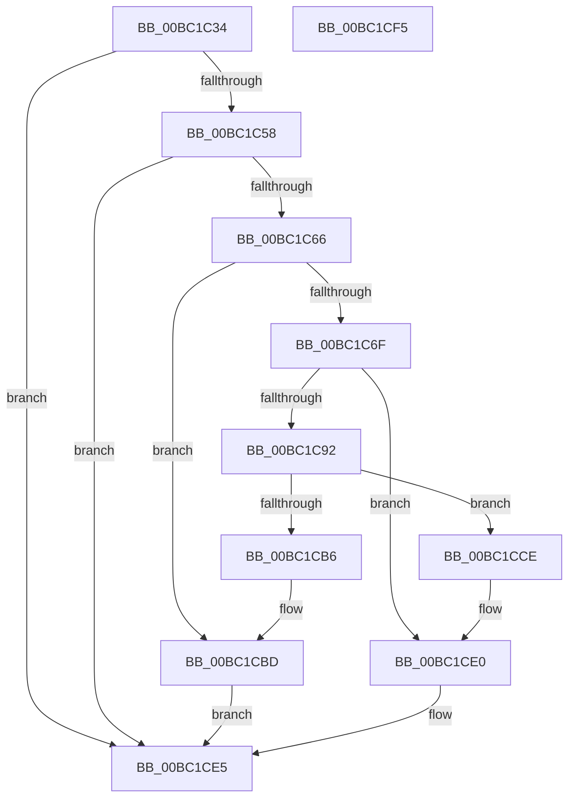

# ResFwpPageOutBackground

- RVA: `0x00BC1C34`–`0x00BC1CF6` (길이 `194` bytes)
- VA: `0x0000000140BC1C34`
- 실행 섹션: `PAGEBGFX`
- PDB 이름 있음: `예`; PDB Function 태그: `아니요`
- unwind 정보 RVA: `0x00060BC4`
- 디코드: `46`개 명령, `194/194` bytes 표시
- 미해석 바이트: `0` (있으면 어셈블리에 `.byte`로 보존)

> 이 문서는 커널 이미지의 기계어와 PDB 기호를 분석해 생성했습니다. 4번과 5번은 함수 원형과 자료형을 바이너리 사용 방식에서 추정한 C 해석이며 원본 소스 복구 결과는 아닙니다.

## 1. Dependencies

- 직접 호출 지점: **8**; 고유 호출 대상: **6**
- 직접 호출자로 확인된 함수: **2**
- RIP 상대 이미지 참조: **6**

### Outgoing calls
- `0x00BC1C6F` → [BgpFwReleaseLock](../../text/4B/BgpFwReleaseLock_function_004B357C.md) (function, `0x004B357C`)
- `0x00BC1C85` → [ExAllocatePool2](../../poolcode/B8/ExAllocatePool2_function_00B820F0.md) (function, `0x00B820F0`)
- `0x00BC1CA3` → [memcpy](../../text/6C/memcpy_function_006C6840.md) (function, `0x006C6840`)
- `0x00BC1CA8` → [BgpFwAcquireLock](../../text/4B/BgpFwAcquireLock_function_004B3AA4.md) (function, `0x004B3AA4`)
- `0x00BC1CC7` → [BgpFwFreeMemory](../../text/3E/BgpFwFreeMemory_function_003E25E0.md) (function, `0x003E25E0`)
- `0x00BC1CCE` → [BgpFwReleaseLock](../../text/4B/BgpFwReleaseLock_function_004B357C.md) (function, `0x004B357C`)
- `0x00BC1CDB` → [ExFreePoolWithTag](../../poolcode/B8/ExFreePoolWithTag_function_00B82870.md) (function, `0x00B82870`)
- `0x00BC1CE0` → [BgpFwAcquireLock](../../text/4B/BgpFwAcquireLock_function_004B3AA4.md) (function, `0x004B3AA4`)

### Direct callers
- [ResFwFreeContext](ResFwFreeContext_function_00BC34C4.md) at `0x00BC357A`
- [ResFwBackgroundTransition](ResFwBackgroundTransition_function_00BC5D28.md) at `0x00BC5D41`

### Static image references
- `0x00BC1C43` → RVA `0x00EF0450` (`.data`; read)
- `0x00BC1C58` → RVA `0x00EF0498` (`.data`; read)
- `0x00BC1C66` → RVA `0x00EF04A0` (`.data`; read)
- `0x00BC1C74` → RVA `0x00EF04A8` (`.data`; read)
- `0x00BC1CB6` → RVA `0x00EF04A0` (`.data`; read/write)
- `0x00BC1CBD` → RVA `0x00EF0498` (`.data`; read/write)

## 2. Other-region calls and transfers

- 다른 실행 섹션으로 향하는 call: **8**
  - `0x00BC1C6F` → [BgpFwReleaseLock](../../text/4B/BgpFwReleaseLock_function_004B357C.md) (`PAGEBGFX` → `.text`)
  - `0x00BC1C85` → [ExAllocatePool2](../../poolcode/B8/ExAllocatePool2_function_00B820F0.md) (`PAGEBGFX` → `POOLCODE`)
  - `0x00BC1CA3` → [memcpy](../../text/6C/memcpy_function_006C6840.md) (`PAGEBGFX` → `.text`)
  - `0x00BC1CA8` → [BgpFwAcquireLock](../../text/4B/BgpFwAcquireLock_function_004B3AA4.md) (`PAGEBGFX` → `.text`)
  - `0x00BC1CC7` → [BgpFwFreeMemory](../../text/3E/BgpFwFreeMemory_function_003E25E0.md) (`PAGEBGFX` → `.text`)
  - `0x00BC1CCE` → [BgpFwReleaseLock](../../text/4B/BgpFwReleaseLock_function_004B357C.md) (`PAGEBGFX` → `.text`)
  - `0x00BC1CDB` → [ExFreePoolWithTag](../../poolcode/B8/ExFreePoolWithTag_function_00B82870.md) (`PAGEBGFX` → `POOLCODE`)
  - `0x00BC1CE0` → [BgpFwAcquireLock](../../text/4B/BgpFwAcquireLock_function_004B3AA4.md) (`PAGEBGFX` → `.text`)
- 별도 외부 분기/꼬리 이동을 확인하지 못했습니다.

## 3. Assembly (complete function range)

```asm
00BC1C34  48 89 5C 24 08                  mov qword ptr [rsp + 8], rbx
00BC1C39  48 89 74 24 10                  mov qword ptr [rsp + 0x10], rsi
00BC1C3E  57                              push rdi
00BC1C3F  48 83 EC 20                     sub rsp, 0x20
00BC1C43  8B 05 07 E8 32 00               mov eax, dword ptr [rip + 0x32e807]
00BC1C49  B9 00 0C 00 00                  mov ecx, 0xc00
00BC1C4E  23 C1                           and eax, ecx
00BC1C50  3B C1                           cmp eax, ecx
00BC1C52  0F 84 8D 00 00 00               je 0x140bc1ce5
00BC1C58  48 8B 35 39 E8 32 00            mov rsi, qword ptr [rip + 0x32e839]
00BC1C5F  33 DB                           xor ebx, ebx
00BC1C61  48 85 F6                        test rsi, rsi
00BC1C64  74 7F                           je 0x140bc1ce5
00BC1C66  48 39 1D 33 E8 32 00            cmp qword ptr [rip + 0x32e833], rbx
00BC1C6D  75 4E                           jne 0x140bc1cbd
00BC1C6F  E8 08 19 8F FF                  call 0x1404b357c
00BC1C74  8B 15 2E E8 32 00               mov edx, dword ptr [rip + 0x32e82e]
00BC1C7A  B9 00 01 00 00                  mov ecx, 0x100
00BC1C7F  41 B8 42 47 49 4B               mov r8d, 0x4b494742
00BC1C85  E8 66 04 FC FF                  call 0x140b820f0
00BC1C8A  48 8B F8                        mov rdi, rax
00BC1C8D  48 85 C0                        test rax, rax
00BC1C90  74 4E                           je 0x140bc1ce0
00BC1C92  44 8B 05 0F E8 32 00            mov r8d, dword ptr [rip + 0x32e80f]
00BC1C99  48 8B C8                        mov rcx, rax
00BC1C9C  48 8B 15 F5 E7 32 00            mov rdx, qword ptr [rip + 0x32e7f5]
00BC1CA3  E8 98 4B B0 FF                  call 0x1406c6840
00BC1CA8  E8 F7 1D 8F FF                  call 0x1404b3aa4
00BC1CAD  48 39 1D EC E7 32 00            cmp qword ptr [rip + 0x32e7ec], rbx
00BC1CB4  75 18                           jne 0x140bc1cce
00BC1CB6  48 87 3D E3 E7 32 00            xchg qword ptr [rip + 0x32e7e3], rdi
00BC1CBD  48 87 1D D4 E7 32 00            xchg qword ptr [rip + 0x32e7d4], rbx
00BC1CC4  48 8B CE                        mov rcx, rsi
00BC1CC7  E8 14 09 82 FF                  call 0x1403e25e0
00BC1CCC  EB 17                           jmp 0x140bc1ce5
00BC1CCE  E8 A9 18 8F FF                  call 0x1404b357c
00BC1CD3  BA 42 47 49 4B                  mov edx, 0x4b494742
00BC1CD8  48 8B CF                        mov rcx, rdi
00BC1CDB  E8 90 0B FC FF                  call 0x140b82870
00BC1CE0  E8 BF 1D 8F FF                  call 0x1404b3aa4
00BC1CE5  48 8B 5C 24 30                  mov rbx, qword ptr [rsp + 0x30]
00BC1CEA  48 8B 74 24 38                  mov rsi, qword ptr [rsp + 0x38]
00BC1CEF  48 83 C4 20                     add rsp, 0x20
00BC1CF3  5F                              pop rdi
00BC1CF4  C3                              ret
00BC1CF5  CC                              int3
```

## 4. C-style interpretation (structured pseudocode)

```c
__int64 __fastcall ResFwpPageOutBackground(void)
{
    __int64 result;
    __int64 v_rbx;
    __int64 v_rsp;
    unsigned __int64 v_stack_p10;
    unsigned __int64 v_stack_p8;

    v_stack_p8 = v_rbx;
    v_stack_p10 = v_rsi;
    v_rsp = (v_rsp) - (32);
    result = (unsigned int)(((unsigned int)(*(unsigned int *)(v_rip + 3336199))) & ((unsigned int)((unsigned int)(0xC00ULL))));
    if (((unsigned int)(result)) == ((unsigned int)((unsigned int)(0xC00ULL)))) goto loc_00BC1CE5;
    v_rbx = 0;
    if (*(unsigned __int64 *)(v_rip + 3336249) == 0) goto loc_00BC1CE5;
    if ((*(unsigned __int64 *)(v_rip + 3336243)) != 0) goto loc_00BC1CBD;
    result = BgpFwReleaseLock((unsigned int)(0xC00ULL), a2, a3, a4);
    result = ExAllocatePool2(256, (unsigned int)(*(unsigned int *)(v_rip + 3336238)), (unsigned int)(0x4B494742ULL), a4);
    if (result == 0) goto loc_00BC1CE0;
    result = memcpy(result, *(unsigned __int64 *)(v_rip + 3336181), (unsigned int)(*(unsigned int *)(v_rip + 3336207)), a4);
    result = BgpFwAcquireLock(result, *(unsigned __int64 *)(v_rip + 3336181), (unsigned int)(*(unsigned int *)(v_rip + 3336207)), a4);
    if ((*(unsigned __int64 *)(v_rip + 3336172)) != 0) goto loc_00BC1CCE;
loc_00BC1CBD:
    result = BgpFwFreeMemory(*(unsigned __int64 *)(v_rip + 3336249), *(unsigned __int64 *)(v_rip + 3336181), (unsigned int)(*(unsigned int *)(v_rip + 3336207)), a4);
    goto loc_00BC1CE5;
loc_00BC1CCE:
    result = BgpFwReleaseLock(*(unsigned __int64 *)(v_rip + 3336249), *(unsigned __int64 *)(v_rip + 3336181), (unsigned int)(*(unsigned int *)(v_rip + 3336207)), a4);
    result = ExFreePoolWithTag(result, (unsigned int)(0x4B494742ULL), (unsigned int)(*(unsigned int *)(v_rip + 3336207)), a4);
loc_00BC1CE0:
    result = BgpFwAcquireLock(result, (unsigned int)(0x4B494742ULL), (unsigned int)(*(unsigned int *)(v_rip + 3336207)), a4);
loc_00BC1CE5:
    v_rsp = (v_rsp) + (32);
    return result;
}
```

## 5. (Beta) C Style

```c
void ResFwpPageOutBackground(void)
{
    int64_t result;
    int64_t local_rbx;
    int64_t local_rsp;
    uint64_t v_stack_p10;
    uint64_t v_stack_p8;

    v_stack_p8 = local_rbx;
    v_stack_p10 = local_rsi;
    local_rsp = (local_rsp) - (32);
    result = (uint32_t)(((uint32_t)(*(uint32_t *)(v_rip + 0x32E807))) & ((uint32_t)((uint32_t)(0xC00ULL))));
    if (((uint32_t)(result)) == ((uint32_t)((uint32_t)(0xC00ULL)))) goto loc_00BC1CE5;
    local_rbx = 0;
    if (*(uint64_t *)(v_rip + 0x32E839) == 0) goto loc_00BC1CE5;
    if ((*(uint64_t *)(v_rip + 0x32E833)) != 0) goto loc_00BC1CBD;
    result = BgpFwReleaseLock((uint32_t)(0xC00ULL), a2, a3, a4);
    result = ExAllocatePool2(256, (uint32_t)(*(uint32_t *)(v_rip + 0x32E82E)), (uint32_t)(0x4B494742ULL), a4);
    if (result == 0) goto loc_00BC1CE0;
    result = memcpy(result, *(uint64_t *)(v_rip + 0x32E7F5), (uint32_t)(*(uint32_t *)(v_rip + 0x32E80F)), a4);
    result = BgpFwAcquireLock(result, *(uint64_t *)(v_rip + 0x32E7F5), (uint32_t)(*(uint32_t *)(v_rip + 0x32E80F)), a4);
    if ((*(uint64_t *)(v_rip + 0x32E7EC)) != 0) goto loc_00BC1CCE;
loc_00BC1CBD:
    result = BgpFwFreeMemory(*(uint64_t *)(v_rip + 0x32E839), *(uint64_t *)(v_rip + 0x32E7F5), (uint32_t)(*(uint32_t *)(v_rip + 0x32E80F)), a4);
    goto loc_00BC1CE5;
loc_00BC1CCE:
    result = BgpFwReleaseLock(*(uint64_t *)(v_rip + 0x32E839), *(uint64_t *)(v_rip + 0x32E7F5), (uint32_t)(*(uint32_t *)(v_rip + 0x32E80F)), a4);
    result = ExFreePoolWithTag(result, (uint32_t)(0x4B494742ULL), (uint32_t)(*(uint32_t *)(v_rip + 0x32E80F)), a4);
loc_00BC1CE0:
    result = BgpFwAcquireLock(result, (uint32_t)(0x4B494742ULL), (uint32_t)(*(uint32_t *)(v_rip + 0x32E80F)), a4);
loc_00BC1CE5:
    local_rsp = (local_rsp) + (32);
    return result;
}
```

## 6. Execution-region graph

[열기: 2D/3D 그래프와 함수 탐색 컨트롤 패널](../../../control-panel.html?section=pagebgfx&rva=0x00BC1C34&view=graph)

- 2D 그래프는 위에서 아래로 흐르고, 3D 그래프는 빈 공간을 드래그해 회전합니다. Shift+드래그는 이동, 휠은 확대·축소, 함수 노드 선택은 대상 보고서 이동입니다.

### Static fallback


