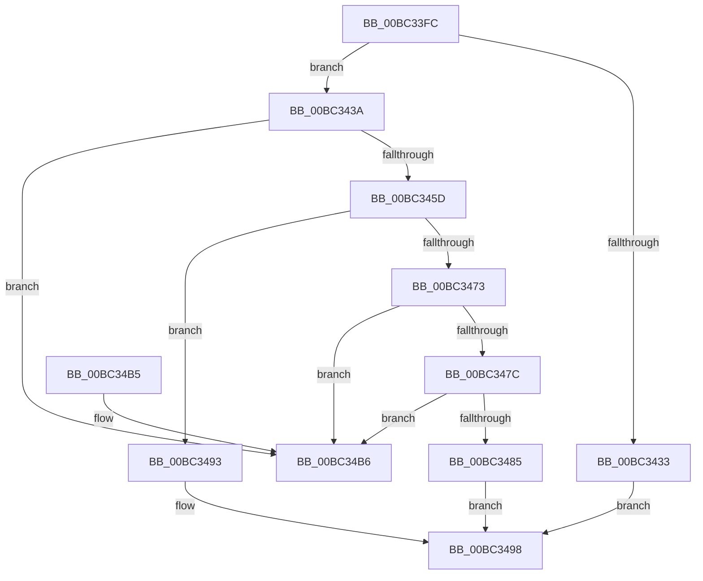

# TxtpAddCacheEntry

- RVA: `0x00BC33FC`–`0x00BC34BD` (길이 `193` bytes)
- VA: `0x0000000140BC33FC`
- 실행 섹션: `PAGEBGFX`
- PDB 이름 있음: `예`; PDB Function 태그: `아니요`
- unwind 정보 RVA: `0x0006B020`
- 디코드: `57`개 명령, `193/193` bytes 표시
- 미해석 바이트: `0` (있으면 어셈블리에 `.byte`로 보존)

> 이 문서는 커널 이미지의 기계어와 PDB 기호를 분석해 생성했습니다. 4번과 5번은 함수 원형과 자료형을 바이너리 사용 방식에서 추정한 C 해석이며 원본 소스 복구 결과는 아닙니다.

## 1. Dependencies

- 직접 호출 지점: **2**; 고유 호출 대상: **2**
- 직접 호출자로 확인된 함수: **1**
- RIP 상대 이미지 참조: **0**

### Outgoing calls
- `0x00BC3427` → [BgpFwAllocateMemory](../../text/3E/BgpFwAllocateMemory_function_003E4374.md) (function, `0x003E4374`)
- `0x00BC348C` → [TxtpDestroyCacheEntry](TxtpDestroyCacheEntry_function_00BC43D4.md) (function, `0x00BC43D4`)

### Direct callers
- [BgpTxtDisplayCharacter](../../text/47/BgpTxtDisplayCharacter_function_0047F120.md) at `0x0047F33C`

### Static image references
- 디코드된 RIP-relative 메모리 참조가 없습니다.

## 2. Other-region calls and transfers

- 다른 실행 섹션으로 향하는 call: **1**
  - `0x00BC3427` → [BgpFwAllocateMemory](../../text/3E/BgpFwAllocateMemory_function_003E4374.md) (`PAGEBGFX` → `.text`)
- 별도 외부 분기/꼬리 이동을 확인하지 못했습니다.

## 3. Assembly (complete function range)

```asm
00BC33FC  48 8B C4                        mov rax, rsp
00BC33FF  48 89 58 08                     mov qword ptr [rax + 8], rbx
00BC3403  48 89 68 10                     mov qword ptr [rax + 0x10], rbp
00BC3407  48 89 70 18                     mov qword ptr [rax + 0x18], rsi
00BC340B  48 89 78 20                     mov qword ptr [rax + 0x20], rdi
00BC340F  41 56                           push r14
00BC3411  48 83 EC 20                     sub rsp, 0x20
00BC3415  48 8B D9                        mov rbx, rcx
00BC3418  49 8B E9                        mov rbp, r9
00BC341B  B9 38 00 00 00                  mov ecx, 0x38
00BC3420  49 8B F0                        mov rsi, r8
00BC3423  44 0F B7 F2                     movzx r14d, dx
00BC3427  E8 48 0F 82 FF                  call 0x1403e4374
00BC342C  33 FF                           xor edi, edi
00BC342E  48 85 C0                        test rax, rax
00BC3431  75 07                           jne 0x140bc343a
00BC3433  BF 17 00 00 C0                  mov edi, 0xc0000017
00BC3438  EB 5E                           jmp 0x140bc3498
00BC343A  66 44 89 70 10                  mov word ptr [rax + 0x10], r14w
00BC343F  0F 10 06                        movups xmm0, xmmword ptr [rsi]
00BC3442  0F 11 40 18                     movups xmmword ptr [rax + 0x18], xmm0
00BC3446  F2 0F 10 4E 10                  movsd xmm1, qword ptr [rsi + 0x10]
00BC344B  F2 0F 11 48 28                  movsd qword ptr [rax + 0x28], xmm1
00BC3450  48 89 68 30                     mov qword ptr [rax + 0x30], rbp
00BC3454  48 8B 0B                        mov rcx, qword ptr [rbx]
00BC3457  48 39 59 08                     cmp qword ptr [rcx + 8], rbx
00BC345B  75 59                           jne 0x140bc34b6
00BC345D  48 89 08                        mov qword ptr [rax], rcx
00BC3460  48 89 58 08                     mov qword ptr [rax + 8], rbx
00BC3464  48 89 41 08                     mov qword ptr [rcx + 8], rax
00BC3468  48 89 03                        mov qword ptr [rbx], rax
00BC346B  8B 4B 10                        mov ecx, dword ptr [rbx + 0x10]
00BC346E  83 F9 7D                        cmp ecx, 0x7d
00BC3471  75 20                           jne 0x140bc3493
00BC3473  48 8B 4B 08                     mov rcx, qword ptr [rbx + 8]
00BC3477  48 39 19                        cmp qword ptr [rcx], rbx
00BC347A  75 3A                           jne 0x140bc34b6
00BC347C  48 8B 41 08                     mov rax, qword ptr [rcx + 8]
00BC3480  48 39 08                        cmp qword ptr [rax], rcx
00BC3483  75 31                           jne 0x140bc34b6
00BC3485  48 89 43 08                     mov qword ptr [rbx + 8], rax
00BC3489  48 89 18                        mov qword ptr [rax], rbx
00BC348C  E8 43 0F 00 00                  call 0x140bc43d4
00BC3491  EB 05                           jmp 0x140bc3498
00BC3493  FF C1                           inc ecx
00BC3495  89 4B 10                        mov dword ptr [rbx + 0x10], ecx
00BC3498  48 8B 5C 24 30                  mov rbx, qword ptr [rsp + 0x30]
00BC349D  8B C7                           mov eax, edi
00BC349F  48 8B 7C 24 48                  mov rdi, qword ptr [rsp + 0x48]
00BC34A4  48 8B 6C 24 38                  mov rbp, qword ptr [rsp + 0x38]
00BC34A9  48 8B 74 24 40                  mov rsi, qword ptr [rsp + 0x40]
00BC34AE  48 83 C4 20                     add rsp, 0x20
00BC34B2  41 5E                           pop r14
00BC34B4  C3                              ret
00BC34B5  CC                              int3
00BC34B6  B9 03 00 00 00                  mov ecx, 3
00BC34BB  CD 29                           int 0x29
```

## 4. C-style interpretation (structured pseudocode)

```c
__int64 __fastcall TxtpAddCacheEntry(__int64 a1, unsigned __int16 a2, __int64 a3, __int64 a4)
{
    __int64 result;
    __int64 v_rdi;
    __int64 v_rsp;
    unsigned __int64 v_stack_p10;
    unsigned __int64 v_stack_p18;
    unsigned __int64 v_stack_p20;
    unsigned __int64 v_stack_p8;

    *(unsigned __int64 *)(v_rsp + 8) = v_rbx;
    *(unsigned __int64 *)(v_rsp + 16) = v_rbp;
    *(unsigned __int64 *)(v_rsp + 24) = v_rsi;
    *(unsigned __int64 *)(v_rsp + 32) = v_rdi;
    v_rsp = (v_rsp) - (32);
    result = BgpFwAllocateMemory(56, a2, a3, a4);
    v_rdi = 0;
    if (result != 0) goto loc_00BC343A;
    goto loc_00BC3498;
loc_00BC343A:
    *(unsigned __int16 *)(result + 16) = a2;
    *(unsigned __int64 *)(result + 24) = v_xmm0;
    *(unsigned __int64 *)(result + 40) = v_xmm1;
    *(unsigned __int64 *)(result + 48) = a4;
    if ((*(unsigned __int64 *)(*(unsigned __int64 *)(a1) + 8)) != a1) goto loc_00BC34B6;
    *(unsigned __int64 *)(result) = *(unsigned __int64 *)(a1);
    *(unsigned __int64 *)(result + 8) = a1;
    *(unsigned __int64 *)(*(unsigned __int64 *)(a1) + 8) = result;
    *(unsigned __int64 *)(a1) = result;
    if (((unsigned int)((unsigned int)(*(unsigned int *)(a1 + 16)))) != 125) goto loc_00BC3493;
    if ((*(unsigned __int64 *)(*(unsigned __int64 *)(a1 + 8))) != a1) goto loc_00BC34B6;
    if ((*(unsigned __int64 *)(*(unsigned __int64 *)(*(unsigned __int64 *)(a1 + 8) + 8))) != (*(unsigned __int64 *)(a1 + 8))) goto loc_00BC34B6;
    *(unsigned __int64 *)(a1 + 8) = *(unsigned __int64 *)(*(unsigned __int64 *)(a1 + 8) + 8);
    *(unsigned __int64 *)(*(unsigned __int64 *)(*(unsigned __int64 *)(a1 + 8) + 8)) = a1;
    result = TxtpDestroyCacheEntry(*(unsigned __int64 *)(a1 + 8), a2, a3, a4);
    goto loc_00BC3498;
loc_00BC3493:
    a1 = (unsigned int)((*(unsigned __int64 *)(a1 + 8)) + 1);
    *(unsigned int *)(a1 + 16) = (unsigned int)(a1);
loc_00BC3498:
    v_rsp = (v_rsp) + (32);
    return (unsigned int)((unsigned int)((unsigned int)(0xC0000017ULL)));
loc_00BC34B6:
    return (unsigned int)((unsigned int)((unsigned int)(0xC0000017ULL)));
}
```

## 5. (Beta) C Style

```c
int64_t TxtpAddCacheEntry(void *Arg1, uint16_t Arg2, void *Arg3, int64_t Arg4)
{
    uint8_t *arg1 = (uint8_t *)Arg1;
    uint8_t *arg3 = (uint8_t *)Arg3;

    int64_t result;
    int64_t local_rdi;
    int64_t local_rsp;
    uint64_t v_stack_p10;
    uint64_t v_stack_p18;
    uint64_t v_stack_p20;
    uint64_t v_stack_p8;

    *(uint64_t *)(local_rsp + 0x8) = local_rbx;
    *(uint64_t *)(local_rsp + 0x10) = local_rbp;
    *(uint64_t *)(local_rsp + 0x18) = local_rsi;
    *(uint64_t *)(local_rsp + 0x20) = local_rdi;
    local_rsp = (local_rsp) - (32);
    result = BgpFwAllocateMemory(56, Arg2, Arg3, Arg4);
    local_rdi = 0;
    if (result != 0) goto loc_00BC343A;
    goto loc_00BC3498;
loc_00BC343A:
    *(uint16_t *)(result + 0x10) = Arg2;
    *(uint64_t *)(result + 0x18) = v_xmm0;
    *(uint64_t *)(result + 0x28) = v_xmm1;
    *(uint64_t *)(result + 0x30) = Arg4;
    if ((*(uint64_t *)(*(uint64_t *)(arg1) + 0x8)) != Arg1) goto loc_00BC34B6;
    *(uint64_t *)(result) = *(uint64_t *)(arg1);
    *(void **)(result + 0x8) = Arg1;
    *(uint64_t *)(*(uint64_t *)(arg1) + 0x8) = result;
    *(uint64_t *)(arg1) = result;
    if (((uint32_t)((uint32_t)(*(uint32_t *)(arg1 + 0x10)))) != 125) goto loc_00BC3493;
    if ((*(uint64_t *)(*(uint64_t *)(arg1 + 0x8))) != Arg1) goto loc_00BC34B6;
    if ((*(uint64_t *)(*(uint64_t *)(*(uint64_t *)(arg1 + 0x8) + 0x8))) != (*(uint64_t *)(arg1 + 0x8))) goto loc_00BC34B6;
    *(uint64_t *)(arg1 + 0x8) = *(uint64_t *)(*(uint64_t *)(arg1 + 0x8) + 0x8);
    *(void **)(*(uint64_t *)(*(uint64_t *)(arg1 + 0x8) + 0x8)) = Arg1;
    result = TxtpDestroyCacheEntry(*(uint64_t *)(arg1 + 0x8), Arg2, Arg3, Arg4);
    goto loc_00BC3498;
loc_00BC3493:
    Arg1 = (uint32_t)((*(uint64_t *)(arg1 + 0x8)) + 1);
    *(uint32_t *)(arg1 + 0x10) = (uint32_t)(Arg1);
loc_00BC3498:
    local_rsp = (local_rsp) + (32);
    return (uint32_t)((uint32_t)((uint32_t)(0xC0000017ULL)));
loc_00BC34B6:
    return (uint32_t)((uint32_t)((uint32_t)(0xC0000017ULL)));
}
```

### 관측된 메모리 오프셋

구조체 형식이 확인되지 않은 접근은 인자 기준의 오프셋으로만 기록했습니다.

| 기준 인자 | 오프셋 표현 | 폭 (bit) | 접근 |
|---|---:|---:|---|
| `Arg1` | `+ 0x0` | `64` | `R` |
| `Arg1` | `+ 0x0` | `64` | `W` |
| `Arg1` | `+ 0x8` | `64` | `R` |
| `Arg1` | `+ 0x8` | `64` | `W` |
| `Arg1` | `+ 0x10` | `32` | `R` |
| `Arg1` | `+ 0x10` | `32` | `W` |
| `Arg3` | `+ 0x0` | `128` | `R` |
| `Arg3` | `+ 0x10` | `64` | `R` |

## 6. Execution-region graph

[열기: 2D/3D 그래프와 함수 탐색 컨트롤 패널](../../../control-panel.html?section=pagebgfx&rva=0x00BC33FC&view=graph)

- 2D 그래프는 위에서 아래로 흐르고, 3D 그래프는 빈 공간을 드래그해 회전합니다. Shift+드래그는 이동, 휠은 확대·축소, 함수 노드 선택은 대상 보고서 이동입니다.

### Static fallback


