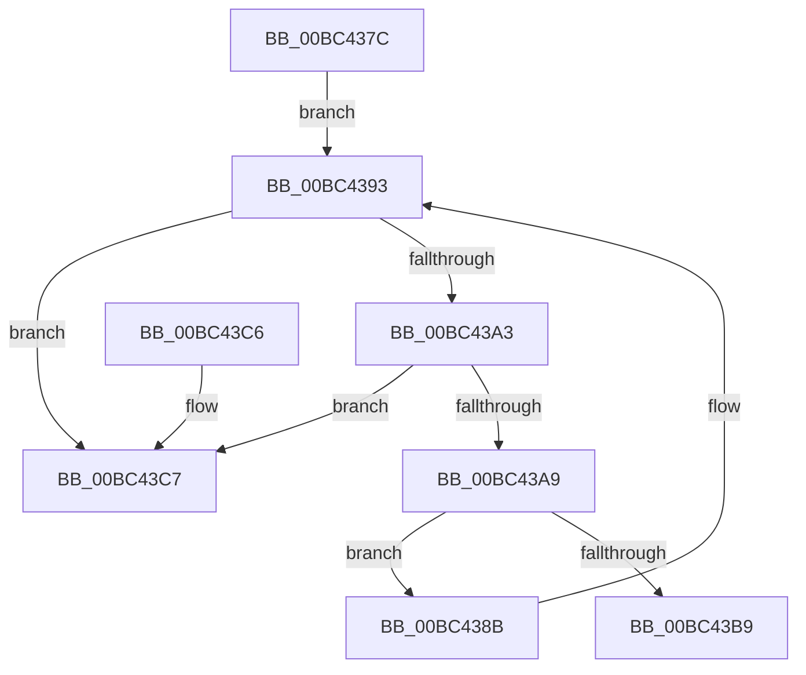

# TxtpClearCache

- RVA: `0x00BC437C`–`0x00BC43CE` (길이 `82` bytes)
- VA: `0x0000000140BC437C`
- 실행 섹션: `PAGEBGFX`
- PDB 이름 있음: `예`; PDB Function 태그: `아니요`
- unwind 정보 RVA: `0x0005DAC8`
- 디코드: `23`개 명령, `82/82` bytes 표시
- 미해석 바이트: `0` (있으면 어셈블리에 `.byte`로 보존)

> 이 문서는 커널 이미지의 기계어와 PDB 기호를 분석해 생성했습니다. 4번과 5번은 함수 원형과 자료형을 바이너리 사용 방식에서 추정한 C 해석이며 원본 소스 복구 결과는 아닙니다.

## 1. Dependencies

- 직접 호출 지점: **1**; 고유 호출 대상: **1**
- 직접 호출자로 확인된 함수: **1**
- RIP 상대 이미지 참조: **3**

### Outgoing calls
- `0x00BC438E` → [TxtpDestroyCacheEntry](TxtpDestroyCacheEntry_function_00BC43D4.md) (function, `0x00BC43D4`)

### Direct callers
- [BgpTxtCacheDestroy](BgpTxtCacheDestroy_function_00BC4354.md) at `0x00BC4358`

### Static image references
- `0x00BC4382` → RVA `0x00E0A2A0` (`.data`; read)
- `0x00BC43A9` → RVA `0x00E0A2A0` (`.data`; write)
- `0x00BC43B9` → RVA `0x00E0A2B0` (`.data`; read/write)

## 2. Other-region calls and transfers

- 다른 실행 섹션으로 향하는 call: **0**
- 별도 외부 분기/꼬리 이동을 확인하지 못했습니다.

## 3. Assembly (complete function range)

```asm
00BC437C  40 53                           push rbx
00BC437E  48 83 EC 20                     sub rsp, 0x20
00BC4382  48 8D 1D 17 5F 24 00            lea rbx, [rip + 0x245f17]
00BC4389  EB 08                           jmp 0x140bc4393
00BC438B  48 8B C8                        mov rcx, rax
00BC438E  E8 41 00 00 00                  call 0x140bc43d4
00BC4393  48 8B 05 06 5F 24 00            mov rax, qword ptr [rip + 0x245f06]
00BC439A  48 8B 08                        mov rcx, qword ptr [rax]
00BC439D  48 39 58 08                     cmp qword ptr [rax + 8], rbx
00BC43A1  75 24                           jne 0x140bc43c7
00BC43A3  48 39 41 08                     cmp qword ptr [rcx + 8], rax
00BC43A7  75 1E                           jne 0x140bc43c7
00BC43A9  48 89 0D F0 5E 24 00            mov qword ptr [rip + 0x245ef0], rcx
00BC43B0  48 89 59 08                     mov qword ptr [rcx + 8], rbx
00BC43B4  48 3B C3                        cmp rax, rbx
00BC43B7  75 D2                           jne 0x140bc438b
00BC43B9  83 25 F0 5E 24 00 00            and dword ptr [rip + 0x245ef0], 0
00BC43C0  48 83 C4 20                     add rsp, 0x20
00BC43C4  5B                              pop rbx
00BC43C5  C3                              ret
00BC43C6  CC                              int3
00BC43C7  B9 03 00 00 00                  mov ecx, 3
00BC43CC  CD 29                           int 0x29
```

## 4. C-style interpretation (structured pseudocode)

```c
__int64 __fastcall TxtpClearCache(void)
{
    __int64 result;
    __int64 v_rsp;

    v_rsp = (v_rsp) - (32);
    goto loc_00BC4393;
loc_00BC438B:
    result = TxtpDestroyCacheEntry(result, a2, a3, a4);
loc_00BC4393:
    if ((*(unsigned __int64 *)(*(unsigned __int64 *)(v_rip + 2383622) + 8)) != (v_rip + 2383639)) goto loc_00BC43C7;
    if ((*(unsigned __int64 *)(*(unsigned __int64 *)(*(unsigned __int64 *)(v_rip + 2383622)) + 8)) != (*(unsigned __int64 *)(v_rip + 2383622))) goto loc_00BC43C7;
    *(unsigned __int64 *)(v_rip + 2383600) = *(unsigned __int64 *)(*(unsigned __int64 *)(v_rip + 2383622));
    *(unsigned __int64 *)(*(unsigned __int64 *)(*(unsigned __int64 *)(v_rip + 2383622)) + 8) = v_rip + 2383639;
    if ((*(unsigned __int64 *)(v_rip + 2383622)) != (v_rip + 2383639)) goto loc_00BC438B;
    v_rsp = (v_rsp) + (32);
    return *(unsigned __int64 *)(v_rip + 2383622);
loc_00BC43C7:
    return *(unsigned __int64 *)(v_rip + 2383622);
}
```

## 5. (Beta) C Style

```c
void TxtpClearCache(void)
{
    int64_t result;
    int64_t local_rsp;

    local_rsp = (local_rsp) - (32);
    goto loc_00BC4393;
loc_00BC438B:
    result = TxtpDestroyCacheEntry(result, a2, a3, a4);
loc_00BC4393:
    if ((*(uint64_t *)(*(uint64_t *)(v_rip + 0x245F06) + 0x8)) != (v_rip + 2383639)) goto loc_00BC43C7;
    if ((*(uint64_t *)(*(uint64_t *)(*(uint64_t *)(v_rip + 0x245F06)) + 0x8)) != (*(uint64_t *)(v_rip + 0x245F06))) goto loc_00BC43C7;
    *(uint64_t *)(v_rip + 0x245EF0) = *(uint64_t *)(*(uint64_t *)(v_rip + 0x245F06));
    *(uint64_t *)(*(uint64_t *)(*(uint64_t *)(v_rip + 0x245F06)) + 0x8) = v_rip + 2383639;
    if ((*(uint64_t *)(v_rip + 0x245F06)) != (v_rip + 2383639)) goto loc_00BC438B;
    local_rsp = (local_rsp) + (32);
    return *(uint64_t *)(v_rip + 0x245F06);
loc_00BC43C7:
    return *(uint64_t *)(v_rip + 0x245F06);
}
```

## 6. Execution-region graph

[열기: 2D/3D 그래프와 함수 탐색 컨트롤 패널](../../../control-panel.html?section=pagebgfx&rva=0x00BC437C&view=graph)

- 2D 그래프는 위에서 아래로 흐르고, 3D 그래프는 빈 공간을 드래그해 회전합니다. Shift+드래그는 이동, 휠은 확대·축소, 함수 노드 선택은 대상 보고서 이동입니다.

### Static fallback


