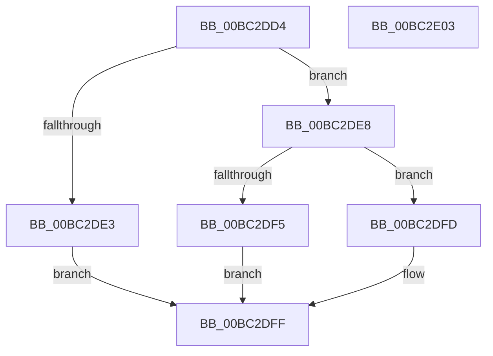

# TxtpJustifyRectangle

- RVA: `0x00BC2DD4`–`0x00BC2E04` (길이 `48` bytes)
- VA: `0x0000000140BC2DD4`
- 실행 섹션: `PAGEBGFX`
- PDB 이름 있음: `예`; PDB Function 태그: `아니요`
- unwind 정보 RVA: `0x000DB714`
- 디코드: `18`개 명령, `48/48` bytes 표시
- 미해석 바이트: `0` (있으면 어셈블리에 `.byte`로 보존)

> 이 문서는 커널 이미지의 기계어와 PDB 기호를 분석해 생성했습니다. 4번과 5번은 함수 원형과 자료형을 바이너리 사용 방식에서 추정한 C 해석이며 원본 소스 복구 결과는 아닙니다.

## 1. Dependencies

- 직접 호출 지점: **0**; 고유 호출 대상: **0**
- 직접 호출자로 확인된 함수: **2**
- RIP 상대 이미지 참조: **0**

### Outgoing calls
- 직접 디코드된 call 명령이 없습니다.

### Direct callers
- [BgpTxtDisplayCharacter](../../text/47/BgpTxtDisplayCharacter_function_0047F120.md) at `0x0047F281`
- [BgpTxtDisplayString](BgpTxtDisplayString_function_00BC2BB0.md) at `0x00BC2D40`

### Static image references
- 디코드된 RIP-relative 메모리 참조가 없습니다.

## 2. Other-region calls and transfers

- 다른 실행 섹션으로 향하는 call: **0**
- 별도 외부 분기/꼬리 이동을 확인하지 못했습니다.

## 3. Assembly (complete function range)

```asm
00BC2DD4  41 83 60 04 00                  and dword ptr [r8 + 4], 0
00BC2DD9  44 8B 49 48                     mov r9d, dword ptr [rcx + 0x48]
00BC2DDD  41 F6 C1 04                     test r9b, 4
00BC2DE1  74 05                           je 0x140bc2de8
00BC2DE3  8B 41 4C                        mov eax, dword ptr [rcx + 0x4c]
00BC2DE6  EB 17                           jmp 0x140bc2dff
00BC2DE8  8B 41 08                        mov eax, dword ptr [rcx + 8]
00BC2DEB  8B 12                           mov edx, dword ptr [rdx]
00BC2DED  2B C2                           sub eax, edx
00BC2DEF  41 F6 C1 08                     test r9b, 8
00BC2DF3  74 08                           je 0x140bc2dfd
00BC2DF5  41 89 00                        mov dword ptr [r8], eax
00BC2DF8  2B 41 4C                        sub eax, dword ptr [rcx + 0x4c]
00BC2DFB  EB 02                           jmp 0x140bc2dff
00BC2DFD  D1 E8                           shr eax, 1
00BC2DFF  41 89 00                        mov dword ptr [r8], eax
00BC2E02  C3                              ret
00BC2E03  CC                              int3
```

## 4. C-style interpretation (structured pseudocode)

```c
__int64 __fastcall TxtpJustifyRectangle(__int64 a1, __int64 a2, __int64 a3)
{
    __int64 result;

    if ((((unsigned __int8)((unsigned int)(*(unsigned int *)(a1 + 72)))) & (4)) == 0) goto loc_00BC2DE8;
    goto loc_00BC2DFF;
loc_00BC2DE8:
    result = (unsigned int)(((unsigned int)(*(unsigned int *)(a1 + 8))) - ((unsigned int)((unsigned int)(*(unsigned int *)(a2)))));
    if ((((unsigned __int8)((unsigned int)(*(unsigned int *)(a1 + 72)))) & (8)) == 0) goto loc_00BC2DFD;
    *(unsigned int *)(a3) = (unsigned int)(result);
    result = (unsigned int)((result) - (*(unsigned int *)(a1 + 76)));
    goto loc_00BC2DFF;
loc_00BC2DFD:
    result = (unsigned int)((result) >> (1));
loc_00BC2DFF:
    *(unsigned int *)(a3) = (unsigned int)(result);
    return result;
}
```

## 5. (Beta) C Style

```c
int64_t TxtpJustifyRectangle(void *Arg1, void *Arg2, void *Arg3)
{
    uint8_t *arg1 = (uint8_t *)Arg1;
    uint8_t *arg2 = (uint8_t *)Arg2;
    uint8_t *arg3 = (uint8_t *)Arg3;

    int64_t result;

    if ((((uint8_t)((uint32_t)(*(uint32_t *)(arg1 + 0x48)))) & (4)) == 0) goto loc_00BC2DE8;
    goto loc_00BC2DFF;
loc_00BC2DE8:
    result = (uint32_t)(((uint32_t)(*(uint32_t *)(arg1 + 0x8))) - ((uint32_t)((uint32_t)(*(uint32_t *)(arg2)))));
    if ((((uint8_t)((uint32_t)(*(uint32_t *)(arg1 + 0x48)))) & (8)) == 0) goto loc_00BC2DFD;
    *(uint32_t *)(arg3) = (uint32_t)(result);
    result = (uint32_t)((result) - (*(uint32_t *)(arg1 + 0x4C)));
    goto loc_00BC2DFF;
loc_00BC2DFD:
    result = (uint32_t)((result) >> (1));
loc_00BC2DFF:
    *(uint32_t *)(arg3) = (uint32_t)(result);
    return result;
}
```

### 관측된 메모리 오프셋

구조체 형식이 확인되지 않은 접근은 인자 기준의 오프셋으로만 기록했습니다.

| 기준 인자 | 오프셋 표현 | 폭 (bit) | 접근 |
|---|---:|---:|---|
| `Arg1` | `+ 0x8` | `32` | `R` |
| `Arg1` | `+ 0x48` | `32` | `R` |
| `Arg1` | `+ 0x4C` | `32` | `R` |
| `Arg2` | `+ 0x0` | `32` | `R` |
| `Arg3` | `+ 0x0` | `32` | `W` |
| `Arg3` | `+ 0x4` | `32` | `R/W` |

## 6. Execution-region graph

[열기: 2D/3D 그래프와 함수 탐색 컨트롤 패널](../../../control-panel.html?section=pagebgfx&rva=0x00BC2DD4&view=graph)

- 2D 그래프는 위에서 아래로 흐르고, 3D 그래프는 빈 공간을 드래그해 회전합니다. Shift+드래그는 이동, 휠은 확대·축소, 함수 노드 선택은 대상 보고서 이동입니다.

### Static fallback


