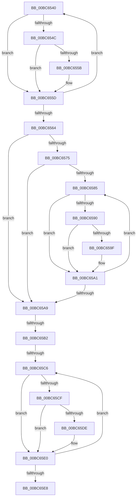

# sub_00BC6540

- RVA: `0x00BC6540`–`0x00BC65ED` (길이 `173` bytes)
- VA: `0x0000000140BC6540`
- 실행 섹션: `PAGEBGFX`
- PDB 이름 있음: `아니요`; PDB Function 태그: `아니요`
- unwind 정보 RVA: `0x000A8004`
- 디코드: `56`개 명령, `173/173` bytes 표시
- 미해석 바이트: `0` (있으면 어셈블리에 `.byte`로 보존)

> 이 문서는 커널 이미지의 기계어와 PDB 기호를 분석해 생성했습니다. 4번과 5번은 함수 원형과 자료형을 바이너리 사용 방식에서 추정한 C 해석이며 원본 소스 복구 결과는 아닙니다.

## 1. Dependencies

- 직접 호출 지점: **0**; 고유 호출 대상: **0**
- 직접 호출자로 확인된 함수: **0**
- RIP 상대 이미지 참조: **0**

### Outgoing calls
- 직접 디코드된 call 명령이 없습니다.

### Direct callers
- 이 함수 시작 RVA로 연결되는 직접 call은 확인되지 않았습니다. 간접 호출은 완전히 역산할 수 없습니다.

### Static image references
- 디코드된 RIP-relative 메모리 참조가 없습니다.

## 2. Other-region calls and transfers

- 다른 실행 섹션으로 향하는 call: **0**
- call이 아닌 외부 분기/꼬리 이동: **3**
  - `0x00BC65AC` → [AnFwpFadeAnimationTimer + 0x178](AnFwpFadeAnimationTimer_function_00BC2F50.md) (`tail-transfer`)
  - `0x00BC65C0` → [AnFwpFadeAnimationTimer + 0x178](AnFwpFadeAnimationTimer_function_00BC2F50.md) (`tail-transfer`)
  - `0x00BC65E8` → [AnFwpFadeAnimationTimer + 0x178](AnFwpFadeAnimationTimer_function_00BC2F50.md) (`tail-transfer`)

## 3. Assembly (complete function range)

```asm
00BC6540  44 8B C1                        mov r8d, ecx
00BC6543  43 0F B6 04 08                  movzx eax, byte ptr [r8 + r9]
00BC6548  84 C0                           test al, al
00BC654A  74 11                           je 0x140bc655d
00BC654C  41 0F AF C7                     imul eax, r15d
00BC6550  C1 E8 0A                        shr eax, 0xa
00BC6553  43 88 04 18                     mov byte ptr [r8 + r11], al
00BC6557  85 C0                           test eax, eax
00BC6559  74 02                           je 0x140bc655d
00BC655B  FF C6                           inc esi
00BC655D  FF C1                           inc ecx
00BC655F  3B 4A 0C                        cmp ecx, dword ptr [rdx + 0xc]
00BC6562  72 DC                           jb 0x140bc6540
00BC6564  4C 8B 5C 24 30                  mov r11, qword ptr [rsp + 0x30]
00BC6569  4C 8B 4C 24 28                  mov r9, qword ptr [rsp + 0x28]
00BC656E  8B FB                           mov edi, ebx
00BC6570  45 84 ED                        test r13b, r13b
00BC6573  75 34                           jne 0x140bc65a9
00BC6575  8B CB                           mov ecx, ebx
00BC6577  4D 8B 42 18                     mov r8, qword ptr [r10 + 0x18]
00BC657B  4D 8B 49 18                     mov r9, qword ptr [r9 + 0x18]
00BC657F  41 39 5A 0C                     cmp dword ptr [r10 + 0xc], ebx
00BC6583  76 24                           jbe 0x140bc65a9
00BC6585  8B D1                           mov edx, ecx
00BC6587  42 0F B6 04 02                  movzx eax, byte ptr [rdx + r8]
00BC658C  84 C0                           test al, al
00BC658E  74 11                           je 0x140bc65a1
00BC6590  41 0F AF C7                     imul eax, r15d
00BC6594  C1 E8 0A                        shr eax, 0xa
00BC6597  42 88 04 0A                     mov byte ptr [rdx + r9], al
00BC659B  85 C0                           test eax, eax
00BC659D  74 02                           je 0x140bc65a1
00BC659F  FF C7                           inc edi
00BC65A1  FF C1                           inc ecx
00BC65A3  41 3B 4A 0C                     cmp ecx, dword ptr [r10 + 0xc]
00BC65A7  72 DC                           jb 0x140bc6585
00BC65A9  45 84 E4                        test r12b, r12b
00BC65AC  0F 85 16 CB FF FF               jne 0x140bc30c8
00BC65B2  4D 8B 46 18                     mov r8, qword ptr [r14 + 0x18]
00BC65B6  33 C9                           xor ecx, ecx
00BC65B8  4D 8B 4B 18                     mov r9, qword ptr [r11 + 0x18]
00BC65BC  41 39 4E 0C                     cmp dword ptr [r14 + 0xc], ecx
00BC65C0  0F 86 02 CB FF FF               jbe 0x140bc30c8
00BC65C6  42 0F B6 04 01                  movzx eax, byte ptr [rcx + r8]
00BC65CB  84 C0                           test al, al
00BC65CD  74 11                           je 0x140bc65e0
00BC65CF  41 0F AF C7                     imul eax, r15d
00BC65D3  C1 E8 0A                        shr eax, 0xa
00BC65D6  42 88 04 09                     mov byte ptr [rcx + r9], al
00BC65DA  85 C0                           test eax, eax
00BC65DC  74 02                           je 0x140bc65e0
00BC65DE  FF C3                           inc ebx
00BC65E0  FF C1                           inc ecx
00BC65E2  41 3B 4E 0C                     cmp ecx, dword ptr [r14 + 0xc]
00BC65E6  72 DE                           jb 0x140bc65c6
00BC65E8  E9 DB CA FF FF                  jmp 0x140bc30c8
```

## 4. C-style interpretation (structured pseudocode)

```c
__int64 __fastcall sub_00BC6540(int a1, __int64 a2, __int64 a3, __int64 a4, __int64 a5, __int64 a6)
{
    __int64 result;
    __int64 v_rbx;
    __int64 v_rdi;
    __int64 v_rsi;

    if ((unsigned __int8)(*(unsigned __int8 *)((unsigned int)(a1) + a4 * 1)) == 0) goto loc_00BC655D;
    result = (unsigned int)((*(unsigned __int8 *)((unsigned int)(a1) + a4 * 1)) * ((unsigned int)(v_r15)));
    result = (unsigned int)((result) >> (10));
    *(unsigned __int8 *)((unsigned int)(a1) + v_r11 * 1) = (unsigned __int8)(result);
    if ((unsigned int)(result) != 0) {
        v_rsi = (unsigned int)((v_rsi) + 1);
    }
    a1 = (unsigned int)((a1) + 1);
    if (a1 < (*(unsigned int *)(a2 + 12))) goto loc_00BC6540;
    if ((unsigned __int8)(v_r13) != 0) goto loc_00BC65A9;
    if ((*(unsigned int *)(v_r10 + 12)) <= ((unsigned int)(v_rbx))) goto loc_00BC65A9;
loc_00BC6585:
    if ((unsigned __int8)(*(unsigned __int8 *)((unsigned int)((unsigned int)((unsigned int)((unsigned int)(v_rbx)))) + *(unsigned __int64 *)(v_r10 + 24) * 1)) == 0) goto loc_00BC65A1;
    result = (unsigned int)((*(unsigned __int8 *)((unsigned int)((unsigned int)((unsigned int)((unsigned int)(v_rbx)))) + *(unsigned __int64 *)(v_r10 + 24) * 1)) * ((unsigned int)(v_r15)));
    result = (unsigned int)((result) >> (10));
    *(unsigned __int8 *)((unsigned int)((unsigned int)((unsigned int)((unsigned int)(v_rbx)))) + *(unsigned __int64 *)(a5 + 24) * 1) = (unsigned __int8)(result);
    v_rdi = (unsigned int)((unsigned int)(v_rbx));
    if ((unsigned int)(result) != 0) {
        v_rdi = (unsigned int)(((unsigned int)((unsigned int)(v_rbx))) + 1);
    }
    a1 = (unsigned int)(((unsigned int)((unsigned int)(v_rbx))) + 1);
    if (a1 < (*(unsigned int *)(v_r10 + 12))) goto loc_00BC6585;
loc_00BC65A9:
    a1 = 0;
loc_00BC65C6:
    if ((unsigned __int8)(*(unsigned __int8 *)(a1 + *(unsigned __int64 *)(v_r14 + 24) * 1)) == 0) goto loc_00BC65E0;
    result = (unsigned int)((*(unsigned __int8 *)(a1 + *(unsigned __int64 *)(v_r14 + 24) * 1)) * ((unsigned int)(v_r15)));
    result = (unsigned int)((result) >> (10));
    *(unsigned __int8 *)(a1 + *(unsigned __int64 *)(a6 + 24) * 1) = (unsigned __int8)(result);
    if ((unsigned int)(result) != 0) {
        v_rbx = (unsigned int)((v_rbx) + 1);
    }
    a1 = (unsigned int)((a1) + 1);
    if (a1 < (*(unsigned int *)(v_r14 + 12))) goto loc_00BC65C6;
}
```

## 5. (Beta) C Style

```c
int64_t sub_00BC6540(int32_t Arg1, void *Arg2, int64_t Arg3, int64_t Arg4, void *Arg5, void *Arg6)
{
    uint8_t *arg2 = (uint8_t *)Arg2;
    uint8_t *arg5 = (uint8_t *)Arg5;
    uint8_t *arg6 = (uint8_t *)Arg6;

    int64_t result;
    int64_t local_rbx;
    int64_t local_rdi;
    int64_t local_rsi;

    if ((uint8_t)(*(uint8_t *)((uint32_t)(Arg1) + Arg4 * 1)) == 0) goto loc_00BC655D;
    result = (uint32_t)((*(uint8_t *)((uint32_t)(Arg1) + Arg4 * 1)) * ((uint32_t)(local_r15)));
    result = (uint32_t)((result) >> (10));
    *(uint8_t *)((uint32_t)(Arg1) + local_r11 * 1) = (uint8_t)(result);
    if ((uint32_t)(result) != 0) {
        local_rsi = (uint32_t)((local_rsi) + 1);
    }
    Arg1 = (uint32_t)((Arg1) + 1);
    if (Arg1 < (*(uint32_t *)(arg2 + 0xC))) goto loc_00BC6540;
    if ((uint8_t)(local_r13) != 0) goto loc_00BC65A9;
    if ((*(uint32_t *)(local_r10 + 0xC)) <= ((uint32_t)(local_rbx))) goto loc_00BC65A9;
loc_00BC6585:
    if ((uint8_t)(*(uint8_t *)((uint32_t)((uint32_t)((uint32_t)((uint32_t)(local_rbx)))) + *(uint64_t *)(local_r10 + 0x18) * 1)) == 0) goto loc_00BC65A1;
    result = (uint32_t)((*(uint8_t *)((uint32_t)((uint32_t)((uint32_t)((uint32_t)(local_rbx)))) + *(uint64_t *)(local_r10 + 0x18) * 1)) * ((uint32_t)(local_r15)));
    result = (uint32_t)((result) >> (10));
    *(uint8_t *)((uint32_t)((uint32_t)((uint32_t)((uint32_t)(local_rbx)))) + *(uint64_t *)(arg5 + 0x18) * 1) = (uint8_t)(result);
    local_rdi = (uint32_t)((uint32_t)(local_rbx));
    if ((uint32_t)(result) != 0) {
        local_rdi = (uint32_t)(((uint32_t)((uint32_t)(local_rbx))) + 1);
    }
    Arg1 = (uint32_t)(((uint32_t)((uint32_t)(local_rbx))) + 1);
    if (Arg1 < (*(uint32_t *)(local_r10 + 0xC))) goto loc_00BC6585;
loc_00BC65A9:
    Arg1 = 0;
loc_00BC65C6:
    if ((uint8_t)(*(uint8_t *)(Arg1 + *(uint64_t *)(local_r14 + 0x18) * 1)) == 0) goto loc_00BC65E0;
    result = (uint32_t)((*(uint8_t *)(Arg1 + *(uint64_t *)(local_r14 + 0x18) * 1)) * ((uint32_t)(local_r15)));
    result = (uint32_t)((result) >> (10));
    *(uint8_t *)(Arg1 + *(uint64_t *)(arg6 + 0x18) * 1) = (uint8_t)(result);
    if ((uint32_t)(result) != 0) {
        local_rbx = (uint32_t)((local_rbx) + 1);
    }
    Arg1 = (uint32_t)((Arg1) + 1);
    if (Arg1 < (*(uint32_t *)(local_r14 + 0xC))) goto loc_00BC65C6;
}
```

### 관측된 메모리 오프셋

구조체 형식이 확인되지 않은 접근은 인자 기준의 오프셋으로만 기록했습니다.

| 기준 인자 | 오프셋 표현 | 폭 (bit) | 접근 |
|---|---:|---:|---|
| `Arg2` | `+ 0xC` | `32` | `R` |
| `Arg5` | `+ 0x18` | `64` | `R` |
| `Arg6` | `+ 0x18` | `64` | `R` |

## 6. Execution-region graph

[열기: 2D/3D 그래프와 함수 탐색 컨트롤 패널](../../../control-panel.html?section=pagebgfx&rva=0x00BC6540&view=graph)

- 2D 그래프는 위에서 아래로 흐르고, 3D 그래프는 빈 공간을 드래그해 회전합니다. Shift+드래그는 이동, 휠은 확대·축소, 함수 노드 선택은 대상 보고서 이동입니다.

### Static fallback


