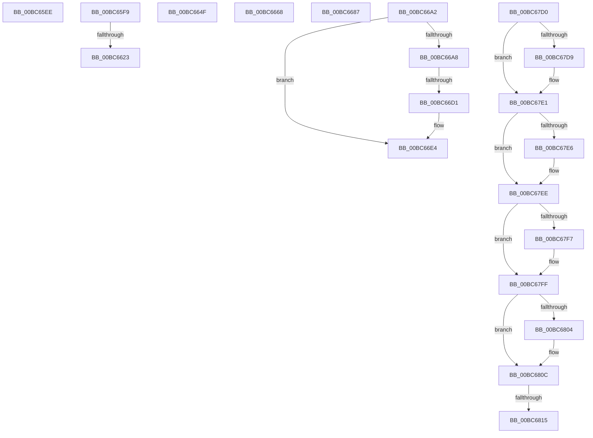

# sub_00BC65EE

- RVA: `0x00BC65EE`–`0x00BC6823` (길이 `565` bytes)
- VA: `0x0000000140BC65EE`
- 실행 섹션: `PAGEBGFX`
- PDB 이름 있음: `아니요`; PDB Function 태그: `아니요`
- unwind 정보 RVA: `0x000AA590`
- 디코드: `130`개 명령, `565/565` bytes 표시
- 미해석 바이트: `0` (있으면 어셈블리에 `.byte`로 보존)

> 이 문서는 커널 이미지의 기계어와 PDB 기호를 분석해 생성했습니다. 4번과 5번은 함수 원형과 자료형을 바이너리 사용 방식에서 추정한 C 해석이며 원본 소스 복구 결과는 아닙니다.

## 1. Dependencies

- 직접 호출 지점: **15**; 고유 호출 대상: **10**
- 직접 호출자로 확인된 함수: **0**
- RIP 상대 이미지 참조: **25**

### Outgoing calls
- `0x00BC660F` → [BgpGxReadRectangle](BgpGxReadRectangle_function_00BC3D18.md) (function, `0x00BC3D18`)
- `0x00BC662F` → [BgpGxRectangleSize](../../text/4C/BgpGxRectangleSize_function_004C1DE4.md) (function, `0x004C1DE4`)
- `0x00BC66C1` → [BgpGxRectangleCreate](BgpGxRectangleCreate_function_00BC3E78.md) (function, `0x00BC3E78`)
- `0x00BC66DF` → [memset](../../text/6C/memset_function_006C6C40.md) (function, `0x006C6C40`)
- `0x00BC66ED` → [LogFwStat](LogFwStat_function_00BC4790.md) (function, `0x00BC4790`)
- `0x00BC6762` → [KeResetEvent](../../text/24/KeResetEvent_function_00248350.md) (function, `0x00248350`)
- `0x00BC676E` → [KeInitializeTimer](../../text/45/KeInitializeTimer_function_0045B590.md) (function, `0x0045B590`)
- `0x00BC6787` → [KeInitializeDpc](../../text/45/KeInitializeDpc_function_0045BBD0.md) (function, `0x0045BBD0`)
- `0x00BC679D` → [LogFwStat](LogFwStat_function_00BC4790.md) (function, `0x00BC4790`)
- `0x00BC67B7` → [KeSetCoalescableTimer](../../text/22/KeSetCoalescableTimer_function_0022FFD0.md) (function, `0x0022FFD0`)
- `0x00BC67DC` → [BgpGxRectangleDestroy](BgpGxRectangleDestroy_function_00BC3F04.md) (function, `0x00BC3F04`)
- `0x00BC67E9` → [BgpGxRectangleDestroy](BgpGxRectangleDestroy_function_00BC3F04.md) (function, `0x00BC3F04`)
- `0x00BC67FA` → [BgpGxRectangleDestroy](BgpGxRectangleDestroy_function_00BC3F04.md) (function, `0x00BC3F04`)
- `0x00BC6807` → [BgpGxRectangleDestroy](BgpGxRectangleDestroy_function_00BC3F04.md) (function, `0x00BC3F04`)
- `0x00BC6818` → [BgpGxRectangleDestroy](BgpGxRectangleDestroy_function_00BC3F04.md) (function, `0x00BC3F04`)

### Direct callers
- 이 함수 시작 RVA로 연결되는 직접 call은 확인되지 않았습니다. 간접 호출은 완전히 역산할 수 없습니다.

### Static image references
- `0x00BC65F9` → RVA `0x00E0EEE8` (`.data`; read)
- `0x00BC6604` → RVA `0x00E0EEE0` (`.data`; read)
- `0x00BC6673` → RVA `0x00E0EEE0` (`.data`; read/write)
- `0x00BC667C` → RVA `0x00E0EEE4` (`.data`; read/write)
- `0x00BC668A` → RVA `0x00E0EF20` (`.data`; read/write)
- `0x00BC6693` → RVA `0x00E0EF24` (`.data`; read/write)
- `0x00BC66F5` → RVA `0x00E65100` (`.data`; read)
- `0x00BC66FC` → RVA `0x00E0EEC4` (`.data`; read/write)
- `0x00BC6703` → RVA `0x00E0EED0` (`.data`; write)
- `0x00BC670C` → RVA `0x00E0EED1` (`.data`; write)
- `0x00BC6715` → RVA `0x00E0EED2` (`.data`; write)
- `0x00BC671F` → RVA `0x00E0EF08` (`.data`; write)
- `0x00BC672A` → RVA `0x00E0EF18` (`.data`; write)
- `0x00BC6735` → RVA `0x00E0EF50` (`.data`; write)
- `0x00BC673C` → RVA `0x00E0EEC0` (`.data`; write)
- `0x00BC6746` → RVA `0x00E0EEC8` (`.data`; write)
- `0x00BC674D` → RVA `0x00E0EED8` (`.data`; write)
- `0x00BC6754` → RVA `0x00E0EF10` (`.data`; write)
- `0x00BC675B` → RVA `0x00E0EF48` (`.data`; write)
- `0x00BC6767` → RVA `0x00E65080` (`.data`; read)
- `0x00BC6773` → RVA `0x00E64FC0` (`.data`; read)
- `0x00BC6780` → RVA `0x00BC2F50` (`AnFwpFadeAnimationTimer`; read)
- `0x00BC678F` → RVA `0x00EEFEE2` (`.data`; write)
- `0x00BC67BC` → RVA `0x00EF0450` (`.data`; read/write)
- `0x00BC67C4` → RVA `0x00EF046C` (`.data`; write)

## 2. Other-region calls and transfers

- 다른 실행 섹션으로 향하는 call: **6**
  - `0x00BC662F` → [BgpGxRectangleSize](../../text/4C/BgpGxRectangleSize_function_004C1DE4.md) (`PAGEBGFX` → `.text`)
  - `0x00BC66DF` → [memset](../../text/6C/memset_function_006C6C40.md) (`PAGEBGFX` → `.text`)
  - `0x00BC6762` → [KeResetEvent](../../text/24/KeResetEvent_function_00248350.md) (`PAGEBGFX` → `.text`)
  - `0x00BC676E` → [KeInitializeTimer](../../text/45/KeInitializeTimer_function_0045B590.md) (`PAGEBGFX` → `.text`)
  - `0x00BC6787` → [KeInitializeDpc](../../text/45/KeInitializeDpc_function_0045BBD0.md) (`PAGEBGFX` → `.text`)
  - `0x00BC67B7` → [KeSetCoalescableTimer](../../text/22/KeSetCoalescableTimer_function_0022FFD0.md) (`PAGEBGFX` → `.text`)
- call이 아닌 외부 분기/꼬리 이동: **10**
  - `0x00BC65F4` → [AnFwDisplayFade + 0x3C8](AnFwDisplayFade_function_00BC36EC.md) (`tail-transfer`)
  - `0x00BC661D` → [AnFwDisplayFade + 0x3C8](AnFwDisplayFade_function_00BC36EC.md) (`tail-transfer`)
  - `0x00BC664A` → [AnFwDisplayFade + 0x26B](AnFwDisplayFade_function_00BC36EC.md) (`tail-transfer`)
  - `0x00BC6663` → [AnFwDisplayFade + 0x2FE](AnFwDisplayFade_function_00BC36EC.md) (`tail-transfer`)
  - `0x00BC6682` → [AnFwDisplayFade + 0x308](AnFwDisplayFade_function_00BC36EC.md) (`tail-transfer`)
  - `0x00BC669D` → [AnFwDisplayFade + 0x312](AnFwDisplayFade_function_00BC36EC.md) (`tail-transfer`)
  - `0x00BC66CB` → [AnFwDisplayFade + 0x3C8](AnFwDisplayFade_function_00BC36EC.md) (`tail-transfer`)
  - `0x00BC67CB` → [AnFwDisplayFade + 0x3C8](AnFwDisplayFade_function_00BC36EC.md) (`tail-transfer`)
  - `0x00BC680F` → [AnFwDisplayFade + 0x3F1](AnFwDisplayFade_function_00BC36EC.md) (`tail-transfer`)
  - `0x00BC681E` → [AnFwDisplayFade + 0x3F1](AnFwDisplayFade_function_00BC36EC.md) (`tail-transfer`)

## 3. Assembly (complete function range)

```asm
00BC65EE  41 BE 01 00 00 C0               mov r14d, 0xc0000001
00BC65F4  E9 BB D4 FF FF                  jmp 0x140bc3ab4
00BC65F9  4C 8D 05 E8 88 24 00            lea r8, [rip + 0x2488e8]
00BC6600  44 89 7D AF                     mov dword ptr [rbp - 0x51], r15d
00BC6604  48 8D 15 D5 88 24 00            lea rdx, [rip + 0x2488d5]
00BC660B  48 8D 4D FF                     lea rcx, [rbp - 1]
00BC660F  E8 04 D7 FF FF                  call 0x140bc3d18
00BC6614  48 8B 7D FF                     mov rdi, qword ptr [rbp - 1]
00BC6618  44 8B F0                        mov r14d, eax
00BC661B  85 C0                           test eax, eax
00BC661D  0F 88 91 D4 FF FF               js 0x140bc3ab4
00BC6623  8B 0F                           mov ecx, dword ptr [rdi]
00BC6625  44 8B C6                        mov r8d, esi
00BC6628  8B 57 04                        mov edx, dword ptr [rdi + 4]
00BC662B  48 89 7D C7                     mov qword ptr [rbp - 0x39], rdi
00BC662F  E8 B0 B7 8F FF                  call 0x1404c1de4
00BC6634  44 8D 78 0F                     lea r15d, [rax + 0xf]
00BC6638  8B 45 AF                        mov eax, dword ptr [rbp - 0x51]
00BC663B  41 83 E7 F0                     and r15d, 0xfffffff0
00BC663F  41 83 C7 20                     add r15d, 0x20
00BC6643  42 8D 04 78                     lea eax, [rax + r15*2]
00BC6647  44 03 F8                        add r15d, eax
00BC664A  E9 08 D3 FF FF                  jmp 0x140bc3957
00BC664F  8B 45 BF                        mov eax, dword ptr [rbp - 0x41]
00BC6652  01 45 AF                        add dword ptr [rbp - 0x51], eax
00BC6655  8B 45 C3                        mov eax, dword ptr [rbp - 0x3d]
00BC6658  01 45 B3                        add dword ptr [rbp - 0x4d], eax
00BC665B  48 8B 75 AF                     mov rsi, qword ptr [rbp - 0x51]
00BC665F  4C 8B 65 D7                     mov r12, qword ptr [rbp - 0x29]
00BC6663  E9 82 D3 FF FF                  jmp 0x140bc39ea
00BC6668  48 8B 45 D7                     mov rax, qword ptr [rbp - 0x29]
00BC666C  48 89 45 C7                     mov qword ptr [rbp - 0x39], rax
00BC6670  8B 45 BF                        mov eax, dword ptr [rbp - 0x41]
00BC6673  01 05 67 88 24 00               add dword ptr [rip + 0x248867], eax
00BC6679  8B 45 C3                        mov eax, dword ptr [rbp - 0x3d]
00BC667C  01 05 62 88 24 00               add dword ptr [rip + 0x248862], eax
00BC6682  E9 6D D3 FF FF                  jmp 0x140bc39f4
00BC6687  8B 45 BF                        mov eax, dword ptr [rbp - 0x41]
00BC668A  01 05 90 88 24 00               add dword ptr [rip + 0x248890], eax
00BC6690  8B 45 C3                        mov eax, dword ptr [rbp - 0x3d]
00BC6693  01 05 8B 88 24 00               add dword ptr [rip + 0x24888b], eax
00BC6699  4C 8B 6D D7                     mov r13, qword ptr [rbp - 0x29]
00BC669D  E9 5C D3 FF FF                  jmp 0x140bc39fe
00BC66A2  80 7D A9 00                     cmp byte ptr [rbp - 0x57], 0
00BC66A6  75 3C                           jne 0x140bc66e4
00BC66A8  41 8B 45 04                     mov eax, dword ptr [r13 + 4]
00BC66AC  4C 8D 45 DF                     lea r8, [rbp - 0x21]
00BC66B0  8B 55 CF                        mov edx, dword ptr [rbp - 0x31]
00BC66B3  48 8D 4D E7                     lea rcx, [rbp - 0x19]
00BC66B7  89 45 E7                        mov dword ptr [rbp - 0x19], eax
00BC66BA  41 8B 45 00                     mov eax, dword ptr [r13]
00BC66BE  89 45 EB                        mov dword ptr [rbp - 0x15], eax
00BC66C1  E8 B2 D7 FF FF                  call 0x140bc3e78
00BC66C6  44 8B F0                        mov r14d, eax
00BC66C9  85 C0                           test eax, eax
00BC66CB  0F 88 E3 D3 FF FF               js 0x140bc3ab4
00BC66D1  48 8B 45 DF                     mov rax, qword ptr [rbp - 0x21]
00BC66D5  33 D2                           xor edx, edx
00BC66D7  44 8B 40 0C                     mov r8d, dword ptr [rax + 0xc]
00BC66DB  48 8B 48 18                     mov rcx, qword ptr [rax + 0x18]
00BC66DF  E8 5C 05 B0 FF                  call 0x1406c6c40
00BC66E4  45 33 C0                        xor r8d, r8d
00BC66E7  33 C9                           xor ecx, ecx
00BC66E9  41 8D 50 05                     lea edx, [r8 + 5]
00BC66ED  E8 9E E0 FF FF                  call 0x140bc4790
00BC66F2  8A 45 A8                        mov al, byte ptr [rbp - 0x58]
00BC66F5  48 8D 0D 04 EA 29 00            lea rcx, [rip + 0x29ea04]
00BC66FC  83 25 C1 87 24 00 00            and dword ptr [rip + 0x2487c1], 0
00BC6703  88 05 C7 87 24 00               mov byte ptr [rip + 0x2487c7], al
00BC6709  8A 45 A9                        mov al, byte ptr [rbp - 0x57]
00BC670C  88 05 BF 87 24 00               mov byte ptr [rip + 0x2487bf], al
00BC6712  8A 45 AA                        mov al, byte ptr [rbp - 0x56]
00BC6715  88 05 B7 87 24 00               mov byte ptr [rip + 0x2487b7], al
00BC671B  48 8B 45 F7                     mov rax, qword ptr [rbp - 9]
00BC671F  48 89 05 E2 87 24 00            mov qword ptr [rip + 0x2487e2], rax
00BC6726  48 8B 45 0F                     mov rax, qword ptr [rbp + 0xf]
00BC672A  48 89 05 E7 87 24 00            mov qword ptr [rip + 0x2487e7], rax
00BC6731  48 8B 45 DF                     mov rax, qword ptr [rbp - 0x21]
00BC6735  48 89 05 14 88 24 00            mov qword ptr [rip + 0x248814], rax
00BC673C  C7 05 7A 87 24 00 64 00 00 00   mov dword ptr [rip + 0x24877a], 0x64
00BC6746  48 89 35 7B 87 24 00            mov qword ptr [rip + 0x24877b], rsi
00BC674D  48 89 3D 84 87 24 00            mov qword ptr [rip + 0x248784], rdi
00BC6754  4C 89 25 B5 87 24 00            mov qword ptr [rip + 0x2487b5], r12
00BC675B  4C 89 2D E6 87 24 00            mov qword ptr [rip + 0x2487e6], r13
00BC6762  E8 E9 1B 68 FF                  call 0x140248350
00BC6767  48 8D 0D 12 E9 29 00            lea rcx, [rip + 0x29e912]
00BC676E  E8 1D 4E 89 FF                  call 0x14045b590
00BC6773  48 8D 35 46 E8 29 00            lea rsi, [rip + 0x29e846]
00BC677A  45 33 C0                        xor r8d, r8d
00BC677D  48 8B CE                        mov rcx, rsi
00BC6780  48 8D 15 C9 C7 FF FF            lea rdx, [rip - 0x3837]
00BC6787  E8 44 54 89 FF                  call 0x14045bbd0
00BC678C  45 33 C0                        xor r8d, r8d
00BC678F  C6 05 4C 97 32 00 01            mov byte ptr [rip + 0x32974c], 1
00BC6796  41 8D 50 07                     lea edx, [r8 + 7]
00BC679A  8D 4A FA                        lea ecx, [rdx - 6]
00BC679D  E8 EE DF FF FF                  call 0x140bc4790
00BC67A2  45 33 C9                        xor r9d, r9d
00BC67A5  48 89 74 24 20                  mov qword ptr [rsp + 0x20], rsi
00BC67AA  33 D2                           xor edx, edx
00BC67AC  48 8D 0D CD E8 29 00            lea rcx, [rip + 0x29e8cd]
00BC67B3  45 8D 41 1E                     lea r8d, [r9 + 0x1e]
00BC67B7  E8 14 98 66 FF                  call 0x14022ffd0
00BC67BC  0F BA 2D 8C 9C 32 00 0D         bts dword ptr [rip + 0x329c8c], 0xd
00BC67C4  44 89 3D A1 9C 32 00            mov dword ptr [rip + 0x329ca1], r15d
00BC67CB  E9 E4 D2 FF FF                  jmp 0x140bc3ab4
00BC67D0  48 8B 45 F7                     mov rax, qword ptr [rbp - 9]
00BC67D4  48 85 C0                        test rax, rax
00BC67D7  74 08                           je 0x140bc67e1
00BC67D9  48 8B C8                        mov rcx, rax
00BC67DC  E8 23 D7 FF FF                  call 0x140bc3f04
00BC67E1  4D 85 E4                        test r12, r12
00BC67E4  74 08                           je 0x140bc67ee
00BC67E6  49 8B CC                        mov rcx, r12
00BC67E9  E8 16 D7 FF FF                  call 0x140bc3f04
00BC67EE  48 8B 45 0F                     mov rax, qword ptr [rbp + 0xf]
00BC67F2  48 85 C0                        test rax, rax
00BC67F5  74 08                           je 0x140bc67ff
00BC67F7  48 8B C8                        mov rcx, rax
00BC67FA  E8 05 D7 FF FF                  call 0x140bc3f04
00BC67FF  4D 85 ED                        test r13, r13
00BC6802  74 08                           je 0x140bc680c
00BC6804  49 8B CD                        mov rcx, r13
00BC6807  E8 F8 D6 FF FF                  call 0x140bc3f04
00BC680C  48 85 F6                        test rsi, rsi
00BC680F  0F 84 C8 D2 FF FF               je 0x140bc3add
00BC6815  48 8B CE                        mov rcx, rsi
00BC6818  E8 E7 D6 FF FF                  call 0x140bc3f04
00BC681D  90                              nop
00BC681E  E9 BA D2 FF FF                  jmp 0x140bc3add
```

## 4. C-style interpretation (structured pseudocode)

```c
__int64 __fastcall sub_00BC65EE(__int64 a1, __int64 a2, __int64 a3, int a4)
{
    unsigned __int64 v_stack_p20;
}
```

## 5. (Beta) C Style

```c
int64_t sub_00BC65EE(int64_t Arg1, int64_t Arg2, int64_t Arg3, int32_t Arg4)
{
    uint64_t v_stack_p20;
}
```

## 6. Execution-region graph

[열기: 2D/3D 그래프와 함수 탐색 컨트롤 패널](../../../control-panel.html?section=pagebgfx&rva=0x00BC65EE&view=graph)

- 2D 그래프는 위에서 아래로 흐르고, 3D 그래프는 빈 공간을 드래그해 회전합니다. Shift+드래그는 이동, 휠은 확대·축소, 함수 노드 선택은 대상 보고서 이동입니다.

### Static fallback


