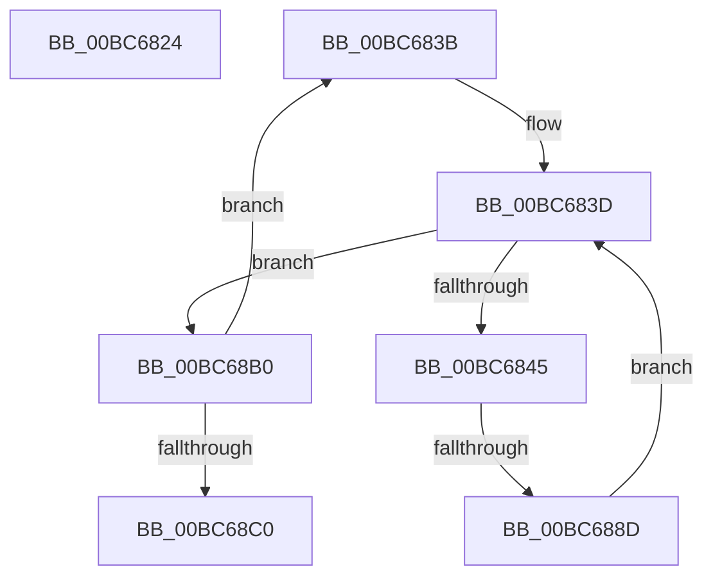

# sub_00BC6824

- RVA: `0x00BC6824`–`0x00BC68C5` (길이 `161` bytes)
- VA: `0x0000000140BC6824`
- 실행 섹션: `PAGEBGFX`
- PDB 이름 있음: `아니요`; PDB Function 태그: `아니요`
- unwind 정보 RVA: `0x000AA5E0`
- 디코드: `45`개 명령, `161/161` bytes 표시
- 미해석 바이트: `0` (있으면 어셈블리에 `.byte`로 보존)

> 이 문서는 커널 이미지의 기계어와 PDB 기호를 분석해 생성했습니다. 4번과 5번은 함수 원형과 자료형을 바이너리 사용 방식에서 추정한 C 해석이며 원본 소스 복구 결과는 아닙니다.

## 1. Dependencies

- 직접 호출 지점: **3**; 고유 호출 대상: **3**
- 직접 호출자로 확인된 함수: **0**
- RIP 상대 이미지 참조: **0**

### Outgoing calls
- `0x00BC682E` → `indirect target` (indirect, 간접 대상)
- `0x00BC687D` → [GxpGetRotatedPixelOffset](../../text/49/GxpGetRotatedPixelOffset_function_00495450.md) (function, `0x00495450`)
- `0x00BC68A1` → [memcpy](../../text/6C/memcpy_function_006C6840.md) (function, `0x006C6840`)

### Direct callers
- 이 함수 시작 RVA로 연결되는 직접 call은 확인되지 않았습니다. 간접 호출은 완전히 역산할 수 없습니다.

### Static image references
- 디코드된 RIP-relative 메모리 참조가 없습니다.

## 2. Other-region calls and transfers

- 다른 실행 섹션으로 향하는 call: **2**
  - `0x00BC687D` → [GxpGetRotatedPixelOffset](../../text/49/GxpGetRotatedPixelOffset_function_00495450.md) (`PAGEBGFX` → `.text`)
  - `0x00BC68A1` → [memcpy](../../text/6C/memcpy_function_006C6840.md) (`PAGEBGFX` → `.text`)
- call이 아닌 외부 분기/꼬리 이동: **3**
  - `0x00BC6836` → [GxpReadFrameBufferPixels + 0x198](GxpReadFrameBufferPixels_function_00BC3F2C.md) (`tail-transfer`)
  - `0x00BC6887` → [GxpReadFrameBufferPixels + 0x198](GxpReadFrameBufferPixels_function_00BC3F2C.md) (`tail-transfer`)
  - `0x00BC68C0` → [GxpReadFrameBufferPixels + 0x198](GxpReadFrameBufferPixels_function_00BC3F2C.md) (`tail-transfer`)

## 3. Assembly (complete function range)

```asm
00BC6824  41 B0 01                        mov r8b, 1
00BC6827  48 8D 4D F7                     lea rcx, [rbp - 9]
00BC682B  48 8B D6                        mov rdx, rsi
00BC682E  FF D0                           call rax
00BC6830  0F 1F 00                        nop dword ptr [rax]
00BC6833  44 8B F0                        mov r14d, eax
00BC6836  E9 89 D8 FF FF                  jmp 0x140bc40c4
00BC683B  33 C0                           xor eax, eax
00BC683D  89 45 97                        mov dword ptr [rbp - 0x69], eax
00BC6840  3B 47 04                        cmp eax, dword ptr [rdi + 4]
00BC6843  73 6B                           jae 0x140bc68b0
00BC6845  8B 45 A7                        mov eax, dword ptr [rbp - 0x59]
00BC6848  4C 8D 4D E7                     lea r9, [rbp - 0x19]
00BC684C  F2 0F 10 45 9F                  movsd xmm0, qword ptr [rbp - 0x61]
00BC6851  48 8D 55 C7                     lea rdx, [rbp - 0x39]
00BC6855  48 8B 4D 97                     mov rcx, qword ptr [rbp - 0x69]
00BC6859  4C 8B C6                        mov r8, rsi
00BC685C  89 45 EF                        mov dword ptr [rbp - 0x11], eax
00BC685F  8B 45 B7                        mov eax, dword ptr [rbp - 0x49]
00BC6862  89 45 CF                        mov dword ptr [rbp - 0x31], eax
00BC6865  48 8D 45 67                     lea rax, [rbp + 0x67]
00BC6869  F2 0F 11 45 E7                  movsd qword ptr [rbp - 0x19], xmm0
00BC686E  F2 0F 10 45 AF                  movsd xmm0, qword ptr [rbp - 0x51]
00BC6873  48 89 44 24 20                  mov qword ptr [rsp + 0x20], rax
00BC6878  F2 0F 11 45 C7                  movsd qword ptr [rbp - 0x39], xmm0
00BC687D  E8 CE EB 8C FF                  call 0x140495450
00BC6882  44 8B F0                        mov r14d, eax
00BC6885  85 C0                           test eax, eax
00BC6887  0F 88 37 D8 FF FF               js 0x140bc40c4
00BC688D  8B 55 67                        mov edx, dword ptr [rbp + 0x67]
00BC6890  49 8B CD                        mov rcx, r13
00BC6893  41 0F AF D7                     imul edx, r15d
00BC6897  45 8B C7                        mov r8d, r15d
00BC689A  41 8B DF                        mov ebx, r15d
00BC689D  48 03 55 D7                     add rdx, qword ptr [rbp - 0x29]
00BC68A1  E8 9A FF AF FF                  call 0x1406c6840
00BC68A6  8B 45 97                        mov eax, dword ptr [rbp - 0x69]
00BC68A9  4C 03 EB                        add r13, rbx
00BC68AC  FF C0                           inc eax
00BC68AE  EB 8D                           jmp 0x140bc683d
00BC68B0  41 FF C4                        inc r12d
00BC68B3  44 89 65 9B                     mov dword ptr [rbp - 0x65], r12d
00BC68B7  44 3B 27                        cmp r12d, dword ptr [rdi]
00BC68BA  0F 82 7B FF FF FF               jb 0x140bc683b
00BC68C0  E9 FF D7 FF FF                  jmp 0x140bc40c4
```

## 4. C-style interpretation (structured pseudocode)

```c
__int64 __fastcall sub_00BC6824(void)
{
    __int64 result;
    unsigned __int64 v_stack_p20;

    result = kernel_indirect_call(v_rbp - 9, v_rsi, 1, a4);
}
```

## 5. (Beta) C Style

```c
void sub_00BC6824(void)
{
    int64_t result;
    uint64_t v_stack_p20;

    result = kernel_indirect_call(local_rbp - 9, local_rsi, 1, a4);
}
```

## 6. Execution-region graph

[열기: 2D/3D 그래프와 함수 탐색 컨트롤 패널](../../../control-panel.html?section=pagebgfx&rva=0x00BC6824&view=graph)

- 2D 그래프는 위에서 아래로 흐르고, 3D 그래프는 빈 공간을 드래그해 회전합니다. Shift+드래그는 이동, 휠은 확대·축소, 함수 노드 선택은 대상 보고서 이동입니다.

### Static fallback


