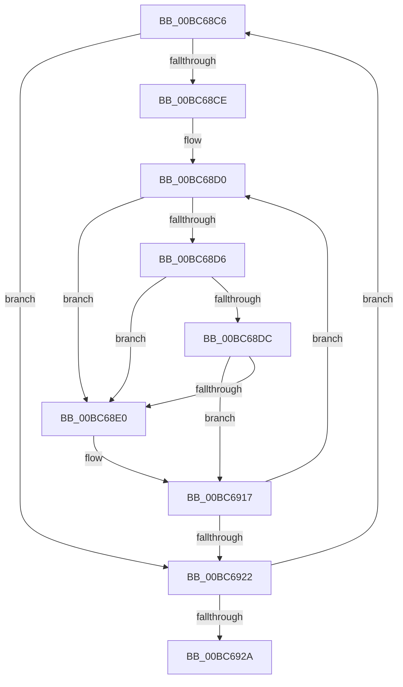

# sub_00BC68C6

- RVA: `0x00BC68C6`–`0x00BC6947` (길이 `129` bytes)
- VA: `0x0000000140BC68C6`
- 실행 섹션: `PAGEBGFX`
- PDB 이름 있음: `아니요`; PDB Function 태그: `아니요`
- unwind 정보 RVA: `0x000AA60C`
- 디코드: `39`개 명령, `129/129` bytes 표시
- 미해석 바이트: `0` (있으면 어셈블리에 `.byte`로 보존)

> 이 문서는 커널 이미지의 기계어와 PDB 기호를 분석해 생성했습니다. 4번과 5번은 함수 원형과 자료형을 바이너리 사용 방식에서 추정한 C 해석이며 원본 소스 복구 결과는 아닙니다.

## 1. Dependencies

- 직접 호출 지점: **0**; 고유 호출 대상: **0**
- 직접 호출자로 확인된 함수: **0**
- RIP 상대 이미지 참조: **0**

### Outgoing calls
- 직접 디코드된 call 명령이 없습니다.

### Direct callers
- 이 함수 시작 RVA로 연결되는 직접 call은 확인되지 않았습니다. 간접 호출은 완전히 역산할 수 없습니다.

### Static image references
- 디코드된 RIP-relative 메모리 참조가 없습니다.

## 2. Other-region calls and transfers

- 다른 실행 섹션으로 향하는 call: **0**
- call이 아닌 외부 분기/꼬리 이동: **1**
  - `0x00BC6942` → [BgpGxFindSubRectangle + 0xDC](BgpGxFindSubRectangle_function_00BC4168.md) (`tail-transfer`)

## 3. Assembly (complete function range)

```asm
00BC68C6  45 33 C0                        xor r8d, r8d
00BC68C9  45 85 D2                        test r10d, r10d
00BC68CC  74 54                           je 0x140bc6922
00BC68CE  8B C3                           mov eax, ebx
00BC68D0  44 38 69 02                     cmp byte ptr [rcx + 2], r13b
00BC68D4  75 0A                           jne 0x140bc68e0
00BC68D6  44 38 71 01                     cmp byte ptr [rcx + 1], r14b
00BC68DA  75 04                           jne 0x140bc68e0
00BC68DC  38 11                           cmp byte ptr [rcx], dl
00BC68DE  74 37                           je 0x140bc6917
00BC68E0  45 3B C7                        cmp r8d, r15d
00BC68E3  C6 44 24 20 01                  mov byte ptr [rsp + 0x20], 1
00BC68E8  41 8B C0                        mov eax, r8d
00BC68EB  41 0F 43 C7                     cmovae eax, r15d
00BC68EF  44 3B C7                        cmp r8d, edi
00BC68F2  44 8B F8                        mov r15d, eax
00BC68F5  41 8B C0                        mov eax, r8d
00BC68F8  0F 46 C7                        cmovbe eax, edi
00BC68FB  45 3B DC                        cmp r11d, r12d
00BC68FE  8B F8                           mov edi, eax
00BC6900  41 8B C3                        mov eax, r11d
00BC6903  41 0F 43 C4                     cmovae eax, r12d
00BC6907  44 3B DE                        cmp r11d, esi
00BC690A  44 8B E0                        mov r12d, eax
00BC690D  41 8B C3                        mov eax, r11d
00BC6910  0F 46 C6                        cmovbe eax, esi
00BC6913  8B F0                           mov esi, eax
00BC6915  8B C3                           mov eax, ebx
00BC6917  48 03 C8                        add rcx, rax
00BC691A  41 FF C0                        inc r8d
00BC691D  45 3B C2                        cmp r8d, r10d
00BC6920  72 AE                           jb 0x140bc68d0
00BC6922  41 FF C3                        inc r11d
00BC6925  45 3B D9                        cmp r11d, r9d
00BC6928  72 9C                           jb 0x140bc68c6
00BC692A  4C 8B B4 24 90 00 00 00         mov r14, qword ptr [rsp + 0x90]
00BC6932  4C 8B AC 24 A8 00 00 00         mov r13, qword ptr [rsp + 0xa8]
00BC693A  4C 8B 9C 24 A0 00 00 00         mov r11, qword ptr [rsp + 0xa0]
00BC6942  E9 FD D8 FF FF                  jmp 0x140bc4244
```

## 4. C-style interpretation (structured pseudocode)

```c
__int64 __fastcall sub_00BC68C6(__int64 a1, unsigned __int8 a2, int a3, int a4, __int64 a5, __int64 a6, __int64 a7, __int64 a8, __int64 a9, __int64 a10, __int64 a11, __int64 a12, __int64 a13, __int64 a14, __int64 a15, __int64 a16, __int64 a17, __int64 a18, __int64 a19, __int64 a20, __int64 a21)
{
    __int64 result;
    __int64 v_r11;
    __int64 v_r12;
    __int64 v_r15;
    __int64 v_rdi;
    __int64 v_rsi;
    unsigned __int8 v_stack_p20;

    a3 = 0;
    if ((unsigned int)(v_r10) == 0) goto loc_00BC6922;
loc_00BC68D0:
    if ((*(unsigned __int8 *)(a1 + 2)) != ((unsigned __int8)(v_r13))) goto loc_00BC68E0;
    if ((*(unsigned __int8 *)(a1 + 1)) != ((unsigned __int8)(v_r14))) goto loc_00BC68E0;
    result = (unsigned int)((unsigned int)(v_rbx));
    if ((*(unsigned __int8 *)(a1)) != a2) {
        v_stack_p20 = 1;
        result = 0;
        if (0 >= ((unsigned int)(v_r15))) { result = (unsigned int)(v_r15); }
        v_r15 = (unsigned int)(result);
        result = 0;
        if (0 <= ((unsigned int)(v_rdi))) { result = (unsigned int)(v_rdi); }
        v_rdi = (unsigned int)(result);
        result = (unsigned int)(v_r11);
        if (((unsigned int)(v_r11)) >= ((unsigned int)(v_r12))) { result = (unsigned int)(v_r12); }
        v_r12 = (unsigned int)(result);
        result = (unsigned int)(v_r11);
        if (((unsigned int)(v_r11)) <= ((unsigned int)(v_rsi))) { result = (unsigned int)(v_rsi); }
        v_rsi = (unsigned int)(result);
        result = (unsigned int)(v_rbx);
    }
    a1 = (a1) + (result);
    a3 = (unsigned int)((a3) + 1);
    if (a3 < ((unsigned int)(v_r10))) goto loc_00BC68D0;
loc_00BC6922:
    v_r11 = (unsigned int)((v_r11) + 1);
    if (((unsigned int)(v_r11)) < a4) goto loc_00BC68C6;
}
```

## 5. (Beta) C Style

```c
int64_t sub_00BC68C6(void *Arg1, uint8_t Arg2, int32_t Arg3, int32_t Arg4, uint64_t Arg5, uint64_t Arg6, uint64_t Arg7, uint64_t Arg8, uint64_t Arg9, uint64_t Arg10, uint64_t Arg11, uint64_t Arg12, uint64_t Arg13, uint64_t Arg14, uint64_t Arg15, uint64_t Arg16, uint64_t Arg17, int64_t Arg18, uint64_t Arg19, int64_t Arg20, int64_t Arg21)
{
    uint8_t *arg1 = (uint8_t *)Arg1;

    int64_t result;
    int64_t local_r11;
    int64_t local_r12;
    int64_t local_r15;
    int64_t local_rdi;
    int64_t local_rsi;
    uint8_t v_stack_p20;

    Arg3 = 0;
    if ((uint32_t)(local_r10) == 0) goto loc_00BC6922;
loc_00BC68D0:
    if ((*(uint8_t *)(arg1 + 0x2)) != ((uint8_t)(local_r13))) goto loc_00BC68E0;
    if ((*(uint8_t *)(arg1 + 0x1)) != ((uint8_t)(local_r14))) goto loc_00BC68E0;
    result = (uint32_t)((uint32_t)(local_rbx));
    if ((*(uint8_t *)(arg1)) != Arg2) {
        v_stack_p20 = 1;
        result = 0;
        if (0 >= ((uint32_t)(local_r15))) { result = (uint32_t)(local_r15); }
        local_r15 = (uint32_t)(result);
        result = 0;
        if (0 <= ((uint32_t)(local_rdi))) { result = (uint32_t)(local_rdi); }
        local_rdi = (uint32_t)(result);
        result = (uint32_t)(local_r11);
        if (((uint32_t)(local_r11)) >= ((uint32_t)(local_r12))) { result = (uint32_t)(local_r12); }
        local_r12 = (uint32_t)(result);
        result = (uint32_t)(local_r11);
        if (((uint32_t)(local_r11)) <= ((uint32_t)(local_rsi))) { result = (uint32_t)(local_rsi); }
        local_rsi = (uint32_t)(result);
        result = (uint32_t)(local_rbx);
    }
    Arg1 = (Arg1) + (result);
    Arg3 = (uint32_t)((Arg3) + 1);
    if (Arg3 < ((uint32_t)(local_r10))) goto loc_00BC68D0;
loc_00BC6922:
    local_r11 = (uint32_t)((local_r11) + 1);
    if (((uint32_t)(local_r11)) < Arg4) goto loc_00BC68C6;
}
```

### 관측된 메모리 오프셋

구조체 형식이 확인되지 않은 접근은 인자 기준의 오프셋으로만 기록했습니다.

| 기준 인자 | 오프셋 표현 | 폭 (bit) | 접근 |
|---|---:|---:|---|
| `Arg1` | `+ 0x0` | `8` | `R` |
| `Arg1` | `+ 0x1` | `8` | `R` |
| `Arg1` | `+ 0x2` | `8` | `R` |

## 6. Execution-region graph

[열기: 2D/3D 그래프와 함수 탐색 컨트롤 패널](../../../control-panel.html?section=pagebgfx&rva=0x00BC68C6&view=graph)

- 2D 그래프는 위에서 아래로 흐르고, 3D 그래프는 빈 공간을 드래그해 회전합니다. Shift+드래그는 이동, 휠은 확대·축소, 함수 노드 선택은 대상 보고서 이동입니다.

### Static fallback


