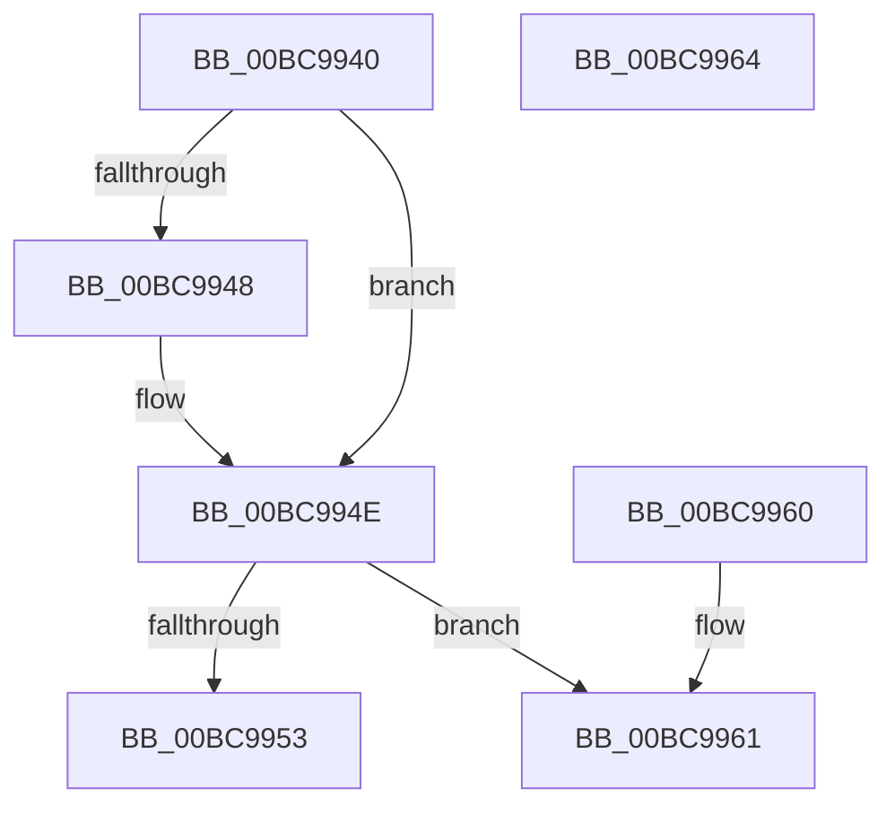

# CmListGetNextElement

- RVA: `0x00BC9940`–`0x00BC9965` (길이 `37` bytes)
- VA: `0x0000000140BC9940`
- 실행 섹션: `PAGECMRC`
- PDB 이름 있음: `예`; PDB Function 태그: `아니요`
- unwind 정보 RVA: `0x000DB714`
- 디코드: `16`개 명령, `37/37` bytes 표시
- 미해석 바이트: `0` (있으면 어셈블리에 `.byte`로 보존)

> 이 문서는 커널 이미지의 기계어와 PDB 기호를 분석해 생성했습니다. 4번과 5번은 함수 원형과 자료형을 바이너리 사용 방식에서 추정한 C 해석이며 원본 소스 복구 결과는 아닙니다.

## 1. Dependencies

- 직접 호출 지점: **0**; 고유 호출 대상: **0**
- 직접 호출자로 확인된 함수: **23**
- RIP 상대 이미지 참조: **0**

### Outgoing calls
- 직접 디코드된 call 명령이 없습니다.

### Direct callers
- [CmUnRegisterCallback](../../page/7E/CmUnRegisterCallback_function_007E1510.md) at `0x007E1573`
- [CmpRmAnalysisPhase](../../page/7F/CmpRmAnalysisPhase_function_007F0568.md) at `0x007F074B`
- [CmpRmUnDoPhase](../../page/7F/CmpRmUnDoPhase_function_007F0968.md) at `0x007F09CE`
- [CmpIsKeyStackDeleted](../../page/84/CmpIsKeyStackDeleted_function_008426E0.md) at `0x0084274A`
- [CmpLogCheckpoint](../../page/84/CmpLogCheckpoint_function_00842F04.md) at `0x00842F81`
- [CmGetVisibleSubkeyCount](../../page/84/CmGetVisibleSubkeyCount_function_00849D74.md) at `0x00849DCD`
- [sub_0084BE91](../../page/84/Unknown_function_0084BE91.md) at `0x0084BEB1`
- [CmpQueryKeyDataFromNode](../../page/84/CmpQueryKeyDataFromNode_function_0084EAE0.md) at `0x0084EF6A`
- [CmpFindSubKeyByNumberEx](../../page/84/CmpFindSubKeyByNumberEx_function_0084F1A0.md) at `0x0084F8BD`
- [CmpWalkOneLevel](../../page/85/CmpWalkOneLevel_function_00852BA0.md) at `0x00853259`
- [CmpQueryKeyDataFromCache](../../page/85/CmpQueryKeyDataFromCache_function_00858F70.md) at `0x00859242`
- [CmpDoParseKey](../../page/85/CmpDoParseKey_function_0085F750.md) at `0x008605F0`
- [CmpSearchForTrans](../../page/87/CmpSearchForTrans_function_00874B04.md) at `0x00874B32`
- [CmSnapshotRMTxArray](../../page/9A/CmSnapshotRMTxArray_function_009AEC9C.md) at `0x009AECE1`
- [CmSnapshotRMTxArray](../../page/9A/CmSnapshotRMTxArray_function_009AEC9C.md) at `0x009AED3C`
- [CmpCommitLightWeightTransaction](../../page/9B/CmpCommitLightWeightTransaction_function_009B0868.md) at `0x009B090E`
- [CmpCommitLightWeightTransaction](../../page/9B/CmpCommitLightWeightTransaction_function_009B0868.md) at `0x009B0980`
- [CmpCleanupLightWeightPrepare](../../page/9B/CmpCleanupLightWeightPrepare_function_009B0A18.md) at `0x009B0A4C`
- [CmpCommitPreparedLightWeightTransaction](../../page/9B/CmpCommitPreparedLightWeightTransaction_function_009B0B88.md) at `0x009B0C1B`
- [CmpPrepareLightWeightTransaction](../../page/9B/CmpPrepareLightWeightTransaction_function_009B0D24.md) at `0x009B0DD3`
- [CmpTransMgrRollback](../../page/9B/CmpTransMgrRollback_function_009B1400.md) at `0x009B142E`
- [CmpTransMgrPrepare](../../page/9B/CmpTransMgrPrepare_function_009B175C.md) at `0x009B17EA`
- [CmpIsCmRm](../../page/9B/CmpIsCmRm_function_009B1E78.md) at `0x009B1EA0`
- [CmpLightWeightUpdateSharedSetValueData](../../page/A0/CmpLightWeightUpdateSharedSetValueData_function_00A0F93C.md) at `0x00A0F979`
- [CmpLightWeightUpdateModificationActions](../../page/A5/CmpLightWeightUpdateModificationActions_function_00A551DC.md) at `0x00A5520D`

### Static image references
- 디코드된 RIP-relative 메모리 참조가 없습니다.

## 2. Other-region calls and transfers

- 다른 실행 섹션으로 향하는 call: **0**
- 별도 외부 분기/꼬리 이동을 확인하지 못했습니다.

## 3. Assembly (complete function range)

```asm
00BC9940  48 8B 02                        mov rax, qword ptr [rdx]
00BC9943  48 85 C0                        test rax, rax
00BC9946  75 06                           jne 0x140bc994e
00BC9948  48 8B 01                        mov rax, qword ptr [rcx]
00BC994B  48 89 02                        mov qword ptr [rdx], rax
00BC994E  48 3B C8                        cmp rcx, rax
00BC9951  74 0E                           je 0x140bc9961
00BC9953  48 8B 08                        mov rcx, qword ptr [rax]
00BC9956  48 89 0A                        mov qword ptr [rdx], rcx
00BC9959  49 63 C8                        movsxd rcx, r8d
00BC995C  48 2B C1                        sub rax, rcx
00BC995F  C3                              ret
00BC9960  CC                              int3
00BC9961  33 C0                           xor eax, eax
00BC9963  C3                              ret
00BC9964  CC                              int3
```

## 4. C-style interpretation (structured pseudocode)

```c
__int64 __fastcall CmListGetNextElement(__int64 a1, __int64 a2, int a3)
{
    __int64 result;

    result = *(unsigned __int64 *)(a2);
    if (*(unsigned __int64 *)(a2) == 0) {
        result = *(unsigned __int64 *)(a1);
        *(unsigned __int64 *)(a2) = result;
    }
    if (a1 == result) goto loc_00BC9961;
    *(unsigned __int64 *)(a2) = *(unsigned __int64 *)(result);
    result = (result) - ((int)(a3));
    return result;
loc_00BC9961:
    result = 0;
    return result;
}
```

## 5. (Beta) C Style

```c
int64_t CmListGetNextElement(void *Arg1, void *Arg2, int32_t Arg3)
{
    uint8_t *arg1 = (uint8_t *)Arg1;
    uint8_t *arg2 = (uint8_t *)Arg2;

    int64_t result;

    result = *(uint64_t *)(arg2);
    if (*(uint64_t *)(arg2) == 0) {
        result = *(uint64_t *)(arg1);
        *(uint64_t *)(arg2) = result;
    }
    if (Arg1 == result) goto loc_00BC9961;
    *(uint64_t *)(arg2) = *(uint64_t *)(result);
    result = (result) - ((int32_t)(Arg3));
    return result;
loc_00BC9961:
    result = 0;
    return result;
}
```

### 관측된 메모리 오프셋

구조체 형식이 확인되지 않은 접근은 인자 기준의 오프셋으로만 기록했습니다.

| 기준 인자 | 오프셋 표현 | 폭 (bit) | 접근 |
|---|---:|---:|---|
| `Arg1` | `+ 0x0` | `64` | `R` |
| `Arg2` | `+ 0x0` | `64` | `R` |
| `Arg2` | `+ 0x0` | `64` | `W` |

## 6. Execution-region graph

[열기: 2D/3D 그래프와 함수 탐색 컨트롤 패널](../../../control-panel.html?section=pagecmrc&rva=0x00BC9940&view=graph)

- 2D 그래프는 위에서 아래로 흐르고, 3D 그래프는 빈 공간을 드래그해 회전합니다. Shift+드래그는 이동, 휠은 확대·축소, 함수 노드 선택은 대상 보고서 이동입니다.

### Static fallback


