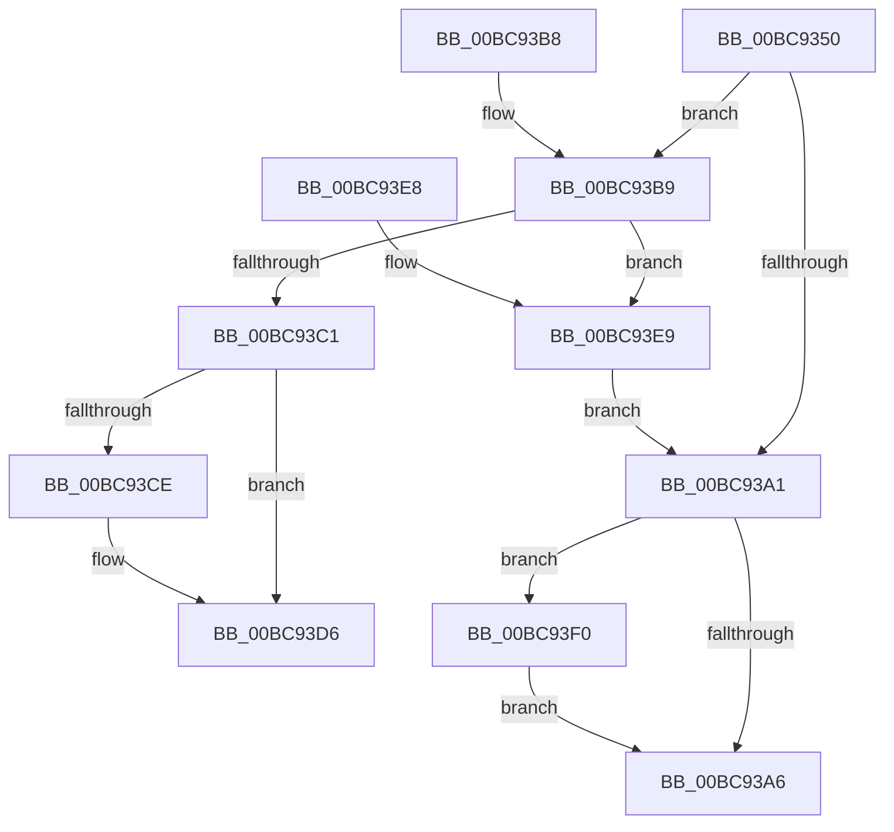

# CmObReferenceObjectByHandle

- RVA: `0x00BC9350`–`0x00BC93FA` (길이 `170` bytes)
- VA: `0x0000000140BC9350`
- 실행 섹션: `PAGECMRC`
- PDB 이름 있음: `예`; PDB Function 태그: `아니요`
- unwind 정보 RVA: `0x00096BE0`
- 디코드: `51`개 명령, `170/170` bytes 표시
- 미해석 바이트: `0` (있으면 어셈블리에 `.byte`로 보존)

> 이 문서는 커널 이미지의 기계어와 PDB 기호를 분석해 생성했습니다. 4번과 5번은 함수 원형과 자료형을 바이너리 사용 방식에서 추정한 C 해석이며 원본 소스 복구 결과는 아닙니다.

## 1. Dependencies

- 직접 호출 지점: **2**; 고유 호출 대상: **2**
- 직접 호출자로 확인된 함수: **23**
- RIP 상대 이미지 참조: **1**

### Outgoing calls
- `0x00BC9391` → [ObReferenceObjectByHandle](../../page/86/ObReferenceObjectByHandle_function_00868DB0.md) (function, `0x00868DB0`)
- `0x00BC93F3` → [ObfDereferenceObject](../../text/2F/ObfDereferenceObject_function_002F9350.md) (function, `0x002F9350`)

### Direct callers
- [CmpSaveBootControlSet](../../page/7D/CmpSaveBootControlSet_function_007DC744.md) at `0x007DC94F`
- [CmpSaveBootControlSet](../../page/7D/CmpSaveBootControlSet_function_007DC744.md) at `0x007DC979`
- [CmOpenKeyForBugCheckRecovery](../../page/7D/CmOpenKeyForBugCheckRecovery_function_007DF3C0.md) at `0x007DF484`
- [NtCompactKeys](../../page/7D/NtCompactKeys_function_007DF730.md) at `0x007DF864`
- [NtCompressKey](../../page/7D/NtCompressKey_function_007DF9D0.md) at `0x007DFA7F`
- [NtLockRegistryKey](../../page/7D/NtLockRegistryKey_function_007DFD60.md) at `0x007DFDD0`
- [NtRenameKey](../../page/7E/NtRenameKey_function_007E04B0.md) at `0x007E070E`
- [NtRenameKey](../../page/7E/NtRenameKey_function_007E04B0.md) at `0x007E0763`
- [NtReplaceKey](../../page/7E/NtReplaceKey_function_007E0970.md) at `0x007E0AA2`
- [NtRestoreKey](../../page/7E/NtRestoreKey_function_007E0CC0.md) at `0x007E0DDC`
- [NtSaveMergedKeys](../../page/7E/NtSaveMergedKeys_function_007E1070.md) at `0x007E11D4`
- [NtSaveMergedKeys](../../page/7E/NtSaveMergedKeys_function_007E1070.md) at `0x007E11FB`
- [NtSetValueKey](../../page/84/NtSetValueKey_function_00844EA0.md) at `0x00845026`
- [NtSetValueKey](../../page/84/NtSetValueKey_function_00844EA0.md) at `0x00845772`
- [NtDeleteValueKey](../../page/84/NtDeleteValueKey_function_00848770.md) at `0x00848899`
- [NtDeleteValueKey](../../page/84/NtDeleteValueKey_function_00848770.md) at `0x00848CAC`
- [NtDeleteKey](../../page/84/NtDeleteKey_function_00849920.md) at `0x00849A18`
- [CmLoadDifferencingKey](../../page/87/CmLoadDifferencingKey_function_00875670.md) at `0x0087611B`
- [CmLoadDifferencingKey](../../page/87/CmLoadDifferencingKey_function_00875670.md) at `0x008761CF`
- [NtQueryMultipleValueKey](../../page/8B/NtQueryMultipleValueKey_function_008B13B0.md) at `0x008B152B`
- [NtEnumerateKey](../../page/8B/NtEnumerateKey_function_008B1F70.md) at `0x008B20E2`
- [NtQueryValueKey](../../page/8B/NtQueryValueKey_function_008B2A00.md) at `0x008B2B86`
- [NtEnumerateValueKey](../../page/8B/NtEnumerateValueKey_function_008B3B50.md) at `0x008B3CE5`
- [NtNotifyChangeMultipleKeys](../../page/9D/NtNotifyChangeMultipleKeys_function_009DC6B0.md) at `0x009DC92E`
- [NtFlushKey](../../page/A8/NtFlushKey_function_00A8A030.md) at `0x00A8A108`
- [sub_00B1664A](../../page/B1/Unknown_function_00B1664A.md) at `0x00B16673`
- [sub_00B44216](../../page/B4/Unknown_function_00B44216.md) at `0x00B4422D`
- [CmSaveKeyToBuffer](CmSaveKeyToBuffer_function_00BC9010.md) at `0x00BC909B`
- [CmpOpenSystemDriverHiveContext](../../init/C7/CmpOpenSystemDriverHiveContext_function_00C73D90.md) at `0x00C73EA5`

### Static image references
- `0x00BC936D` → RVA `0x00FC6AC0` (`ALMOSTRO`; read)

## 2. Other-region calls and transfers

- 다른 실행 섹션으로 향하는 call: **2**
  - `0x00BC9391` → [ObReferenceObjectByHandle](../../page/86/ObReferenceObjectByHandle_function_00868DB0.md) (`PAGECMRC` → `PAGE`)
  - `0x00BC93F3` → [ObfDereferenceObject](../../text/2F/ObfDereferenceObject_function_002F9350.md) (`PAGECMRC` → `.text`)
- 별도 외부 분기/꼬리 이동을 확인하지 못했습니다.

## 3. Assembly (complete function range)

```asm
00BC9350  4C 8B DC                        mov r11, rsp
00BC9353  49 89 5B 08                     mov qword ptr [r11 + 8], rbx
00BC9357  49 89 73 10                     mov qword ptr [r11 + 0x10], rsi
00BC935B  4D 89 43 18                     mov qword ptr [r11 + 0x18], r8
00BC935F  57                              push rdi
00BC9360  48 83 EC 40                     sub rsp, 0x40
00BC9364  48 8B 5C 24 78                  mov rbx, qword ptr [rsp + 0x78]
00BC9369  49 8D 43 E8                     lea rax, [r11 - 0x18]
00BC936D  4C 8B 05 4C D7 3F 00            mov r8, qword ptr [rip + 0x3fd74c]
00BC9374  33 F6                           xor esi, esi
00BC9376  48 85 DB                        test rbx, rbx
00BC9379  49 89 73 E8                     mov qword ptr [r11 - 0x18], rsi
00BC937D  49 89 73 18                     mov qword ptr [r11 + 0x18], rsi
00BC9381  48 0F 44 C6                     cmove rax, rsi
00BC9385  49 89 43 E0                     mov qword ptr [r11 - 0x20], rax
00BC9389  49 8D 43 18                     lea rax, [r11 + 0x18]
00BC938D  49 89 43 D8                     mov qword ptr [r11 - 0x28], rax
00BC9391  E8 1A FA C9 FF                  call 0x140868db0
00BC9396  8B F8                           mov edi, eax
00BC9398  48 8B 44 24 60                  mov rax, qword ptr [rsp + 0x60]
00BC939D  85 FF                           test edi, edi
00BC939F  79 18                           jns 0x140bc93b9
00BC93A1  48 85 C0                        test rax, rax
00BC93A4  75 4A                           jne 0x140bc93f0
00BC93A6  8B C7                           mov eax, edi
00BC93A8  48 8B 5C 24 50                  mov rbx, qword ptr [rsp + 0x50]
00BC93AD  48 8B 74 24 58                  mov rsi, qword ptr [rsp + 0x58]
00BC93B2  48 83 C4 40                     add rsp, 0x40
00BC93B6  5F                              pop rdi
00BC93B7  C3                              ret
00BC93B8  CC                              int3
00BC93B9  81 38 32 30 79 6B               cmp dword ptr [rax], 0x6b793032
00BC93BF  75 28                           jne 0x140bc93e9
00BC93C1  48 8B 4C 24 70                  mov rcx, qword ptr [rsp + 0x70]
00BC93C6  48 89 01                        mov qword ptr [rcx], rax
00BC93C9  48 85 DB                        test rbx, rbx
00BC93CC  74 08                           je 0x140bc93d6
00BC93CE  48 8B 4C 24 30                  mov rcx, qword ptr [rsp + 0x30]
00BC93D3  48 89 0B                        mov qword ptr [rbx], rcx
00BC93D6  48 8B 5C 24 50                  mov rbx, qword ptr [rsp + 0x50]
00BC93DB  8B C6                           mov eax, esi
00BC93DD  48 8B 74 24 58                  mov rsi, qword ptr [rsp + 0x58]
00BC93E2  48 83 C4 40                     add rsp, 0x40
00BC93E6  5F                              pop rdi
00BC93E7  C3                              ret
00BC93E8  CC                              int3
00BC93E9  BF 08 00 00 C0                  mov edi, 0xc0000008
00BC93EE  EB B1                           jmp 0x140bc93a1
00BC93F0  48 8B C8                        mov rcx, rax
00BC93F3  E8 58 FF 72 FF                  call 0x1402f9350
00BC93F8  EB AC                           jmp 0x140bc93a6
```

## 4. C-style interpretation (structured pseudocode)

```c
__int64 __fastcall CmObReferenceObjectByHandle(__int64 a1, __int64 a2, __int64 a3, __int64 a4, __int64 a5, __int64 a6)
{
    __int64 result;
    __int64 v_rsi;
    __int64 v_rsp;
    unsigned __int64 v_stack_p10;
    unsigned __int64 v_stack_p18;
    unsigned __int64 v_stack_p30;
    unsigned __int64 v_stack_p50;
    unsigned __int64 v_stack_p58;
    unsigned __int64 v_stack_p8;

    *(unsigned __int64 *)(v_rsp + 8) = v_rbx;
    *(unsigned __int64 *)(v_rsp + 16) = v_rsi;
    *(unsigned __int64 *)(v_rsp + 24) = a3;
    v_rsp = (v_rsp) - (64);
    v_rsi = 0;
    *(unsigned __int64 *)(v_rsp - 24) = 0;
    *(unsigned __int64 *)(v_rsp + 24) = 0;
    result = v_rsp - 24;
    if (a6 == 0) { result = 0; }
    *(unsigned __int64 *)(v_rsp - 32) = result;
    *(unsigned __int64 *)(v_rsp - 40) = v_rsp + 24;
    result = ObReferenceObjectByHandle(a1, a2, *(unsigned __int64 *)(v_rip + 4183884), a4);
    if (!sign_flag) goto loc_00BC93B9;
loc_00BC93A1:
    if (v_stack_p18 != 0) goto loc_00BC93F0;
loc_00BC93A6:
    v_rsp = (v_rsp) + (64);
    return (unsigned int)((unsigned int)((unsigned int)((unsigned int)(result))));
loc_00BC93B9:
    if ((*(unsigned int *)((unsigned int)((unsigned int)((unsigned int)((unsigned int)(result)))))) != 0x6B793032ULL) goto loc_00BC93E9;
    *(unsigned __int64 *)(a5) = (unsigned int)((unsigned int)((unsigned int)((unsigned int)(result))));
    if (v_stack_p8 != 0) {
        a1 = v_stack_p30;
        *(unsigned __int64 *)(v_stack_p8) = a1;
    }
    v_rsp = (v_rsp) + (64);
    return (unsigned int)((unsigned int)(v_stack_p10));
loc_00BC93E9:
    goto loc_00BC93A1;
loc_00BC93F0:
    result = ObfDereferenceObject((unsigned int)((unsigned int)(v_stack_p10)), a2, *(unsigned __int64 *)(v_rip + 4183884), a4);
    goto loc_00BC93A6;
}
```

## 5. (Beta) C Style

```c
int64_t CmObReferenceObjectByHandle(int64_t Arg1, int64_t Arg2, int64_t Arg3, int64_t Arg4, void *Arg5, int64_t Arg6)
{
    uint8_t *arg5 = (uint8_t *)Arg5;

    int64_t result;
    int64_t local_rsi;
    int64_t local_rsp;
    uint64_t v_stack_p10;
    uint64_t v_stack_p18;
    uint64_t v_stack_p30;
    uint64_t v_stack_p50;
    uint64_t v_stack_p58;
    uint64_t v_stack_p8;

    *(uint64_t *)(local_rsp + 0x8) = local_rbx;
    *(uint64_t *)(local_rsp + 0x10) = local_rsi;
    *(uint64_t *)(local_rsp + 0x18) = Arg3;
    local_rsp = (local_rsp) - (64);
    local_rsi = 0;
    *(uint64_t *)(local_rsp - 0x18) = 0;
    *(uint64_t *)(local_rsp + 0x18) = 0;
    result = local_rsp - 24;
    if (Arg6 == 0) { result = 0; }
    *(uint64_t *)(local_rsp - 0x20) = result;
    *(uint64_t *)(local_rsp - 0x28) = local_rsp + 24;
    result = ObReferenceObjectByHandle(Arg1, Arg2, *(uint64_t *)(v_rip + 0x3FD74C), Arg4);
    if (!sign_flag) goto loc_00BC93B9;
loc_00BC93A1:
    if (v_stack_p18 != 0) goto loc_00BC93F0;
loc_00BC93A6:
    local_rsp = (local_rsp) + (64);
    return (uint32_t)((uint32_t)((uint32_t)((uint32_t)(result))));
loc_00BC93B9:
    if ((*(uint32_t *)((uint32_t)((uint32_t)((uint32_t)((uint32_t)(result)))))) != 0x6B793032ULL) goto loc_00BC93E9;
    *(uint64_t *)(arg5) = (uint32_t)((uint32_t)((uint32_t)((uint32_t)(result))));
    if (v_stack_p8 != 0) {
        Arg1 = v_stack_p30;
        *(uint64_t *)(v_stack_p8) = Arg1;
    }
    local_rsp = (local_rsp) + (64);
    return (uint32_t)((uint32_t)(v_stack_p10));
loc_00BC93E9:
    goto loc_00BC93A1;
loc_00BC93F0:
    result = ObfDereferenceObject((uint32_t)((uint32_t)(v_stack_p10)), Arg2, *(uint64_t *)(v_rip + 0x3FD74C), Arg4);
    goto loc_00BC93A6;
}
```

### 관측된 메모리 오프셋

구조체 형식이 확인되지 않은 접근은 인자 기준의 오프셋으로만 기록했습니다.

| 기준 인자 | 오프셋 표현 | 폭 (bit) | 접근 |
|---|---:|---:|---|
| `Arg5` | `+ 0x0` | `64` | `W` |

## 6. Execution-region graph

[열기: 2D/3D 그래프와 함수 탐색 컨트롤 패널](../../../control-panel.html?section=pagecmrc&rva=0x00BC9350&view=graph)

- 2D 그래프는 위에서 아래로 흐르고, 3D 그래프는 빈 공간을 드래그해 회전합니다. Shift+드래그는 이동, 휠은 확대·축소, 함수 노드 선택은 대상 보고서 이동입니다.

### Static fallback


