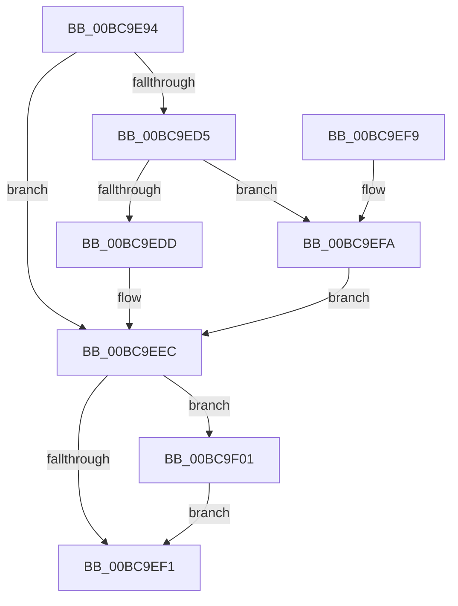

# CmObReferenceObjectByName

- RVA: `0x00BC9E94`–`0x00BC9F08` (길이 `116` bytes)
- VA: `0x0000000140BC9E94`
- 실행 섹션: `PAGECMRC`
- PDB 이름 있음: `예`; PDB Function 태그: `아니요`
- unwind 정보 RVA: `0x000B44E0`
- 디코드: `34`개 명령, `116/116` bytes 표시
- 미해석 바이트: `0` (있으면 어셈블리에 `.byte`로 보존)

> 이 문서는 커널 이미지의 기계어와 PDB 기호를 분석해 생성했습니다. 4번과 5번은 함수 원형과 자료형을 바이너리 사용 방식에서 추정한 C 해석이며 원본 소스 복구 결과는 아닙니다.

## 1. Dependencies

- 직접 호출 지점: **2**; 고유 호출 대상: **2**
- 직접 호출자로 확인된 함수: **4**
- RIP 상대 이미지 참조: **1**

### Outgoing calls
- `0x00BC9EC5` → [ObReferenceObjectByNameEx](../../page/8B/ObReferenceObjectByNameEx_function_008BD524.md) (function, `0x008BD524`)
- `0x00BC9F01` → [ObfDereferenceObject](../../text/2F/ObfDereferenceObject_function_002F9350.md) (function, `0x002F9350`)

### Direct callers
- [CmKeyBodyReplicateToVirtual](../../page/84/CmKeyBodyReplicateToVirtual_function_00843FE4.md) at `0x008442E7`
- [sub_008B4B26](../../page/8B/Unknown_function_008B4B26.md) at `0x008B4C5B`
- [NtNotifyChangeMultipleKeys](../../page/9D/NtNotifyChangeMultipleKeys_function_009DC6B0.md) at `0x009DC989`
- [CmKeyBodyRemapToVirtual](../../page/AC/CmKeyBodyRemapToVirtual_function_00AC9494.md) at `0x00AC96EE`

### Static image references
- `0x00BC9EA0` → RVA `0x00FC6AC0` (`ALMOSTRO`; read)

## 2. Other-region calls and transfers

- 다른 실행 섹션으로 향하는 call: **2**
  - `0x00BC9EC5` → [ObReferenceObjectByNameEx](../../page/8B/ObReferenceObjectByNameEx_function_008BD524.md) (`PAGECMRC` → `PAGE`)
  - `0x00BC9F01` → [ObfDereferenceObject](../../text/2F/ObfDereferenceObject_function_002F9350.md) (`PAGECMRC` → `.text`)
- 별도 외부 분기/꼬리 이동을 확인하지 못했습니다.

## 3. Assembly (complete function range)

```asm
00BC9E94  4C 8B DC                        mov r11, rsp
00BC9E97  4D 89 4B 20                     mov qword ptr [r11 + 0x20], r9
00BC9E9B  53                              push rbx
00BC9E9C  48 83 EC 40                     sub rsp, 0x40
00BC9EA0  4C 8B 0D 19 CC 3F 00            mov r9, qword ptr [rip + 0x3fcc19]
00BC9EA7  49 8D 43 20                     lea rax, [r11 + 0x20]
00BC9EAB  49 83 63 20 00                  and qword ptr [r11 + 0x20], 0
00BC9EB0  49 89 43 E8                     mov qword ptr [r11 - 0x18], rax
00BC9EB4  48 8B 44 24 78                  mov rax, qword ptr [rsp + 0x78]
00BC9EB9  49 89 43 E0                     mov qword ptr [r11 - 0x20], rax
00BC9EBD  8A 44 24 70                     mov al, byte ptr [rsp + 0x70]
00BC9EC1  88 44 24 20                     mov byte ptr [rsp + 0x20], al
00BC9EC5  E8 5A 36 CF FF                  call 0x1408bd524
00BC9ECA  48 8B 4C 24 68                  mov rcx, qword ptr [rsp + 0x68]
00BC9ECF  8B D8                           mov ebx, eax
00BC9ED1  85 C0                           test eax, eax
00BC9ED3  78 17                           js 0x140bc9eec
00BC9ED5  81 39 32 30 79 6B               cmp dword ptr [rcx], 0x6b793032
00BC9EDB  75 1D                           jne 0x140bc9efa
00BC9EDD  48 8B 84 24 80 00 00 00         mov rax, qword ptr [rsp + 0x80]
00BC9EE5  48 89 08                        mov qword ptr [rax], rcx
00BC9EE8  33 C9                           xor ecx, ecx
00BC9EEA  33 DB                           xor ebx, ebx
00BC9EEC  48 85 C9                        test rcx, rcx
00BC9EEF  75 10                           jne 0x140bc9f01
00BC9EF1  8B C3                           mov eax, ebx
00BC9EF3  48 83 C4 40                     add rsp, 0x40
00BC9EF7  5B                              pop rbx
00BC9EF8  C3                              ret
00BC9EF9  CC                              int3
00BC9EFA  BB 08 00 00 C0                  mov ebx, 0xc0000008
00BC9EFF  EB EB                           jmp 0x140bc9eec
00BC9F01  E8 4A F4 72 FF                  call 0x1402f9350
00BC9F06  EB E9                           jmp 0x140bc9ef1
```

## 4. C-style interpretation (structured pseudocode)

```c
__int64 __fastcall CmObReferenceObjectByName(__int64 a1, __int64 a2, __int64 a3, __int64 a4, unsigned __int8 a5, __int64 a6, __int64 a7)
{
    __int64 result;
    __int64 v_rbx;
    __int64 v_rsp;
    unsigned __int8 v_stack_m28;
    unsigned __int64 v_stack_p20;

    *(unsigned __int64 *)(v_rsp + 32) = a4;
    v_rsp = (v_rsp) - (64);
    *(unsigned __int64 *)(v_rsp - 24) = v_rsp + 32;
    *(unsigned __int64 *)(v_rsp - 32) = a6;
    v_stack_m28 = a5;
    result = ObReferenceObjectByNameEx(a1, a2, a3, *(unsigned __int64 *)(v_rip + 4181017));
    if (sign_flag) goto loc_00BC9EEC;
    if ((*(unsigned int *)(v_stack_p20)) != 0x6B793032ULL) goto loc_00BC9EFA;
    *(unsigned __int64 *)(a7) = v_stack_p20;
    a1 = 0;
    v_rbx = 0;
loc_00BC9EEC:
    if (0 != 0) goto loc_00BC9F01;
loc_00BC9EF1:
    v_rsp = (v_rsp) + (64);
    return 0;
loc_00BC9EFA:
    goto loc_00BC9EEC;
loc_00BC9F01:
    result = ObfDereferenceObject(a1, a2, a3, *(unsigned __int64 *)(v_rip + 4181017));
    goto loc_00BC9EF1;
}
```

## 5. (Beta) C Style

```c
int64_t CmObReferenceObjectByName(int64_t Arg1, int64_t Arg2, int64_t Arg3, int64_t Arg4, uint8_t Arg5, int64_t Arg6, void *Arg7)
{
    uint8_t *arg7 = (uint8_t *)Arg7;

    int64_t result;
    int64_t local_rbx;
    int64_t local_rsp;
    uint8_t v_stack_m28;
    uint64_t v_stack_p20;

    *(uint64_t *)(local_rsp + 0x20) = Arg4;
    local_rsp = (local_rsp) - (64);
    *(uint64_t *)(local_rsp - 0x18) = local_rsp + 32;
    *(uint64_t *)(local_rsp - 0x20) = Arg6;
    v_stack_m28 = Arg5;
    result = ObReferenceObjectByNameEx(Arg1, Arg2, Arg3, *(uint64_t *)(v_rip + 0x3FCC19));
    if (sign_flag) goto loc_00BC9EEC;
    if ((*(uint32_t *)(v_stack_p20)) != 0x6B793032ULL) goto loc_00BC9EFA;
    *(uint64_t *)(arg7) = v_stack_p20;
    Arg1 = 0;
    local_rbx = 0;
loc_00BC9EEC:
    if (0 != 0) goto loc_00BC9F01;
loc_00BC9EF1:
    local_rsp = (local_rsp) + (64);
    return 0;
loc_00BC9EFA:
    goto loc_00BC9EEC;
loc_00BC9F01:
    result = ObfDereferenceObject(Arg1, Arg2, Arg3, *(uint64_t *)(v_rip + 0x3FCC19));
    goto loc_00BC9EF1;
}
```

### 관측된 메모리 오프셋

구조체 형식이 확인되지 않은 접근은 인자 기준의 오프셋으로만 기록했습니다.

| 기준 인자 | 오프셋 표현 | 폭 (bit) | 접근 |
|---|---:|---:|---|
| `Arg7` | `+ 0x0` | `64` | `W` |

## 6. Execution-region graph

[열기: 2D/3D 그래프와 함수 탐색 컨트롤 패널](../../../control-panel.html?section=pagecmrc&rva=0x00BC9E94&view=graph)

- 2D 그래프는 위에서 아래로 흐르고, 3D 그래프는 빈 공간을 드래그해 회전합니다. Shift+드래그는 이동, 휠은 확대·축소, 함수 노드 선택은 대상 보고서 이동입니다.

### Static fallback


